# 1. Read First

## 1.1 Introduction to TurboPi

### 1.1.1 Product Introduction

TurboPi is an AI-powered vision wheeled robot developed based on the Raspberry Pi platform. It features a Mecanum wheel chassis and a 2-DOF pan-tilt camera. Supporting Python programming, TurboPi is capable of ultrasonic distance-based obstacle avoidance, AI color recognition, object tracking, visual line following, and more. This product helps with learning robotics and AI technologies while experiencing the fun of technology.

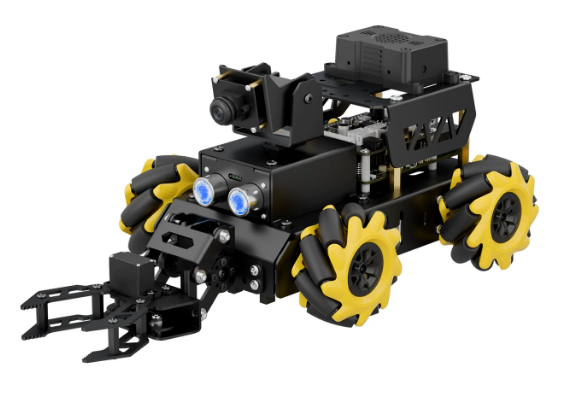

### 1.1.2 Product List

The TurboPi Ultimate Kit consists of the standard kit, WonderEchoPro AI Voice Interaction and 2DOF robotic arm expansion pack. After receiving the product, check whether all accessories are complete according to the following list before assembly and use.

**1. Standard Kit Packing List**

The standard kit includes basic components such as the robot body structural parts, Raspberry Pi 5 board, expansion board, HD wide-angle camera, glowing ultrasonic sensor, Mecanum wheels, anti-blocking servos, TT motors, 4-channel line following sensor, USB camera cable, 4PIN wires, screw accessory pack and battery-related accessories.

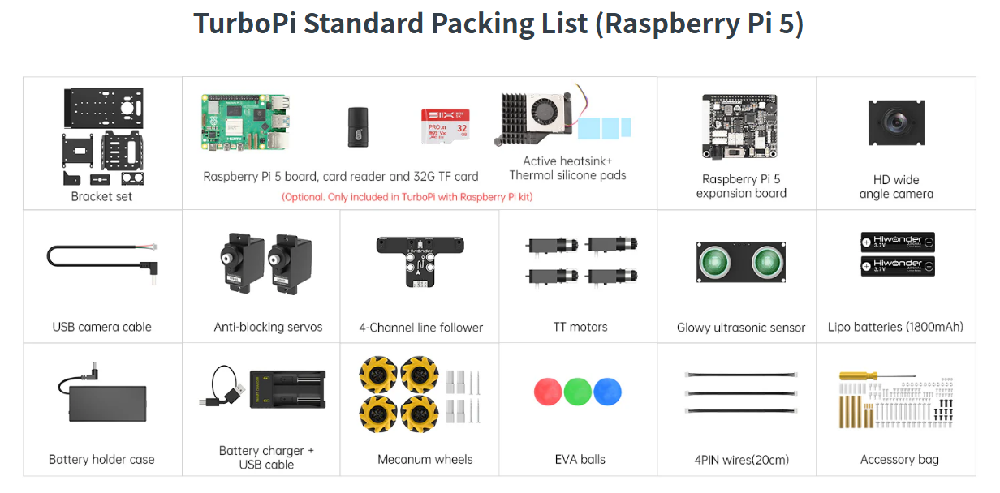

**2. Ultimate Kit Expansion Pack List**

The Ultimate Kit adds the following two expansion packs based on the standard kit:

* **AI Voice Interaction Module Expansion Pack**: Includes the WonderEcho Pro AI Voice Interaction Module, data cable, and screw accessory pack. It can be used for voice interaction and large AI model related features.

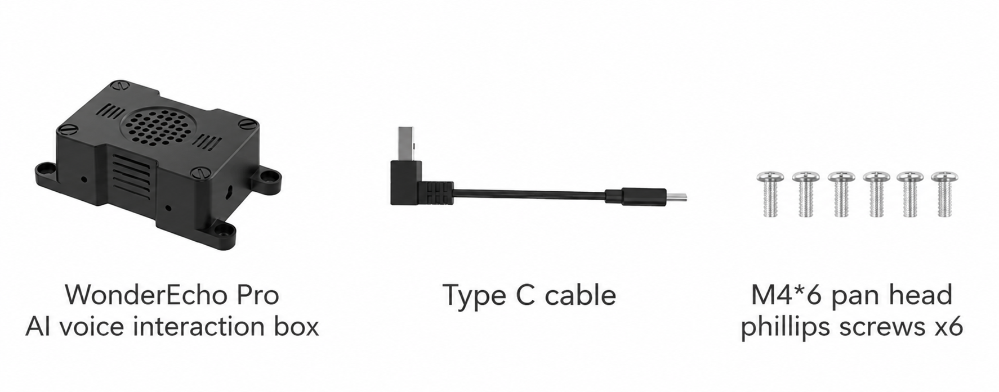

* **2DOF Robotic Arm Expansion Pack**: Includes a metal gripper, robotic arm linkage components, and screw accessory pack. It can be used for robotic arm activities such as gripping and carrying.

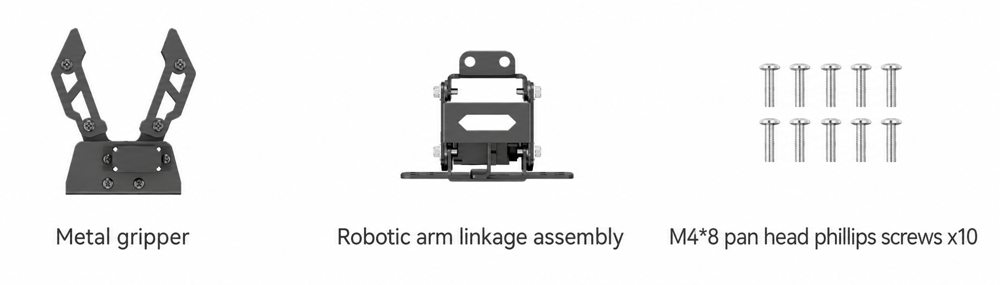

### 1.1.3 Usage Notes

Observe the following precautions when using and storing this product:

1. This product contains conductive parts. Do not touch it with metal objects while power is on.

2. Do not forcibly turn the servos after the robot is powered on. Otherwise, servo damage may occur.

3. If the robot runs continuously for a long time, the servos will heat up. Let the robot rest until the servos cool down before running it again.

4. Keep the robot away from the face, eyes, and other body parts during operation. Do not place fingers within the moving range of device joints to avoid pinching. Prevent the robot from falling from high edges.

5. The robot servos are precision parts and consumable components. Replace them after long-term or excessive use.

6. When the robot is equipped with servos and is running, stop the drive operation immediately if the servo output shaft cannot rotate smoothly due to external resistance. Continued operation may cause a stall. The current will increase sharply, which may seriously damage or even burn out the servo.

7. Servo damage caused by human operation such as stalling, overloading, or incorrect installation is not covered by the warranty. Operate the robot according to the specifications and avoid overload operation to ensure normal and safe operation of the robot and servos.

8. If the product will not be used for a long time, fully charge the batteries, remove them, and store them in a cool and dry place.

### 1.1.4 Copyright Notice

This manual is copyrighted by Hiwonder. Without permission, no organization or individual may excerpt, copy, translate, or distribute the contents of this manual.

If any organization or individual is found to infringe the copyright of this reference material, the company reserves the right to pursue legal responsibility.

### 1.1.5 Disclaimer

The products described in this manual, including hardware and software, are provided in their current form. Every effort was made to ensure the accuracy of the content during writing, but the manual may still contain errors or omissions. The materials will be checked regularly, and improvement suggestions are welcome.

As product versions are upgraded, the corresponding product content may also change. Contact Hiwonder support team to obtain the latest product information.

In addition, unless Hiwonder has clearly stated that the product is intended for a specific use, the company assumes no responsibility for losses caused by failures or damage resulting from product use under extreme conditions.

## 1.2 Introduction to Raspberry Pi 5

Raspberry Pi, or RPi or RasPi in short, is a credit card-sized computer developed by the Raspberry Pi Foundation in the UK. It was created with the vision of helping children around the world learn programming and understand how computers work. Raspberry Pi can be connected to a keyboard, mouse, and Ethernet cable. It includes both analog video output and HDMI high-definition video output, making it accessible to users of all ages. It's an excellent tool for learning programming languages like Python. In addition to learning, Raspberry Pi can handle many of the tasks a desktop computer can do, such as web browsing, playing HD videos, working with spreadsheets, word processing, and even gaming! 


<p style="text-align:center">Raspberry Pi Logo</p>

### 1.2.1 Overview of Raspberry Pi 5

Raspberry Pi 5 uses a 64-bit quad-core Arm Cortex-A76 processor running at 2.4GHz. Compared with Raspberry Pi 4, CPU performance is improved by 2 to 3 times. In addition to the greatly improved graphics performance of the 800MHz VideoCore VII GPU, it supports dual 4Kp60 display output through HDMI and advanced camera support from the redesigned Raspberry Pi Image Signal Processor. It provides a smooth desktop experience for consumers and opens the door to new applications for industrial customers.

This is the first full-size Raspberry Pi computer to use chips built internally by Raspberry Pi. RP1 provides most of the I/O functions for Raspberry Pi 5 and delivers a major leap in peripheral performance and functionality. Total USB bandwidth is more than doubled, which improves transfer speed to external UAS drives and other high-speed peripherals. The dedicated dual-channel 1Gbps MIPI camera and display interfaces on earlier models have been replaced by a pair of four-channel 1.5Gbps MIPI transceivers. Total bandwidth is tripled, and up to two cameras or displays are supported in any combination. By supporting SDR104 high-speed mode, peak SD card performance is doubled. This platform exposes a single-channel PCI Express 2.0 interface for the first time, providing support for high-bandwidth peripherals.

### 1.2.2 Structure and Features of Raspberry Pi 5

#### 1.2.2.1 Hardware Layout

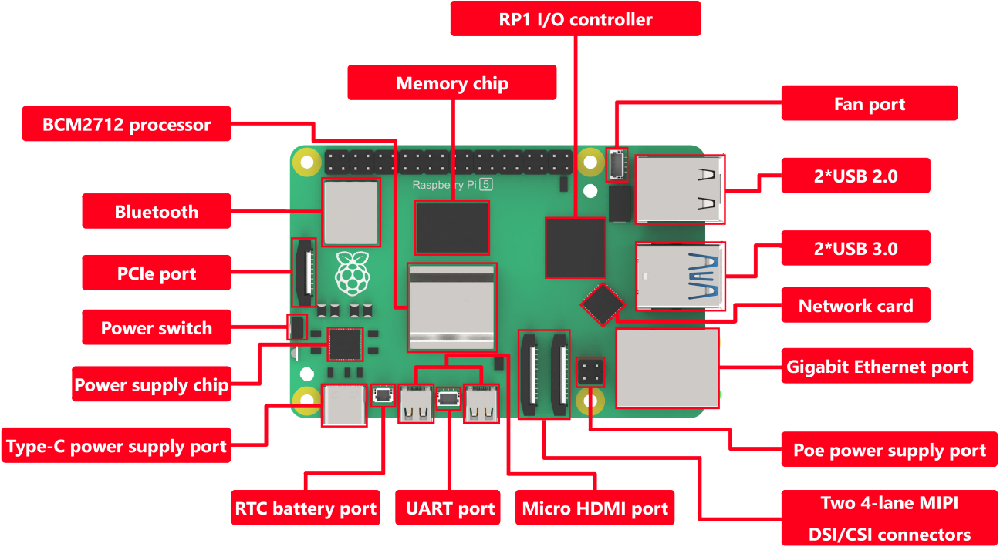

#### 1.2.2.2 Key Features

1. Quad-core Arm Cortex-A76 at 2.4GHz, cryptographic extension support with hardware AES, 512KB L2 cache per core, and 2MB L3 cache.

2. 4GB or 8GB LPDDR4X-4267 SDRAM.

3. Dual 4Kp60 HDMI display output, HDR support, and 4Kp60 HEVC decoder.

4. VideoCore VII graphics card with OpenGL-ES 3.1 and Vulkan 1.2 support.

5. Raspberry Pi Image Signal Processor, ISP.

6. Raspberry Pi connector for PCIe. It provides one PCIe 2.0 lane and requires an additional HAT.

7. 802.11ac dual-band Wi-Fi and Bluetooth 5.0 with BLE support.

8. Gigabit Ethernet.

9. Two USB 2.0 ports and two USB 3.0 ports, with full throughput available simultaneously.

10. PoE support, requiring an additional HAT.

11. Dual-channel 4-lane MIPI CSI/DSI transceivers, supporting two displays, two cameras, or one display plus one camera.

12. Raspberry Pi 40-pin GPIO header.

13. Fan connector.

14. Real-time clock, RTC.

15. Power button.

#### 1.2.2.3 Advantages

1. Powerful computing performance.

2. Open-source hardware and ease of use.

3. Free tools compared with Microsoft systems.

4. Can be used as a low-cost development platform and troubleshooting tool.

5. All applications can be opened without internet access.

6. Compact size, similar to a credit card.

Based on these advantages, Raspberry Pi is widely used around the world to learn programming skills, build hardware projects, create home automation projects, and even support industrial applications.

### 1.2.3 Parameter Comparison between Raspberry Pi 5 and Raspberry Pi 4B

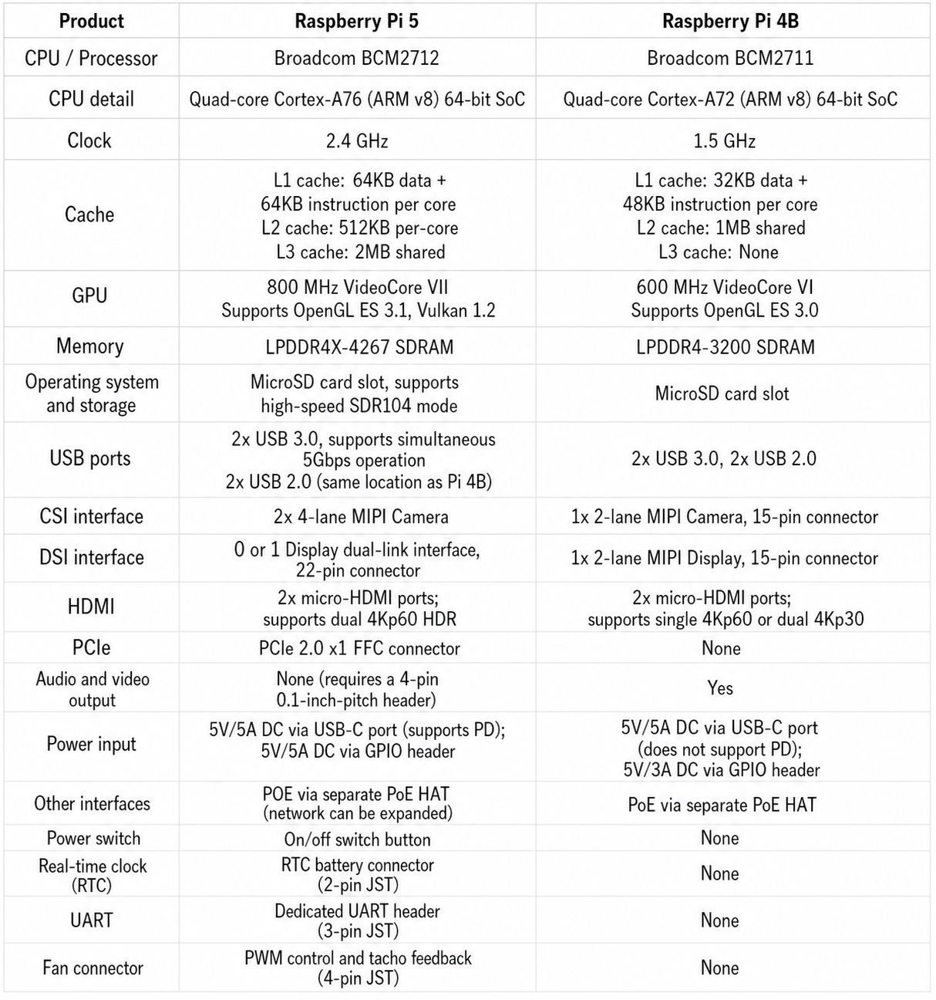

### 1.2.4 Dimensions (Unit: mm)

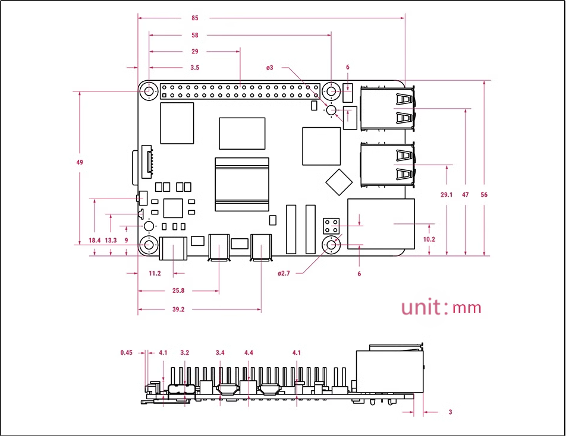

### 1.2.5 Uses of Raspberry Pi

1. Web server

Raspberry Pi consumes very little power, so it can run around the clock without a cooling fan or a large amount of power. It can serve web pages at adequate speed over the internet or a local network.

2. Laptop

Raspberry Pi can serve as the "brain" of a laptop. Only a computer screen needs to be added.

3. Home theater set-top box

Many free operating systems can turn Raspberry Pi into a set-top box that streams favorite content.

4. Game emulator

With the free RetroPie OS, Raspberry Pi can run games from Game Boy, arcade systems, SNES, and more.

5. Monitor

A simple monitoring system can be built with a relatively small investment by adding an external camera.

6. Wi-Fi extender

If certain areas of a home have poor Wi-Fi signal, Raspberry Pi can help by acting as an extender. A USB Wi-Fi adapter can repeat the signal through the built-in Raspberry Pi Wi-Fi.

7. Music streaming and multi-room audio

With suitable software and several Raspberry Pi boards, an inexpensive sound system can be created to play music in different locations at home.

These examples show that Raspberry Pi is not only a capable development tool, but also a practical companion for daily life. More applications are available beyond those listed here.

## 1.3 Raspberry Pi Image Flashing

Raspberry Pi must have an operating system installed on the SD card before use. The system image and software toolkit used in this section can be found in this section directory.

> [!NOTE]
>
> **The SD card is already flashed with the robot image before shipment. The image does not need to be reflashed according to this section.**

Flashing the image will format the SD card. Back up the data in advance if the SD card contains data. 

This is a general section. The image file name in this section is only an example. Use the actual image file.

### 1.3.1 Preparation

#### 1.3.1.1 Hardware

Prepare a card reader, an SD card with at least 32GB storage, and a computer running Windows 10.

#### 1.3.1.2 Software

Install SD Card Formatter and Win32DiskImager. This section uses these two tools as examples.

### 1.3.2 SD Card Formatting

> [!NOTE]
>
> **If the SD card is blank, formatting is not required.**

1. Insert the SD card into the card reader, then connect the card reader to the computer.

2. Open SD Card Formatter. Select the SD card drive letter in the **Select card** field, then click **Format** to format the SD card.

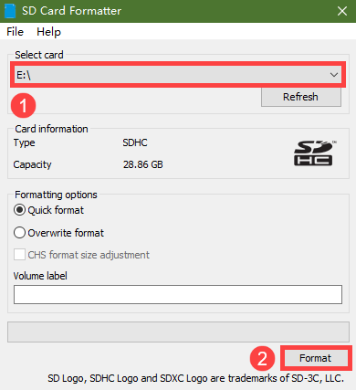

3. If the prompt shown below appears, click **Yes** and wait for formatting to complete.

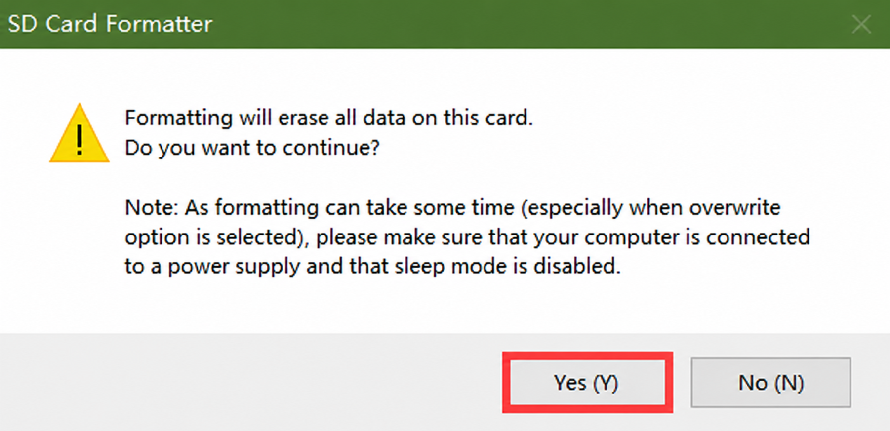

### 1.3.3 Image Flashing

1. Open Win32DiskImager. Click the icon  to select the image file. To obtain the download link for the system image, contact **support@hiwonder.com** and provide the order number. Download and extract the image file before use. The image file shown here is for reference only. Select the actual extracted image file. Select the SD card drive letter in the **Device** field, then click **Write** to start flashing the image.

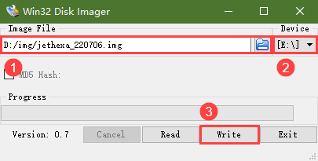

> [!NOTE]
>
> **The image file storage path must contain English characters only.**

2. If the prompt shown below appears, click **Yes**.

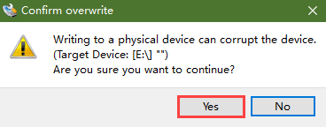

3. If **Write Successful** appears, image flashing is complete. If an error appears, close software such as firewall tools, reinsert the SD card, and repeat the operations in this section.

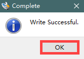

> [!NOTE]
>
> **After flashing succeeds, ignore any prompt asking whether to format the partition.**

4. After flashing is complete, eject the SD card, remove it from the card reader, and insert it into the Raspberry Pi board as shown below.

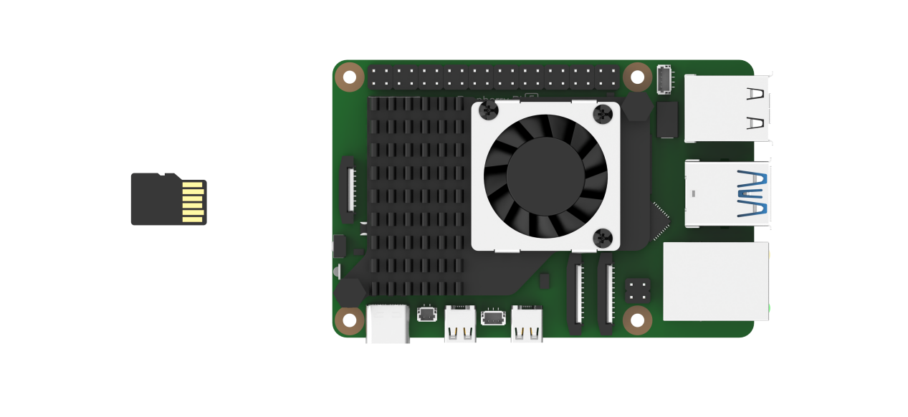

<p id="14-assembly"></p>

## 1.4 Assembly

This section is organized based on the assembly instructions in the product manual. Before assembly, check whether all screws, brass standoffs, nylon standoffs, servos, sensors, wheels, cables, and other parts in the kit are complete. Make sure the batteries are not installed and the device is powered off.

> [!NOTE]
>
> **Strictly install the parts in the direction shown in the figures. When installing the servos, pan-tilt, and gripper structure, do not forcibly turn the servo output shaft. When wiring, connect cables according to the port numbers and wire sequence to avoid abnormal device movement caused by incorrect connections.**

### 1.4.1 Chassis and Basic Structure Assembly

1. Install the chassis support parts as shown. Use `M4*8` screws, `M4*50` brass standoffs, and `M4*28` brass standoffs to secure the chassis structure.

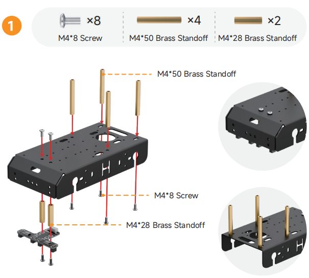

2. Install the nylon standoffs and upper support parts as shown. Use `M2.5*6` screws, `M2.5*16` double-pass nylon standoffs, and `M2.5*6` single-pass nylon standoffs to secure them.

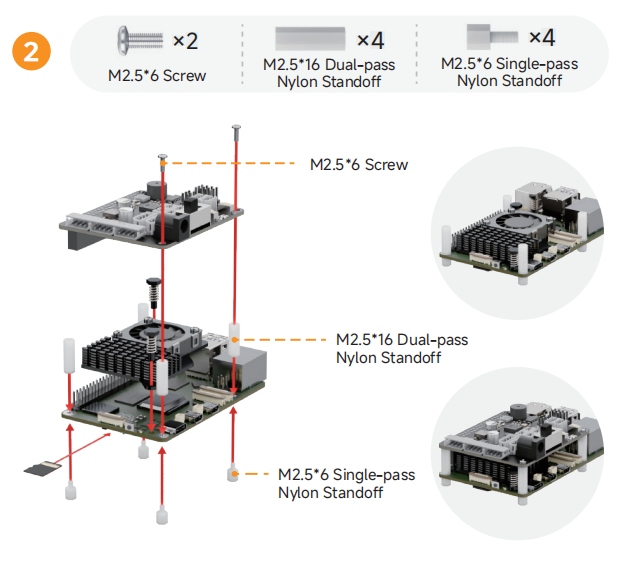

3. Secure the bottom mounting parts as shown. Use `M2.5*6` screws to complete installation.

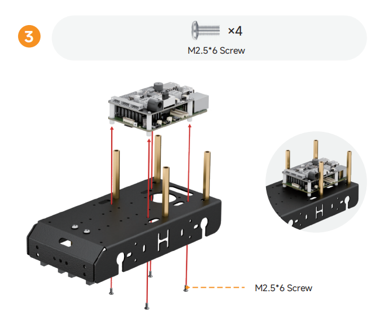

4. Install the four TT DC motors as shown. Use `M3*25` screws and `M3` nuts to secure the motors to the body.

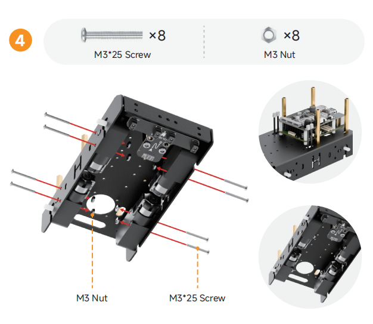

5. Install the front and bottom parts of the body as shown. Use `M3*6` screws and `M2*4` screws to secure them.

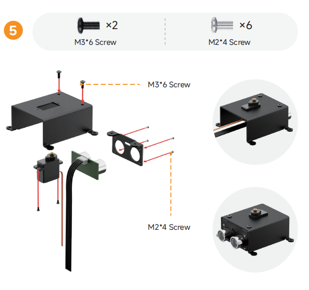

6. Check the chassis wiring sequence as shown. The ultrasonic sensor, 4-channel line following sensor, and four motors must be connected to the corresponding ports. Connect the front-left wheel to M1, front-right wheel to M2, rear-left wheel to M3, and rear-right wheel to M4.

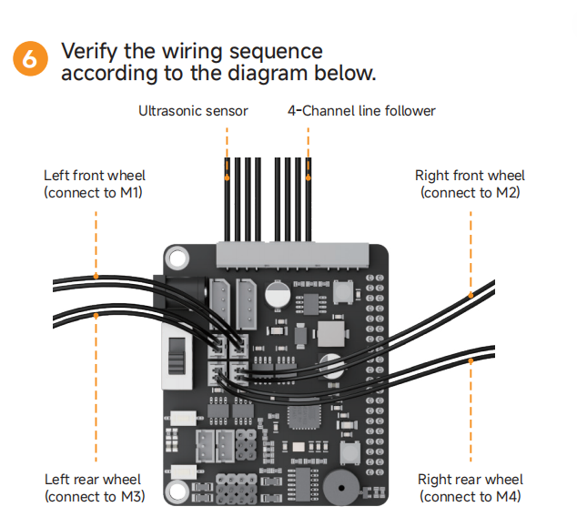

### 1.4.2 Pan-Tilt, Camera, and Robotic Arm Assembly

7. Install the upper structural parts as shown, and secure them with `M3*6` screws.

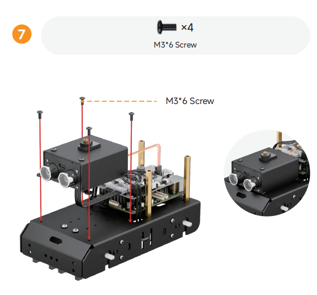

8. Install the pan-tilt or connection bracket as shown, and secure it with `M3*4` flat-head screws.

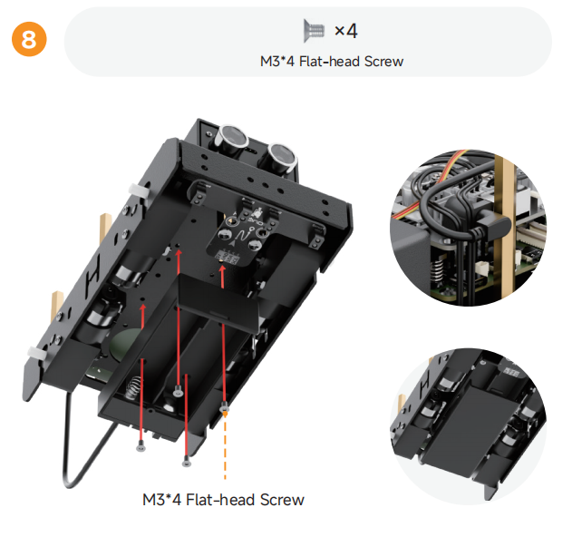

9. Install the servo horn onto the servo as shown. Secure it with `M2*4` self-tapping screws, and keep the servo arm direction consistent with the figure.

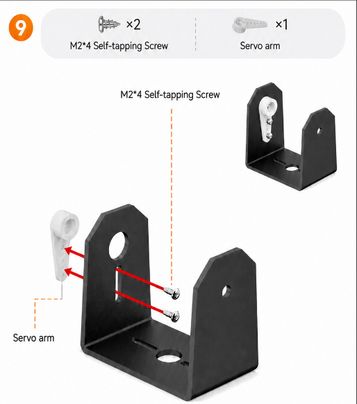

10. Install the coupling and related connectors as shown. Use `M2*4` self-tapping screws, `M2.3*25` pan-head screws, and couplings to secure them.

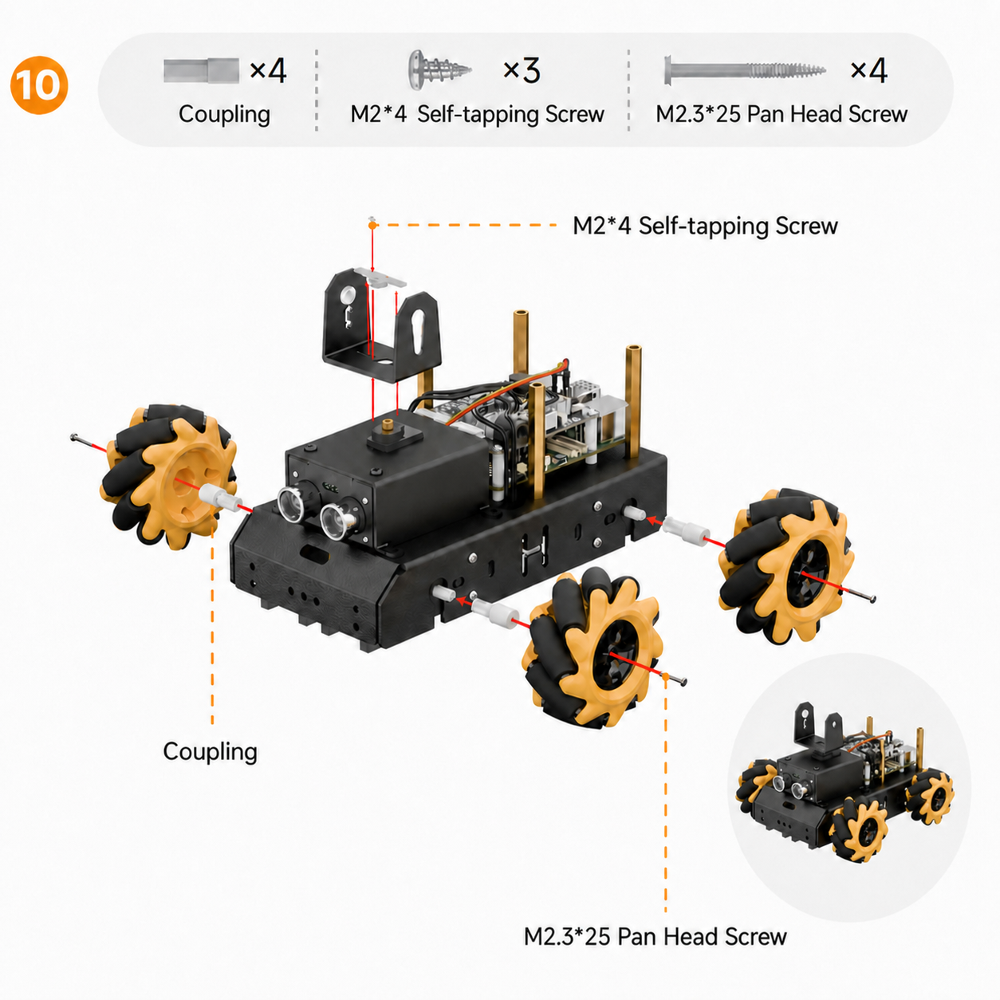

11. Assemble the robotic arm linkages and support structure as shown. Use `M2*8` brass standoffs, `M2*4` screws, `M2*12` screws, and `M2` nuts to secure them.

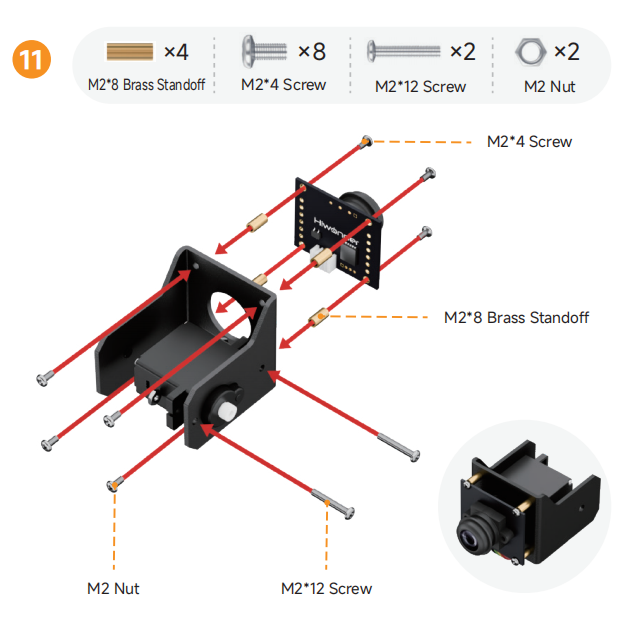

12. Install the camera, cables, and fixing parts as shown. Use `M2*4` self-tapping screws, the nylon rivet, and the USB data cable to complete connection and fixation.

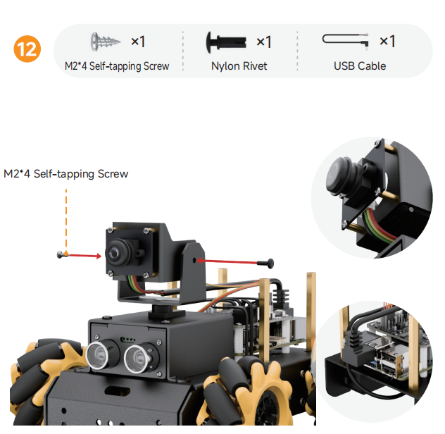

13. Install the assembled parts onto the body as shown, and secure them with `M4*6` screws.

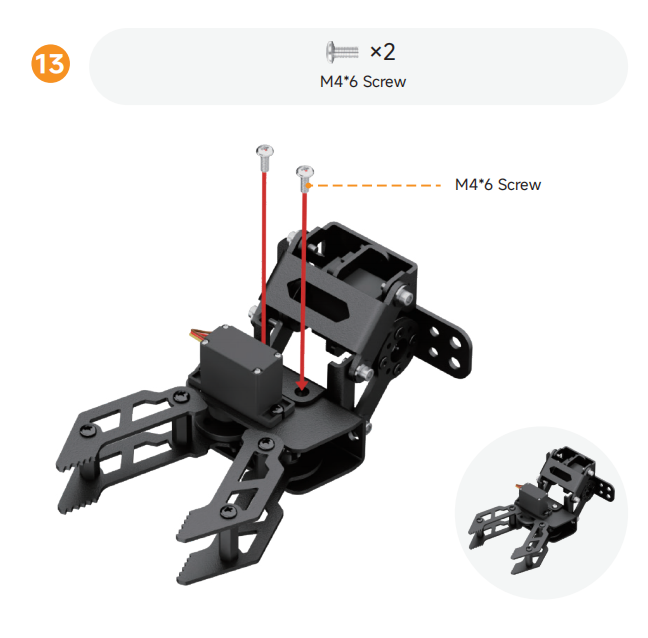

14. Continue securing the structural parts on the other side as shown, and complete installation with `M4*6` screws.

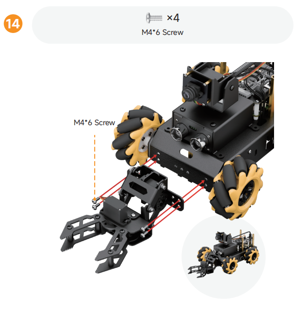

15. Check the robotic arm servo wiring sequence as shown. Make sure the connection positions and directions of ID5 and ID6 are consistent with the figure.

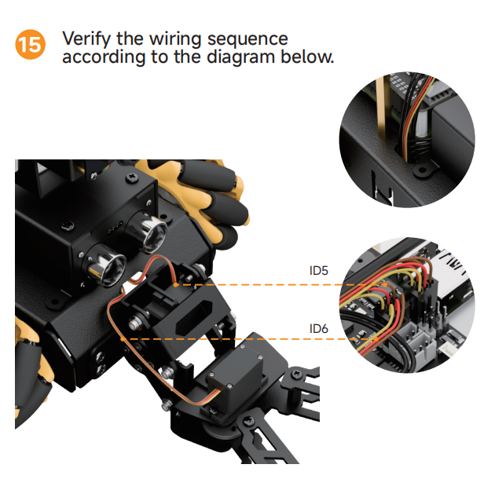

16. Secure the corresponding components to the body as shown, and tighten them with `M4*8` screws.

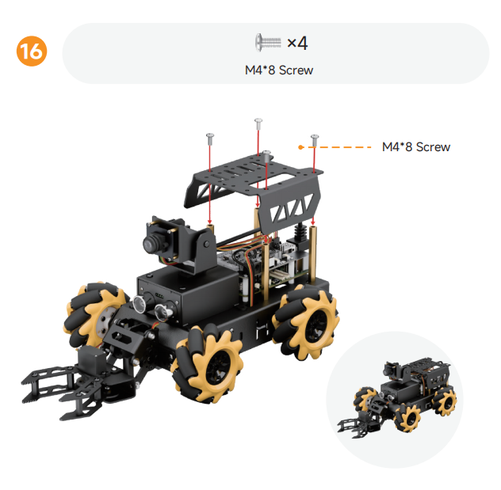

17. Install the remaining structural parts as shown, and secure them with `M4*6` screws.

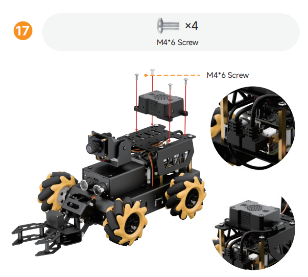

18. After assembly, check whether all screws are tightened, cables are organized properly, and no obstacles are within the movement range of the pan-tilt or gripper.

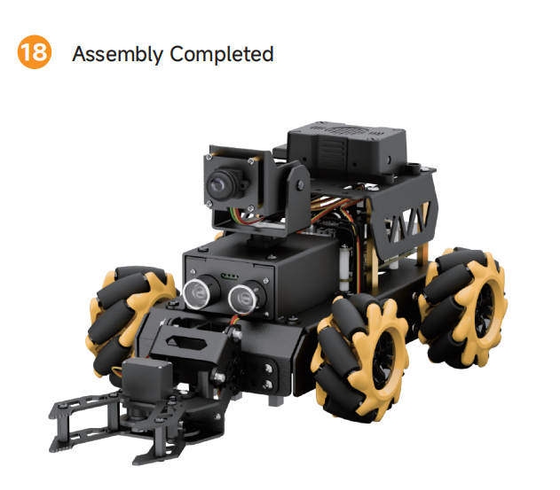

### 1.4.3 Overall Wiring Check

19. Check all ports according to the overall wiring diagram. Connect the ultrasonic sensor to NO.3 and the 4-channel line following sensor to NO.4. Connect the pan-tilt left-right servo to NO.2 and the pan-tilt pitch servo to NO.1. Connect the gripper servo to NO.6 and the lifting servo to NO.5. Connect the motor ports in this order: front-left M1, front-right M2, rear-left M3, and rear-right M4.

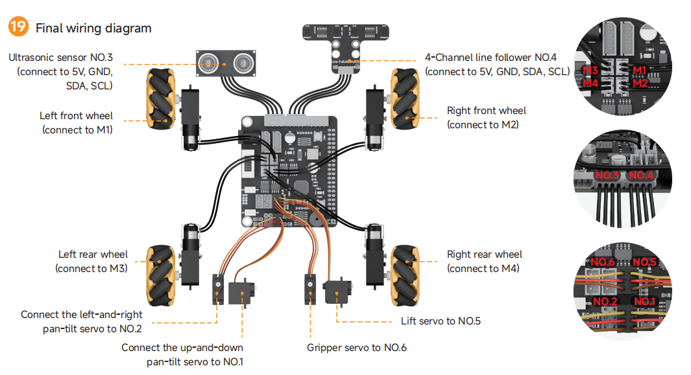

After assembly and wiring checks are complete, proceed with battery charging, installation, and power-on operations.

## 1.5 Charging and Power-On Status Description

**Before powering on, complete robot assembly according to [1.4 Assembly](#14-assembly).**

### 1.5.1 Battery Charging and Installation

The batteries cannot be fully charged during transportation. Fully charge the batteries before first power-on. Follow the charging method below:

1. Place two batteries into the charging box, then use the charging cable and charger to charge them.

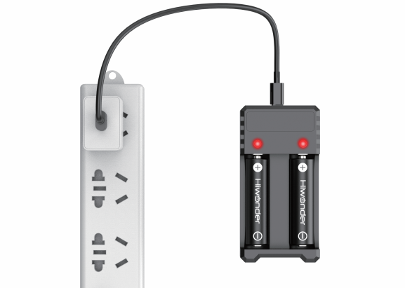

2. The charger indicator is green when not powered and red while charging. Charging takes about 3 hours. When the indicator changes from red to green, charging is complete. Unplug the charger promptly after charging is complete. Do not keep charging continuously.

### 1.5.2 Battery Installation

1. Before installing the batteries, make sure the battery box switch is set to **OFF**.

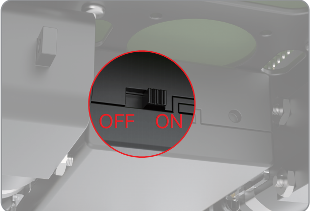

2. Install the fully charged batteries into the battery box, then close the battery cover. **Do not reverse the positive and negative terminals.**

### 1.5.3 Camera Connection Check

Before powering on, check whether the camera cable is securely connected. The camera cable can be connected to any of the four USB ports on the Raspberry Pi board.

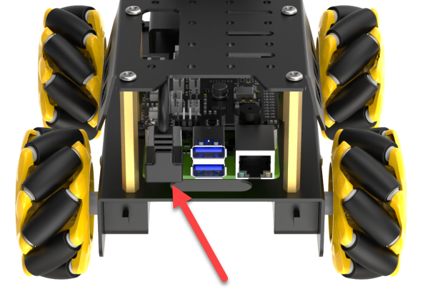

<p id="154-power-on-status-description"></p>


### 1.5.4 Power-On Status Description

1. Push the switch to **ON** and wait about 60 seconds. When the buzzer beeps once and the pan-tilt returns to the initial position, the device has powered on successfully.

> [!NOTE]
>
> - **Raspberry Pi itself is also a computer, so startup takes a short time. Power-on takes about 30 seconds. Wait patiently.**
>
> - **LED1 is the power indicator. It lights up when power is supplied and stays on while the device is running. If the light becomes dim, the battery is low and needs charging.**
>
> - **LED2 is the communication indicator. The default factory network connection mode is AP mode. After the device powers on successfully, LED2 blinks once every 1s. If the device is set to LAN mode, LED2 stays on. For network connection mode setup and introduction, refer to [1 Tutorials\2. Getting Started\2.1 APP Installation and Connection](https://drive.google.com/drive/folders/1jwOsKF7qMvAUdWTauRZfooTpKvBkD_oU?usp=sharing).**
>
> - **During device operation, if LED1 and LED2 become dim and remain steadily on, the battery is low and needs charging.**
>
> - **After the device powers on successfully, the factory default mode is AP direct connection mode, and a hotspot starting with HW is generated.**

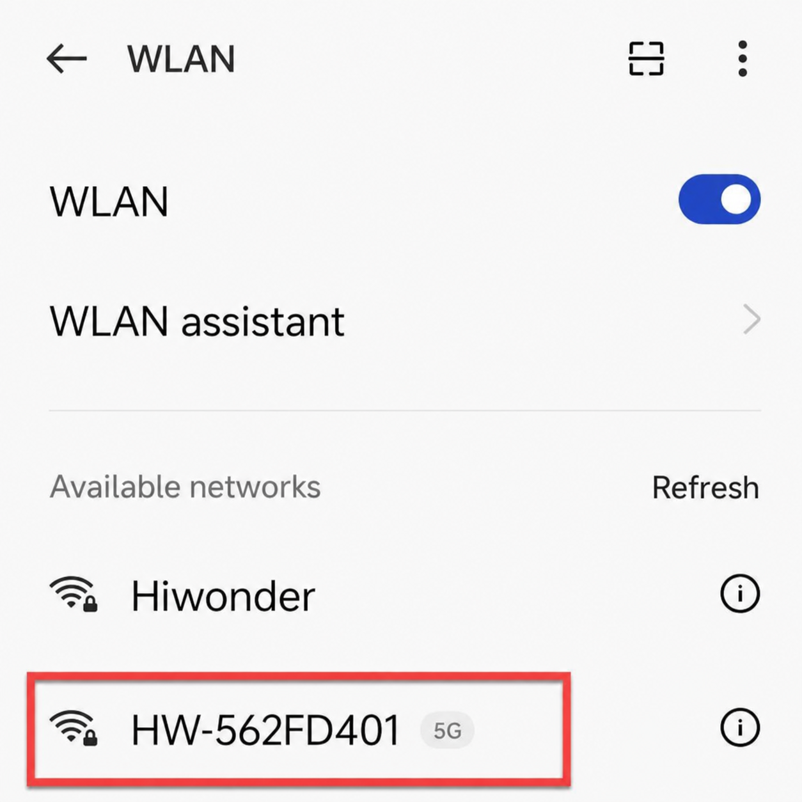

### 1.5.5 Checking Battery Level

The battery level can be checked in the following two ways:

**Method 1: Low-Voltage Alarm**

The robot has a low-voltage alarm feature. When the voltage is lower than 7.1V, the buzzer will continue beeping.

When the LED on the Raspberry Pi expansion board shows a weak blue light, the battery level is insufficient and cannot support startup or feature operation. Charge the batteries as soon as possible.

**Method 2: Check Through the Mobile App Screen**

The live video screen in the mobile app directly displays the real-time battery level. When the voltage is lower than 7.1V, the battery level is insufficient and the batteries need to be charged as soon as possible. For the mobile app experience, go to [**1. Tutorials/2. Getting Started**](https://drive.google.com/drive/folders/1jwOsKF7qMvAUdWTauRZfooTpKvBkD_oU?usp=sharing).

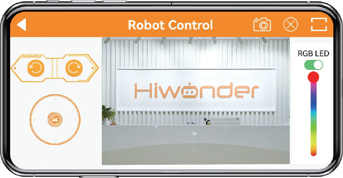

After finishing this section, go to [**1.7 Pan-Tilt Position Adjustment**](#17-pan-tilt-position-adjustment) in sequence. Do not skip this step.

## 1.6 Remote Tool Installation and Connection

> [!NOTE]
>
> - **A laptop is required for this section. If using a desktop PC, prepare a wireless network adapter. The demonstration can be viewed in this section folder.**
>
> - **This section uses the Windows version as an example. For Mac installation method, search online.**

<p id="161-preparation"></p>

### 1.6.1 Preparation

#### 1.6.1.1 VNC Remote Tool Installation

To run features from the computer, view feature code later, and modify programs, complete this section first and install VNC.

VNC is graphical remote control software. After the computer connects to the Raspberry Pi Wi-Fi hotspot, Raspberry Pi can be controlled directly from the computer. The following steps explain how to use VNC.

1. Double-click **VNC-Viewer-6.17.731-Windows** in [2 Software Tools\3 Remote Connection Tool\2 VNC](https://drive.google.com/drive/folders/14a5vq_34yXB_XkakNJkyyILMmTutfAn5?usp=sharing). Select **English** as the installation language in the pop-up dialog box, then click **OK**.

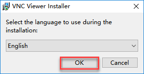

2. Click **Next** on the pop-up screen.

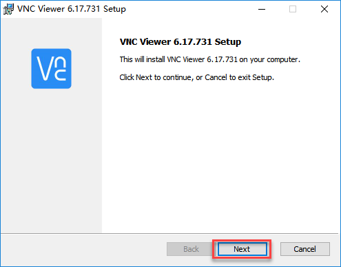

3. In the new prompt box, select the option to agree to the agreement, then click **Next**. When the installation location setting appears, keep the default setting and click **Next** again.

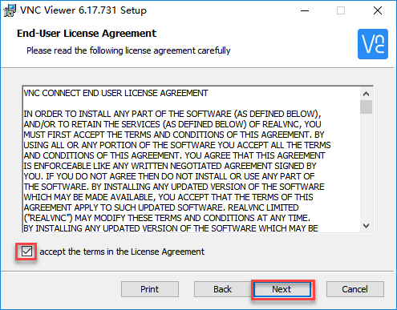

4. Click **Install** on the new page.

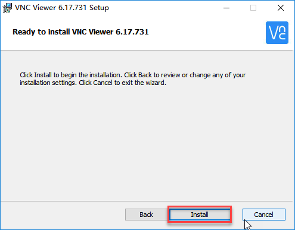

5. Wait for installation. When the installation completion page appears, click **Finish** to complete installation, then open VNC.

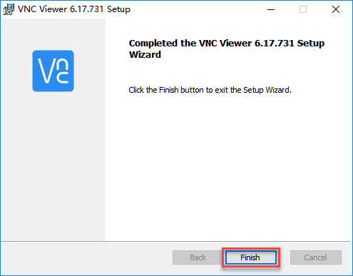

6. After VNC is installed, open it directly from the icon .

#### 1.6.1.2 Device Power-On

Following the previous operations, ensure that the battery holder cable is properly connected, then push the switch on the Raspberry Pi expansion board. After a short wait, LED2 on the Raspberry Pi expansion board changes from steady on to blinking once every 1s, which indicates successful power-on.

### 1.6.2 Device Connection

1. After the robot powers on, it creates a hotspot starting with HW. Open the computer Wi-Fi settings and search for a hotspot starting with HW, as shown below:

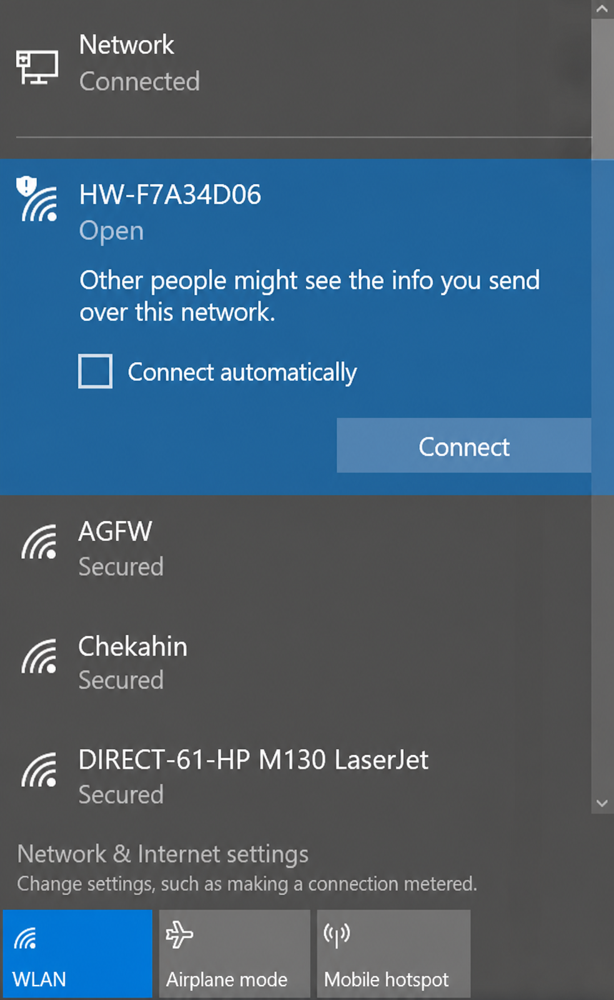

2. In VNC Viewer, enter the default Raspberry Pi IP address `192.168.149.1`, then press **Enter**. If an unsafe connection prompt appears, click **Continue**.

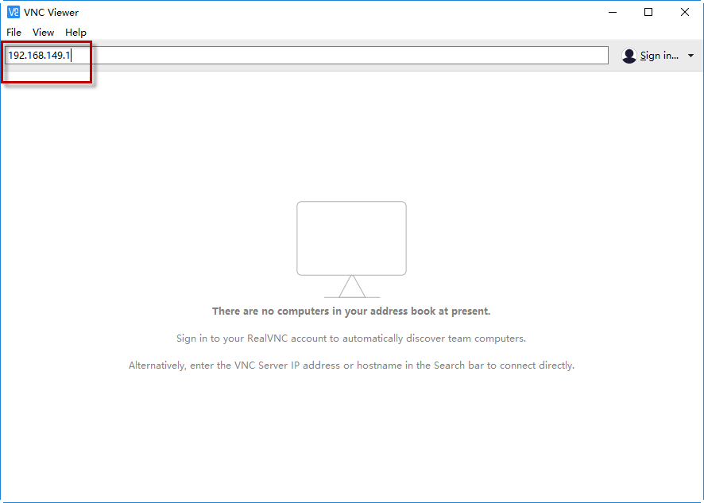

3. A prompt box appears and asks for the username and password.

> [!NOTE]
>
> **The accounts and passwords for TurboPi, MasterPi, and ArmPi mini vary by controller version as follows:**
>
> * **RPi 4B version username: pi, password: raspberry**
>
> * **RPi5 version username: pi, password: raspberrypi**
>
> **For other products, all controller versions use:**
>
> * **Username: pi, password: raspberrypi**

Select the remember password checkbox, then click **OK**. The Raspberry Pi desktop appears.

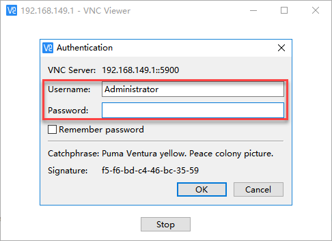

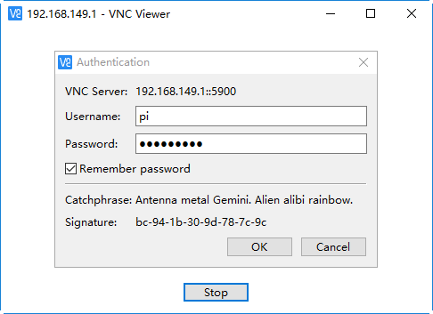


4. A warning dialog box may appear on the desktop. This is a Raspberry Pi system feature. Click **OK** to close it. If a black screen with only a mouse cursor appears, restart Raspberry Pi.

> [!NOTE]
>
> **For detailed startup steps of each feature, refer to the following chapters.**

### 1.6.3 Docker Container Introduction and Access

#### 1.6.3.1 Docker Introduction

Docker is an open-source platform and tool that helps package, distribute, and run applications in containers. A container is a lightweight, standalone, and executable software package that includes application code, runtime, system tools, libraries, and settings. Docker allows developers to package applications together with dependencies, not only the applications themselves, so they can be deployed quickly and consistently across different environments.

Technically, Docker uses Linux operating system containerization technology, which makes isolation between applications more efficient. Multiple containers can run on the same physical machine, and each container remains independent without affecting the others.

In summary, Docker can be understood as a tool that makes applications and dependencies more portable and easier to manage, bringing significant convenience to software development and deployment.


<p style="text-align:center">Docker Logo</p>

For Docker learning, refer to the related sections in [**7. Docker Container Basics**](https://drive.google.com/drive/folders/1SVneVhdVOgx98CRpG5w2lMO7wu1XeXwz?usp=sharing) in the course materials, or refer to Docker-related websites.

Docker official website: [http://www.docker.com](http://www.docker.com)

Docker Hub official website: [https://hub.docker.com](https://hub.docker.com)

#### 1.6.3.2 Common Docker Commands

All features and programs of this product run in Docker containers. To quickly understand and get started with this product, the following introduces common Docker commands.

1. Power on the device, then connect through the VNC remote connection tool according to [1.6.1 Preparation](#161-preparation) in this document.


2. Click the icon 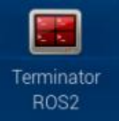 in the upper-left corner of the system desktop to open the ROS2 terminal.

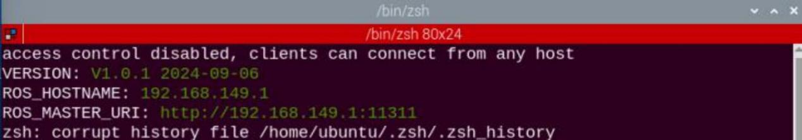

The image shows the Raspberry Pi system terminal.

3. On the remote desktop, double-click the robot system configuration tool icon 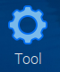 **Tool**, then click **Execute**.

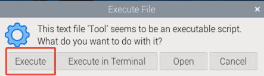

4. Select the language type to switch to in the language function options, as shown in the red box below. This configuration must match the language version used by the large model.


5. After configuration, click **Save > Apply > Quit** in sequence. Click them in this order so the robot type can be switched successfully.


6. Wait until the buzzer **beeps** once, which indicates that the chassis type has been switched successfully. Then click the command-line terminal  to view the ROS2 system environment.

<p id="1633-viewing-containers"></p>

#### 1.6.3.3 Viewing Containers

The device is preset to enter the container before shipment. This section is only for understanding.

Command syntax: `docker ps [OPTIONS]`

Common options:

1. `-a`: Lists all currently running containers and containers that have run before.

2. `-l`: Shows the most recently created container.

3. `-n=?`: Shows the most recent `n` created containers.

4. `-q`: Quiet mode, showing only container IDs.

In the command-line terminal, enter the command and press **Enter**. Running and previously run containers are displayed. `container id` is the container ID, `image` is the image name used by the container, `created` is the container creation time, and `status` is the current container status.

```bash
docker ps -a
```


#### 1.6.3.4 Entering a Container

**The device is preset to enter the container before shipment. This section is only for understanding.**

According to the container ID obtained in [**1.6.3.3 Viewing Containers**](#1633-viewing-containers), enter the command to access the container that contains the feature programs. The container ID can be shortened as long as it uniquely identifies the container.

```bash
docker exec -it -u ubuntu -w /home/ubuntu TurboPi /bin/bash
```


#### 1.6.3.5 Exiting a Container

There are two commands or methods to exit a container:

1. Enter the command directly in the terminal and press **Enter**. The container stops running and exits.

```bash
exit
```


2. Use the shortcut key combination **Ctrl + P + Q**. The container exits directly without stopping. Enter the command in the terminal to view the running containers.

```bash
docker ps
```


<p id="17-pan-tilt-position-adjustment"></p>

## 1.7 Pan-Tilt Position Adjustment

During TurboPi assembly, servo shaft offset may occur due to servo shaft deviation, servo replacement, or other operations. Offset adjustment is required in this case. Offsets are divided into small offset and large offset. Different adjustment methods apply depending on the situation.

### 1.7.1 Preparation

1. Power on TurboPi according to [**1.5.4 Power-On Status Description**](#154-power-on-status-description).

2. Connect TurboPi through the VNC remote connection tool according to [**1.6.1 Preparation**](#161-preparation).

### 1.7.2 Determining Offset Size

1. After TurboPi powers on successfully, the servos reset automatically. If the lower edge of the pan-tilt camera is aligned and parallel with the upper edge of the ultrasonic module, and the vertical direction of the connector behind the camera is perpendicular to the pan-tilt, as shown below, the pan-tilt offset does not need adjustment and this section can be skipped.


2. If the angle between the servo and the centerline is less than 13 degrees, meaning the servo pulse width is within `[1350,1650]`, and the servo can be restored through the PC software, it is a small offset. Adjust it by following [**1.7.3 Small Offset Adjustment**](#173-small-offset-adjustment). The offset of servo No. 2 is used as an example below:


**The PWM servo pulse width range is `[500,2500]`, corresponding to an angle range of 0 to 180 degrees. The angle conversion formula is: pulse width = (angle * 11.1) + 500. The initial angle of the pan-tilt servo is 90 degrees, meaning the pulse width is 1500.**

3. If the angle between the servo and the centerline is greater than 13 degrees, and the servo cannot be restored through the PC software, it is a large offset. Adjust it by following [**1.7.4 Large Offset Adjustment**](#174-large-offset-adjustment). The offset of servo No. 2 is used as an example below:


<p id="173-small-offset-adjustment"></p>

### 1.7.3 Small Offset Adjustment

1. Click the desktop icon  to open the terminal, then enter the command to switch to the corresponding path.

```bash
cd software/Servo_upper_computer/
```

2. Enter the command to open the servo debugging software.

```bash
python3 main.py
```


3. Click **Load Offsets**, select and open the yaml file in `/home/ubuntu/software/Servo_upper_computer`, and load the servo offsets.


4. Drag the slider of servo No.2 to make the U-shaped bracket of TurboPi parallel to the base bracket.

> [!NOTE]
>
> **The adjustable range here is 1372~1627. If the U-shaped bracket and base bracket can be adjusted to be parallel within this range, it is a small offset. If the adjustment range exceeds this range, it is a large offset. Adjust it by following [1.7.4 Large Offset Adjustment](#174-large-offset-adjustment).**


5. Click **Save Offsets**, select the yaml file in `/home/ubuntu/software/Servo_upper_computer`, and save the adjusted offset value to TurboPi.


6. Select **Yes** in the pop-up prompt box.


<p id="174-large-offset-adjustment"></p>

### 1.7.4 Large Offset Adjustment

Large offset adjustment requires removing the servo from the pan-tilt, centering the servo, and then repeating the small offset adjustment steps.

1. After TurboPi powers on successfully, the servo resets automatically. At this time, servo No. 2 has an obvious offset, and the offset angle is greater than 13 degrees.


2. Power off TurboPi. The following disassembly steps must not be performed while power is on.

3. Remove the screw from the main shaft of servo No. 2.


4. Pull the U-shaped bracket off servo No. 2.


5. Turn on the Raspberry Pi switch again. When the buzzer **beeps** once after power-on, the servo automatically moves to the center position. After the servo is centered, power off the device.

6. After the device is powered off, install the U-shaped bracket onto servo No. 2 according to the position shown below. During installation, do not twist the servo. If the servo is accidentally twisted, repeat Step 5.


7. Tighten the main shaft screw, then fine-tune the servo according to [**1.7.3 Small Offset Adjustment**](#173-small-offset-adjustment).

