# 3. Mecanum Wheel Robot Motion Control

## 3.1 Introduction to Mecanum Wheel Robot Motion

### 3.1.1 Introduction

The TurboPi chassis uses Mecanum wheels for omnidirectional movement. Based on the direction of the rollers positioned at a 45-degree angle, Mecanum wheels are divided into two mirror-image types, Type A and Type B, as shown below.

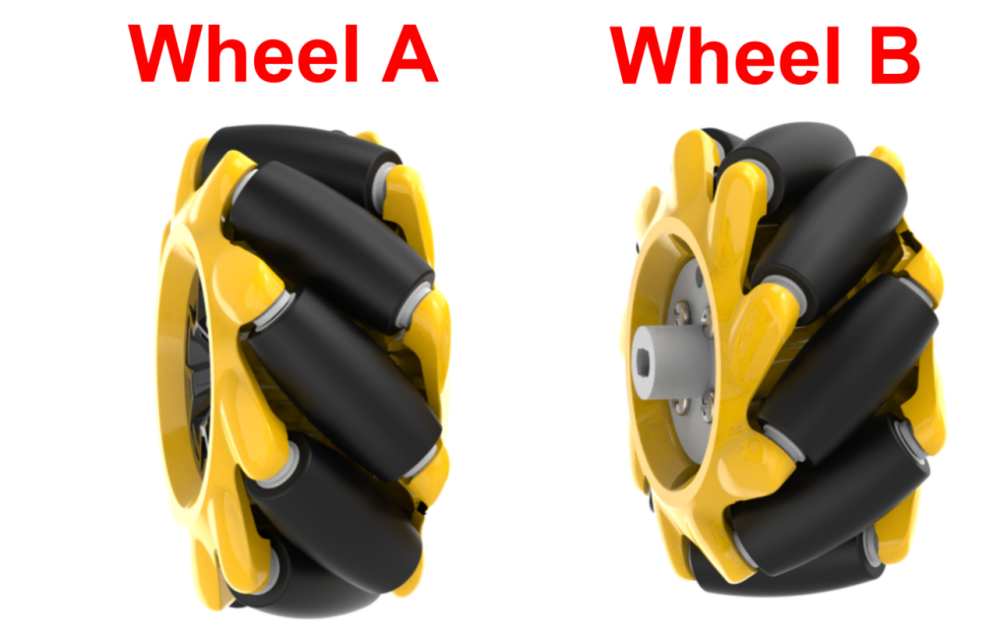

Mecanum wheels provide omnidirectional mobility, flexibility, and stability. Combining four Mecanum wheels allows TurboPi to move freely and conveniently in any direction.

### 3.1.2 Working Principle

#### 3.1.2.1 Hardware Structure and Physical Characteristics

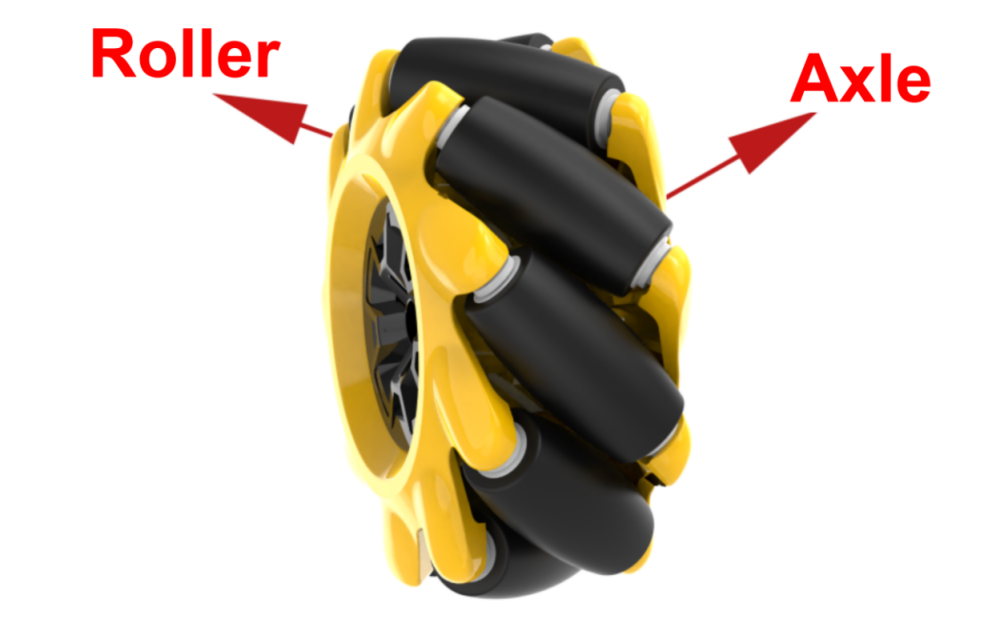

A Mecanum wheel consists of a wheel hub and rollers. The hub is the main support structure, and the drum-shaped rollers are mounted around it. The hub axis and roller axes form a 45-degree angle. Mecanum wheels are generally used in sets of four, with two left-handed wheels known as Type A and two right-handed wheels known as Type B. Type A and Type B wheels are symmetrical.

Four Mecanum wheels can be arranged in configurations such as AAAA, BBBB, AABB, ABAB, and BABA. Not every configuration supports forward, backward, rotational, leftward, and rightward movement. TurboPi uses the ABAB configuration, which supports omnidirectional movement.

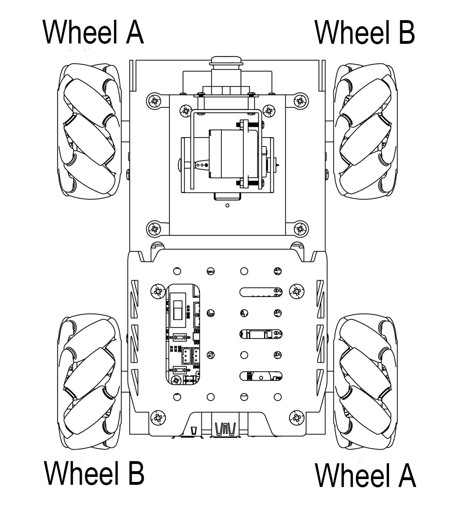

#### 3.1.2.2 Physical Characteristics of Mecanum Wheels

The direction and speed of each wheel determine the motion of a Mecanum wheel robot. The forces generated by the wheels combine into a resultant force vector in the required direction. This allows the platform to move freely along the resultant force vector without changing the orientation of the wheels.

Many small rollers are arranged diagonally around the wheel rim, allowing the wheel to slide laterally. The generatrix of each roller has a special shape. As the wheel rotates around its fixed center axis, the envelopes of the rollers form a cylindrical surface, allowing the wheel to roll forward continuously.

The kinematic model of a Mecanum wheel chassis includes the following parameters.

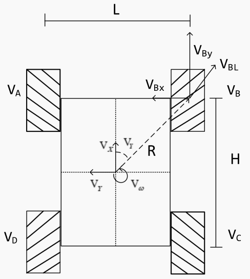

1. V<sub>x</sub>: Velocity of the Mecanum wheel along the X-axis, which is normally the forward and backward direction.

2. V<sub>y</sub>: Velocity of the Mecanum wheel along the Y-axis, which is normally the left and right direction.

3. V<sub>ω</sub>: Angular velocity of the Mecanum wheel chassis around its center.

4. V<sub>A</sub>, V<sub>B</sub>, V<sub>C</sub>, and V<sub>D</sub>: Real-time velocities of the four Mecanum wheels.

The planar motion of the front-right wheel can be decomposed into the following parameters.

1. VBx: Velocity of the Mecanum wheel along the X-axis, which is normally the forward and backward direction.

2. VBy: Velocity of the Mecanum wheel along the Y-axis, which is normally the left and right direction.

3. L: Distance between the centers of the left and right wheels.

4. H: Distance between the centers of the front and rear wheels.

5. θ<sub>ω</sub>: The 45-degree angle formed by the chassis center of mass and the center of the front-right wheel.

   These parameters can be used to analyze the kinematics of the Mecanum wheel chassis.

### 3.1.3 Kinematic Analysis and Formula Calculation (Optional)

Make the following two idealized assumptions to simplify the kinematic model.

1. The omnidirectional wheels do not slip on the ground, and the ground provides sufficient friction.

2. The four wheels are positioned at the four corners of a rectangle or square and are parallel to one another.

The rigid-body motion of the robot is linearly decomposed into three components. Calculate the four wheel velocities as the Mecanum wheel chassis translates in the positive X and Y directions and rotates in the positive Z direction. Combine these formulas to calculate the wheel speeds required for compound **translation and rotation**.

V<sub>A</sub>, V<sub>B</sub>, V<sub>C</sub>, and V<sub>D</sub> are the rotational speeds of wheels A, B, C, and D and therefore the motor speeds. V<sub>X</sub> is the translational velocity along the X-axis. V<sub>y</sub> is the translational velocity along the Y-axis. V<sub>ω</sub> is the rotational velocity around the Z-axis. 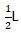 is half of track width L, and 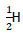 is half of wheelbase H.

1. Calculate the velocity component of each wheel during translation along the X-axis with the following formulas.

*V*<sub>*A*</sub> = +*V*<sub>*X*</sub>, *V*<sub>*B*</sub> = +*V*<sub>*X*</sub>, *V*<sub>*C*</sub> = +*V*<sub>*X*</sub>, *V*<sub>*D*</sub> = +*V*<sub>*X*</sub>

V<sub>A</sub>, V<sub>B</sub>, V<sub>C</sub>, and V<sub>D</sub> are the real-time velocities of the four Mecanum wheels. V<sub>X</sub> is the velocity along the X-axis.

2. Calculate the velocity component of each wheel during translation along the Y-axis with the following formulas.

*V*<sub>*A*</sub> = −*V*<sub>*Y*</sub>, *V*<sub>*B*</sub> = +*V*<sub>*Y*</sub>, *V*<sub>*C*</sub> = −*V*<sub>*Y*</sub>, *V*<sub>*D*</sub> = +*V*<sub>*Y*</sub>

V<sub>y</sub> is the Mecanum wheel velocity along the Y-axis.

3. Calculate the velocity component of each wheel during rotation around the Z-axis with the following formulas.

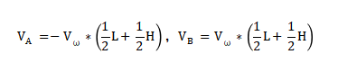

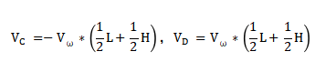

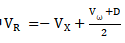 is the angular velocity of the Mecanum wheel chassis around its center.

4. Combine the velocities along the X, Y, and Z axes to calculate the rotational speeds of the four wheels based on the robot motion state.

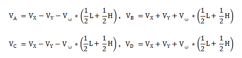

## 3.2 Moving Forward

### 3.2.1 Feature Overview

All four wheels must rotate forward for the robot to move straight ahead, as shown in the force analysis diagram below.

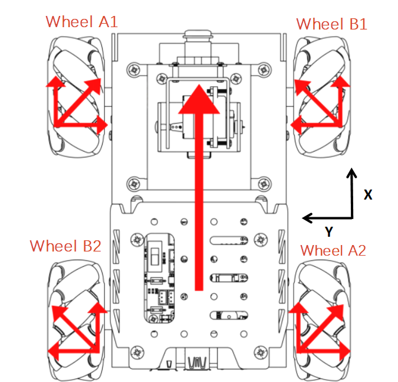

According to kinematics, forces of equal magnitude in opposite directions cancel each other.

Assume that the Type A and Type B wheels rotate forward at the same speed. The rightward force components from wheels A1 and A2 cancel the leftward force components from wheels B1 and B2. Only the forward force components from wheels A1, A2, B1, and B2 remain.

The resultant force points forward. According to Newton's second law of motion, **F=ma**, the acceleration and resultant velocity V<sub>res</sub> also point forward.

<p id="section-3-2-2"></p>

### 3.2.2 Starting and Stopping the Feature

> [!NOTE]
>
> **Commands are case-sensitive and space-sensitive. Press "Tab" to complete keywords.**

1. Power on the device and connect through the VNC remote access tool.

   

2. Click the icon  in the upper-left corner of the system desktop to open a command-line terminal.

   

3. Enter the command below and press **Enter** to navigate to the feature program directory.

```bash
cd ~/ros2_ws/src/example/example/mecanum_control
```

4. Enter the command below and press **Enter** to run the feature.

```bash
python3 car_forward_demo.py
```

5. Press **Ctrl+C** in the terminal to stop the feature. Repeat this operation until the program closes if it does not stop immediately.

### 3.2.3 Project Outcome

After the feature starts, TurboPi continuously moves forward.

### 3.2.4 Program Overview

The source code is located at **ros2_ws/src/example/example/mecanum_control/car_forward_demo.py**.

```python
# Move the chassis forward.

import rclpy
import signal
from rclpy.node import Node
from geometry_msgs.msg import Twist

class CarMoveDemo(Node):
    def __init__(self):
        super().__init__('car_forward') 
        signal.signal(signal.SIGINT, self.stop)  
        self.mecanum_pub = self.create_publisher(Twist, 'cmd_vel', 1)  # Chassis control 
        self.timer = self.create_timer(1.0, self.timer_callback)

    def timer_callback(self):    
        twist = Twist()
        twist.linear.x = 0.5  # Set linear velocity 
        self.mecanum_pub.publish(twist)
        self.get_logger().info(f"Published twist: {twist.linear.x}")
        
    def stop(self, signum, frame):
        self.mecanum_pub.publish(Twist())
        rclpy.shutdown()

def main():
    rclpy.init()  
    node = CarMoveDemo()
    try:
        rclpy.spin(node)
    except KeyboardInterrupt:
        node.mecanum_pub.publish(Twist())
    finally:
        node.destroy_node()
        rclpy.shutdown()

if __name__ == "__main__":
    main()
```

The program mainly controls the motors through `self.create_publisher(Twist, 'cmd_vel', 1)`. Consider the parameter in `twist.linear.x = 0.9`.

The value `0.9` is the motor linear velocity. Its range is `-1` to `1`. A negative value reverses the motor. Values from `0` to `1` move the wheels forward. Larger values produce higher wheel speeds. Set the parameter above `0.35` for clearly visible forward rotation. Values from `-1` to `0` move the wheels backward. Smaller values produce higher wheel speeds in reverse. Set the parameter below `-0.35` for clearly visible reverse rotation.

### 3.2.5 Feature Extension

**The default forward speed is 0.5. Follow these steps to change the speed to 0.9.**

1. Click the icon  in the upper-left corner of the system desktop to open a command-line terminal.

2. Enter the command below and press **Enter** to navigate to the feature program directory.

```bash
cd ~/ros2_ws/src/example/example/mecanum_control
```

3. Enter the command below and press **Enter** to open the program file.

```bash
vim car_forward_demo.py
```

4. Locate the code to modify and press **i**. When the prompt appears in the lower-left corner, edit mode is active.

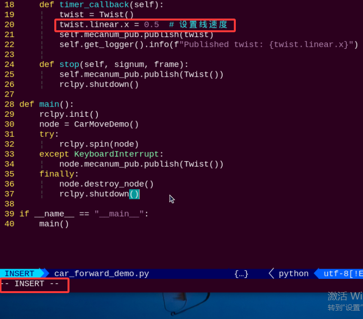

5. The parameter in `twist.linear.x` represents the motor linear velocity. Change the value to `0.9`. Press **Esc**, enter the command below, and press **Enter** to save and close the file.

```bash
:wq
```

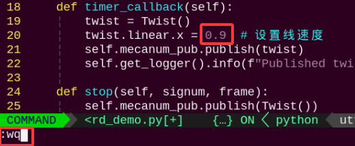

> [!NOTE]
>
> **The adjustable speed range is -1 to 1. A positive value rotates the motor forward, and a negative value rotates it in reverse. A negative value may change the robot's direction of travel. A value from 0 to 1 is recommended for this exercise.**

6. Follow [**3.2.2 Starting and Stopping the Feature**](#section-3-2-2) to run the program again and check the result.

## 3.3 Turning

### 3.3.1 Feature Overview

When the wheels on the left side rotate in reverse and the wheels on the right side rotate forward, the robot rotates counterclockwise in place. When the left wheels rotate forward and the right wheels rotate in reverse, the robot rotates clockwise in place.

The force analysis diagrams for both cases are shown below.


1. When the left wheels rotate in reverse and the right wheels rotate forward, the left wheels push backward and the right wheels pull forward. This causes the robot to rotate counterclockwise.

2. When the left wheels rotate forward and the right wheels rotate in reverse, the left wheels pull forward and the right wheels push backward. This causes the robot to rotate clockwise.

The properties of Mecanum wheels generate rotational torque when the left and right wheels rotate in different directions. This torque causes the robot to rotate around its center axis. Control the speed and direction of the left and right wheels to rotate the robot in place.

<p id="section-3-3-2"></p>

### 3.3.2 Starting and Stopping the Feature

> [!NOTE]
>
> **Commands are case-sensitive and space-sensitive. Press "Tab" to complete keywords.**

1. Power on the device and connect through the VNC remote access tool.

   

2. Click the icon  in the upper-left corner of the system desktop to open a command-line terminal.

   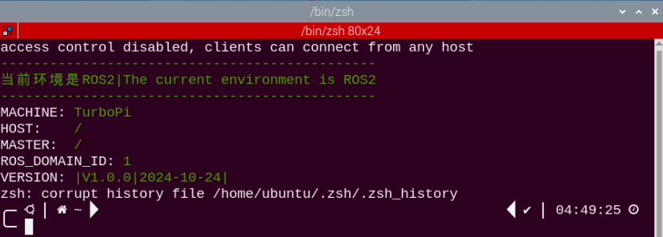

3. Enter the command below and press **Enter** to navigate to the feature program directory.

```bash
cd ~/ros2_ws/src/example/example/mecanum_control
```

4. Enter the command below and press **Enter** to run the feature.

```bash
python3 car_turn_demo.py
```

5. Press **Ctrl+C** in the terminal to stop the feature. Press it repeatedly if the feature does not stop immediately.

### 3.3.3 Project Outcome

After the feature starts, TurboPi first rotates counterclockwise in place and then rotates clockwise in place.

### 3.3.4 Program Analysis

The source code is located at **/ros2_ws/src/example/example/mecanum_control/car_turn_demo.py**.

```python
# Turn the chassis. 

import rclpy
import signal
from rclpy.node import Node
from geometry_msgs.msg import Twist

class CarMoveDemo(Node):
    def __init__(self):
        super().__init__('car_turn') 
        signal.signal(signal.SIGINT, self.stop)  
        self.mecanum_pub = self.create_publisher(Twist, 'cmd_vel', 1)  # Chassis control 
        self.timer = self.create_timer(1.0, self.timer_callback)
        self.state = 0  # Current state
        self.twist = Twist()  # Motion command 

    def timer_callback(self):
        if self.state == 0:
            self.twist.angular.z = 5.0 # Left
        elif self.state == 1:
            self.twist.angular.z = -5.0  # Right 
            
        self.mecanum_pub.publish(self.twist)
        self.get_logger().info(f"Published twist: angular.z = {self.twist.angular.z}")
        
        # Update the state. 
        self.state = (self.state + 1) % 2  # Loop state 

    
        
    def stop(self, signum, frame):
        self.mecanum_pub.publish(Twist())
        rclpy.shutdown()

def main():
    rclpy.init()  
    node = CarMoveDemo()
    try:
        rclpy.spin(node)
    except KeyboardInterrupt:
        node.mecanum_pub.publish(Twist())
    finally:
        node.destroy_node()
        rclpy.shutdown()

if __name__ == "__main__":
    main()
```

The program mainly controls the motors through `self.twist.angular.z`. Consider `self.twist.angular.z=-5.0`. The value `-5.0` is the angular velocity for clockwise rotation. A larger absolute value produces a higher angular velocity. Values from `-10` to `0` produce clockwise rotation.

### 3.3.5 Feature Extension

The default turning angular velocity is `5.0`. Follow these steps to change the counterclockwise rotation speed to `6.0`.

1. Click the icon  in the upper-left corner of the desktop to open a command-line terminal.

2. Enter the command below and press **Enter** to navigate to the feature program directory.

```bash
cd ~/ros2_ws/src/example/example/mecanum_control
```

3. Enter the command below and press **Enter** to open the program file.

```bash
vim car_turn_demo.py
```

4. Locate the code to modify and press **i** to enter edit mode.

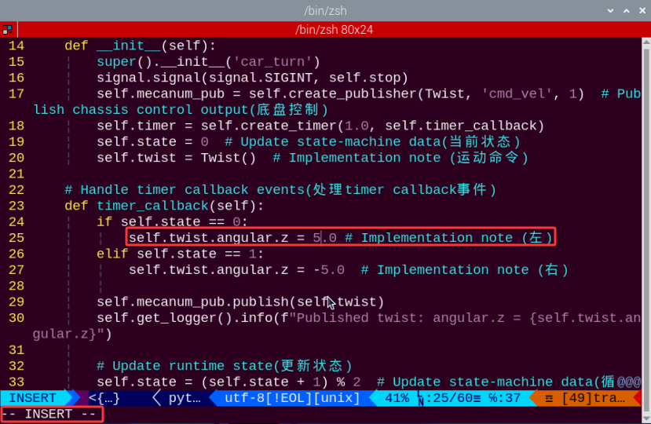

5. The parameter in `self.twist.angular.z` controls the turning angular velocity. A positive value rotates the robot counterclockwise, and a negative value rotates it clockwise. Change the default value from `5.0` to `6.0`. Press **Esc**, enter the command below, and press **Enter** to save and close the file.

```bash
:wq
```

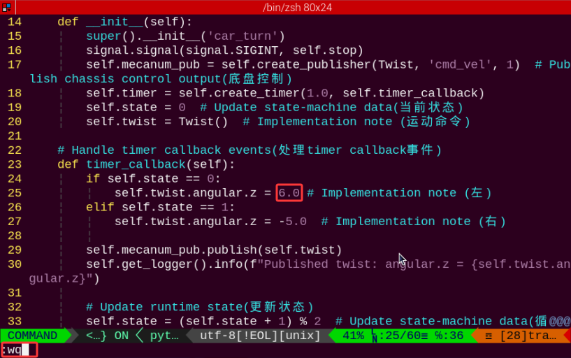

> [!NOTE]
>
> **The adjustable speed range is -10.0 to 10.0. A positive value rotates the robot counterclockwise, and a negative value rotates it clockwise. Make small adjustments based on actual conditions.**

Follow [**3.3.2 Starting and Stopping the Feature**](#section-3-3-2) to run the program again and check the result.

## 3.4 Forward, Backward, and Sideways Movement

### 3.4.1 Feature Overview

When all wheels rotate forward, the robot moves forward. When all wheels rotate in reverse, the robot moves backward. When all Type A wheels rotate in reverse and the Type B wheels rotate forward, the robot moves laterally to the left. When all Type B wheels rotate in reverse and the Type A wheels rotate forward, the robot moves laterally to the right. The force analysis diagram is shown below.

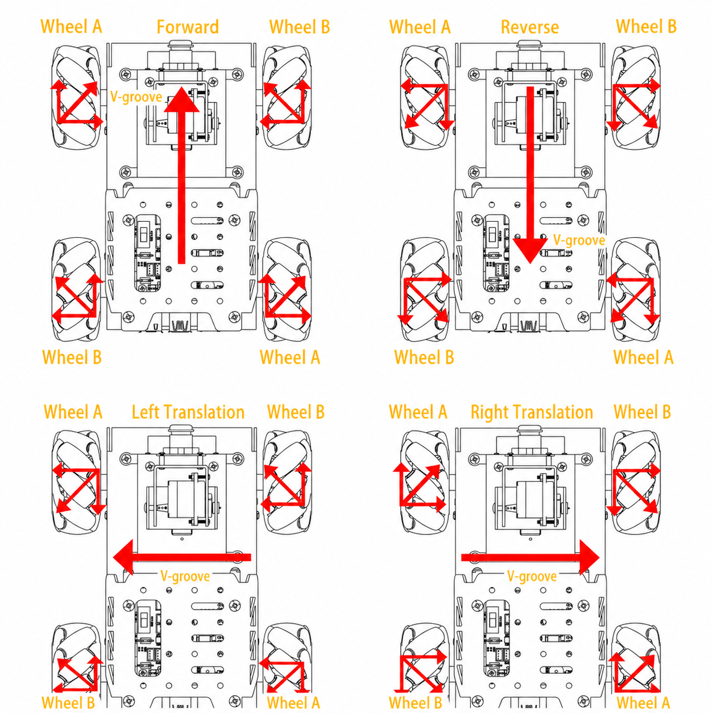

According to kinematics, forces of equal magnitude in opposite directions cancel each other. Assume that the Type A and Type B wheels rotate forward at the same speed. The rightward force components from the Type A wheels cancel the leftward force components from the Type B wheels. The resultant force points forward. According to Newton's second law of motion, F=ma, the acceleration and resultant velocity V<sub>resultant</sub> point forward. Velocities in the other directions are derived in the same way.

1. **Forward and Backward Movement**

   When all wheels rotate forward, the robot moves forward. When all wheels rotate in reverse, the robot moves backward. The thrust from all four wheels points in the same direction and drives the robot forward or backward.

2. **Leftward Movement**

   When the two left wheels rotate in reverse and the two right wheels rotate forward, the left wheels push backward and the right wheels pull forward. The resulting leftward torque moves the robot laterally to the left.

3. **Rightward Movement**

   When the two right wheels rotate in reverse and the two left wheels rotate forward, the right wheels push backward and the left wheels pull forward. The resulting rightward torque moves the robot laterally to the right.

<p id="section-3-4-2"></p>

### 3.4.2 Starting and Stopping the Feature

> [!NOTE]
>
> **Commands are case-sensitive and space-sensitive. Press "Tab" to complete keywords.**

1. Power on the device and connect through the VNC remote access tool.

   

2. Click the icon  in the upper-left corner of the system desktop to open a command-line terminal.

   

3. Enter the command below and press **Enter** to navigate to the feature program directory.

```bash
  cd ~/ros2_ws/src/example/example/mecanum_control
```

4. Enter the command below and press **Enter** to run the feature.

 ```bash
 python3 car_move_demo.py
 ```

5. Press **Ctrl+C** in the terminal to stop the feature. Press it repeatedly if the feature does not stop immediately.

### 3.4.3 Project Outcome

After the feature starts, TurboPi moves forward, backward, left, and right in sequence.

### 3.4.4 Program Analysis

The source code is located at **/ros2_ws/src/example/example/mecanum_control/car_move_demo.py**.

```python
# Move the chassis forward, backward, left, or right. 

import rclpy
import signal
from rclpy.node import Node
from geometry_msgs.msg import Twist

class CarMoveDemo(Node):
    def __init__(self):
        super().__init__('car_move') 
        signal.signal(signal.SIGINT, self.stop)  
        self.mecanum_pub = self.create_publisher(Twist, 'cmd_vel', 1)  # Chassis control 
        self.timer = self.create_timer(1.0, self.timer_callback)
        self.state = 0  # Current state 
        self.twist = Twist()  # Motion command 

    def timer_callback(self):
        if self.state == 0:
            self.twist.linear.x = 0.5  # Move forward 
            self.twist.linear.y = 0.0
        elif self.state == 1:
            self.twist.linear.x = -0.5  # Move backward 
            self.twist.linear.y = 0.0
        elif self.state == 2:
            self.twist.linear.x = 0.0
            self.twist.linear.y = 0.5  # Move left 
        elif self.state == 3:
            self.twist.linear.x = 0.0
            self.twist.linear.y = -0.5  # Move right 

        self.mecanum_pub.publish(self.twist)
        self.get_logger().info(f"Published twist: linear.x = {self.twist.linear.x}, linear.y = {self.twist.linear.y}")
        
        # Update the state. 
        self.state = (self.state + 1) % 4  # Loop state 

    
        
    def stop(self, signum, frame):
        self.mecanum_pub.publish(Twist())
        rclpy.shutdown()

def main():
    rclpy.init()  
    node = CarMoveDemo()
    try:
        rclpy.spin(node)
    except KeyboardInterrupt:
        node.mecanum_pub.publish(Twist())
    finally:
        node.destroy_node()
        rclpy.shutdown()

if __name__ == "__main__":
    main()
```

The program mainly controls the motors through `self.twist.linear.x` and `self.twist.linear.y`. In `self.twist.linear.x = 0.5` and `self.twist.linear.y = 0.0`, the X value is `0.5` and the Y value is `0.0`, so the robot moves forward.

### 3.4.5 Feature Extension

The default leftward speed is `0.5`. Follow these steps to change the leftward speed to `0.6`.

1. Click the icon  in the upper-left corner of the desktop to open a command-line terminal.

2. Enter the command below and press **Enter** to navigate to the feature program directory.

```bash
cd ~/ros2_ws/src/example/example/mecanum_control
```

3. Enter the command below and press **Enter** to open the program file.

```bash
vim car_move_demo.py
```

4. Locate the code to modify and press **i** to enter edit mode.

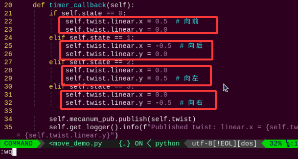

5. The sign of the parameter in `self.twist.linear.x` controls forward and backward movement. The parameter in `self.twist.linear.y` controls leftward and rightward movement. The default leftward speed is `0.5`, as set by `self.twist.linear.y = 0.5`. Change it to `0.6`, as set by `self.twist.linear.y = 0.6`. Press **Esc**, enter the command below, and press **Enter** to save and close the file.

```bash
:wq
```

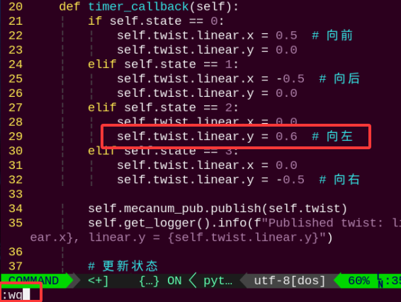

> [!NOTE]
>
> **The adjustable speed range is -1 to 1. A positive value moves the robot to the left, and a negative value moves it to the right.**

6. Follow [**3.4.2 Starting and Stopping the Feature**](#section-3-4-2) to run the program again and check the result.

## 3.5 Diagonal Movement

### 3.5.1 Feature Overview

When the Type A wheels remain stationary and the Type B wheels rotate forward, the robot moves diagonally forward-left. When the Type B wheels rotate in reverse, the robot moves diagonally backward-right. When the Type B wheels remain stationary and the Type A wheels rotate forward, the robot moves diagonally forward-right. When the Type A wheels rotate in reverse, the robot moves diagonally backward-left. The force analysis diagram is shown below.

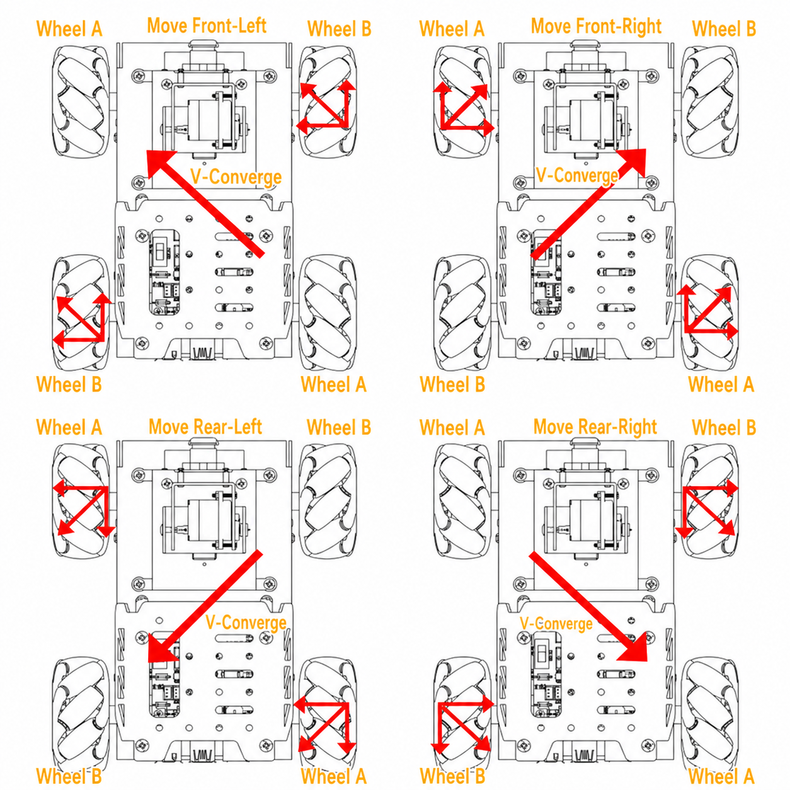

1. When the Type A wheels remain stationary and the Type B wheels rotate forward, the Type B wheels push forward. This generates forward-left torque and moves the robot diagonally forward-left.

2. When the Type B wheels remain stationary and the Type A wheels rotate forward, the Type A wheels pull forward. This generates forward-right torque and moves the robot diagonally forward-right.

3. When the Type A wheels remain stationary and the Type B wheels rotate in reverse, the Type B wheels pull backward. This generates backward-right torque and moves the robot diagonally backward-right.

4. When the Type B wheels remain stationary and the Type A wheels rotate in reverse, the Type A wheels push backward. This generates backward-left torque and moves the robot diagonally backward-left.

<p id="section-3-5-2"></p>

### 3.5.2 Starting and Stopping the Feature

> [!NOTE]
>
> **Commands are case-sensitive. Press "Tab" to complete keywords.**

1. Power on the device and connect through the VNC remote access tool.

   

2. Click the icon  in the upper-left corner of the system desktop to open a command-line terminal.

   

3. Enter the command below and press **Enter** to navigate to the feature program directory.

```bash
cd ~/ros2_ws/src/example/example/mecanum_control
```

4. Enter the command below and press **Enter** to run the feature.

```bash
python3 car_slant_demo.py
```

5. Press **Ctrl+C** in the terminal to stop the feature. Repeat this operation until the program closes if it does not stop immediately.

### 3.5.3 Project Outcome

After the feature starts, TurboPi moves forward-left, forward-right, backward-left, and backward-right in sequence.

### 3.5.4 Program Analysis

The source code is located at **/ros2_ws/src/example/example/mecanum_control/car_slant_demo.py**.

```python
# Move the chassis diagonally. 

import rclpy
import signal
from rclpy.node import Node
from geometry_msgs.msg import Twist
import time

class CarMoveDemo(Node):
    def __init__(self):
        super().__init__('car_slant') 
        signal.signal(signal.SIGINT, self.stop)  
        self.mecanum_pub = self.create_publisher(Twist, 'cmd_vel', 1)  # Chassis control 
        time.sleep(1)
        self.timer = self.create_timer(1.0, self.timer_callback)
        self.state = 0  # Current state 
        self.twist = Twist()  # Motion command 

    def timer_callback(self):
        if self.state == 0:
            self.twist.linear.x = 0.5  
            self.twist.linear.y = 0.5
        elif self.state == 1:
            self.twist.linear.x = 0.5 
            self.twist.linear.y = -0.5
        elif self.state == 2:
            self.twist.linear.x = -0.5
            self.twist.linear.y = 0.5  
        elif self.state == 3:
            self.twist.linear.x = -0.5
            self.twist.linear.y = -0.5  

        self.mecanum_pub.publish(self.twist)
        self.get_logger().info(f"Published twist: linear.x = {self.twist.linear.x}, linear.y = {self.twist.linear.y}")
        
        # Update the state. 
        self.state = (self.state + 1) % 4  # Loop state 

    
        
    def stop(self, signum, frame):
        self.mecanum_pub.publish(Twist())
        rclpy.shutdown()

def main():
    rclpy.init()  
    node = CarMoveDemo()
    try:
        rclpy.spin(node)
    except KeyboardInterrupt:
        node.mecanum_pub.publish(Twist())
    finally:
        node.destroy_node()
        rclpy.shutdown()

if __name__ == "__main__":
    main()
```

The program mainly controls the motors through `self.twist.linear.x` and `self.twist.linear.y`. In `self.twist.linear.x = 0.5` and `self.twist.linear.y = -0.5`, the X value is `0.5` and the Y value is `-0.5`, so the robot moves diagonally forward-right.

### 3.5.5 Feature Extension

**The default diagonal angle is 45 degrees. Follow these steps to change the forward-left motion parameter to 0.6.**

1. Click the icon  in the upper-left corner of the system desktop to open a command-line terminal.

2. Enter the command below and press **Enter** to navigate to the feature program directory.

```bash
cd ~/ros2_ws/src/example/example/mecanum_control
```

3. Enter the command below and press **Enter** to open the program file.

```bash
vim car_slant_demo.py
```

4. Locate the code shown in the red box and press **i**. When the prompt appears in the lower-left corner, edit mode is active.

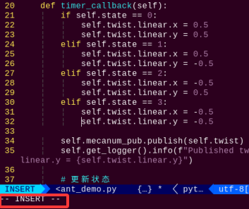

5. The parameters in `self.twist.linear.x` and `self.twist.linear.y` control forward or backward movement and leftward or rightward movement. Change the values to `0.6`. Press **Esc**, enter the command below, and press **Enter** to save and close the file.

```
:wq
```

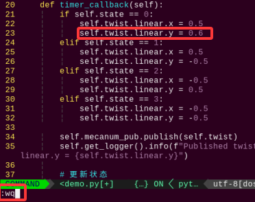

> [!NOTE]
>
> **The adjustable direction range is -1 to 1. y=-0.5 moves the robot to the right. x=0.5 moves it forward. y=0.5 moves it to the left. x=-0.5 moves it backward.**

6. Follow [**3.5.2 Starting and Stopping the Feature**](#section-3-5-2) to run the program again and check the result.

## 3.6 Drifting Motion

### 3.6.1 Feature Overview

When the front wheels remain stationary, the rear Type A wheel rotates forward, and the rear Type B wheel rotates in reverse, the robot drifts counterclockwise. When the rear Type B wheel rotates forward and the rear Type A wheel rotates in reverse, the robot drifts clockwise.

1. When the front wheels remain stationary, the rear Type A wheel rotates forward, and the rear Type B wheel rotates in reverse, the Type A wheel pulls forward and the Type B wheel pushes backward. This generates counterclockwise torque and causes counterclockwise drifting.

2. When the front wheels remain stationary, the rear Type B wheel rotates forward, and the rear Type A wheel rotates in reverse, the Type B wheel pulls forward and the Type A wheel pushes backward. This generates clockwise torque and causes clockwise drifting.

   The properties of Mecanum wheels generate rotational torque when the left and right wheels rotate in different directions. When the front wheels remain stationary and only the rear wheels rotate, the resulting torsional torque causes the robot to drift around its center axis. Control the speed and direction of the rear wheels to control the drifting motion.

   The force analysis diagram is shown below.

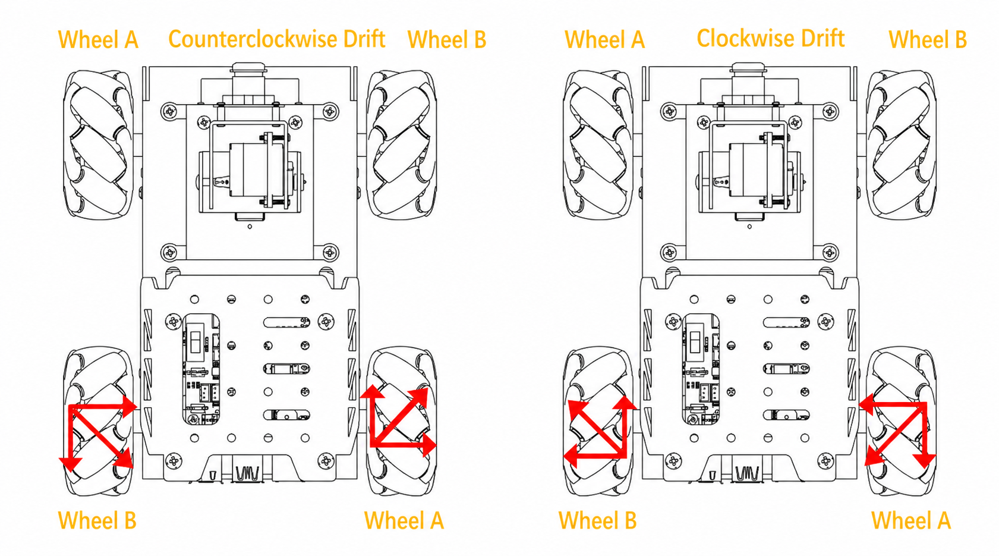

According to kinematics, forces of equal magnitude in opposite directions cancel each other. Consider counterclockwise drifting. Assume that the Type A and Type B wheels rotate at the same speed. The upward force component from the Type A wheel cancels the downward force component from the Type B wheel, producing a resultant force to the right.

According to Newton's second law of motion, **F=ma**, the acceleration and resultant velocity point to the right. Because the front wheels remain stationary, the robot drifts. Clockwise drifting follows the same principle.

<p id="section-3-6-2"></p>

### 3.6.2 Starting and Stopping the Feature

> [!NOTE]
>
> **Commands are case-sensitive. Press "Tab" to complete keywords.**

1. Power on the device and connect through the VNC remote access tool.

   

2. Click the icon  in the upper-left corner of the system desktop to open a command-line terminal.

   

3. Enter the command below and press **Enter** to navigate to the feature program directory.

```bash
cd ~/ros2_ws/src/example/example/mecanum_control
```

4. Enter the command below and press **Enter** to run the feature.

```bash
python3 car_drifting_demo.py
```

5. Press **Ctrl+C** in the terminal to stop the feature. Repeat this operation until the program closes if it does not stop immediately.

### 3.6.3 Project Outcome

After the feature starts, TurboPi alternates continuously between counterclockwise and clockwise drifting.

### 3.6.4 Program Analysis

The source code is located at **/ros2_ws/src/example/example/mecanum_control/car_drifting_demo.py**.

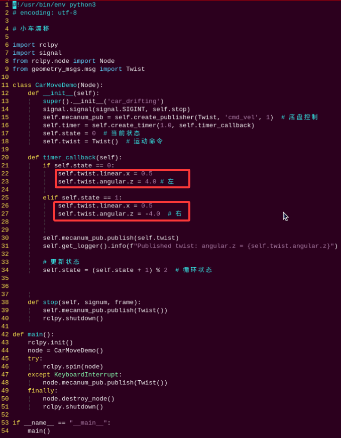

The program mainly controls the motors through `self.twist.linear.x` and `self.twist.angular.z`. In `self.twist.linear.x = 0.5` and `self.twist.angular.z = 4.0`, the X value is `0.5` and the Z value is `4.0`, so the robot drifts counterclockwise.

### 3.6.5 Feature Extension

The default drift angular velocity is **4.0**. Follow these steps to change the counterclockwise drift angular velocity to **5.0**.

1. Click the icon  in the upper-left corner of the system desktop to open a command-line terminal.

2. Enter the command below and press **Enter** to navigate to the feature program directory.

```bash
cd ~/ros2_ws/src/example/example/mecanum_control
```

3. Enter the command below and press **Enter** to open the program file.

```bash
vim car_drifting_demo.py
```

4. Locate the code shown in the red box and press **i**. When the prompt appears in the lower-left corner, edit mode is active.

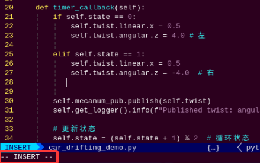

5. The parameter in `self.twist.angular.z` controls the drift angular velocity. Change the value to `5.0`. Press **Esc**, enter the command below, and press **Enter** to save and close the file.

```bash
:wq
```

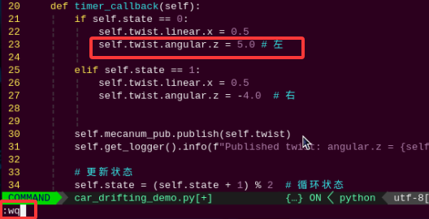

> [!NOTE]
>
> **The adjustable speed range is -10.0 to 10.0. A positive value rotates the robot counterclockwise, and a negative value rotates it clockwise. Make small adjustments based on actual conditions.**

6. Follow [**3.6.2 Starting and Stopping the Feature**](#section-3-6-2) to run the program again and check the result.
## 3.7 Robotic Arm Installation

This section describes how to install the TurboPi robotic arm and gripper assembly. The robotic arm is used in subsequent lessons involving grasping, transport, vision-based grasping, and OpenClaw smart logistics. Power off the robot before installation to prevent accidental Servo movement or wiring short circuits.

### 3.7.1 Preparation

Prepare the following parts and tools before installation.

* TurboPi robotic arm and gripper assembly
* M4×6 screws
* M4×8 screws
* Phillips screwdriver
* TurboPi with the chassis, pan-tilt, and Raspberry Pi controller installed

> [!NOTE]
>
> **Do not force the Servo output shaft or gripper structure during installation. If the screw holes do not align, check the robotic arm orientation and mounting position before securing the assembly.**

### 3.7.2 Installing the Robotic Arm and Gripper Assembly

1. Place the robotic arm and gripper assembly at the mounting position on the front of the chassis. Align the mounting holes.

2. Use **two M4×6 screws** to secure the robotic arm base to the front mounting bracket.

3. Insert both screws loosely first. Confirm that the robotic arm is oriented correctly, and then tighten both screws evenly.

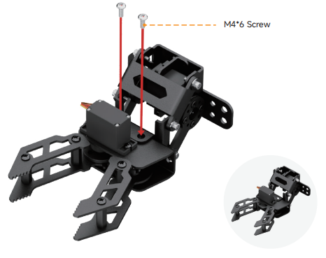

### 3.7.3 Securing the Robotic Arm to the Chassis

1. Align the installed robotic arm assembly with the front structure of the chassis.

2. Use **four M4×6 screws** to secure the robotic arm assembly firmly.

3. Gently move the robotic arm base after installation and confirm that it is not loose.

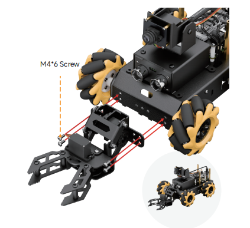

### 3.7.4 Connecting and Checking the Robotic Arm Wiring

1. Connect the robotic arm Servo cables according to the wiring sequence diagram in the product manual.

2. Connect the robotic arm lift Servo to the corresponding **ID5** port. Connect the gripper Servo to the corresponding **ID6** port.

3. Check that no cable is pinched by the chassis. Prevent cables from being pulled while the robot or robotic arm moves.

4. Confirm that all cables are connected securely before powering on the robot for testing.

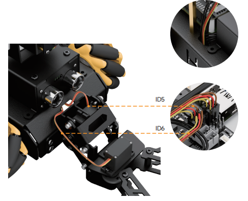

> [!WARNING]
>
> **The robotic arm and gripper do not include pinch protection. Keep fingers, cables, and other objects away from the gripper and Servo movement range before powering on the robot.**

### 3.7.5 Installation Check

Check the following items after installation.

| Item | Requirement |
| :--- | :--- |
| Robotic arm base | Screws are tight with no noticeable movement |
| Gripper orientation | Gripper faces the front of the robot and opens and closes in the correct direction |
| Wiring sequence | Lift Servo and gripper Servo are connected to the corresponding ports |
| Cable condition | Cables are not pinched or wrapped around the wheels or moving robotic arm components |
| Power-on test | Servos reset normally without abnormal vibration or noise |

If the robotic arm moves in the wrong direction or the gripper does not open and close correctly, power off the robot first. Check the Servo wiring sequence and port connections again.

## 3.8 Robotic Arm Control

### 3.8.1 Feature Overview

This section uses ROS2 commands to control the TurboPi robotic arm. The examples cover individual Servo control, robotic arm joint-space trajectory control, and gripper control.

Robotic arm control consists mainly of a controller node and control commands. After the controller node starts, it receives control messages from a topic or action and drives the corresponding Servos. The control commands specify parameters such as Servo ID, joint name, target position, and motion duration.

This section demonstrates the following controls in sequence.

1. **Individual Servo Control**: Send a pulse-width control command to a Servo with a specified ID through the `/servo_controller` topic.

2. **Robotic Arm Joint-Space Trajectory Control**: Control joints 1 through 5 to move to specified angular positions through the `/arm_controller/follow_joint_trajectory` action.

3. **Gripper Control**: Open or close the gripper through the `/gripper_controller/follow_joint_trajectory` action.

4. **PWM Servo Debugging**: Use graphical software to assist with Servo parameter debugging.

> [!WARNING]
>
> **The robotic arm and gripper do not include pinch protection. Keep fingers, cables, and other objects away from the gripper and Servo movement range before starting this feature. Stop the test immediately if a Servo reaches a mechanical limit, stalls, vibrates, or produces abnormal noise.**

### 3.8.2 Starting and Stopping the Feature

> [!NOTE]
>
> **Commands are case-sensitive and space-sensitive. Press "Tab" to complete keywords.**

1. Power on the device and connect through the VNC remote access tool.

2. Confirm that the robotic arm is installed and that its base is firmly secured. Remove fingers, cables, and other obstacles from the area around the gripper.

3. Click the terminal icon in the upper-left corner of the system desktop to open a command-line terminal.

4. If another ROS program has been run, enter the following command first to stop automatically started or residual nodes.

```bash
~/.stop_ros.sh
```

5. Enter the following command and press **Enter** to start the controller node.

```bash
ros2 launch controller controller.launch.py
```

Keep this terminal open and running.

6. Open a new command-line terminal. Enter the individual Servo control command and press **Enter**. The following example moves the **ID6 gripper Servo** to a specified position.

```bash
ros2 topic pub /servo_controller servo_controller_msgs/msg/ServosPosition "{duration: 1.0, position_unit: pulse, position: [{id: 6, position: 2500}]}" --once
```

7. To move robotic arm joints 1 through 5 to specified angular positions, enter the following joint-space trajectory control command.

```bash
ros2 action send_goal /arm_controller/follow_joint_trajectory control_msgs/action/FollowJointTrajectory "{trajectory: {joint_names: [joint1, joint2, joint3, joint4, joint5], points: [{positions: [0.0, 0.0, 0.0, 0.0, 1.0], time_from_start: {sec: 1, nanosec: 0}}]}}"
```

8. To open or close the gripper, enter the following gripper control command.

```bash
ros2 action send_goal /gripper_controller/follow_joint_trajectory control_msgs/action/FollowJointTrajectory "{trajectory: {joint_names: [joint6], points: [{positions: [0.5], time_from_start: {sec: 1, nanosec: 0}}]}}"
```

9. To debug a PWM Servo through a graphical interface, enter the following command to run the Servo control software.

```bash
python3 software/pwm_servo_control/servo_ui.py
```

10. Press **Ctrl+C** in the terminal running the program to stop the feature. If the ROS nodes do not exit normally, open a new terminal and run the following command.

```bash
~/.stop_ros.sh
```

### 3.8.3 Project Outcome

After the feature starts, TurboPi performs the motion specified by each control command.

1. After an individual Servo control command is sent, the Servo with the specified ID moves to the corresponding pulse-width position.

2. After a robotic arm joint-space trajectory command is sent, robotic arm joints 1 through 5 follow the set trajectory to the target pose.

3. After a gripper control command is sent, the gripper opens or closes according to the `positions` parameter.

4. After the PWM Servo control software opens, Servo parameters can be debugged through the graphical interface.

> [!NOTE]
>
> **The gripper opening direction and Servo movement direction may vary slightly with the mechanical installation orientation. Start testing with small parameter changes.**

### 3.8.4 Program Analysis

This section sends control messages through ROS2 topics and actions to control robotic arm and gripper motion.

#### 3.8.4.1 Individual Servo Control

Send a pulse-width control command through the `/servo_controller` topic to control an individual Servo.

```bash
ros2 topic pub /servo_controller servo_controller_msgs/msg/ServosPosition "{duration: 1.0, position_unit: pulse, position: [{id: 6, position: 2500}]}" --once
```

The parameters are described below.

| Parameter | Description |
| :--- | :--- |
| `duration` | Time required for the Servo to move from its current position to the target position, in seconds |
| `position_unit` | Position unit. `pulse` specifies a pulse-width value |
| `id` | Servo ID. The gripper Servo is ID6 |
| `position` | Target position. The direction corresponding to a larger or smaller value depends on the installation orientation |

`--once` publishes the control message only once. Change the `id` and `position` parameters and send the command again for additional tests.

#### 3.8.4.2 Robotic Arm Joint-Space Trajectory Control

Control robotic arm joints 1 through 5 through the `/arm_controller/follow_joint_trajectory` action. The following example sends `joint1` through `joint5` to specified angular positions.

```bash
ros2 action send_goal /arm_controller/follow_joint_trajectory control_msgs/action/FollowJointTrajectory "{trajectory: {joint_names: [joint1, joint2, joint3, joint4, joint5], points: [{positions: [0.0, 0.0, 0.0, 0.0, 1.0], time_from_start: {sec: 1, nanosec: 0}}]}}"
```

The parameters are described below.

| Parameter | Description |
| :--- | :--- |
| `joint_names` | Names of the joints to control, from `joint1` through `joint5` |
| `positions` | Target position for each joint. The order must match `joint_names` |
| `time_from_start` | Time from the start of execution until the target point is reached |

After the command runs, the robotic arm follows the specified trajectory to the target pose.

#### 3.8.4.3 Gripper Control

The gripper uses `gripper_controller`, and its control joint is `joint6`. Enter the following command to open or close the gripper.

```bash
ros2 action send_goal /gripper_controller/follow_joint_trajectory control_msgs/action/FollowJointTrajectory "{trajectory: {joint_names: [joint6], points: [{positions: [0.5], time_from_start: {sec: 1, nanosec: 0}}]}}"
```

The `positions` value controls the gripper opening position. The opening direction may vary slightly with the mechanical installation orientation. Start debugging with a small adjustment.

#### 3.8.4.4 PWM Servo Control Software

Run the Servo control software to debug a PWM Servo through a graphical interface.

```bash
python3 software/pwm_servo_control/servo_ui.py
```

This software is used to debug Servo parameters. Confirm the Servo type, ID, and movement range before making adjustments to prevent a Servo stall.

### 3.8.5 Feature Extension

Modify the parameters in the control commands to create different motions. Change only one parameter at a time and observe the robotic arm movement.

1. **Change the Target Position of an Individual Servo**

Change the `position` parameter in the individual Servo control command to change the target position. For example:

```bash
ros2 topic pub /servo_controller servo_controller_msgs/msg/ServosPosition "{duration: 1.0, position_unit: pulse, position: [{id: 6, position: 2000}]}" --once
```

2. **Change the Target Angles of Robotic Arm Joints**

Each value in the `positions` array corresponds to a joint in the same order as `joint_names`. Make small changes to the corresponding values to change the robotic arm pose.

3. **Change the Gripper Opening Position**

Change the `positions` parameter in the gripper control command to adjust the gripper opening. Keep fingers, cables, and other objects away from the gripper during testing.

> [!WARNING]
>
> **Adjust Servo parameters in small increments. If the robotic arm moves in the wrong direction, reaches a mechanical limit, stalls, vibrates, or produces abnormal noise, press "Ctrl+C" immediately to stop the program. Power off the robot and check the robotic arm installation and wiring sequence.**
## 3.9 URDF Model

### 3.9.1 URDF Model Introduction and Getting Started

#### 3.9.1.1 URDF Model Introduction

URDF is an XML-based format used to describe robot structures. It is designed to provide a robot description specification with broad applicability.

A robot is generally modeled as a structure consisting of multiple links and joints. A link is a rigid object with mass. A joint connects two links and constrains their relative motion.

When multiple links are connected and constrained by joints, they form a robot kinematic model. A URDF document describes the relationships between the links and joints, along with their inertial properties, geometry, and collision models.

#### 3.9.1.2 Comparison Between Xacro and URDF Models

URDF is a simple robot model description format with a clear and easy-to-understand structure. However, a URDF description of a complex robot can become lengthy and difficult to express concisely.

Xacro is an extension of URDF, and both formats serve the same fundamental purpose. Xacro provides higher-level features that simplify robot description files, improve code reuse, and reduce excessive repetition in URDF models.

For example, a URDF model of a humanoid robot requires each leg to be described separately. An Xacro model can describe one leg and reuse that description for the other leg.

<p id="urdf-basic-syntax"></p>

#### 3.9.1.3 Basic URDF Model Syntax

* **Basic XML Syntax**

URDF models follow the XML specification, so first understand the basic structure of XML.

Elements: 

Define an element with the required name using the following syntax.

**&lt;element&gt;**

**&lt;/element&gt;**

Attributes: 

Attributes are contained within an element and define its properties and parameters. Define an element with attributes using the following syntax.

**&lt;element attribute_1="attribute value 1" attribute_2="attribute value 2"&gt;**

**&lt;/element&gt;**

Comments:

Comments do not affect other attributes or elements. Define a comment using the following syntax.

**&lt;!-- comment content --&gt;**

* **Link**

URDF uses the **link** tag to describe the appearance and physical properties of a rigid robot component. The tags shown below are used when defining a link.

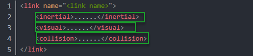

**&lt;visual&gt;** describes the appearance of the link, including its size, color, and shape.

**&lt;inertial&gt;** describes the inertial parameters of the link, which are mainly used in robot dynamics calculations.

**&lt;collision&gt;** describes the collision properties of the link.

Each tag contains corresponding child tags and serves a different purpose. Refer to the table below.

| **Tag** | **Function** |
| --- | --- |
| origin | Describes the link pose. The xyz parameter describes the position of the link in the simulation map. The rpy parameter describes its orientation. |
| mass | Describes the mass of the link. |
| inertia | Describes link inertia. Because the inertia matrix is symmetric, enter the six attributes ixx, ixy, ixz, iyy, iyz, and izz. Calculate these values for the model. |
| geometry | Describes the link shape. The mesh parameter loads a mesh file, and the filename parameter specifies its path. The child tags box, cylinder, and sphere represent a box, cylinder, and sphere. |
| material | Describes the link material. The name parameter is required. Use the color child tag to adjust color and transparency. |

* **Joint**

URDF uses the **joint** tag to describe the kinematic and dynamic properties of a robot joint, along with its position and velocity limits. URDF joints are divided into the following six types according to their motion.

| **Type and Description** | **Tag** |
| --- | --- |
| Rotational joint that can rotate indefinitely around a single axis | continuous |
| Rotational joint similar to continuous but with angular limits | revolute |
| Sliding joint that moves along one axis and has position limits | prismatic |
| Planar joint that allows translation or rotation in orthogonal directions within a plane | planar |
| Floating joint that allows translation and rotation | floating |
| Fixed joint that does not allow motion | fixed |

The tags shown below are used when defining a joint.


**&lt;parent_link&gt;** specifies the parent link.

**&lt;child_link&gt;** specifies the child link.

**&lt;calibration&gt;** calibrates the joint angle.

**&lt;dynamics&gt;** describes physical properties of the motion.

**&lt;limit&gt;** describes the motion limits.

Each tag contains corresponding child tags and serves a different purpose. Refer to the table below.

| **Tag** | **Function** |
| --- | --- |
| origin | Describes the pose of the parent link. The xyz parameter describes the position of the link in the simulation map. The rpy parameter describes its orientation. |
| axis | Sets the X, Y, or Z axis of the parent link around which the child link rotates. |
| limit | Limits child-link motion. The lower and upper attributes define the rotational range in radians. The effort attribute limits force during motion, with positive and negative values measured in newtons or N. The velocity attribute limits rotational speed in meters per second or m/s. |
| mimic | Describes the relationship between this joint and another joint. |
| safety_controller | Describes safety controller parameters that protect robot joint motion. |

* **robot Tag**

The **&lt;robot&gt;** tag is the top-level tag of a complete robot. All **&lt;link&gt;** and **&lt;joint&gt;** tags must be contained within **&lt;robot&gt;**, as shown below.

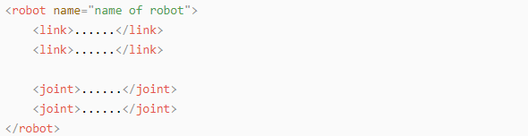

* **gazebo Tag**

Use this tag with the Gazebo simulator to set simulation parameters, load Gazebo plugins, and configure Gazebo physical properties.

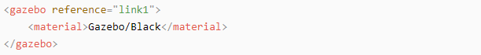

* **Writing a Simple URDF Model**

1. Set the Robot Model Name

At the beginning of the URDF model, set the robot model name with **&lt;robot name="robot model name"&gt;**. Enter **&lt;/robot&gt;** at the end to complete the robot model.


2. Set the Links

**Step 1:** Define the first link. Use indentation to indicate that the link belongs to the current model. Set the link name with **&lt;link name="link name"&gt;**. Enter **&lt;/link&gt;** at the end to complete the link definition.


**Step 2:** Define the link description. Use indentation to indicate that the description belongs to the current link. Start with **&lt;visual&gt;** and end with **&lt;/visual&gt;**.


**Step 3:** Use **&lt;geometry&gt;** to describe the link shape and enter **&lt;/geometry&gt;** after the description. Use indentation for the detailed shape description. The example **&lt;cylinder length="0.01" radius="0.2"/&gt;** defines a cylinder with a length of 0.01 meters and a radius of 0.2 meters.


**Step 4:** Use **&lt;origin&gt;** to describe the link position. Use indentation for the detailed position. In **&lt;origin rpy="0 0 0" xyz="0 0 0" /&gt;**, rpy specifies the link angles and xyz specifies its coordinates. This example places the link at the coordinate-system origin.


**Step 5:** Use **&lt;material&gt;** to describe the visual appearance of the link. Use indentation for the detailed color description. Start with **&lt;material&gt;** and end with **&lt;/material&gt;**. The example **&lt;color rgba="1 1 0 1" /&gt;** sets the link to yellow. The value `rgba="1 1 0 1"` specifies the color and opacity values.


3. Set the Joints

**Step 1:** Define the first joint. Use indentation to indicate that the joint belongs to the current model. Set the joint name and type with **&lt;joint name="joint name" type="joint type"&gt;**. Enter **&lt;/joint&gt;** at the end to complete the joint definition.


**Step 2:** Define how the joint connects the links. Use indentation to indicate that the description belongs to the current joint. Set the parent and child parameters with **&lt;parent link="parent link"/&gt;** and **&lt;child link="child link" /&gt;**. During joint rotation, the parent link acts as the pivot and the child link rotates relative to it.


**Step 3:** Use **&lt;origin&gt;** to describe the joint position. Use indentation for the detailed joint coordinates. In **&lt;origin xyz="0 0 0.1" /&gt;**, xyz specifies the joint coordinates. This example places the joint at x=0, y=0, and z=0.1.


**Step 4:** Use **&lt;axis&gt;** to describe the joint orientation. Use indentation for the detailed orientation. In **&lt;axis xyz="0 0 1" /&gt;**, xyz specifies the joint orientation.


**Step 5:** Use **&lt;limit&gt;** to constrain joint motion. Use indentation for the detailed angular limits. The example below limits the maximum joint force to 300 N, the upper rotation limit to 3.14 radians, and the lower rotation limit to -3.14 radians. Set the attributes as follows. effort specifies **joint force in newtons**. velocity specifies **joint speed**. lower specifies the **lower angular limit in radians**. upper specifies the **upper angular limit in radians**.


**Step 6:** Use **&lt;dynamics&gt;** to describe the joint dynamics. Use indentation for the detailed motion parameters. In **&lt;dynamics damping="50" friction="1" /&gt;**, damping specifies the **damping value** and friction specifies the **friction coefficient**.

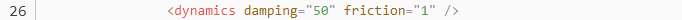

**The complete code is shown below.**


### 3.9.2 Robot URDF Model

#### 3.9.2.1 Preparation

Refer to [**3.9.1.3 Basic URDF Model Syntax**](#urdf-basic-syntax) to understand the syntax used in the URDF model.

#### 3.9.2.2 Viewing the Robot Model Code

1. Click the icon  on the system desktop to open a command-line terminal.

2. Enter the command below and press **Enter** to navigate to the directory containing the simulation model files.

```bash
cd ros2_ws/src/simulations/turbopi_description/urdf
```

3. Enter the command below to open the robot simulation model file and view the model code.

```bash
vim turbopi.xacro
```

#### 3.9.2.3 URDF Model Visualization

1. Click the icon  on the system desktop to open a command-line terminal.

2. Enter the command below and press **Enter** to start the RViz simulation.

```bash
ros2 launch turbopi_description display.launch.py
```

   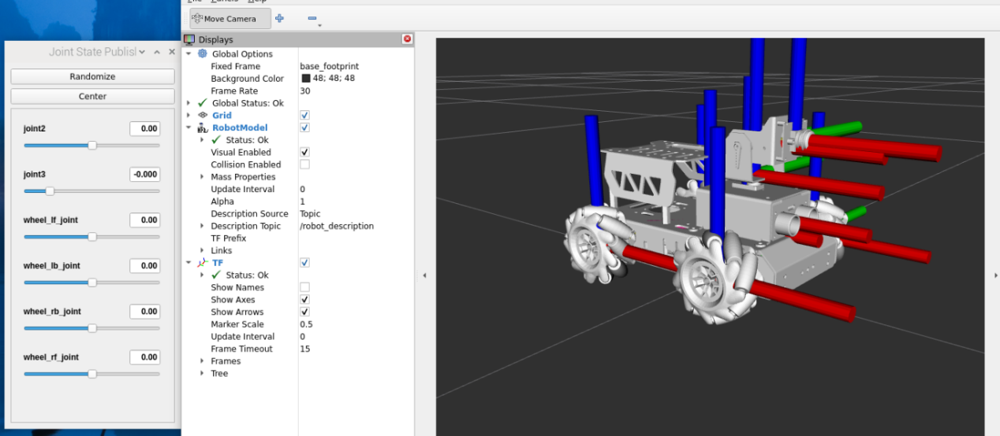

3. Drag the sliders on the left to rotate the corresponding components.

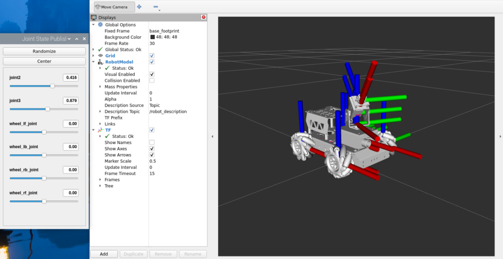

