# 4. ROS+OpenCV Course

## 4.1 Single Color Recognition

### 4.1.1 Feature Overview

This section uses the camera to recognize colors. When a red object is detected, the object is circled in the image and **Color: red** is printed.

Color recognition consists of color detection and feedback after detection.

During color detection, Gaussian blur first reduces image noise. The image is then converted to the LAB color space.

Next, color thresholds identify the color of the object inside the circle. A mask is applied to globally or locally block parts of the image with a selected image, shape, or object.

After opening and closing operations are applied to the object image, the object with the largest contour is circled.

**Opening operation:** Apply erosion followed by dilation. This removes small objects, smooths shape boundaries without changing their area, removes small particle noise, and separates connected objects.

**Closing operation:** Apply dilation followed by erosion. This fills small holes inside objects, connects nearby objects and broken contour lines, and smooths boundaries without changing their area.

After recognition, the Buzzer is configured to provide feedback based on the result. Refer to [**4.1.3 Project Outcome**](#section-4-1-3) for details.

<p id="section-4-1-2"></p>

### 4.1.2 Starting and Stopping the Feature

> [!NOTE]
>
> **Commands are case-sensitive and space-sensitive. Press "Tab" to complete keywords.**

1. Power on the device and connect through the VNC remote access tool.

   

2. Click the icon  in the upper-left corner of the system desktop to open a command-line terminal.


3. Enter the command below and press **Enter** to navigate to the feature program directory.

```bash
cd /home/ubuntu/ros2_ws/src/example/example
```

4. Enter the command below and press **Enter** to start the feature.

```bash
python3 color_warning.py
```

5. Press **Ctrl+C** in the terminal to stop the feature. Press it repeatedly if the feature does not stop immediately.

<p id="section-4-1-3"></p>

### 4.1.3 Project Outcome

After the feature starts, the camera recognizes colors. When a red object is detected, the object is circled in the returned image and **Color: red** is printed.

> [!NOTE]
>
> * **Perform recognition in a well-lit environment to prevent inaccurate results caused by insufficient lighting.**
>
> * **Keep objects with colors similar or identical to the target color out of the camera's field of view to prevent false recognition.**
>
> * **If color recognition is inaccurate, refer to [4.1.5.1 Adjusting Color Thresholds](#section-4-1-5-1) to configure the color thresholds.**

### 4.1.4 Program Analysis

#### 4.1.4.1 Importing Libraries

1. Python uses `import` to load libraries such as `cv2` for image processing, `numpy` for numerical calculations, and `rclpy` for the ROS2 robotics development framework. These libraries provide the tools required for image operations, mathematical calculations, and robot control.

```python
import cv2
import math
import time
import threading
import numpy as np
import rclpy
from rclpy.node import Node
from sensor_msgs.msg import Image
from ros_robot_controller_msgs.msg import BuzzerState, RGBStates
from cv_bridge import CvBridge
import sdk.yaml_handle as yaml_handle
import sdk.Misc as Misc
```

2. Import the OpenCV, time, mathematics, and threading libraries. Call a function from a library with `library_name.function_name(parameter, parameter...)`, as shown below.

```python
            time.sleep(0.01)
```

   This example calls the `sleep()` function from the `time` library. The function adds a delay.

   Python includes built-in libraries such as `time`, `cv2`, and `math`, which can be imported directly. Custom libraries can also be created. For example, `yaml_handle` is a custom file-reading library.

3. Create library aliases.

   Some library names are long and difficult to remember. Assign an alias to simplify function calls, as shown below.

```python
import sdk.yaml_handle as yaml_handle
```

After the alias is assigned, call functions from the `ros_robot_controller_sdk` library with `yaml_handle.function_name(parameter, parameter...)`.

```python
        lab_data = yaml_handle.get_yaml_data(yaml_handle.lab_file_path)
```

#### 4.1.4.2 Main Function Analysis

In a Python program, `__name__ == '__main__':` identifies the main function entry point.

* **Converting a ROS Image Message**

```python
        # Convert ROS image message to OpenCV image
        img = self.bridge.imgmsg_to_cv2(msg, "bgr8")
```

When the feature starts, obtain the image and store it in `img`.

* **Processing the Image**

  After an image is received, call `run()` to process it.

```python
        # Process image and detect color
        frame = self.run(img)
```

* **Gaussian Blur**

  Images often contain noise that reduces image quality and makes features less distinct. Select a suitable filtering method based on the noise type. Common methods include Gaussian blur, median blur, and mean blur.

  Gaussian blur is a linear smoothing filter suitable for reducing Gaussian noise. It is widely used for image denoising.

```python
        frame_gb = cv2.GaussianBlur(frame_resize, (3, 3), 3)
```

The first parameter, `frame_resize`, is the input image.

The second parameter, `(3, 3)`, is the Gaussian kernel size.

The third parameter, `3`, is the standard deviation of the Gaussian kernel along the X-axis.

* **Converting the Image to the LAB Color Space**

  The `cv2.cvtColor()` function converts between color spaces.

```python
        frame_lab = cv2.cvtColor(frame_gb, cv2.COLOR_BGR2LAB)
```

The first parameter, `frame_gb`, is the input image.

The second parameter, `cv2.COLOR_BGR2LAB`, is the conversion mode. It converts BGR to LAB. Use `cv2.COLOR_BGR2RGB` to convert BGR to RGB.

* **Converting the Image to a Binary Image**

  A binary image contains only 0 and 1. This simplifies the image and reduces the amount of data for easier processing. Use `inRange()` from the `cv2` library to convert the image to binary form.

  ```python
          for color_name, color_data in lab_data.items():
              if color_name not in ['black', 'white']:
                  frame_mask = cv2.inRange(frame_lab,
                                          (color_data['min'][0], color_data['min'][1], color_data['min'][2]),
                                          (color_data['max'][0], color_data['max'][1], color_data['max'][2]))
  ```

  The first parameter, `frame_lab`, is the input image.
  
  The second parameter, `(lab_data[i]['min'][0],lab_data[i]['min'][1],lab_data[i]['min'][2])`, is the lower color threshold.
  
  The third parameter, `(lab_data[i]['max'][0],lab_data[i]['max'][1],lab_data[i]['max'][2])`, is the upper color threshold.
  
  Apply erosion and dilation to reduce interference and smooth the image. Erosion and dilation are basic morphological operations commonly used for binary image processing. They remove small amounts of noise, separate and identify objects, and adjust object sizes.

```python
                eroded = cv2.erode(frame_mask, cv2.getStructuringElement(cv2.MORPH_RECT, (3, 3)))
                dilated = cv2.dilate(eroded, cv2.getStructuringElement(cv2.MORPH_RECT, (3, 3))) 
```

The first parameter is the input image.

The second parameter is the structuring element, also called the kernel. It defines the operation. The kernel size and shape determine the amount of erosion and dilation.

* **Obtaining the Largest Contour**

  After completing the image processing above, obtain the contour of the target object. This process uses `cv2.contourArea()` from the `cv2` library.

```python
    def get_area_max_contour(self, contours):
        """Get the largest contour"""
        max_area = 0
        max_contour = None
        for c in contours:
            area = math.fabs(cv2.contourArea(c))
            if area > max_area and area > 50:
                max_area = area
                max_contour = c
        return max_contour, max_area
```

The first parameter, `max_area`, records the largest contour area found. Its initial value is `0`.

The second parameter, `max_contour`, stores the contour with the largest area. Its initial value is `None`.

The third parameter, `cv2.contourArea`, calculates the area of each contour.

Check whether the current contour area `area` is greater than the recorded `max_area` and greater than `50`. If both conditions are met, update `max_area` with the current contour area and update `max_contour` with the current contour `c`.

```python
            area = math.fabs(cv2.contourArea(c))
            if area > max_area and area > 50:
                max_area = area
                max_contour = c
```

* **Displaying the Returned Image**

```python
        # Display processed image 
        cv2.imshow('Frame', frame)
        key = cv2.waitKey(1)
        if key == 27:  # Exit with ESC
            self.destroy_node()
            cv2.destroyAllWindows()
```

`cv2.resize()` scales the processed image to a suitable size.

`cv2.imshow()` displays the image in a window. `'frame'` is the window name, and `frame_resize` is the displayed content. Include `cv2.waitKey()` after this function so the image can be displayed.

`cv2.waitKey()` waits for keyboard input. The parameter `1` specifies the delay.

#### 4.1.4.3 Subthread Analysis

* **Turning On the RGB LED**

Set the RGB LED to the detected color.

```python
    def get_color(self, color_name):
        """Return RGB value of the color """
        color_map = {
            'red': (0, 0, 255),
            'green': (0, 255, 0),
            'blue': (255, 0, 0),
            'black': (0, 0, 0),
            'purple':(255, 255, 126),
        }
        return color_map.get(color_name, (0, 0, 0))
```

* **Driving the Buzzer**

```python
        while rclpy.ok():
            if self.detect_color == 'red' and self.di_once:
                # Buzzer starts ringing 
                self.publish_buzzer_state(True)
                self.di_once = False
            elif self.detect_color != 'red' and not self.di_once:
                # Buzzer stops 
                self.publish_buzzer_state(False)
                self.di_once = True
            time.sleep(0.01)
```

Call `self.publish_buzzer_state(True)` to turn on the Buzzer. `True` turns it on, and `False` turns it off. Set `di_once` to `True` to indicate that the current red detection has been processed and prevent the Buzzer from responding continuously.

`time.sleep(0.1)` adds a delay. The parameter `0.1` specifies how long the Buzzer sounds.

### 4.1.5 Feature Extension

<p id="section-4-1-5-1"></p>

#### 4.1.5.1 Adjusting Color Thresholds

If color recognition performs poorly, adjust the color thresholds. This section uses **red** as an example. Apply the same method to other colors.

> [!NOTE]
>
> * **Auto-start is enabled by default upon system boot. Click the icon**  **to open the tool.**
>
> * **If auto-start is disabled on the system, open a command-line terminal, enter the following command, and press "Enter" to open the color threshold adjustment tool.**
>
>   ```bash
>   ros2 launch peripherals usb_cam.launch.py
>   ```

1. Double-click the icon  on the system desktop. Click **Execute** in the dialog box.

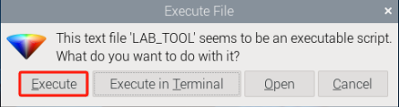

2. After the interface opens, click **Connect**.


3. After the connection succeeds, select **red** from the color options in the lower-right corner.


4. If no returned image appears, check the camera cable because the camera is not connected successfully.

The right side of the interface displays the live camera image, and the left side displays the sampled color. Point the camera at a red colored block. Drag the six sliders until the red colored block area in the left image becomes completely white and all other areas become black. Click **Save** to save the data.


<p id="section-4-1-5-2"></p>

#### 4.1.5.2 Changing the Default Recognition Color

The color recognition program includes red, green, and blue. By default, detecting red causes the Buzzer to sound, circles the object in the returned image, and prints **Color: red**.

**The following example changes the recognition color to green.**

1. Enter the command below and press **Enter** to navigate to the source code directory.

```bash
cd /home/ubuntu/ros2_ws/src/example/example
```

2. Enter the command below and press **Enter** to open the program file.

```bash
vim color_warning.py
```

3. Locate the code shown below.

   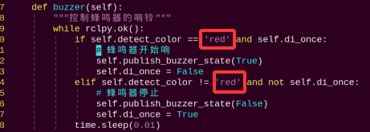

4. Press **i** to enter edit mode.

   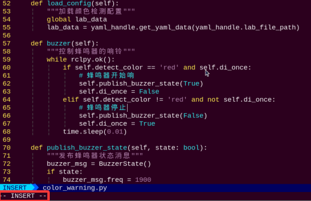

5. Change the code in the red box to `green`.

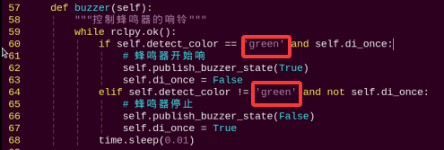

6. Press **Esc**, enter `:wq`, and press **Enter** to save the changes and close the file. The colon must appear before `wq`.

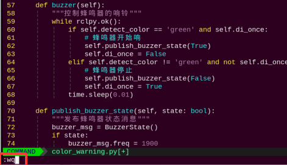

7. Return to the terminal opened in the source code directory. Enter the command below and press **Enter** to start color recognition.

```bash
python3 color_warning.py
```

#### 4.1.5.3 Adding a New Recognition Color

Additional recognition colors can be added to the three built-in colors. The following example adds **purple**.

1. Double-click the system desktop icon . Click **Execute** in the dialog box.


2. Click **Connect** in the interface.

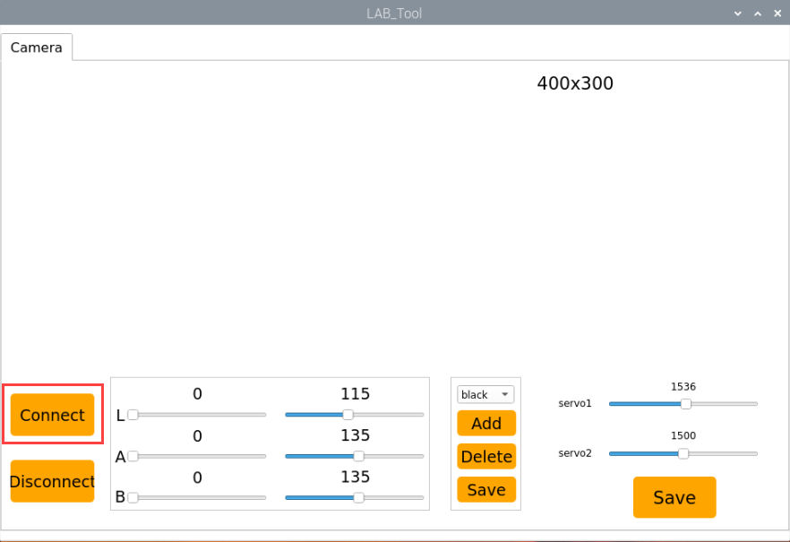

3. Click **Add**, enter **purple** as the new color name, and click **OK**.


4. Open the color drop-down list and select **purple**.


5. Point the camera at a purple object. Drag the L, A, and B sliders until the target color area in the left image becomes white and all other areas become black.

```bash
cd /home/ubuntu/ros_ws/src/example/example
```

6. Click **Save** to save the adjusted color thresholds.


After completing the adjustment, enter the command below and press **Enter** to navigate to the program directory and confirm that the values were saved.

```python
cd /home/ubuntu/software/lab_tool
```

7. Enter the command below and press **Enter** to open the program file.

```bash
vim lab_config.yaml
```

8. After opening the color threshold configuration file, check the purple threshold parameters.


9. Follow steps 1 through 4 in [**4.1.5.2 Changing the Default Recognition Color**](#section-4-1-5-2). Open the program file, press **i** to enter edit mode, and locate the code shown below.

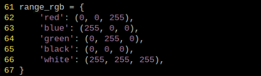

10. Add `'purple':(255, 255, 114),` manually, as shown below. `(255, 255, 114)` is the purple `max` threshold checked in step 8.

`'purple':(255, 255, 114),`

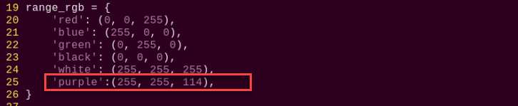

11. Press **Esc**, enter `:wq`, and press **Enter** to save the changes and close the file. The colon must appear before `wq`.

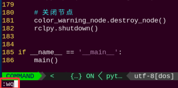

12. Follow [**4.1.2 Starting and Stopping the Feature**](#section-4-1-2) to start the feature again. Place a purple object in front of the camera. A purple box appears in the returned image, and **purple** is printed. To set purple as the default recognition color, change the color to purple as described above.

13. Follow the preceding steps to add other recognition colors.

<p id="section-4-2"></p>

## 4.2 Color Recognition

### 4.2.1 Feature Overview

This section uses the camera to recognize colors. When red is detected, the pan-tilt **nods**. When blue or green is detected, the pan-tilt **shakes its head**.

Color recognition consists of color detection and feedback after detection.

During color detection, Gaussian blur first reduces image noise. The image is then converted to the LAB color space.

Next, color thresholds identify the color of the object inside the circle. A mask is applied to globally or locally block parts of the image with a selected image, shape, or object.

After opening and closing operations are applied to the object image, the object with the largest contour is circled.

**Opening operation:** Apply erosion followed by dilation. This removes small objects, smooths shape boundaries without changing their area, removes small particle noise, and separates connected objects.

**Closing operation:** Apply dilation followed by erosion. This fills small holes inside objects, connects nearby objects and broken contour lines, and smooths boundaries without changing their area.

After recognition, configure the Servos, Buzzer, and RGB LEDs to provide feedback for different colors. For example, after red is recognized, the robot nods, the Buzzer sounds once, and the RGB LEDs turn red.

Refer to [**4.2.3 Project Outcome**](#section-4-2-3) for detailed feedback.

<p id="section-4-2-2"></p>

### 4.2.2 Starting and Stopping the Feature

> [!NOTE]
>
> **Commands are case-sensitive and space-sensitive. Press "Tab" to complete keywords.**

1. Power on the device and connect through the VNC remote access tool.


2. Click the icon  in the upper-left corner of the system desktop to open a command-line terminal.

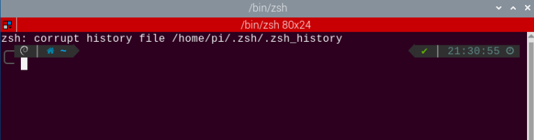

3. Enter the command below and press **Enter** to navigate to the feature program directory.

```bash
cd /home/ubuntu/ros2_ws/src/example/example
```

4. Enter the command below and press **Enter** to start the feature.

```bash
python3 color_recognize.py
```

5. Press **Ctrl+C** in the terminal to stop the feature. Press it repeatedly if the feature does not stop immediately.

<p id="section-4-2-3"></p>

### 4.2.3 Project Outcome

After the feature starts, the robot provides the following feedback based on the color recognized by the camera.

| **Object Color** | **Buzzer** | **RGB LEDs** | **Action** | **Printed Text** |
| ---------------- | ---------- | ------------ | ---------- | ---------------- |
| Red | Sounds once | Red | Nods | red |
| Green | Sounds once | Green | Shakes its head | green |
| Blue | Sounds once | Blue | Shakes its head | blue |

> [!NOTE]
>
> * **Perform recognition in a well-lit environment to prevent inaccurate results caused by insufficient lighting.**
>
> * **Keep objects with colors similar or identical to the target color out of the camera's field of view to prevent false recognition.**
>
> * **If color recognition is inaccurate, refer to [4.2.5.1 Adjusting Color Thresholds](#section-4-2-5-1) to configure the color thresholds.**

### 4.2.4 Program Analysis

The source code is located at **/home/ubuntu/ros2_ws/src/example/example/color_recognize.py**.

#### 4.2.4.1 Importing Libraries

1. Python uses `import` to load libraries such as `cv2` for image processing, `numpy` for numerical calculations, and `rclpy` for the ROS2 robotics development framework. These libraries provide the tools required for image operations, mathematical calculations, and robot control.

```python
import cv2
import math
import time
import threading
import numpy as np
import rclpy
from rclpy.node import Node
from sensor_msgs.msg import Image
from ros_robot_controller_msgs.msg import BuzzerState, RGBStates, SetPWMServoState, PWMServoState, RGBState  # import RGBState
from cv_bridge import CvBridge
import sdk.yaml_handle as yaml_handle
import sdk.Misc as Misc
```

2. Import the OpenCV, time, mathematics, and threading libraries. Call a function from a library with `library_name.function_name(parameter, parameter...)`, as shown below.

```python
            time.sleep(0.01)
```

This example calls the `sleep()` function from the `time` library. The function adds a delay.

Python includes built-in libraries such as `time`, `cv2`, and `math`, which can be imported directly. Custom libraries can also be created. For example, `yaml_handle` is a custom file-reading library.

3. Create library aliases.

Some library names are long and difficult to remember. Assign an alias to simplify function calls, as shown below.

```python
import sdk.yaml_handle as yaml_handle
```

After the alias is assigned, call functions from the `ros_robot_controller_sdk` library with `yaml_handle.function_name(parameter, parameter...)`.

#### 4.2.4.2 Main Function Analysis

In a Python program, `__name__ == '__main__':` identifies the main function entry point. First call `init()` to initialize the configuration. This program returns the Servos to their initial positions and reads the color threshold file. Initialization commonly also includes port, peripheral, and timer interrupt configuration.

```python
def main():
    rclpy.init()
    color_warning_node = ColorWarningNode()
    try:
        rclpy.spin(color_warning_node)
    finally:
        # Perform cleanup before exiting 
        color_warning_node.running = False  # Set flag to stop the thread 
        color_warning_node.destroy_node()  # Ensure the node is destroyed 
        rclpy.shutdown()
        cv2.destroyAllWindows() # Ensure OpenCV windows are closed 


if __name__ == '__main__':
    main()
```

1. Read the Camera Image

```python
    def image_callback(self, msg):
        """Process image from camera """
        # Convert ROS image message to OpenCV image 
        img = self.bridge.imgmsg_to_cv2(msg, "bgr8")
        with self.lock:
            self.current_image = img
```

When the feature starts, store the image in `img`.

2. Process the Image

After an image is received, call `run()` to process it.

```python
            with self.lock:
                if self.current_image is not None:
                    img = self.current_image.copy()  
                    self.current_image = None  
            if img is not None:
                frame = self.run(img)
                cv2.imshow('Frame', frame)
                key = cv2.waitKey(1)
```

`img.copy()` copies the contents of `img` to `frame`.

`run()` processes the image.

```python
    def run(self, img):
        """Color detection processing """
        img_copy = img.copy()
        img_h, img_w = img.shape[:2]

        frame_resize = cv2.resize(img_copy, (320, 240), interpolation=cv2.INTER_NEAREST)
        frame_gb = cv2.GaussianBlur(frame_resize, (3, 3), 3)
        frame_lab = cv2.cvtColor(frame_gb, cv2.COLOR_BGR2LAB)

        max_area = 0
        color_area_max = None
        areaMaxContour_max = 0

        # Traverse color ranges from config file for detection 
        for color_name, color_data in lab_data.items():
            if color_name not in ['black', 'white']:
                frame_mask = cv2.inRange(frame_lab,
                                        (color_data['min'][0], color_data['min'][1], color_data['min'][2]),
                                        (color_data['max'][0], color_data['max'][1], color_data['max'][2]))
                eroded = cv2.erode(frame_mask, cv2.getStructuringElement(cv2.MORPH_RECT, (3, 3)))
                dilated = cv2.dilate(eroded, cv2.getStructuringElement(cv2.MORPH_RECT, (3, 3)))
                contours = cv2.findContours(dilated, cv2.RETR_EXTERNAL, cv2.CHAIN_APPROX_NONE)[-2]
                areaMaxContour, area_max = self.get_area_max_contour(contours)

                if areaMaxContour is not None:  # Ensure areaMaxContour exists 
                    if area_max > max_area:
                        max_area = area_max
                        color_area_max = color_name
                        areaMaxContour_max = areaMaxContour
```

* **Scaling the Image for Easier Processing**

```python
        frame_resize = cv2.resize(img_copy, (320, 240), interpolation=cv2.INTER_NEAREST)
```

The first parameter, `img_copy`, is the input image.

The second parameter, `(320, 240)`, is the output image size. Set this value as required.

The third parameter, `interpolation=cv2.INTER_NEAREST`, specifies the interpolation method. `INTER_NEAREST` uses nearest-neighbor interpolation. `INTER_LINEAR` uses bilinear interpolation and is the default when the final parameter is omitted. `INTER_CUBIC` uses bicubic interpolation over a 4x4 pixel neighborhood. `INTER_LANCZOS4` uses Lanczos interpolation over an 8x8 pixel neighborhood.

* **Gaussian Blur**

  Images often contain noise that reduces image quality and makes features less distinct. Select a suitable filtering method based on the noise type. Common methods include Gaussian blur, median blur, and mean blur.

  Gaussian blur is a linear smoothing filter suitable for reducing Gaussian noise. It is widely used for image denoising.

```python
        frame_gb = cv2.GaussianBlur(frame_resize, (3, 3), 3)
```

The first parameter, `frame_resize`, is the input image.

The second parameter, `(3, 3)`, is the Gaussian kernel size.

The third parameter, `3`, is the standard deviation of the Gaussian kernel along the X-axis.

* **Converting the Image to the LAB Color Space**

  The `cv2.cvtColor()` function converts between color spaces.

```python
        frame_lab = cv2.cvtColor(frame_gb, cv2.COLOR_BGR2LAB)
```

The first parameter, `frame_gb`, is the input image.

The second parameter, `cv2.COLOR_BGR2LAB`, is the conversion mode. It converts BGR to LAB. Use `cv2.COLOR_BGR2RGB` to convert BGR to RGB.

* **Converting the Image to a Binary Image**

  A binary image contains only 0 and 1. This simplifies the image and reduces the amount of data for easier processing. Use `inRange()` from the `cv2` library to convert the image to binary form.

  ```python
                  frame_mask = cv2.inRange(frame_lab,
                                          (color_data['min'][0], color_data['min'][1], color_data['min'][2]),
                                          (color_data['max'][0], color_data['max'][1], color_data['max'][2]))
  ```

  The first parameter, `frame_lab`, is the input image.

  The second parameter, `(color_data[i]['min'][0],color_data[i]['min'][1],color_data[i]['min'][2])`, is the lower color threshold.

  The third parameter, `(color_data[i]['max'][0],color_data[i]['max'][1],color_data[i]['max'][2])`, is the upper color threshold.

* **Applying Morphological Operations and Contour Detection**

  Optimize the initial color mask with OpenCV morphological operations and contour detection. This removes noise, regularizes contours, and accurately extracts and analyzes information about objects of a specific color.

```python
                eroded = cv2.erode(frame_mask, cv2.getStructuringElement(cv2.MORPH_RECT, (3, 3)))
                dilated = cv2.dilate(eroded, cv2.getStructuringElement(cv2.MORPH_RECT, (3, 3)))
                contours = cv2.findContours(dilated, cv2.RETR_EXTERNAL, cv2.CHAIN_APPROX_NONE)[-2]
                areaMaxContour, area_max = self.get_area_max_contour(contours)
```

The first parameter on the first line, `frame_mask`, is the input image.

The second parameter on the first line, `cv2.getStructuringElement(cv2.MORPH_RECT, (3, 3))`, creates the structuring element. During erosion, if the area covered by the structuring element does not consist entirely of foreground pixels with a value of 255, the center pixel is set to a background value of 0.

The first parameter on the second line, `eroded`, is the image after erosion.

The second parameter on the second line, `cv2.getStructuringElement(cv2.MORPH_RECT, (3, 3))`, creates a 3x3 rectangular structuring element. During dilation, if the area covered by the structuring element contains a foreground pixel with a value of 255, the center pixel is set to 255, expanding the foreground region.

* **Obtaining the Largest Contour**

  After completing the image processing above, obtain the target contour with `findContours()` from the `cv2` library.

```python
                contours = cv2.findContours(dilated, cv2.RETR_EXTERNAL, cv2.CHAIN_APPROX_NONE)[-2]
```

The first parameter, `dilated`, is the image used to find contours.

The second parameter, `cv2.RETR_EXTERNAL`, is the contour retrieval mode.

The third parameter, `cv2.CHAIN_APPROX_NONE)[-2]`, is the contour approximation method.

Find the contour with the largest area. Set a minimum area to reduce interference. A contour is valid only when its area is greater than this minimum.

```python
    def get_area_max_contour(self, contours):
        """Get the largest contour """
        max_area = 0
        max_contour = None
        for c in contours:
            area = math.fabs(cv2.contourArea(c))
            if area > max_area and area > 50:
                max_area = area
                max_contour = c
        return max_contour, max_area
```

* **Determining the Color With the Largest Area**

```python
                if areaMaxContour is not None:  # Ensure areaMaxContour exists 
                    if area_max > max_area:
                        max_area = area_max
                        color_area_max = color_name
                        areaMaxContour_max = areaMaxContour
```

3. Display the Returned Image

```python
        frame_resize = cv2.resize(img_copy, (320, 240), interpolation=cv2.INTER_NEAREST)
```

```python
            if img is not None:
                frame = self.run(img)
                cv2.imshow('Frame', frame)
                key = cv2.waitKey(1)
                if key == 27:  # Exit with ESC 
                    self.running = False
                    cv2.destroyAllWindows()
                    break
```

`cv2.resize()` scales the processed image to a suitable size.

`cv2.imshow()` displays the image in a window. `'frame'` is the window name, and `frame_resize` is the displayed content. Include `cv2.waitKey()` after this function so the image can be displayed.

`cv2.waitKey()` waits for keyboard input. The parameter `1` specifies the delay.

#### 4.2.4.3 Subthread Analysis

After a color is recognized, the robot subthread calls `run()` to process the color.

The subthread evaluates the image processing result and provides different feedback by controlling the RGB LEDs, Buzzer, and other modules.

```python
    def run(self, img):
        """Color detection processing """
        img_copy = img.copy()
        img_h, img_w = img.shape[:2]

        frame_resize = cv2.resize(img_copy, (320, 240), interpolation=cv2.INTER_NEAREST)
        frame_gb = cv2.GaussianBlur(frame_resize, (3, 3), 3)
        frame_lab = cv2.cvtColor(frame_gb, cv2.COLOR_BGR2LAB)

        max_area = 0
        color_area_max = None
        areaMaxContour_max = 0

        # Traverse color ranges from config file for detection 
        for color_name, color_data in lab_data.items():
            if color_name not in ['black', 'white']:
                frame_mask = cv2.inRange(frame_lab,
                                        (color_data['min'][0], color_data['min'][1], color_data['min'][2]),
                                        (color_data['max'][0], color_data['max'][1], color_data['max'][2]))
                eroded = cv2.erode(frame_mask, cv2.getStructuringElement(cv2.MORPH_RECT, (3, 3)))
                dilated = cv2.dilate(eroded, cv2.getStructuringElement(cv2.MORPH_RECT, (3, 3)))
                contours = cv2.findContours(dilated, cv2.RETR_EXTERNAL, cv2.CHAIN_APPROX_NONE)[-2]
                areaMaxContour, area_max = self.get_area_max_contour(contours)

                if areaMaxContour is not None:  # Ensure areaMaxContour exists 
                    if area_max > max_area:
                        max_area = area_max
                        color_area_max = color_name
                        areaMaxContour_max = areaMaxContour

        with self.lock:  # Lock when accessing shared resources 
            if max_area > 2000:
                ((centerX, centerY), radius) = cv2.minEnclosingCircle(areaMaxContour_max)
                centerX = int(Misc.map(centerX, 0, 320, 0, img_w))
                centerY = int(Misc.map(centerY, 0, 240, 0, img_h))
                radius = int(Misc.map(radius, 0, 320, 0, img_w))
                cv2.circle(img, (centerX, centerY), radius, self.get_color(color_area_max), 2)

                self.detect_color = color_area_max
                self.draw_color = self.get_color(color_area_max)

                if self.detect_color != self.previous_color:
                    if self.detect_color == 'red':
                        self.nod_head()
                    else:
                        self.shake_head()

                    self.previous_color = self.detect_color

            # Set RGB light based on detected color (always set) 
                self.set_rgb_color(self.detect_color)  # Always call 
```

1. Turn On the RGB LEDs

Set the RGB LEDs to the detected color.

```python
    def set_rgb_color(self, color_name):
        """Set RGB light color """
        rgb_msg = RGBStates()
        rgb_msg.states = []  # Initialize status list 

        if color_name == 'red':
            rgb_msg.states.append(RGBState(index=1, red=255, green=0, blue=0))  # Set LED 1 to red 
            rgb_msg.states.append(RGBState(index=2, red=255, green=0, blue=0))  # Set LED 2 to red 
        elif color_name == 'green':
            rgb_msg.states.append(RGBState(index=1, red=0, green=255, blue=0))  # Set LED 1 to green 
            rgb_msg.states.append(RGBState(index=2, red=0, green=255, blue=0))  # Set LED 2 to green 
        elif color_name == 'blue':
            rgb_msg.states.append(RGBState(index=1, red=0, green=0, blue=255))  # Set LED 1 to blue 
            rgb_msg.states.append(RGBState(index=2, red=0, green=0, blue=255))  # Set LED 2 to blue 
        elif color_name == 'yellow':
            rgb_msg.states.append(RGBState(index=1, red=255, green=255, blue=0))  # Set LED 1 to yellow 
            rgb_msg.states.append(RGBState(index=2, red=255, green=255, blue=0))  # Set LED 2 to yellow 
        elif color_name == 'purple':
            rgb_msg.states.append(RGBState(index=1, red=192, green=0, blue=192))  
            rgb_msg.states.append(RGBState(index=2, red=192, green=0, blue=192))
        else:  # 'None' or other undefined colors 
            rgb_msg.states.append(RGBState(index=1, red=0, green=0, blue=0))  # Turn off LED 1 
            rgb_msg.states.append(RGBState(index=2, red=0, green=0, blue=0))  # Turn off LED 2 
```

2. Drive the Buzzer

```python
    def publish_buzzer_state(self, state: bool):
        """Publish buzzer status message """
        buzzer_msg = BuzzerState()
        if state:
            buzzer_msg.freq = 1900
            buzzer_msg.on_time = 0.2
            buzzer_msg.off_time = 0.01
            buzzer_msg.repeat = 1
        else:
            buzzer_msg.freq = 0
            buzzer_msg.on_time = 0.0
            buzzer_msg.off_time = 0.0
            buzzer_msg.repeat = 0
        self.buzzer_publisher.publish(buzzer_msg)
```

`publish_buzzer_stater()` drives the Buzzer. Consider the following code.

`if state:`

`buzzer_msg.freq = 1900`

`buzzer_msg.on_time = 0.2`

`buzzer_msg.off_time = 0.01`

`buzzer_msg.repeat = 1`

The first value, `1900`, is the frequency.

The second value, `0.2`, is the duration of the Buzzer sound in seconds.

The third value, `0.01`, is the duration for which the Buzzer remains off in seconds.

The fourth value, `1`, is the number of repetitions. The default is one repetition.

3. Move the Robot

Compare the detected color with the configured color and execute the nodding or head-shaking motion.

```python
    def buzzer(self):
        """Control buzzer sound """
        while rclpy.ok() and self.running: 
            with self.lock:
                if self.detect_color == 'red' and self.di_once:
                    self.publish_buzzer_state(True)
                    self.di_once = False
                elif self.detect_color != 'red' and not self.di_once:
                    self.publish_buzzer_state(False)
                    self.di_once = True
            time.sleep(0.01)
```

```python
    def nod_head(self):
        """Nodding motion"""
        self.pwm_controller([1, 1800])
        time.sleep(0.3)
        self.pwm_controller([1, 1200])
        time.sleep(0.3)
        self.pwm_controller([1, 1500])
        time.sleep(0.3)
    def shake_head(self):
        """Shaking head motion"""
        self.pwm_controller([2, 1200])
        time.sleep(0.3)
        self.pwm_controller([2, 1800])
        time.sleep(0.3)
        self.pwm_controller([2, 1500])
        time.sleep(0.3)
```

```python
                if self.detect_color != self.previous_color:
                    if self.detect_color == 'red':
                        self.nod_head()
                    else:
                        self.shake_head()

                    self.previous_color = self.detect_color
```

`self.pwm_controller()` controls the PWM Servo. Consider `self.pwm_controller([1, 1800])`.

The first parameter, `0.3`, is the Servo movement duration in seconds.

The second parameter, `pwm_controller`, specifies the Servo positions. It is a list in which each element is a pair containing a Servo ID and position value.
### 4.2.5 Feature Extension

<p id="section-4-2-5-1"></p>

#### 4.2.5.1 Adjusting Color Thresholds

If color recognition performs poorly, adjust the color thresholds. This section uses red as an example. Apply the same method to other colors.

> [!NOTE]
>
> * **Auto-start is enabled by default upon system boot. Click the icon**  **to open the tool.**
>
> * **If auto-start is disabled on the system, open a command-line terminal, enter "ros2 launch peripherals usb_cam.launch.py", and press "Enter" to open the color threshold adjustment tool.**

1. Double-click the icon  on the system desktop. Click **Execute** in the dialog box.


2. After the interface opens, click **Connect** to connect the camera.


3. After the connection succeeds, select **red** from the color options in the lower-right corner.


4. If no returned image appears, check the camera cable because the camera is not connected successfully.

The right side of the interface displays the live camera image, and the left side displays the sampled color. Point the camera at a red ball. Drag the six sliders until the red ball area in the left image becomes completely white and all other areas become black. Click **Save** to save the data.

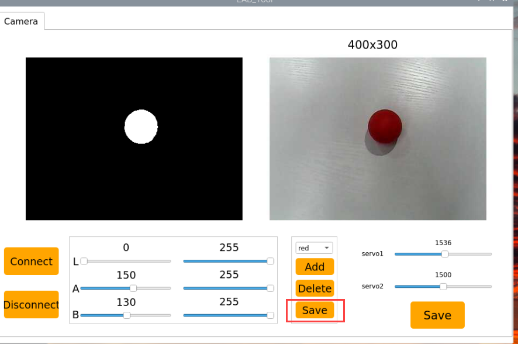

<p id="section-4-2-5-2"></p>

#### 4.2.5.2 Changing the Default Recognition Color

The color recognition program includes red, green, and blue. By default, the pan-tilt nods when red is recognized.

**The following example changes the recognition color to green.**

1. Enter the command below and press **Enter** to navigate to the source code directory.

```bash
cd /home/ubuntu/ros2_ws/src/example/example
```

2. Enter the command below and press **Enter** to open the program file.

```bash
vim color_recognize.py
```

3. Locate the code shown below.

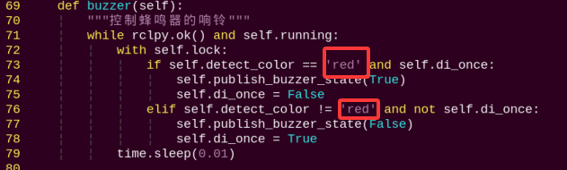

> [!NOTE]
>
> **Enter a code line number and press "Shift+G" to jump directly to that position. The line number shown in the figure is for reference only. Use the actual line number in the current file.**

4. Press **i** to enter edit mode.

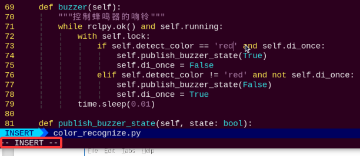

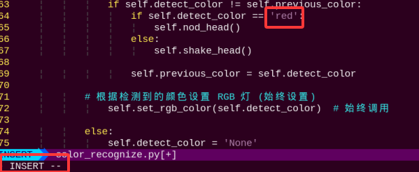

5. To make the pan-tilt nod when green is recognized instead of red, change `red` to `green` in `detect_color == 'red'`, as shown below.

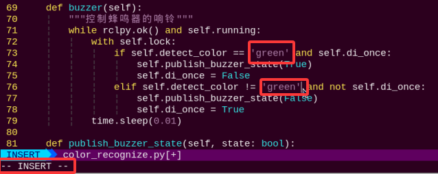

6. To make the Buzzer sound when green is recognized instead of red, change `red` to `green` in `detect_color == 'red'`, as shown below.

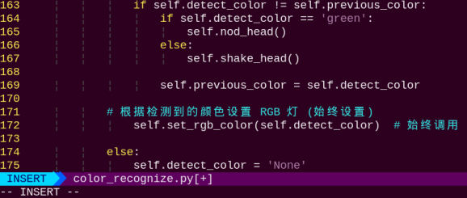

7. Press **Esc**, enter the command below, and press **Enter** to save the changes and close the file. The colon must appear before `wq`.

```bash
:wq
```

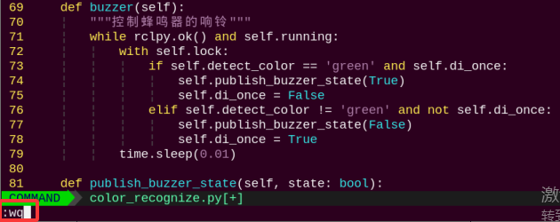

8. Enter the command below and press **Enter** to start color recognition again.

```bash
python3 color_recognize.py
```

#### 4.2.5.3 Adding a New Recognition Color

Additional recognition colors can be added to the three built-in colors. The following example adds purple.

> [!NOTE]
>
> - **Auto-start is enabled by default upon system boot. Click the icon**  **to open the tool.**
>
> - **If auto-start is disabled on the system, open a command-line terminal, enter "ros2 launch peripherals usb_cam.launch.py", and press "Enter" to open the color threshold adjustment tool.**

1. Double-click the icon  on the system desktop. Click **Execute** in the dialog box.


2. Click **Connect** in the interface.


3. Click **Add**, enter **purple** as the new color name, and click **OK**.


4. Open the color drop-down list and select **purple**.


5. Point the camera at a purple object. Drag the L, A, and B sliders until the target color area in the left image becomes white and all other areas become black.


6. Click **Save** to save the adjusted color thresholds.


7. Enter the command below and press **Enter** to navigate to the program directory and confirm that the values were saved.

```bash
cd /home/ubuntu/software/lab_tool
```

8. Enter the command below and press **Enter** to open the configuration file.

```bash
vim lab_config.yaml
```

9. After opening the color threshold configuration file, check the purple threshold parameters.

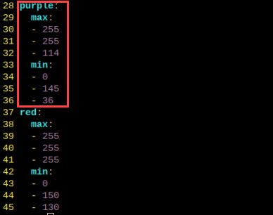

10. Follow steps 1 and 2 in [**4.2.5.2 Changing the Default Recognition Color**](#section-4-2-5-2). Open the program file, press **i** to enter edit mode, and locate the code shown below.

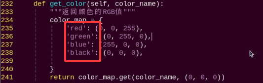

11. Add `'purple': (255, 255, 126)` manually. `(255, 255, 126)` is the RGB value for purple. The code uses BGR order, but the value remains the same because the red and blue values are identical. 

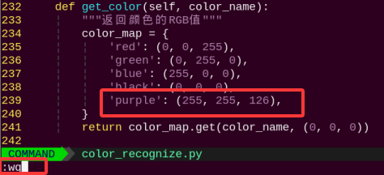

12. Locate the code shown below.

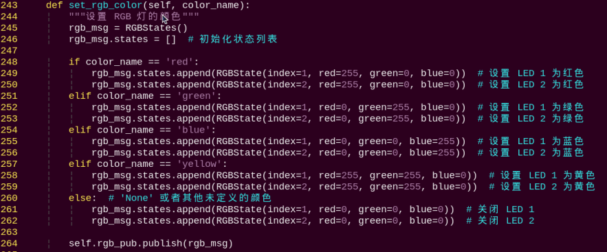

13. Add the content shown in the box to set the expansion board LED to purple. Enter the RGB value for purple. 

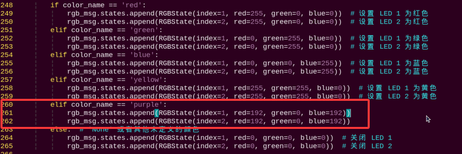

14. Locate the code shown below.

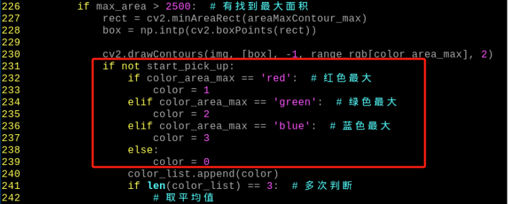

15. Press **Esc**, enter the command below, and press **Enter** to save the changes and close the file. The colon must appear before `wq`.

```bash
:wq
```

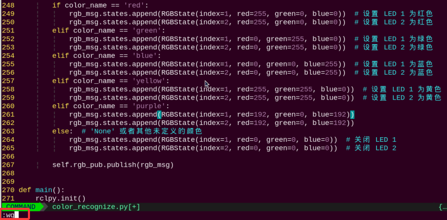

16. Follow [**4.2.2 Starting and Stopping the Feature**](#section-4-2-2) to start the feature again. Place a purple object in front of the camera. The pan-tilt shakes its head. To make the pan-tilt nod, follow 4.2.5.2 and change the default recognition color to purple.

17. Follow the preceding steps to add other recognition colors.
## 4.3 Colored Block Positioning

### 4.3.1 Feature Overview

This section uses the camera to recognize red, green, and blue balls. Each ball is circled in the returned image, and its X and Y coordinates are displayed.

Color position recognition consists of color detection and position marking.

During color detection, Gaussian blur first reduces image noise. The image is then converted to the LAB color space.

Next, color thresholds identify the color of the object inside the circle. A mask is applied to globally or locally block parts of the image with a selected image, shape, or object.

After opening and closing operations are applied to the object image, the object with the largest contour is circled.

**Opening operation:** Apply erosion followed by dilation. This removes small objects, smooths shape boundaries without changing their area, removes small particle noise, and separates connected objects.

**Closing operation:** Apply dilation followed by erosion. This fills small holes inside objects, connects nearby objects and broken contour lines, and smooths boundaries without changing their area.

Position marking uses a specific detection algorithm. It searches the image for regions that match predefined features or patterns and returns their positions and bounding boxes.

<p id="section-4-3-2"></p>

### 4.3.2 Starting and Stopping the Feature

> [!NOTE]
>
> **Commands are case-sensitive and space-sensitive. Press "Tab" to complete keywords.**

1. Power on the device and connect through the VNC remote access tool.

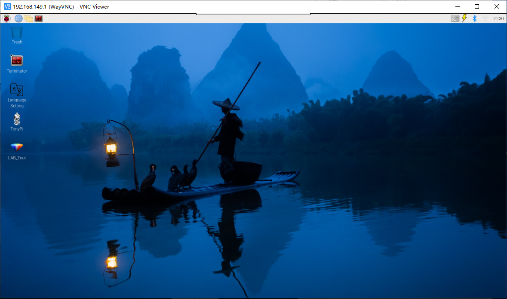

2. Click the icon  in the upper-left corner of the system desktop to open a command-line terminal.


3. Enter the command below and press **Enter** to navigate to the feature program directory.

```bash
cd /home/ubuntu/ros2_ws/src/example/example
```

4. Enter the command below and press **Enter** to start the feature.

```bash
python3 color_position_recognition.py
```

5. Press **Ctrl+C** in the terminal to stop the feature. Press it repeatedly if the feature does not stop immediately.

### 4.3.3 Project Outcome

**By default, the program recognizes red, green, and blue balls. After recognition, each ball is circled in the returned image, and its X and Y coordinates are displayed in the lower-left corner of the box.**

> [!NOTE]
>
> * **Perform recognition in a well-lit environment to prevent inaccurate results caused by insufficient lighting.**
>
> * **Keep objects with colors similar or identical to the target color out of the camera's field of view to prevent false recognition.**
>
> * **If color recognition is inaccurate, refer to "4.3.5.1 Adjusting Color Thresholds" to configure the color thresholds.**

### 4.3.4 Program Analysis

The source code is located at **/home/ubuntu/ros2_ws/src/example/example/color_position_recognition.py**.

#### 4.3.4.1 Importing Libraries

1. Python uses `import` to load libraries such as `cv2` for image processing, `numpy` for numerical calculations, and `rclpy` for the ROS2 robotics development framework. These libraries provide the tools required for image operations, mathematical calculations, and robot control.

```python
import cv2
import math
import time
import threading
import rclpy
from rclpy.node import Node
from sensor_msgs.msg import Image
from cv_bridge import CvBridge
import sdk.yaml_handle as yaml_handle
import sdk.Misc as Misc
import numpy as np  # import numpy
```

2. Import the OpenCV, time, mathematics, threading, and other related libraries. Call a function from a library with `library_name.function_name(parameter, parameter...)`, as shown below.

```python
                time.sleep(0.01)  # Wait briefly if no image is available 
```

This example calls the `sleep()` function from the `time` library. The function adds a delay.

Python includes built-in libraries such as `time`, `cv2`, and `math`, which can be imported directly. Custom libraries can also be created. For example, `yaml_handle` is a custom file-reading library.

3. Create library aliases.

Some library names are long and difficult to remember. Assign an alias to simplify function calls, as shown below.

```python
import cv2
import math
import time
import threading
import rclpy
from rclpy.node import Node
from sensor_msgs.msg import Image
from cv_bridge import CvBridge
import sdk.yaml_handle as yaml_handle
import sdk.Misc as Misc
import numpy as np  # import numpy
```

After the alias is assigned, call functions from the `Misc` library with `Misc.function_name(parameter, parameter...)`.

#### 4.3.4.2 Main Function Analysis

In a Python program, `__name__ == '__main__':` identifies the main function entry point. First open the camera and read the video stream. The `read` method obtains each frame. Find and mark the colored balls, and display the result. Continuously reading and displaying frames plays the video. After video capture and display end, call `release()` to release the resources.

```python
def main():
    rclpy.init()
    color_warning_node = ColorWarningNode()
    try:
        rclpy.spin(color_warning_node)
    finally:
        # Perform cleanup before exiting 
        color_warning_node.running = False  # Set flag to stop the thread 
        color_warning_node.destroy_node()  # Ensure the node is destroyed 
        rclpy.shutdown()
        cv2.destroyAllWindows() # Ensure OpenCV windows are closed 


if __name__ == '__main__':
    main()
```

* **Processing the Image**

Call `run()` to process the image.

```python
    def run(self, img):
        """Color detection processing """
        img_copy = img.copy()
        img_h, img_w = img.shape[:2]

        if not self.__isRunning:   # Check if the program is enabled, return the original image if not enabled
            return img

        frame_resize = cv2.resize(img_copy, self.size, interpolation=cv2.INTER_NEAREST)
        frame_gb = cv2.GaussianBlur(frame_resize, (3, 3), 3)
        frame_lab = cv2.cvtColor(frame_gb, cv2.COLOR_BGR2LAB)  # Convert the image to the LAB space

        max_area = 0
        areaMaxContour = None #fixed
```

* **Scaling the Image**

```python
        frame_resize = cv2.resize(img_copy, self.size, interpolation=cv2.INTER_NEAREST)
```

The first parameter, `img_copy`, is the input image.

The second parameter, `self.size`, is the output image size. Set this value as required.

The third parameter, `interpolation=cv2.INTER_NEAREST`, specifies the interpolation method. `INTER_NEAREST` uses nearest-neighbor interpolation. `INTER_LINEAR` uses bilinear interpolation and is the default when the final parameter is omitted. `INTER_CUBIC` uses bicubic interpolation over a 4x4 pixel neighborhood. `INTER_LANCZOS4` uses Lanczos interpolation over an 8x8 pixel neighborhood.

* **Gaussian Blur**

  Images often contain noise that reduces image quality and makes features less distinct. Select a suitable filtering method based on the noise type. Common methods include Gaussian blur, median blur, and mean blur.

  Gaussian blur is a linear smoothing filter suitable for reducing Gaussian noise. It is widely used for image denoising.

```python
        frame_gb = cv2.GaussianBlur(frame_resize, (3, 3), 3)
```

The first parameter, `frame_resize`, is the input image.

The second parameter, `(3, 3)`, is the Gaussian kernel size.

The third parameter, `3`, is the standard deviation of the Gaussian kernel along the X-axis.

* **Converting the Image to the LAB Color Space**

  The `cv2.cvtColor()` function converts between color spaces.

```python
        frame_lab = cv2.cvtColor(frame_gb, cv2.COLOR_BGR2LAB)  # Convert the image to the LAB space
```

The first parameter, `frame_gb`, is the input image.

The second parameter, `cv2.COLOR_BGR2LAB`, is the conversion mode. It converts BGR to LAB. Use `cv2.COLOR_BGR2RGB` to convert BGR to RGB.

* **Converting the Image to a Binary Image**

  A binary image contains only 0 and 1. This simplifies the image and reduces the amount of data for easier processing. Use `inRange()` from the `cv2` library to convert the image to binary form.

  ```python
              frame_mask = cv2.inRange(frame_lab,
                                           (self.lab_data[color_name]['min'][0],
                                            self.lab_data[color_name]['min'][1],
                                            self.lab_data[color_name]['min'][2]),
                                           (self.lab_data[color_name]['max'][0],
                                            self.lab_data[color_name]['max'][1],
                                            self.lab_data[color_name]['max'][2]))
  ```
  
  The first parameter, `frame_lab`, is the input image.
  
  The second parameter, `(lab_data[i]['min'][0],lab_data[i]['min'][1],lab_data[i]['min'][2])`, is the lower color threshold.
  
  The third parameter, `(lab_data[i]['max'][0],lab_data[i]['max'][1],lab_data[i]['max'][2])`, is the upper color threshold.
  
  Apply morphological opening and closing operations to preprocess the image mask for subsequent image analysis and object recognition. These operations remove noise and fill holes.

```python
            opened = cv2.morphologyEx(frame_mask, cv2.MORPH_OPEN, np.ones((3, 3), np.uint8))  # Opening operation
            closed = cv2.morphologyEx(opened, cv2.MORPH_CLOSE, np.ones((3, 3), np.uint8))  # Closing operation
            contours = cv2.findContours(closed, cv2.RETR_EXTERNAL, cv2.CHAIN_APPROX_NONE)[-2]  # Find contours
            contour, area = self.getAreaMaxContour(contours)  # Find the maximal contour
```

* **Obtaining the Largest Contour**

  After completing the image processing above, obtain the target contour with `findContours()` from the `cv2` library.

```python
            contours = cv2.findContours(closed, cv2.RETR_EXTERNAL, cv2.CHAIN_APPROX_NONE)[-2]  # Find contours
```

The first parameter, `dilated`, is the input image.

The second parameter, `cv2.RETR_EXTERNAL`, is the contour retrieval mode.

The third parameter, `cv2.CHAIN_APPROX_NONE)[-2]`, is the contour approximation method.

Find the contour with the largest area. Set a minimum area to reduce interference. A contour is valid only when its area is greater than this minimum.

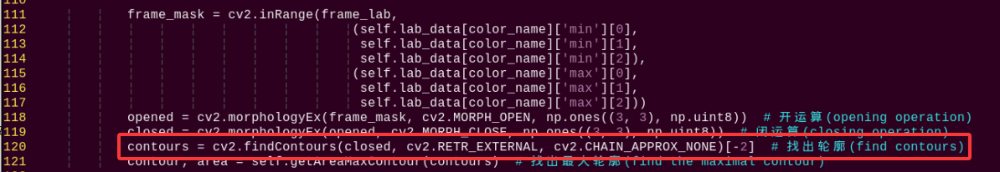

* **Obtaining Position Information**

  Use `cv2.putText()` from the `cv2` library to draw text on the image.

```python
            cv2.putText(img, f"X: {self.color_center_x}, Y: {self.color_center_y}",
                        (self.color_center_x + self.color_radius, self.color_center_y),
                        cv2.FONT_HERSHEY_SIMPLEX, 0.5, color, 2)
```

The first parameter, `img`, is the input image.

The second parameter, `f"X: {self.color_center_x}, Y: {self.color_center_y}"`, is the text to draw. `self.color_center_x` is the X coordinate of the detected color area's center. `self.color_center_y` is its Y coordinate. These values display the coordinates in the image.

The third parameter, `(self.color_center_x + self.color_radius, self.color_center_y)`, is the starting coordinate of the text and therefore the lower-left corner of the text.

The fourth parameter, `cv2.FONT_HERSHEY_SIMPLEX`, selects a simple font.

The fifth parameter, `0.5`, scales the font to half its default size. The parameter `1.0` specifies the default text color.

The sixth parameter, `color`, specifies the text color.

The seventh parameter, `2`, specifies the text stroke width.

* **Displaying the Returned Image**

```python
            if img is not None:
                frame = self.run(img)
                cv2.imshow('Frame', frame)
                key = cv2.waitKey(1)
                if key == 27:  # Exit with ESC 
                    self.running = False
                    cv2.destroyAllWindows()
                    break
```

`cv2.imshow()` displays the image in a window. `'Frame'` is the window name, and `frame` is the displayed content. Include `cv2.waitKey()` after this function so the image can be displayed.

`cv2.waitKey()` waits for keyboard input. The parameter `1` specifies the delay.

### 4.3.5 Feature Extension

<p id="section-4-3-5-1"></p>

#### 4.3.5.1 Adjusting Color Thresholds

If color recognition performs poorly, adjust the color thresholds. This section uses **red** as an example. Apply the same method to other colors.

> [!NOTE]
>
> * **Auto-start is enabled by default upon system boot. Click the icon**  **to open the tool.**
>
> * **If auto-start is disabled on the system, open a command-line terminal, enter "ros2 launch peripherals usb_cam.launch.py", and press "Enter" to open the color threshold adjustment tool.**

1. Double-click the icon  on the system desktop. Click **Execute** in the dialog box.


2. After the interface opens, click **Connect**.


3. After the connection succeeds, select **red** from the color options in the lower-right corner.

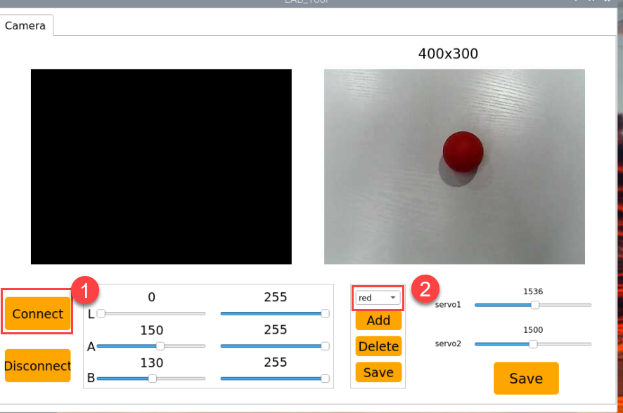

4. If no returned image appears, check the camera cable because the camera is not connected successfully.

The right side of the interface displays the live camera image, and the left side displays the sampled color. Point the camera at a red colored block. Drag the six sliders until the red colored block area in the left image becomes completely white and all other areas become black. Click **Save** to save the data.


#### 4.3.5.2 Adding a New Recognition Color

Additional recognition colors can be added to the three built-in colors. The following example adds purple.

1. Double-click the icon 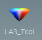 on the system desktop. Click **Execute** in the dialog box.


2. Click **Connect** in the interface.


3. Click **Add**, enter **purple** as the new color name, and click **OK**.

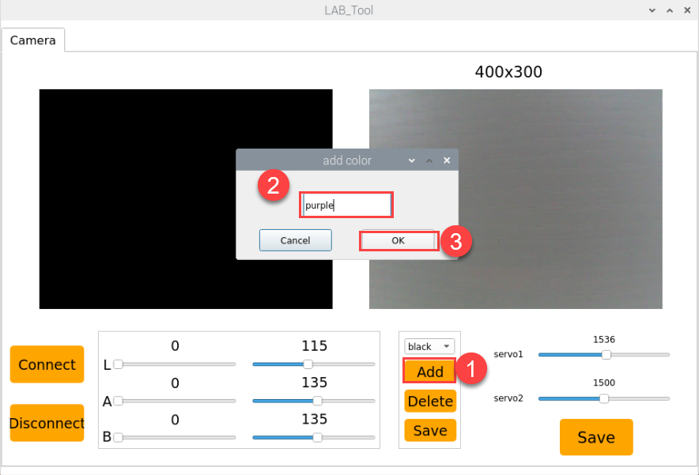

4. Open the color drop-down list and select **purple**.

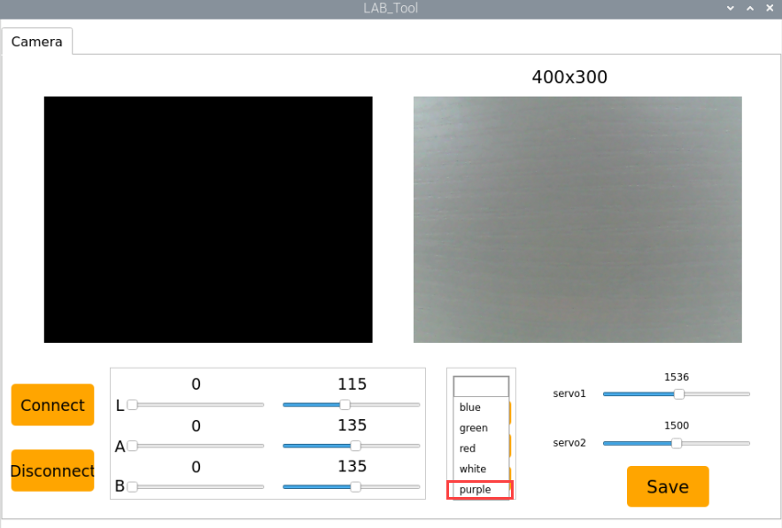

5. Point the camera at a purple object. Drag the L, A, and B sliders until the target color area in the left image becomes white and all other areas become black.

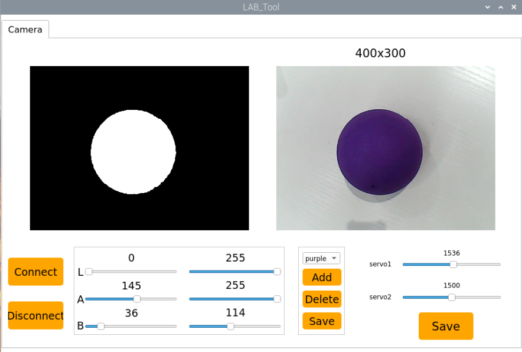

6. Click **Save** to save the adjusted color thresholds.


7. Enter the command below and press **Enter** to navigate to the program directory and confirm that the values were saved.

```bash
cd /home/ubuntu/software/lab_tool
```

8. Enter the command below and press **Enter** to open the configuration file.

```bash
vim lab_config.yaml
```

9. After opening the color threshold configuration file, check the purple threshold parameters.


10. Enter `:q` and press **Enter** to close the file.

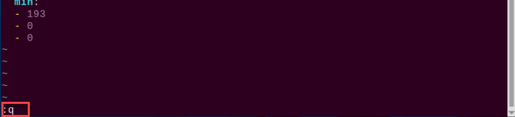

11. Enter the command below to navigate to the feature directory.

```bash
cd /home/ubuntu/ros2_ws/src/example/example 
```

12. Enter the command below and press **Enter** to open the program file.

```bash
vim color_position_recognition.py
```

13. Locate the code shown below.

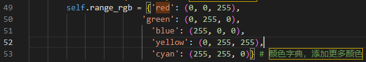

14. Press **i** to enter edit mode.

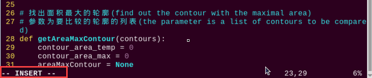

15. Add `'purple':(255, 255, 114),` manually, as shown below. `(255, 255, 114)` is the purple `max` threshold checked in step 9.

`'purple':(255, 255, 114),`

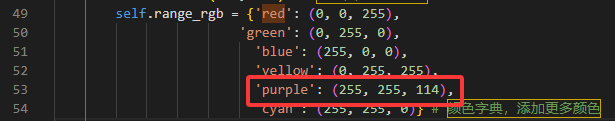

16. Locate the code shown below. The code iterates through all possible colors except black and white.

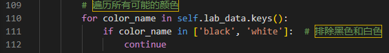

17. Press **Esc**, enter `:wq`, and press **Enter** to save the changes and close the file. The colon must appear before `wq`.

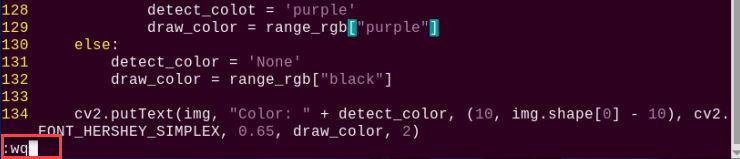

18. Follow the preceding steps to add other recognition colors.
## 4.4 Target Tracking

> [!NOTE]
>
> **Before starting this feature, ensure that the pan-tilt Servo deviation has been adjusted.**

### 4.4.1 Feature Overview

This section uses the camera to recognize a color and obtain the target position, allowing TurboPi to follow the target as it moves.

Target tracking consists of two parts: color recognition and tracking.

For color recognition, first apply Gaussian filtering to reduce image noise, and then convert the object colors to the LAB color space.

Next, recognize the color of the object inside the circle according to its color threshold, and apply a mask to the image. A mask uses a selected image, shape, or object to cover all or part of the image being processed.

After applying opening and closing operations to the object image, circle the object with the largest contour.

**Opening operation:** Erode the image first, and then dilate it. This operation removes small objects, smooths shape boundaries without changing their area, removes small particle noise, and separates connected objects.

**Closing operation:** Dilate the image first, and then erode it. This operation fills small holes inside objects, connects nearby objects and broken contour lines, and smooths boundaries without changing their area.

The tracking process uses a PID algorithm. It compares the target pixel coordinates with the center coordinates of the image and reduces the distance between them to track the target.

The PID algorithm is one of the most widely used automatic control methods. In process control, it performs control according to the proportional (P), integral (I), and derivative (D) components of the error. Its advantages include a simple principle, straightforward implementation, broad applicability, independent control parameters, and relatively simple parameter selection.

<p id="section-4-4-2"></p>

### 4.4.2 Starting and Stopping the Feature

> [!NOTE]
>
> **Commands are case-sensitive and space-sensitive. Press the Tab key to autocomplete keywords.**

1. Power on the device and connect through the VNC remote connection tool.


2. Click the icon  in the upper-left corner of the system desktop to open a command-line terminal.


3. Enter the command below and press **Enter** to stop the auto-start service before running this feature.

After stopping this feature, open a new red terminal and restart the auto-start service; otherwise, other features may not operate correctly. First run `~/.stop_ros.sh`, and then run `ros2 launch bringup bringup.launch.py`.

```bash
~/.stop_ros.sh
```

4. Enter the command below and press **Enter** to start the feature.

```bash
ros2 launch app object_tracking.launch.py debug:=true
```

5. Open another red command-line terminal. Enter the command below and press **Enter** to open the camera feed. Click the object to track in the camera display, as shown below.

```bash
ros2 service call /object_tracking/enter std_srvs/srv/Trigger {}
```

6. In the red command-line terminal opened in step 5, enter the command below and press **Enter** to enable pan-tilt tracking.

```bash
ros2 service call /object_tracking/set_pan_tilt std_srvs/srv/SetBool "{data: true}"
```

7. In the same terminal, enter the command below and press **Enter** to enable chassis tracking.

```bash
ros2 service call /object_tracking/set_chassis_following std_srvs/srv/SetBool "{data: true}"
```

8. To stop the feature, run the following commands in the red command-line terminal opened in step 5. First disable pan-tilt tracking, then disable chassis tracking, and finally exit the feature. Press **Ctrl+C** in the red terminal opened in step 4. If the program does not stop, press **Ctrl+C** repeatedly.

```bash
ros2 service call /object_tracking/set_pan_tilt std_srvs/srv/SetBool "{data: false}"
```

```bash
ros2 service call /object_tracking/set_chassis_following std_srvs/srv/SetBool "{data: false}"
```

```bash
ros2 service call /line_following/exit std_srvs/srv/Trigger {}
```

### 4.4.3 Project Outcome

After the camera display opens, click the color to track. The TurboPi pan-tilt and chassis follow the selected colored object as it moves.

> [!NOTE]
>
> * **Perform recognition in a well-lit environment whenever possible. Insufficient lighting may reduce recognition accuracy.**
>
> * **Keep objects with colors similar or identical to the target color out of the camera view to prevent false recognition.**

### 4.4.4 Program Analysis

The source code is located at **/home/ubuntu/ros2_ws/src/app/app/tracking.py**.

#### 4.4.4.1 Importing Libraries

1. Import Python libraries such as cv2 for image processing, numpy for numerical computation, and rclpy for the ROS 2 robotics development framework. These libraries provide the tools required for subsequent image operations, mathematical calculations, and robot control.

```python
import os
import cv2
import math
import queue
import rclpy
import threading
import numpy as np
import sdk.pid as pid
import sdk.common as common
import sdk.yaml_handle as yaml_handle
from rclpy.node import Node
from app.common import Heart
from cv_bridge import CvBridge
from sensor_msgs.msg import Image
from app.common import ColorPicker
from geometry_msgs.msg import Twist
from std_srvs.srv import SetBool, Trigger
from interfaces.srv import SetPoint, SetFloat64
from large_models_msgs.srv import SetString
from ros_robot_controller_msgs.msg import MotorsState, SetPWMServoState, PWMServoState, RGBState, RGBStates
import time
from rclpy.callback_groups import ReentrantCallbackGroup
```

2. Import libraries related to OpenCV, time, mathematics, threading, and inverse kinematics. Call a function from a library by using **library_name + function_name(parameters)**, as shown below.

```python
              time.sleep(0.01)
```

This example calls the **sleep** function from the **time** library. The `sleep()` function adds a delay.

Python includes built-in libraries such as **time**, **cv2**, and **math**, which can be imported and called directly. Custom libraries can also be created, such as the **yaml_handle** file-reading library shown above.

3. Instantiate libraries.

Some library names are long and difficult to remember. Instantiate a library to make its functions easier to call, as shown below.

```python
	import sdk.common as common
```

After instantiation, call functions from the `common` library directly in the form **common.function_name(parameters)**.

#### 4.4.4.2 Main Function Analysis

In a Python program, **`__name__ == '__main__'`** identifies the main function. First, call `init()` to initialize the configuration. In this program, initialization returns the Servos to their initial positions and reads the color threshold file. Other programs may also initialize ports, peripherals, timed interrupts, and related configurations.

After initialization, set red as the default tracking color and enable chassis following.

```python
	def main():
    node = OjbectTrackingNode('object_tracking')
    try:
        rclpy.spin(node)
    finally:
        node.destroy_node()
        rclpy.shutdown()


if __name__ == "__main__":
    main()
```

1. Start image processing.

```python
	    def __call__(self, image, result_image, threshold):
	        """Process image, detect target and return results"""
        h, w = image.shape[:2]
        image = cv2.resize(image, self.pro_size)
        image = cv2.cvtColor(image, cv2.COLOR_RGB2LAB)
        image = cv2.GaussianBlur(image, (5, 5), 5)

	        # Determine threshold range based on manual or AI-set target color
        if self.set_status == False:
            min_color = [int(self.target_lab[0] - 50 * threshold * 2),
                         int(self.target_lab[1] - 50 * threshold),
                         int(self.target_lab[2] - 50 * threshold)]
            max_color = [int(self.target_lab[0] + 50 * threshold * 2),
                         int(self.target_lab[1] + 50 * threshold),
                         int(self.target_lab[2] + 50 * threshold)]
            target_color = self.target_lab, min_color, max_color
        else:
            min_color = [self.lab_data[self.set_color]['min'][0],
                         self.lab_data[self.set_color]['min'][1],
                         self.lab_data[self.set_color]['min'][2]]
            max_color = [self.lab_data[self.set_color]['max'][0],
                         self.lab_data[self.set_color]['max'][1],
                         self.lab_data[self.set_color]['max'][2]]
            target_color = 0, min_color, max_color

	        # Image processing: mask, erode, dilate, find contours
        mask = cv2.inRange(image, tuple(target_color[1]), tuple(target_color[2]))
        eroded = cv2.erode(mask, cv2.getStructuringElement(cv2.MORPH_RECT, (3, 3)))
        dilated = cv2.dilate(eroded, cv2.getStructuringElement(cv2.MORPH_RECT, (3, 3)))
        contours = cv2.findContours(dilated, cv2.RETR_EXTERNAL, cv2.CHAIN_APPROX_NONE)[-2]
        contour_area = map(lambda c: (c, math.fabs(cv2.contourArea(c))), contours)
        contour_area = list(filter(lambda c: c[1] > 40, contour_area))
        circle = None
        target_pos = None
        target_radius = 0

	        # Select target when valid contour is detected
        if len(contour_area) > 0:
            if self.last_color_circle is None:
                contour, area = max(contour_area, key=lambda c_a: c_a[1])
                circle = cv2.minEnclosingCircle(contour)
            else:
                (last_x, last_y), last_r = self.last_color_circle
```

- **Resize the image for easier processing.**

```python
	        image = cv2.resize(image, self.pro_size)
```

The first parameter, **image**, is the input image.

The second parameter, **self.pro_size**, specifies the output image size. Set this size as required.

- **Apply Gaussian filtering.**

  Images often contain noise that reduces image quality and obscures features. Select an appropriate filtering method for the type of noise. Common methods include Gaussian filtering, median filtering, and mean filtering.

  Gaussian filtering is a linear smoothing filter suitable for removing Gaussian noise. It is widely used for noise reduction in image processing.

```python
	        image = cv2.GaussianBlur(image, (5, 5), 5)
```

The first parameter, **image**, is the input image.

The second parameter, **(5, 5)**, specifies the Gaussian kernel size.

The third parameter, **5**, specifies the standard deviation of the Gaussian kernel in the X direction.

- **Convert the image to the LAB color space. The `cv2.cvtColor()` function performs color-space conversion.**

```python
	        image = cv2.cvtColor(image, cv2.COLOR_RGB2LAB)
```

The first parameter, **image**, is the input image.

The second parameter, **cv2.COLOR_BGR2LAB**, specifies the conversion format. **cv2.COLOR_BGR2LAB** converts a BGR image to LAB. To convert a BGR image to RGB, use **cv2.COLOR_BGR2RGB**.

- **Convert the image into a binary image containing only 0 and 1. This simplifies the image, reduces the data volume, and makes processing easier.**

  Call the `inRange()` function from the cv2 library to binarize the image.

  ```python
  	        if self.set_status == False:
              min_color = [int(self.target_lab[0] - 50 * threshold * 2),
                           int(self.target_lab[1] - 50 * threshold),
                           int(self.target_lab[2] - 50 * threshold)]
              max_color = [int(self.target_lab[0] + 50 * threshold * 2),
                           int(self.target_lab[1] + 50 * threshold),
                           int(self.target_lab[2] + 50 * threshold)]
              target_color = self.target_lab, min_color, max_color
          else:
              min_color = [self.lab_data[self.set_color]['min'][0],
                           self.lab_data[self.set_color]['min'][1],
                           self.lab_data[self.set_color]['min'][2]]
              max_color = [self.lab_data[self.set_color]['max'][0],
                           self.lab_data[self.set_color]['max'][1],
                           self.lab_data[self.set_color]['max'][2]]
              target_color = 0, min_color, max_color
  
  	        # Image processing: mask, erode, dilate, find contours
          mask = cv2.inRange(image, tuple(target_color[1]), tuple(target_color[2]))
  ```

  The first parameter `image` is the input image.

  The second parameter, `min_color = [self.lab_data[self.set_color]['min'][0]`, `self.lab_data[self.set_color]['min'][1]`, `self.lab_data[self.set_color]['min'][2]])`, specifies the lower color threshold.

  The third parameter, `max_color = [self.lab_data[self.set_color]['max'][0]`, `self.lab_data[self.set_color]['max'][1]`, `self.lab_data[self.set_color]['max'][2]]`, specifies the upper color threshold.

- **To reduce interference and smooth the image, erode the image first and then dilate it. The `cv2.erode()` and `cv2.dilate()` functions perform these morphological operations.**

```python
	        eroded = cv2.erode(mask, cv2.getStructuringElement(cv2.MORPH_RECT, (3, 3)))
        dilated = cv2.dilate(eroded, cv2.getStructuringElement(cv2.MORPH_RECT, (3, 3)))
```

The first parameter, **mask**, is the input image.

The second parameter, **cv2.erode (erosion)**, reduces small noise points or isolated pixels in the mask.

The third parameter, **cv2.dilate (dilation)**, makes the target contour more complete.

The fourth parameter, **cv2.MORPH_RECT((3, 3)**, specifies a 3-row by 3-column matrix as the operation window, which determines the effective range of the erosion operation.

- **Obtain the contour of the recognized target.**

  After completing the image processing above, obtain the target contour with the `findContours()` function from the cv2 library.

```python
	        contours = cv2.findContours(dilated, cv2.RETR_EXTERNAL, cv2.CHAIN_APPROX_NONE)[-2]
```

The first parameter, **dilated**, is the input image.

The second parameter, **cv2.RETR_EXTERNAL**, specifies the contour retrieval mode.

The third parameter, **cv2.CHAIN_APPROX_NONE)[-2]**, specifies the contour approximation method.

Among the detected contours, first select either the contour with the largest area or the contour closest to the previously detected target, and fit a circle to it. To reduce interference, set a threshold; the target contour is considered valid only when its area is less than this threshold.

```python
	        if len(contour_area) > 0:
            if self.last_color_circle is None:
                contour, area = max(contour_area, key=lambda c_a: c_a[1])
                circle = cv2.minEnclosingCircle(contour)
            else:
                (last_x, last_y), last_r = self.last_color_circle
                circles = map(lambda c: cv2.minEnclosingCircle(c[0]), contour_area)
                circle_dist = list(map(lambda c: (c, math.sqrt(((c[0][0] - last_x) ** 2) + ((c[0][1] - last_y) ** 2))),
                                       circles))
                circle, dist = min(circle_dist, key=lambda c: c[1])
                if dist < 100:
                    circle = circle
```

- **Obtain position information.**

  Call `cv2.circle` to obtain the minimum enclosing circle of the target contour and determine its center coordinates and radius.

```python
	        if len(contour_area) > 0:
            if self.last_color_circle is None:
                contour, area = max(contour_area, key=lambda c_a: c_a[1])
                circle = cv2.minEnclosingCircle(contour)
            else:
                (last_x, last_y), last_r = self.last_color_circle
                circles = map(lambda c: cv2.minEnclosingCircle(c[0]), contour_area)
                circle_dist = list(map(lambda c: (c, math.sqrt(((c[0][0] - last_x) ** 2) + ((c[0][1] - last_y) ** 2))),
                                       circles))
                circle, dist = min(circle_dist, key=lambda c: c[1])
                if dist < 100:
                    circle = circle
```

2. Display the returned image.

```python
	                image = self.image_queue.get(block=True, timeout=0.1)
                result = cv2.cvtColor(image, cv2.COLOR_RGB2BGR)
                cv2.imshow("result", result)
                k = cv2.waitKey(1)
                if k == ord('q'):
                    break
```

The `self.image_queue()` function obtains image data. `block=True` enables blocking waits, and `timeout=0.1` sets a 0.1-second timeout to balance response speed and resource usage.

The `cv2.imshow()` function displays an image in a window. **frame** is the window name, and **frame_resize** is the displayed content. A subsequent `cv2.waitKey()` call is required; otherwise, the image cannot be displayed.

The `cv2.waitKey()` function waits for keyboard input. The parameter **1** specifies the delay time.

### 4.4.5 Subthread Analysis

After a color is recognized, the pan-tilt camera and chassis track it.

TurboPi uses a PID algorithm for tracking, moving the center of the camera view toward the target center coordinates.

The PID algorithm is one of the most widely used automatic control methods. In process control, it performs control according to the proportional (P), integral (I), and derivative (D) components of the error.

1. Pan-tilt tracking

```python
	            if self.pan_tilt_enabled and not self.chassis_following_enabled:
	                # Pan-tilt-only tracking
                if target_pos:
                    x, y = target_pos
                    servo_x, servo_y, _, _ = self.tracker.update_pid(x, y, self.image_width, self.image_height)
                    self.publish_servo(servo_x, servo_y)
                    self.last_target_time = time.time()
                else:
                    self.handle_target_lost_pan_tilt()
                    if time.time() - self.last_target_time > 5 and self.exit_funcation:
```

The `self.tracker.update_pid()` function controls the PWM Servos. In `servo_x, servo_y = self.tracker.update_pid(x, y, self.image_width, self.image_height)`:

The first parameters, `servo_x, servo_y`, are the pan-tilt Servo control values calculated by the PID algorithm.

The second parameters, `self.image_width, self.image_height`, specify the image width and height.

2. Chassis tracking

```python
	            elif self.chassis_following_enabled and not self.pan_tilt_enabled:
	                # Chassis-only tracking
                if target_pos:
                    x, y = target_pos
                    self.control_chassis(x, y, 1500, target_radius)
                    self.publish_servo(1500, 1600)
                    self.last_target_time = time.time()
                else:
                    self.handle_target_lost_chassis()
                    if time.time() - self.last_target_time > 5 and self.exit_funcation:
                        self.get_logger().info("5秒未检测到目标，自动退出")
                        self.exit_funcation = False
                        self.exit_srv_callback(Trigger.Request(), Trigger.Response())
            elif self.pan_tilt_enabled and self.chassis_following_enabled:
	                # Pan-tilt + chassis joint tracking: use pan-tilt PID output for chassis control
```

For chassis tracking, consider **self.control_chassis(x, y, 1500, target_radius)**. The parameters are described below.

The first parameters, **x, y**, are the coordinates of the tracked object.

The second parameter, **1500**, specifies the Servo position.

The third parameter, **target_radius**, is the radius of the tracked object.
## 4.5 Visual Line Following

> [!NOTE]
>
> **Before starting this feature, ensure that the pan-tilt Servo deviation has been adjusted.**

### 4.5.1 Feature Overview

This section uses the camera to recognize a black line, allowing TurboPi to follow the line.

Visual line following consists of two parts: color recognition and line-following motion.

For color recognition, first apply Gaussian filtering to reduce image noise, and then convert the line color to the LAB color space.

Next, recognize the color of the object inside the box according to its color threshold, and apply a mask to the image. A mask uses a selected image, shape, or object to cover all or part of the image being processed.

After applying opening and closing operations to the image, enclose the object with the largest contour in a rectangle and mark the center point of the line with a dot.

**Opening operation:** Erode the image first, and then dilate it. This operation removes small objects, smooths shape boundaries without changing their area, removes small particle noise, and separates connected objects.

**Closing operation:** Dilate the image first, and then erode it. This operation fills small holes inside objects, connects nearby objects and broken contour lines, and smooths boundaries without changing their area.

After recognizing the black line, the PID algorithm compares the center coordinates of the image with the actual coordinates of the black line. The motors then drive TurboPi along the recognized line.

The PID algorithm is one of the most widely used automatic control methods. In process control, it performs control according to the proportional (P), integral (I), and derivative (D) components of the error. Its advantages include a simple principle, straightforward implementation, broad applicability, independent control parameters, and relatively simple parameter selection.

### 4.5.2 Starting and Stopping the Feature

> [!NOTE]
>
> **Commands are case-sensitive and space-sensitive. Press the Tab key to autocomplete keywords.**

1. Power on TurboPi and connect through the VNC remote connection tool.


2. Click the icon  in the upper-left corner of the system desktop to open a command-line terminal.


3. Before starting this feature, enter the command below and press **Enter** to stop the auto-start service.

After stopping this feature, open a new red terminal and restart the auto-start service; otherwise, other features may not operate correctly. First run `~/.stop_ros.sh`, and then run `ros2 launch bringup bringup.launch.py`.

```bash
~/.stop_ros.sh
```

4. Enter the command below and press **Enter** to start the feature.

```bash
ros2 launch app line_following.launch.py debug:=true
```

5. Enter the command below and press **Enter** to open the camera window. Click the object to track in the camera display, as shown below.

```bash
ros2 service call /line_following/enter std_srvs/srv/Trigger {}
```

6. Enter the command below and press **Enter** to start color-sampling line following. TurboPi begins following the line.

```bash
ros2 service call /line_following/set_running std_srvs/srv/SetBool "{data: True}"
```

7. To stop the program, run the following commands in order in the red terminal used in step 5. Then press **Ctrl+C** in the red terminal used in step 4. If the program does not stop, press **Ctrl+C** repeatedly.

```bash
ros2 service call /line_following/set_running std_srvs/srv/SetBool "{data: false}"
```

```bash
ros2 service call /line_following/exit std_srvs/srv/Trigger {}
```

### 4.5.3 Project Outcome

By default, TurboPi recognizes black. After the feature starts, TurboPi travels along the black line.

Use black electrical tape approximately 3 cm wide to create the line-following map. Refer to the image below.

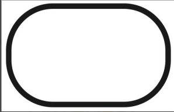

### 4.5.4 Program Analysis

The source code is located at **/home/ubuntu/ros2_ws/src/app/app/line_following.py**.

#### 4.5.4.1 Importing Libraries

Import Python libraries such as cv2 for image processing, numpy for numerical computation, and rclpy for the ROS 2 robotics development framework. These libraries provide the tools required for subsequent image operations, mathematical calculations, and robot control.

```python
import os
import cv2
import math
import time
import rclpy
import queue
import threading
import numpy as np
import sdk.pid as pid
import sdk.common as common
import sdk.yaml_handle as yaml_handle
from rclpy.node import Node
from app.common import Heart,ColorPicker
from cv_bridge import CvBridge
from geometry_msgs.msg import Twist
from std_msgs.msg import Int32
from std_srvs.srv import SetBool, Trigger
from sensor_msgs.msg import Image
from interfaces.srv import SetPoint, SetFloat64
from rclpy.qos import QoSProfile, QoSReliabilityPolicy
from large_models_msgs.srv import SetString
from ros_robot_controller_msgs.msg import MotorsState, SetPWMServoState, PWMServoState,RGBState,RGBStates 
```

#### 4.5.4.2 Main Function Analysis

1. Initialization and instantiation

```python
def main():
    node = LineFollowingNode('line_following')
    try:
        rclpy.spin(node)
    finally:
        node.destroy_node()
        rclpy.shutdown()

if __name__ == "__main__":
    main()
```

(1) Call `init()` to initialize TurboPi.

```python
class LineFollowingNode(Node):
    def __init__(self, name):
        rclpy.init()
        super().__init__(name, allow_undeclared_parameters=True, automatically_declare_parameters_from_overrides=True)
```

- **Use `get_yaml_data` to read and parse the YAML file specified by `servo_file_path`. The file contains data such as Servo angle ranges, initial positions, and control parameters. Assign the parsed YAML data to the class instance variable `self.servo_data` for subsequent operations such as Servo initialization and motion parameter configuration.**

  ```python
          self.servo_data = yaml_handle.get_yaml_data(yaml_handle.servo_file_path)
  ```

(2) Click a color in the camera display to select the line-following color.

```python
    def main(self):
        while True:
            try:
                image = self.image_queue.get(block=True, timeout=1)
            except queue.Empty:
                continue

            result = cv2.cvtColor(image, cv2.COLOR_RGB2BGR)
            cv2.imshow("result", result)
            if self.debug and not self.set_callback:
                self.set_callback = True
                # Set a callback function for mouse click event
                cv2.setMouseCallback("result", self.mouse_callback)
            k = cv2.waitKey(1)
            if k != -1:
                break
        self.mecanum_pub.publish(Twist())
        rclpy.shutdown()

    def mouse_callback(self, event, x, y, flags, param):
        if event == cv2.EVENT_LBUTTONDOWN:
            self.get_logger().info("x:{} y{}".format(x, y))
            msg = SetPoint.Request()
            if self.image_height is not None and self.image_width is not None:
                msg.data.x = x / self.image_width
                msg.data.y = y / self.image_height
                self.set_target_color_srv_callback(msg, SetPoint.Response())
```

- **Use a loop to acquire and display images in real time, process interactions, respond to keyboard input, and publish robot motion commands.**

  ```python
      def set_large_model_target_color_srv_callback(self, request, response):
          self.get_logger().info('\033[1;32m%s\033[0m' % "set_large_model_target_color")
          with self.lock:           
              self.__target_color = request.data
              self.set_model = True
              self.mecanum_pub.publish(Twist())
              self.no_target_time = 0
              self.exit_funcation = True
          response.success = True
          return response
  ```

- **Use the `set_target_color_srv_callback()` service callback to set the target color. This key color-interaction logic resets the state, controls the color selector, and provides thread-safe processing.**

(3) Call `set_running_srv_callback()` to start visual line following.

```python
    # Start feature 
    def set_running_srv_callback(self, request, response):
        self.get_logger().info('\033[1;32m%s\033[0m' % "set_running")
        with self.lock:
            self.is_running = request.data
            if not self.is_running:
                self.mecanum_pub.publish(Twist())
            if self.is_running:
                self.no_target_time = 0
        response.success = True
        response.message = "set_running"
        return response
```

2. Image processing

The `image_callback()` callback preprocesses the image data for subsequent target detection and image annotation.

```python
    def image_callback(self, ros_image):
        cv_image = self.bridge.imgmsg_to_cv2(ros_image, "rgb8")
        rgb_image = np.array(cv_image, dtype=np.uint8)
        self.image_height, self.image_width = rgb_image.shape[:2]
        result_image = np.copy(rgb_image)  #  The image used to display the result
        target_detected = False # Flag indicating whether the target is detected 
```

- **Apply Gaussian filtering.**

  Images often contain noise that reduces image quality and obscures features. Select an appropriate filtering method for the type of noise. Common methods include Gaussian filtering, median filtering, and mean filtering.

  Gaussian filtering is a linear smoothing filter suitable for removing Gaussian noise. It is widely used for noise reduction in image processing.

```python
            img_blur = cv2.GaussianBlur(img_lab, (3, 3), 3)  # Perform Gaussian filtering to reduce noise
```

The first parameter, **img_lab**, is the input image.

The second parameter, **(3, 3)**, specifies the Gaussian kernel size.

The third parameter, **3**, specifies the standard deviation of the Gaussian kernel in the X direction.

- **Crop the image area defined by the coordinate ratios `roi[0]*h`, `roi[1]*h`, `roi[2]*w`, and `roi[3]*w` from the original image, and assign the cropped result to `blob`.**

  ```python
              blob = image[int(roi[0]*h):int(roi[1]*h), int(roi[2]*w):int(roi[3]*w)]  # Intercept roi
  ```
  
  **Then call `cvtColor()` from the cv2 library to convert the BGR image to the LAB color space.**

```python
            img_lab = cv2.cvtColor(blob, cv2.COLOR_RGB2LAB)  # Convert rgb into lab
```

The first parameter, **blobs**, is the input image.

The second parameter, **cv2.COLOR_BGR2RGB**, converts the BGR image to RGB.

- **Call `inRange()` from the cv2 library to binarize the image.**

  ```python
              mask = cv2.inRange(img_blur, tuple(target_color[1]), tuple(target_color[2]))  # Image binarization
  ```

  The first parameter, **img_blur**, is the input image.

  The second parameter, **tuple(target_color[1])**, specifies the lower threshold.

  The third parameter, **tuple(target_color[2])**, specifies the upper threshold.

- **Erode and dilate the image to reduce interference and make the image smoother.**

  ```python
              eroded = cv2.erode(mask, cv2.getStructuringElement(cv2.MORPH_RECT, (3, 3)))  # Corrode
              dilated = cv2.dilate(eroded, cv2.getStructuringElement(cv2.MORPH_RECT, (3, 3)))  # Dilate
  ```

  The `erode()` function erodes the image. Consider **eroded = cv2.erode(frame_mask, cv2.getStructuringElement(cv2.MORPH_RECT, (3, 3))**. The parameters are described below.

  The first parameter, **mask**, is the input image.

  The second parameter, **cv2.getStructuringElement(cv2.MORPH_RECT, (3, 3))**, specifies the structuring element or kernel that determines the operation. The first value in parentheses specifies the kernel shape, and the second specifies the kernel size.

  The `dilate()` function dilates the image. Its parameters have the same meanings as those of `erode()`.

- **After completing the image processing above, obtain the target contour with the `findContours()` function from the cv2 library.**

  ```python
              contours = cv2.findContours(dilated, cv2.RETR_EXTERNAL, cv2.CHAIN_APPROX_TC89_L1)[-2]  # Find the contour
  ```

  The first parameter, **dilated**, is the input image.

  The second parameter, **cv2.RETR_EXTERNAL**, specifies the contour retrieval mode.

  The third parameter, **cv2.CHAIN_APPROX_NONE)[-2]**, specifies the contour approximation method.

- **Find the contour with the largest area and draw rectangles around its upper, middle, and lower sections.**

  ```python
              max_contour_area = self.get_area_max_contour(contours, 30)  # Get the contour corresponding to the largest contour
              if max_contour_area is not None:
                  rect = cv2.minAreaRect(max_contour_area[0])  # Minimum circumscribed rectangle
                  box = np.intp(cv2.boxPoints(rect))  # Four corners
                  for j in range(4):
                      box[j, 1] = box[j, 1] + int(roi[0]*h)
                  cv2.drawContours(result_image, [box], -1, (0, 255, 255), 2)  # Draw the rectangle composed of four points
  ```

- **Calculate and mark the center points of the three rectangles. Use `line_center_x` to determine the degree of TurboPi's steering deviation.**

  ```python
                  # Acquire the diagonal points of the rectangle
                  pt1_x, pt1_y = box[0, 0], box[0, 1]
                  pt3_x, pt3_y = box[2, 0], box[2, 1]
                  # Center point of the line
                  line_center_x, line_center_y = (pt1_x + pt3_x) / 2, (pt1_y + pt3_y) / 2
  
                  cv2.circle(result_image, (int(line_center_x), int(line_center_y)), 5, (0, 0, 255), -1)   # Draw the center point
                  centroid_sum += line_center_x * roi[-1]
          if centroid_sum == 0:
              return result_image, None
          center_pos = centroid_sum / self.weight_sum  # Calculate the center point according to the ratio
          deflection_angle = -math.atan((center_pos - (w / 2.0)) / (h / 2.0))   # Calculate the line angle
          return result_image, deflection_angle
  ```

3. Display the returned image.

Call `image_callback()` from the cv2 library to resize the image and display it in the returned camera feed in real time.

```python
    def image_callback(self, ros_image):
        cv_image = self.bridge.imgmsg_to_cv2(ros_image, "rgb8")
        rgb_image = np.array(cv_image, dtype=np.uint8)
        self.image_height, self.image_width = rgb_image.shape[:2]
        result_image = np.copy(rgb_image)  #  The image used to display the result
        target_detected = False # Flag indicating whether the target is detected 
```

## 4.6 QR Code Recognition

### 4.6.1 Feature Overview

This section uses the camera to recognize QR codes and control TurboPi according to the recognized code. The QR code images are in the [**QR Code Images**](https://drive.google.com/drive/folders/16sFCzVnNNLT7OjOcSambPiZgt1_r71Nu?usp=sharing) folder in the same directory as this document. Send an image to a phone or print it at 5 x 5 cm for recognition.

A QR code records data using black-and-white geometric patterns distributed according to specific rules on a two-dimensional plane.

Its encoding uses the **0** and **1** bit-stream concepts underlying computer logic. Geometric shapes corresponding to binary values represent text and numerical information. Image input devices or photoelectric scanning devices read these shapes automatically for automated information processing.

QR codes share several characteristics with barcode technology: each code system has a specific character set, each character occupies a certain width, and each system provides verification capabilities.

This section uses generated QR code patterns. The camera captures and processes the QR code image.

The program then detects the QR code and obtains its information.

Finally, the program draws a box around the recognized QR code and controls the robot to perform the corresponding action.

### 4.6.2 Starting and Stopping the Feature

> [!NOTE]
>
> **Commands are case-sensitive and space-sensitive. Press the Tab key to autocomplete keywords.**

1. Power on the device and connect through the VNC remote connection tool.

   

2. Click the icon  in the upper-left corner of the system desktop to open a command-line terminal.


3. Enter the command below and press **Enter** to start the feature.

```bash
ros2 service call /qrcode/enter std_srvs/srv/Trigger {}
```

4. Enter the command below and press **Enter** to run the feature.

```bash
ros2 service call /qrcode/set_running std_srvs/srv/SetBool data:\ true
```

5. Open another red terminal, enter the command below to open the interface, and select the **/qrcode/image_result** feed.

```bash
rqt
```

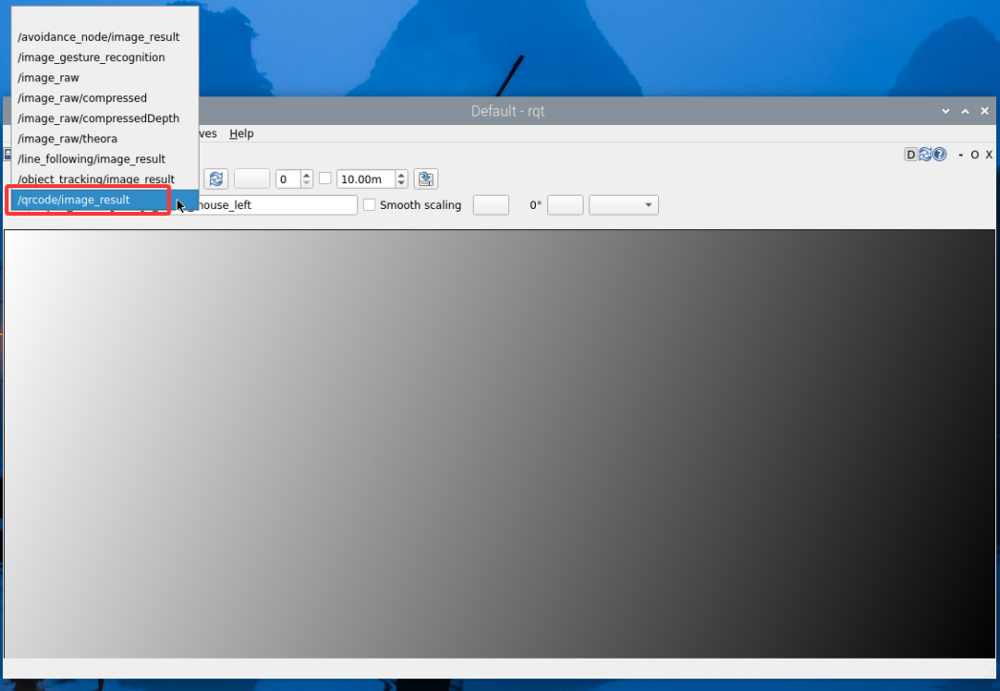

6. To stop the program, run the following commands in order in the first red command-line terminal. Then press **Ctrl+C** in the red command-line terminal opened in step 5. If the program does not stop, press **Ctrl+C** repeatedly.

```bash
ros2 service call /qrcode/set_running std_srvs/srv/SetBool data:\ false
```

```bash
ros2 service call /qrcode/exit std_srvs/srv/Trigger {}
```

### 4.6.3 Project Outcome

After the feature starts, the camera draws a box around a recognized QR code and displays the decoded information in the lower-left corner of the returned image. TurboPi then moves according to the recognized code. The directions in the table are from TurboPi's perspective.

| QR Code ID | Action |
| --- | --- |
| 1 | TurboPi moves forward for a set distance. |
| 2 | TurboPi moves backward for a set distance. |
| 3 | TurboPi moves right for a set distance. |
| 4 | TurboPi moves left for a set distance. |

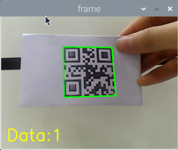

### 4.6.4 Program Analysis

The source code is located at **/home/ubuntu/ros2_ws/src/app/app/qrcode.py**.

#### 4.6.4.1 Importing Libraries

```python
import os
import cv2
import queue
import rclpy
import threading
import numpy as np
import time
from rclpy.node import Node
from cv_bridge import CvBridge
from sensor_msgs.msg import Image
from pyzbar import pyzbar
from geometry_msgs.msg import Twist
from std_srvs.srv import SetBool, Trigger
from rclpy.callback_groups import ReentrantCallbackGroup
from app.common import Heart
from ros_robot_controller_msgs.msg import SetPWMServoState, PWMServoState
```

Import Python libraries such as cv2 for image processing, numpy for numerical computation, and rclpy for the ROS 2 robotics development framework. These libraries provide the tools required for subsequent image operations, mathematical calculations, and robot control.

#### 4.6.4.2 Parameter Declaration and Property Initialization

```python
class QRCodeDetectNode(Node):
    def __init__(self, name):
        super().__init__(name)

        self.declare_parameter('debug', False)
        self.name = name
        self.is_running = False
        self.bridge = CvBridge()
        self.lock = threading.RLock()
        self.image_sub = None
        self.result_image = None
        self.image_height = None
        self.image_width = None
        self.image_queue = queue.Queue(2)
        self.exit_allowed = True  # Add flag to allow execution of exit_srv_callback
        self.heart = None # Heartbeat object 
        # self._timers = []  # Remove timer from list 
        threading.Thread(target=self.main, daemon=True).start()

        self.debug = self.get_parameter('debug').value

        callback_group = ReentrantCallbackGroup()
```

Configure components for QR code detection, including debug parameters, the QR code recognition switch, image conversion tools, and data locks. These settings provide the basic configuration for subsequent QR code detection tasks.

#### 4.6.4.3 Main Function Analysis

- **Initialization and instantiation**

1. In a Python program, **`__name__ == '__main__'`** identifies the main function.

   ```python
   def main():
       rclpy.init()  # Initialization 
       node = QRCodeDetectNode('qrcode')
       rclpy.spin(node)
       node.destroy_node()
       rclpy.shutdown()
   
   
   if __name__ == "__main__":
       main()
   ```

2. Control the Servo position.

   ```python
       def set_servo_position(self, servo_id, position, duration=0.0):
           """Publish servo control message with duration"""
           servo_state = PWMServoState()
           servo_state.id = [servo_id]
           servo_state.position = [position]
           set_pwm_servo_state_msg = SetPWMServoState()
           set_pwm_servo_state_msg.state = [servo_state]
           set_pwm_servo_state_msg.duration = duration
   
           self.pwm_servo_pub.publish(set_pwm_servo_state_msg)
           self.get_logger().info(
               f"Set servo {servo_id} position to {position} with duration {duration} seconds")
   ```

The first parameter, **servo_id**, specifies the Servo ID.

The second parameter, **position**, specifies the target position.

The third parameter, **duration**, specifies the action duration. The default value is 0.0 seconds.

Create instances of different classes and set their properties as required. Combine the Servo ID, position, and action duration into the required control-message format to control the Servo precisely. Publishing the message delivers the control command to the Servo. Logging improves program maintainability and traceability, making issues easier to locate and resolve.

3. Handle entry to and exit from QR code detection, control the Servo position, and manage camera subscriptions.

```python
    def enter_srv_callback(self, request, response):
        self.get_logger().info('\033[1;32m%s\033[0m' % 'QRCode detect enter')
        self.set_servo_position(1, 1200, 2.0)
        self.set_servo_position(2, 1500, 2.0)
        with self.lock:
            self.is_running = True
            self.exit_allowed = True # Allow exit_srv_callback to run 
            if self.image_sub is None:
                self.image_sub = self.create_subscription(Image, '/image_raw',
                                                        self.image_callback, 1)  # Subscribe to the camera 
            self.mecanum_pub.publish(Twist())
        response.success = True
        response.message = "enter"
        return response
```

The first statement, **self.get_logger().info('\033[1;32m%s\033[0m' % 'QRCode detect enter')**, records a message indicating entry into QR code detection. **\033[1;32m** and **\033[0m** display the log text in green.

The second statement, **self.set_servo_position(1, 1500, 2.0)**, sets Servo 1 to position 1500 with an action duration of 2.0 seconds.

- **QR code image processing**

1. The `start_recognition_srv_callback()` function enables or disables QR code recognition.

   ```python
       def start_recognition_srv_callback(self, request, response):
           """Service: Start/stop QR code recognition"""
           with self.lock:
               self.is_running = request.data  # Start or stop QR code recognition 
               if self.is_running:
                   self.get_logger().info("二维码识别已启动")
               else:
                   self.get_logger().info("二维码识别已停止")
                   self.mecanum_pub.publish(Twist())  # Stop robot motion control 
   
           response.success = True
           response.message = "Start recognition" if self.is_running else "Stop recognition"
           return response
   ```

2. The `set_running_srv_callback()` function starts or stops QR code recognition.

   ```python
       def start_recognition_srv_callback(self, request, response):
           """Service: Start/stop QR code recognition"""
           with self.lock:
               self.is_running = request.data  # Start or stop QR code recognition 
               if self.is_running:
                   self.get_logger().info("二维码识别已启动")
               else:
                   self.get_logger().info("二维码识别已停止")
                   self.mecanum_pub.publish(Twist())  # Stop robot motion control 
   
           response.success = True
           response.message = "Start recognition" if self.is_running else "Stop recognition"
           return response
   ```

3. Add a box around a recognized QR code and display the decoded information.

   ```python
                           cv2.polylines(result_image, [np.int32(hull)], isClosed=True,
                                           color=(0, 255, 0), thickness=3)
                       cv2.putText(result_image, obj.data.decode("utf-8"),
                                   (obj.rect[0], obj.rect[1]),
                                   cv2.FONT_HERSHEY_SIMPLEX, 0.5, (0, 0, 255), 2)
   ```

   First, call `cv2.polylines()` from the cv2 library to draw a box around the QR code. Consider `cv2.polylines(result_image, [np.int32(hull)], isClosed=True, color=(0, 255, 0), thickness=3)`.

   The first parameter, **result_img**, specifies the image on which to draw the target border.

   The second parameter, **[np.int32(hull)]**, specifies the coordinates of the polygon vertices.

   The third parameter, **isClosed**, is `True` when the polygon is closed. If it is `False`, the function draws an open polyline.
   
   The fourth parameter, **(0, 255, 0)**, specifies the polygon line color.
   
   The fifth parameter, **3**, specifies the polygon line thickness.
   
   Then call `cv2.putText()` from the cv2 library to display the decoded information.

- **Display the returned image.**

Call `imgmsg_to_cv2()` from the cv2 library to receive a ROS image message and convert it to OpenCV format, making the image data easier to process.

```python
    def image_callback(self, ros_image):
        cv_image = self.bridge.imgmsg_to_cv2(ros_image, "rgb8")
        rgb_image = np.array(cv_image, dtype=np.uint8)
        self.image_height, self.image_width = rgb_image.shape[:2]
```

#### 4.6.4.4 Subthread Analysis

Run a subthread and call `control_robot_based_on_qr()` to control how long the mecanum-wheel robot moves.

```python
    def control_robot_based_on_qr(self, qr_data):
        if qr_data == "1":
            # Move forward for 2 seconds using time.sleep 
            self.move_forward(2)
        elif qr_data == "2":
            self.move_backward(2)
        elif qr_data == "3":
            self.move_right(2)
        elif qr_data == "4":
            self.move_left(2)
```

In `control_robot_based_on_qr()`, control the motors according to the recognized QR code information.

```python
    def move_forward(self, duration):
        twist = Twist()
        twist.linear.x = 0.6  # Forward speed
        self.mecanum_pub.publish(twist)
        self.get_logger().info(f"Moving forward for {duration} seconds")
        time.sleep(duration)
        self.stop_robot()

    def move_backward(self, duration):
        twist = Twist()
        twist.linear.x = -0.6  # Backward speed
        self.mecanum_pub.publish(twist)
        self.get_logger().info(f"Moving backward for {duration} seconds")
        time.sleep(duration)
        self.stop_robot()

    def move_right(self, duration):
        twist = Twist()
        twist.linear.y = -0.6  # Right translation speed 
        self.mecanum_pub.publish(twist)
        self.get_logger().info(f"Moving right for {duration} seconds")
        time.sleep(duration)
        self.stop_robot()

    def move_left(self, duration):
        twist = Twist()
        twist.linear.y = 0.6  # Left translation speed 
        self.mecanum_pub.publish(twist)
        self.get_logger().info(f"Moving left for {duration} seconds")
        time.sleep(duration)
        self.stop_robot()

    def stop_robot(self):
        """Stop robot motion"""
        twist = Twist()
        self.mecanum_pub.publish(twist)
        self.get_logger().info("Robot stopped")
```

Consider **twist.linear.x** and **twist.linear.y** in the motion-control code.

The first parameter, **twist.linear.x**, specifies the linear velocity for forward and backward motion. A positive value moves TurboPi forward, and a negative value moves it backward. The value range is -1 to 1.

The second parameter, **twist.linear.y**, specifies the linear velocity for left and right motion. A positive value moves TurboPi right, and a negative value moves it left. The value range is -1 to 1.
## 4.7 Intelligent Obstacle Avoidance

### 4.7.1 Feature Overview

This section uses an ultrasonic sensor to detect obstacles. When an obstacle is detected, TurboPi automatically avoids it.

This feature uses an illuminated ultrasonic ranging module. Its ranging chip integrates an ultrasonic transmitting circuit, ultrasonic receiving circuit, digital processing circuit, and related components. The module uses an IIC communication interface, allowing the distance measured by the ultrasonic sensor to be read through IIC communication.

The module has two probes: one transmits ultrasonic waves, and the other receives them.

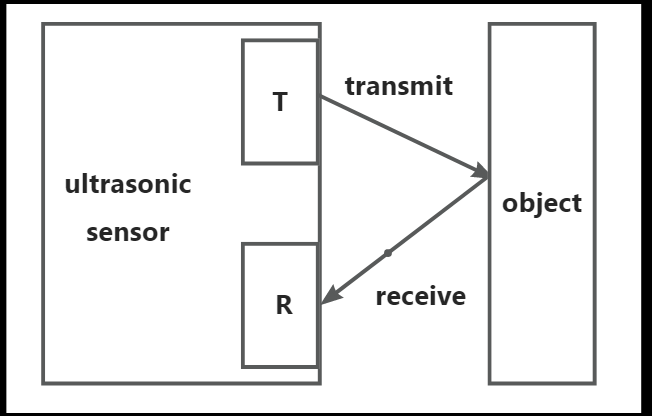

**Ranging principle:** During ranging, the module automatically transmits eight 40 kHz square waves and checks for a return signal. If a return signal is detected, the module outputs a high-level signal. The duration of the high-level signal is the time required for the ultrasonic wave to travel to the object and return.

**Formula:** Distance = (high-level duration x speed of sound (340 m/s)) / 2

After intelligent obstacle avoidance starts, the ultrasonic sensor measures the distance to an object ahead and controls TurboPi accordingly. When the measured distance is greater than the configured distance, TurboPi moves forward. When the measured distance is less than the configured distance, TurboPi stops moving forward and turns to avoid the obstacle.

<p id="section-4-7-2"></p>

### 4.7.2 Starting and Stopping the Feature

> [!NOTE]
>
> **Commands are case-sensitive and space-sensitive. Press the Tab key to autocomplete keywords.**

1. Power on TurboPi and connect through the VNC remote connection tool.

   

2. Click the icon  in the upper-left corner of the system desktop to open a command-line terminal.

   

3. Enter the command below and press **Enter** to enter the intelligent obstacle avoidance feature.

```bash
ros2 service call /avoidance_node/enter std_srvs/srv/Trigger {}
```

4. Enter the command below and press **Enter** to set the obstacle avoidance parameters. This example sets an obstacle avoidance threshold of 30 cm and a speed value of 40.

```bash
ros2 service call /avoidance_node/set_param interfaces/srv/SetFloat64List "{data: [30, 40]}"
```

5. Enter the command below and press **Enter** to run intelligent obstacle avoidance.

```bash
ros2 service call /avoidance_node/set_running std_srvs/srv/SetBool "{data: true}"
```

6. To stop the program, first stop intelligent obstacle avoidance, and then exit the feature. Run the following commands in order.

```bash
ros2 service call /avoidance_node/set_running std_srvs/srv/SetBool "{data: false}"
```

```bash
ros2 service call /avoidance_node/exit std_srvs/srv/Trigger {}
```

### 4.7.3 Project Outcome

After the feature starts, the returned image displays the distance to the detected object. When the distance is 30 cm or less, TurboPi turns left. When the distance is greater than 30 cm, TurboPi continues moving forward.

### 4.7.4 Program Analysis

The source code is located at **/home/ubuntu/ros2_ws/src/app/app/avoidance_node.py**.

#### 4.7.4.1 Importing Libraries

```python
import math
import time
import queue
import rclpy
import signal
import threading
import numpy as np
import pandas as pd
import cv2
from app.common import Heart
from rclpy.node import Node
from std_srvs.srv import Trigger
from geometry_msgs.msg import Twist
from std_msgs.msg import Int32
from cv_bridge import CvBridge
from sensor_msgs.msg import Image
from std_srvs.srv import SetBool, Trigger
from std_msgs.msg import UInt16, Bool
from interfaces.srv import SetInt64, SetFloat64List

from sdk.sonar import Sonar
from ros_robot_controller_msgs.msg import RGBState,RGBStates
```

Import Python libraries such as cv2 for image processing, numpy for numerical computation, and rclpy for the ROS 2 robotics development framework. These libraries provide the tools required for subsequent image operations, mathematical calculations, and robot control.

#### 4.7.4.2 Defining Class Instance Variables

```python
        self.sonar = Sonar()
        self.running = True
        self.heart = None #  Heartbeat object 
        
        self.name = name
        self.image_sub = None
        self.sonar_sub = None
        self.threshold = 30  # Centimeters
        self.speed = 0.4 
        self.distance = 500
        self.distance_data = []
        self.bridge = CvBridge()
        self.is_running = False
        self.turn = True
        self.forward = True
        self.stopMotor = True
        self.lock = threading.RLock()
        
        self.result_publisher = self.create_publisher(Image, '~/image_result', 1)  # Publish the image processing result
        self.mecanum_pub = self.create_publisher(Twist, 'cmd_vel', 1)  # Chassis control
        self.sonar_rgb_pub = self.create_publisher(RGBStates, 'sonar_controller/set_rgb', 10)
```

Initialize the obstacle avoidance node with its basic configuration. Set key parameters such as the obstacle avoidance distance threshold and motion speed, allocate storage for distance data, prepare the image-format conversion tool, and define flags for the node state, turning state, and motor state. Also create a thread lock to protect data during multitasking. This configuration prepares the node to perform obstacle avoidance, image-data processing, and motion control.

#### 4.7.4.3 Main Function Analysis

- **Initialization and instantiation**

```python
def main():
    node = AvoidanceNode('avoidance_node')
    try:
        rclpy.spin(node)
    except KeyboardInterrupt:
        node.destroy_node()
        node.sonar.setPixelColor(0, (0, 0, 0))
        node.sonar.setPixelColor(1, (0, 0, 0))        
        rclpy.shutdown()
        print('shutdown')
    finally:
        node.destroy_node()
        print('shutdown finish')

if __name__ == '__main__':
    main()
```

1. Call `init()` to initialize TurboPi.

```python
        rclpy.init()
        super().__init__(name, allow_undeclared_parameters=True, automatically_declare_parameters_from_overrides=True)
        self.sonar = Sonar()
        self.running = True
```

2. Call `reset_value()` to reset the Servo and motor variables.

```python
    def get_node_state(self, request, response):
        response.success = True
        return response
        
    def reset_value(self,):
        self.threshold = 30
        self.speed = 0.4
        self.distance = 500
        self.stopMotor = True
        self.is_running = False
        self.forward = True
        self.turn = True
```

- **Sensor detection processing**

1. Call `distance()` to obtain the ultrasonic measurement and store it in the `data` list.

   ```python
           dist = self.distance / 4.0 # Get ultrasonic sensor distance data
           self.distance_data.append(dist) # Cache distance data into a list
           data = pd.DataFrame(self.distance_data)
           data_ = data.copy()
   ```

2. To reduce false detections, calculate the average of five measurements to determine whether an obstacle has been detected.

   ```python
           data_c = data[np.abs(data - u) <= std]
           distance = data_c.mean()[0]
           if len(self.distance_data) == 5: # Take the average of multiple detections
               self.distance_data.remove(self.distance_data[0])
   ```

3. Call `putText()` from the cv2 library to display the ultrasonic distance measurement on the image.

```python
        result_image = cv2.putText(result_image, "Dist:%.1fcm"%distance, (30, 480-30), cv2.FONT_HERSHEY_SIMPLEX, 1.2, (255, 255, 0), 2)
```

#### 4.7.4.4 Subthread Analysis

Run a subthread and call `distance_callback()` to control TurboPi's obstacle avoidance.

```python
    def distance_callback(self,msg):
        self.distance = msg.data
```

1. In `distance_callback()`, set TurboPi's speed according to whether the measured distance reaches the threshold.

```python
        twist = Twist()
        if self.is_running:                
            if self.distance / 4.0 <= self.threshold:   # Check if distance threshold is reached
                twist.angular.z = 11.0

                if self.turn: # Implement a check to prevent duplicate commands
                    self.turn = False
                    self.forward = True
                    self.stopMotor = True
            else:
                twist.linear.x = float(self.speed)
                twist.angular.z = 0.0
                if self.forward: # Implement a check to prevent duplicate commands
                    self.turn = True
                    self.forward = False
                    self.stopMotor = True
            self.mecanum_pub.publish(twist)
        else:
            if self.stopMotor: # Implement a check to prevent duplicate commands
                self.stopMotor = False
            self.turn = True
            self.forward = True
            #self.mecanum_pub.publish(Twist())
```

Consider the following motor-control logic:

**if self.distance / 4.0 &lt;= self.threshold: twist.angular.z = 7.0**

**if self.turn:**

**self.turn = False**

**self.forward = True**

**self.stopMotor = True**

The first condition, **if self.distance / 4.0 &lt;= self.threshold:**, compares the measured distance with the configured threshold. If the obstacle is too close, `twist.angular.z = 7.0` sets the angular velocity and makes TurboPi turn.

The second condition, **if self.turn:**, updates `self.turn = False`, `self.forward = True`, and `self.stopMotor = True` when the condition is `True`. These state flags prevent repeated turning commands and maintain consistent control logic.

2. Determine whether an obstacle is present from the ultrasonic measurement. TurboPi moves straight when no obstacle is detected and turns when an obstacle is detected.

```python
        twist = Twist()
        if self.is_running:                
            if self.distance / 4.0 <= self.threshold:   # Check if distance threshold is reached
                twist.angular.z = 11.0

                if self.turn: # Implement a check to prevent duplicate commands
                    self.turn = False
                    self.forward = True
                    self.stopMotor = True
            else:
                twist.linear.x = float(self.speed)
                twist.angular.z = 0.0
                if self.forward: # Implement a check to prevent duplicate commands
                    self.turn = True
                    self.forward = False
                    self.stopMotor = True
            self.mecanum_pub.publish(twist)
        else:
            if self.stopMotor: # Implement a check to prevent duplicate commands
                self.stopMotor = False
            self.turn = True
            self.forward = True
            #self.mecanum_pub.publish(Twist())
```

### 4.7.5 Feature Extension

#### 4.7.5.1 Changing the Distance Threshold

The default distance threshold is 30 cm. Follow the steps below to change it. This example makes TurboPi turn left when the distance to the detected object is 20 cm or less.

1. Enter the command below and press **Enter** to open the directory containing the feature program.

```bash
cd /home/ubuntu/ros2_ws/src/app/app
```

2. Enter the command below and press **Enter** to open the program file.

```bash
vim avoidance_node.py
```

3. Locate the code shown below.

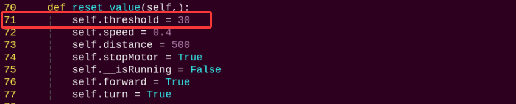

> [!NOTE]
>
> **Enter the code line number and press Shift+G to jump directly to that location. The line number shown in the figure is for reference only; use the actual line number in the file.**

4. Press **i** to enter edit mode.

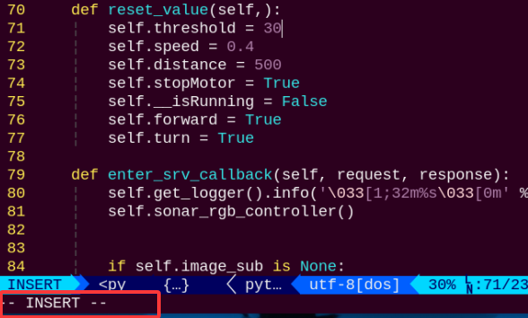

5. Change **30.0** in **Threshold = 30.0** to **20.0**, as shown below.

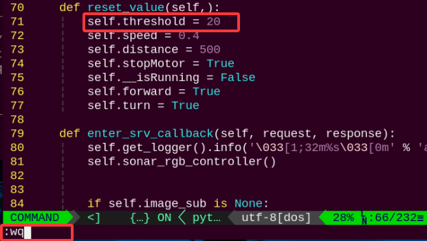

6. Press **Esc**, enter **:wq**, and press **Enter** to save the changes and close the file. The colon must appear before `wq`.


7. Follow [**4.7.2 Starting and Stopping the Feature**](#section-4-7-2) to start the feature again. TurboPi now turns left when the distance to the detected object is 20 cm or less.

#### 4.7.5.2 Changing the Speed

Follow the steps below to change TurboPi's motion speed. This example changes the speed setting to 20.

1. Enter the command below and press **Enter** to switch to the source-code directory.

```bash
cd /home/ubuntu/ros2_ws/src/app/app
```

2. Enter the command below and press **Enter** to open the program file.

```bash
vim avoidance_node.py
```

3. Locate the code shown below.

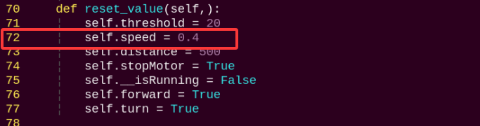

> [!NOTE]
>
> **Enter the code line number and press Shift+G to jump directly to that location. The line number shown in the figure is for reference only; use the actual line number in the file.**

4. Press **i** to enter edit mode.

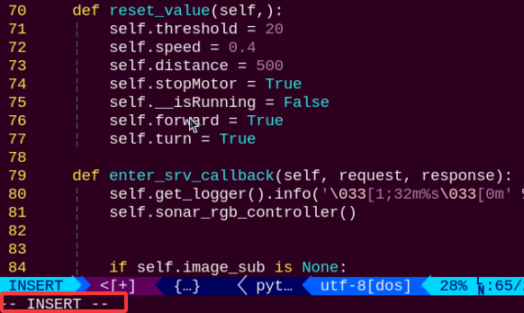

5. Change **0.4** in **speed = 0.4** to **0.2**, as shown below.

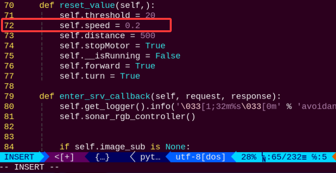

6. Press **Esc**, enter the command below, and press **Enter** to save the changes and close the file. The colon must appear before `wq`.

```bash
:wq
```

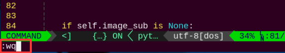

7. Follow [**4.7.2 Starting and Stopping the Feature**](#section-4-7-2) to start the feature again. TurboPi now travels at the speed setting of 20.

## 4.8 Traffic Light Navigation

### 4.8.1 Feature Overview

This section uses the camera to recognize traffic lights and a line-following sensor to follow a line. TurboPi stops and waits when it detects a red light, and resumes line following when it detects a green light.

Traffic light navigation consists of color recognition and line following. The line-following process is described below.

A four-channel line-following sensor guides TurboPi along the line.

First, the four-channel line-following sensor detects the black line, allowing TurboPi to travel along it.

The sensor has four probes. Each probe contains an infrared transmitter and an infrared receiver.

Black surfaces absorb infrared light. When a probe is over a black background, the infrared receiver cannot receive the light emitted by the transmitter. After signal shaping by a Schmitt trigger, the sensor outputs a high level, represented by 1. When a probe is over a white or light-colored background, the infrared receiver detects the emitted light. After signal shaping, the sensor outputs a low level, represented by 0. The corresponding blue LED on the back of the line-following sensor turns on for 1 and turns off for 0. During travel, camera-based color recognition is also used. When TurboPi recognizes a red traffic light, it stops. When it recognizes a green traffic light, it continues moving. For the color recognition principle, refer to [**4.2 Color Recognition**](#section-4-2).

### 4.8.2 Starting and Stopping the Feature

> [!NOTE]
>
> **Commands are case-sensitive and space-sensitive. Press the Tab key to autocomplete keywords.**

1. Power on the device and connect through the VNC remote connection tool.


2. Click the icon  in the upper-left corner of the system desktop to open a command-line terminal.


3. Enter the command below and press **Enter** to switch to the feature program directory.

```bash
cd /home/ubuntu/ros2_ws/src/example/example
```

4. Enter the command below and press **Enter** to start the feature and open the camera window.

```bash
python3 line_follower.py
```

5. Open another red command-line terminal. Enter the command below and press **Enter** to start the feature.

```bash
ros2 service call /start_game example_interfaces/srv/SetBool "{data: true}"
```

6. To stop the feature, enter the command below in the terminal opened in step 5 and press **Enter**. Then press **Ctrl+C** in the red command-line terminal used in step 4. If the program does not stop, press **Ctrl+C** repeatedly.

```bash
ros2 service call /stop_game example_interfaces/srv/SetBool "{data: true}"
```

### 4.8.3 Project Outcome

> [!NOTE]
>
> **After placing the robot on the map, adjust the camera angle so that no part of the robot appears in the returned image. Otherwise, feature operation may be affected.**

After starting the feature, place the robot on a map containing traffic lights and a route made from black tape. When the robot reaches a traffic light, it recognizes the signal color. It stops for red and continues for green.

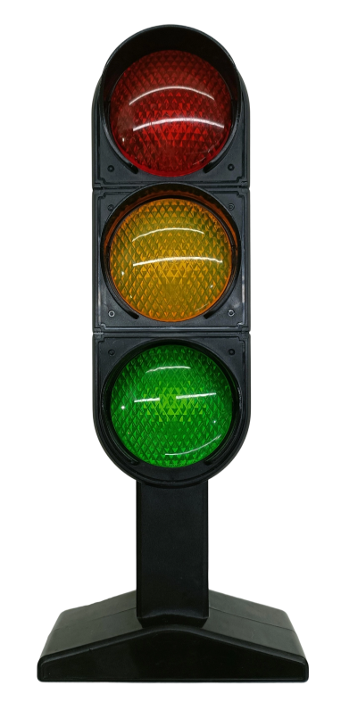


### 4.8.4 Program Analysis

The source code is located at **/home/ubuntu/ros2_ws/src/example/example/line_follower.py**.

#### 4.8.4.1 Importing Libraries

1. Import Python libraries such as cv2 for image processing, numpy for numerical computation, and rclpy for the ROS 2 robotics development framework. These libraries provide the tools required for subsequent image operations, mathematical calculations, and robot control.

```python
import sys
import time
import math
import signal
import threading
import numpy as np
import cv2
import yaml
import rclpy
from rclpy.node import Node
from std_msgs.msg import String
from geometry_msgs.msg import Twist
from sensor_msgs.msg import Image
from cv_bridge import CvBridge
from rclpy.service import Service
from example_interfaces.srv import SetBool
import sdk.FourInfrared as infrared
```

2. Import libraries related to OpenCV, time, mathematics, and threading. Call a function from a library by using **library_name + function_name(parameters)**, as shown below.

```python
	        cv2.imshow('Processed Frame', frame)
```

Python includes built-in libraries such as **time**, **cv2**, and **math**, which can be imported and called directly. Custom libraries can also be created, such as the `CvBridge` file-reading library shown above.

#### 4.8.4.2 Main Function Analysis

In a Python program, **`__name__ == '__main__'`** identifies the main function. First, call `init()` to initialize the configuration. In this program, initialization returns the Servos to their initial positions and reads the color threshold file. Other programs may also initialize ports, peripherals, timed interrupts, and related configurations.

```python
def main(args=None):
    rclpy.init(args=args)
    robot_controller = RobotController()
    rclpy.spin(robot_controller)
    robot_controller.destroy_node()
    rclpy.shutdown()


if __name__ == '__main__':
    main()
```

#### 4.8.4.3 Node and Hardware Initialization

1. Create the ROS 2 node **RobotController**, and initialize topics, services, timers, and hardware interfaces.

   ```python
   class RobotController(Node):
       def __init__(self):
           super().__init__('robot_controller')
   
           # Initialize publisher 
           self.mecanum_pub = self.create_publisher(Twist, '/cmd_vel', 1)
           self.color_pub = self.create_publisher(String, '/detected_color', 10)
           self.rgb_pub = self.create_publisher(RGBStates, '/ros_robot_controller/set_rgb', 1)
           self.buzzer_pub = self.create_publisher(BuzzerState, '/ros_robot_controller/set_buzzer', 1)
   ```

   The first parameter, **/cmd_vel**, publishes robot motion commands, including linear and angular velocity.

   The second parameter, **/detected_color**, publishes detected color information.

   The third parameters, **/set_rgb** and **/set_buzzer**, control the RGB light and Buzzer.

2. Implement services for starting and stopping the robot-control feature.

   ```python
   	    # Start and stop game services
           self.start_service = self.create_service(SetBool, 'start_game', self.start_game_callback)
           self.stop_service = self.create_service(SetBool, 'stop_game', self.stop_game_callback)
   ```

3. Use **/image_raw** to receive raw camera images.

   ```python
   	        self.image_sub = self.create_subscription(Image, '/image_raw', self.image_callback, 10)
   ```

4. Read the four-channel infrared sensor data through the **FourInfrared** class.

   ```python
   	    # Initialize infrared line-following sensors
           self.line = infrared.FourInfrared()
   ```

#### 4.8.4.4 Image Processing

Resize the input image to a fixed size of 640 x 480, and apply Gaussian filtering to reduce noise.

```python
	    frame_resize = cv2.resize(img_copy, self.size, interpolation=cv2.INTER_NEAREST)
        frame_gb = cv2.GaussianBlur(frame_resize, (3, 3), 3)
        frame_lab = cv2.cvtColor(frame_gb, cv2.COLOR_BGR2LAB)
```

- **Resize the image for easier processing.**

```python
	    frame_resize = cv2.resize(img_copy, self.size, interpolation=cv2.INTER_NEAREST)
```

The first parameter, **img_copy**, is the input image.

The second parameter, **self.size**, specifies the output image size.

The third parameter, **interpolation=cv2.INTER_NEAREST**, specifies the interpolation method. `INTER_NEAREST` uses nearest-neighbor interpolation. `INTER_LINEAR` uses bilinear interpolation and is the default when this parameter is omitted. `INTER_CUBIC` uses bicubic interpolation over a 4 x 4 pixel neighborhood. `INTER_LANCZOS4` uses Lanczos interpolation over an 8 x 8 pixel neighborhood.

- **Apply Gaussian filtering.**

  Images often contain noise that reduces image quality and obscures features. Select an appropriate filtering method for the type of noise. Common methods include Gaussian filtering, median filtering, and mean filtering.

  Gaussian filtering is a linear smoothing filter suitable for removing Gaussian noise. It is widely used for noise reduction in image processing.

```python
        frame_gb = cv2.GaussianBlur(frame_resize, (3, 3), 3)
```

The first parameter, **frame_resize**, is the input image.

The second parameter, **(3, 3)**, specifies the Gaussian kernel size.

The third parameter, **3**, specifies the standard deviation of the Gaussian kernel in the X direction.

- **Convert the image to the LAB color space. The `cv2.cvtColor()` function performs color-space conversion.**

```python
        frame_gb = cv2.GaussianBlur(frame_resize, (3, 3), 3)
        frame_lab = cv2.cvtColor(frame_gb, cv2.COLOR_BGR2LAB)
```

The first parameter, **frame_gb**, is the input image.

The second parameter, **cv2.COLOR_BGR2LAB**, specifies the conversion format. **cv2.COLOR_BGR2LAB** converts a BGR image to LAB. To convert a BGR image to RGB, use **cv2.COLOR_BGR2RGB**.

- **After completing the image processing above, obtain the target contour with the `findContours()` function from the cv2 library.**

```python
        frame_gb = cv2.GaussianBlur(frame_resize, (3, 3), 3)
        frame_lab = cv2.cvtColor(frame_gb, cv2.COLOR_BGR2LAB)
```

The first parameter, **closed**, is the input image.

The second parameter, **cv2.RETR_EXTERNAL**, specifies the contour retrieval mode.

The third parameter, **cv2.CHAIN_APPROX_NONE)[-2]**, specifies the contour approximation method.

Find the contour with the largest area. To reduce interference, set a minimum threshold; the target contour is considered valid only when its area is greater than this threshold.

```python
	                if contour is not None and area > max_area:
                    max_area = area
                    color_area_max = color
                    max_contour = contour
        
        if max_area > 2500 and max_contour is not None:
            rect = cv2.minAreaRect(max_contour)
            box = np.intp(cv2.boxPoints(rect))
            cv2.drawContours(img, [box], -1, (0, 255, 0), 2)
            self.detect_color = color_area_max
        else:
            self.detect_color = "None"

        cv2.putText(img, "Color: " + self.detect_color, (10, img.shape[0] - 10),
                    cv2.FONT_HERSHEY_SIMPLEX, 0.65, (255, 0, 0), 2)
```

```python
	    def get_area_max_contour(self, contours):
        """Get largest contour and its area """
        area_max = 0
        contour_max = None
        for c in contours:
            area = abs(cv2.contourArea(c))
            if area > area_max and area > 300:  # Area threshold to avoid noise
                area_max = area
                contour_max = c
        return contour_max, area_max
```

- **Use a conditional statement to determine the color with the largest area in the image.**

```python
        for color in self.target_color:
            if color in self.lab_data:
                min_lab = tuple(self.lab_data[color]['min'])
                max_lab = tuple(self.lab_data[color]['max'])

                mask = cv2.inRange(frame_lab, min_lab, max_lab)
                mask = cv2.morphologyEx(mask, cv2.MORPH_OPEN, np.ones((3,3), np.uint8))
                mask = cv2.morphologyEx(mask, cv2.MORPH_CLOSE, np.ones((3,3), np.uint8))

                contours = cv2.findContours(mask, cv2.RETR_EXTERNAL, cv2.CHAIN_APPROX_SIMPLE)[-2]
                contour, area = self.get_area_max_contour(contours)

                if contour is not None and area > max_area:
                    max_area = area
                    color_area_max = color
                    max_contour = contour
        
        if max_area > 2500 and max_contour is not None:
            rect = cv2.minAreaRect(max_contour)
            box = np.intp(cv2.boxPoints(rect))
            cv2.drawContours(img, [box], -1, (0, 255, 0), 2)
            self.detect_color = color_area_max
        else:
            self.detect_color = "None"

        cv2.putText(img, "Color: " + self.detect_color, (10, img.shape[0] - 10),
                    cv2.FONT_HERSHEY_SIMPLEX, 0.65, (255, 0, 0), 2)

        return img
```

#### 4.8.4.5 Displaying the Returned Image

```python
	def image_callback(self, img_msg):
        """Image callback: convert to OpenCV image and process for color detection"""
        img = self.bridge.imgmsg_to_cv2(img_msg, 'bgr8')
        frame = self.process_image(img)
        cv2.imshow('Processed Frame', frame)
        cv2.waitKey(1)
```

The `cv2.imshow()` function displays an image in a window. **frame** is the window name, and **frame_resize** is the displayed content. A subsequent `cv2.waitKey()` call is required; otherwise, the image cannot be displayed.

The `cv2.waitKey()` function waits for keyboard input. The parameter **1** specifies the delay time.

### 4.8.5 Subthread Analysis

The `line_following()` motion function runs as a subthread. After a color is recognized, the program executes `line_following()`.

The function evaluates the image-processing result and performs the corresponding response, including control of the RGB light, Buzzer, and four-channel line-following sensor.

```python
	def line_following(self):
        """
        Line-following logic (sensor signal logic has been inverted):
        Now True means black line detected, False means no black line — as per your requirement
        """

        raw_data = self.line.readData()
        # Invert sensor states to simplify later judgment, True means black line detected 
        sensor_data = [not s for s in raw_data]

	        self.get_logger().info(f"传感器状态（True检测到线）: S0={sensor_data[0]}, S1={sensor_data[1]}, S2={sensor_data[2]}, S3={sensor_data[3]}")

        # Control movement based on inverted signal status 
        if sensor_data[0] and not sensor_data[1] and sensor_data[2] and sensor_data[3]:
            self.get_logger().info("执行：右大转弯")
            self.sharp_right_turn()

        elif sensor_data[0] and  sensor_data[1] and  not sensor_data[2] and sensor_data[3]:
            self.get_logger().info("执行：左大转弯")
            self.sharp_left_turn()

        elif all(sensor_data):
            self.get_logger().info("所有传感器检测到黑线，停止机器人")
            self.stop_robot()

        elif sensor_data[0] and not sensor_data[1] and not sensor_data[2] and sensor_data[3]:
            self.get_logger().info("执行：直走")
            self.move_forward()

        elif not sensor_data[0] and not sensor_data[1]  and  sensor_data[2] and  sensor_data[3]:
            self.get_logger().info("执行：左转")
            self.turn_left()

        elif  sensor_data[0] and  sensor_data[1] and not sensor_data[2] and not sensor_data[3]:
            self.get_logger().info("执行：右转")
            self.turn_right()

        elif sensor_data[0] and  sensor_data[1] and not sensor_data[2] and sensor_data[3]:
            self.get_logger().info("执行：右转")
            self.turn_right()

        elif sensor_data[0] and not sensor_data[1] and   sensor_data[2] and sensor_data[3]:
            self.get_logger().info("执行：左转")
            self.turn_left()

        elif  sensor_data[0] and not  sensor_data[1] and not sensor_data[2] and not sensor_data[3]:
            self.get_logger().info("执行：右大转弯")
            self.sharp_right_turn()

        elif not sensor_data[0] and not sensor_data[1] and not sensor_data[2] and  sensor_data[3]:
            self.get_logger().info("执行：左大转弯")
            self.sharp_left_turn()

        elif  sensor_data[0] and not sensor_data[1] and not sensor_data[2] and sensor_data[3]:
            self.get_logger().info("执行：直走")
            self.move_forward()

        elif sensor_data[0] and sensor_data[1] and sensor_data[2] and sensor_data[3]:
            self.get_logger().info("所有传感器都检测到线，继续前进")
            self.move_forward()

        else:
            self.get_logger().info("传感器状态异常，停止机器人")
            self.stop_robot()
```

#### 4.8.5.1 Turning On the RGB Light

The RGB light matches the recognized color.

```python
	def set_rgb(self, color):
        """Set RGB light color, mapping color name to RGB value """
        rgb_msg = RGBStates()
        rgb_state1 = RGBState()
        rgb_state1.index = 1
        rgb_state2 = RGBState()
        rgb_state2.index = 2

        if color == "red":
            rgb_state1.red, rgb_state1.green, rgb_state1.blue = 255, 0, 0
            rgb_state2.red, rgb_state2.green, rgb_state2.blue = 255, 0, 0
        elif color == "green":
            rgb_state1.red, rgb_state1.green, rgb_state1.blue = 0, 255, 0
            rgb_state2.red, rgb_state2.green, rgb_state2.blue = 0, 255, 0
        elif color == "yellow":
            rgb_state1.red, rgb_state1.green, rgb_state1.blue = 255, 255, 0
            rgb_state2.red, rgb_state2.green, rgb_state2.blue = 255, 255, 0
        else:  # Turn off light 
            rgb_state1.red, rgb_state1.green, rgb_state1.blue = 0, 0, 0
            rgb_state2.red, rgb_state2.green, rgb_state2.blue = 0, 0, 0

        rgb_msg.states = [rgb_state1, rgb_state2]
        self.rgb_pub.publish(rgb_msg)
	        self.get_logger().info(f"设置RGB灯为：{color}")
```

#### 4.8.5.2 Driving the Buzzer

```python
	def play_buzzer(self):
        """Activate buzzer"""
        buzzer_msg = BuzzerState()
        buzzer_msg.freq = 1000  # Frequency: 1000Hz 
        buzzer_msg.on_time = 0.1  # Buzz duration: 0.1 seconds 
        buzzer_msg.off_time = 0.1  # Silence duration: 0.1 seconds 
        buzzer_msg.repeat = 1  # Repeat count 
        self.buzzer_pub.publish(buzzer_msg)
        self.get_logger().info("蜂鸣器响起")
```

The `setBuzzer()` function drives the Buzzer. In the code shown above:

The first parameter, **1000**, specifies the frequency.

The second parameter, **0.1**, specifies the Buzzer on-time in seconds.

The third parameter, **0.1**, specifies the Buzzer off-time in seconds.

The fourth parameter, **1**, specifies the number of repetitions. The default is 1.
## 4.9 Simple Line-Following Transport

### 4.9.1 Feature Overview

This section combines line following, color recognition, and robotic arm gripper control to implement a simple line-following transport feature.

After the feature starts, TurboPi travels along a black line and recognizes target objects placed on the line. By default, the program uses a red object as the grasping target. When TurboPi reaches the target point, the robotic arm grasps the red object. TurboPi then continues following the line and places the object at the next T-shaped intersection or designated location.

This feature combines visual line following, color recognition, chassis motion control, and robotic arm gripper control introduced in the preceding sections.

### 4.9.2 Starting and Stopping the Feature

> [!NOTE]
>
> **Commands are case-sensitive and space-sensitive. Press the Tab key to autocomplete keywords.**

1. Power on the device and connect through the VNC remote connection tool.


2. Click the icon  in the upper-left corner of the system desktop to open a command-line terminal.


3. If another ROS program has been run previously, enter the command below to stop the auto-start service or any remaining nodes.

```bash
~/.stop_ros.sh
```

4. Enter the command below and press **Enter** to start the feature.

```bash
ros2 launch example line_follow_transport.launch.py
```

5. Open another command-line terminal. Enter the command below and press **Enter** to run the feature.

```bash
ros2 service call /line_follow_transport/start std_srvs/srv/Trigger "{}"
```

6. To stop the feature, press **Ctrl+C** in the terminal running the launch file. If the ROS nodes do not exit correctly, run the following command.

```bash
~/.stop_ros.sh
```

### 4.9.3 Project Outcome

After the feature starts, TurboPi travels along the black line. At the target point, the robot recognizes and grasps the red object on the line. After grasping the object, it continues following the line, stops at the next T-shaped intersection or designated placement point, and places the object.

> [!NOTE]
>
> **Use black tape to create the line-following map. The default target-object color is red. Before starting, adjust the camera angle to keep the line-following area and target object within the effective recognition range.**

### 4.9.4 Program Analysis

The launch command for this feature is:

```bash
ros2 launch example line_follow_transport.launch.py
```

The source code is located at **/home/ubuntu/ros2_ws/src/example/example/line_follow_transport/line_follow_transport.py**.

The program consists mainly of line detection, target recognition, state transitions, and robotic arm control.

#### 4.9.4.1 Importing Libraries

Use `import` to load `rclpy`, `std_msgs`, `std_srvs`, custom service interfaces, and other Python libraries. These libraries provide tools for ROS 2 node communication, state control, and task scheduling. The program communicates with the line-following module and color-tracking grasping module through services and topics.

```python
import rclpy
from rclpy.node import Node
from std_msgs.msg import Bool, String
from std_srvs.srv import SetBool, Trigger
from interfaces.srv import SetString
```

1. `rclpy` is the ROS 2 Python client library. It initializes ROS 2, creates nodes, and keeps nodes running.

2. `Bool` and `String` from `std_msgs.msg` receive status information published by other nodes, such as whether an object has been grasped, the current status of the visual grasping module, and whether the line-following node has reached an intersection.

3. `SetBool` and `Trigger` from `std_srvs.srv` create or call ROS 2 services. `Trigger` commonly triggers an action, while `SetBool` commonly enables or disables a feature.

4. `SetString` from `interfaces.srv` is a custom string service interface. This program uses it to set the target color and send control commands to the line-following node.

#### 4.9.4.2 Main Function Analysis

In a Python program, `__name__ == '__main__'` identifies the main function.

After startup, the program creates the `line_follow_transport` controller node and initializes the service clients and subscribers required by the line-following and grasping modules. By default, the program recognizes and grasps a red target object. It also creates a start service and timer to receive the start command and schedule state processing periodically.

```python
def main():
    """
    Start the line-following transport coordinator.
    """
    rclpy.init()
    node = LineFollowTransport()
    try:
        rclpy.spin(node)
    except KeyboardInterrupt:
        pass
    finally:
        node.destroy_node()
        rclpy.shutdown()


if __name__ == '__main__':
    main()
```

#### 4.9.4.3 State Transition Analysis

A state machine controls the complete line-following transport process. The primary states are:

- `IDLE`: Waits for a start command.
- `STARTING`: Initializes the line-following and grasping modules.
- `WAITING_PICK`: Follows the line and waits for a successful grasp.
- `WAITING_CROSSROADS`: Continues following the line after grasping and waits to stop at the next intersection.
- `PLACING`: Places the object after reaching the placement point.

```python
    # ── state tick ───────────────────────────
    def _tick(self):
        """
        Advance the transport workflow state machine.
        """
        if self.state == 'STARTING':
            if not self.lf_ready:
                if self.lf_init_cli.wait_for_service(timeout_sec=0.1):
                    self.lf_init_cli.call_async(Trigger.Request())
                    self.lf_ready = True
                    self.get_logger().info('line_follow init OK')

            if not self.ctp_ready:
                if self.ctp_init_cli.wait_for_service(timeout_sec=0.1):
                    self.ctp_init_cli.call_async(Trigger.Request())
                    self.ctp_ready = True
                    self.get_logger().info('color_track_pick init OK')

            if self.lf_ready and self.ctp_ready and not self.started:
                self.started = True
                self._set_target_color(self.target_color)
                self._set_running(self.ctp_run_cli, 'color_track_pick', True)
                if self._start_lf_timer is not None:
                    self._start_lf_timer.cancel()
                self._start_lf_timer = self.create_timer(2.0, self._start_lf)

        elif self.state == 'WAITING_PICK':
            if self.was_picked:
                self.get_logger().info('\033[1;35mPick done — sending STOP_NEXT_ROAD\033[0m')
                self._send_cmd()
                self.crossroads_stop_received = False
                self.state = 'WAITING_CROSSROADS'

        elif self.state == 'WAITING_CROSSROADS':
            if self.crossroads_stop_received:
                self.get_logger().info('\033[1;33mCrossroads stop — placing\033[0m')
                self._set_running(self.lf_run_cli, 'line_follow', False)
                self.state = 'PLACING'

        elif self.state == 'PLACING':
            if self.ctp_state == 'IDLE' and not self.ctp_picked:
                self.get_logger().info('\033[1;32mPlace complete\033[0m')
                self._set_running(self.ctp_run_cli, 'color_track_pick', False)
                self.state = 'IDLE'
                self.get_logger().info('\033[1;32mSequence done — ready\033[0m')
```

1. In the `IDLE` state, no transport task is running, and the program can receive a new start command.

2. After the `/line_follow_transport/start` service is called, the program enters the `STARTING` state and waits for the line-following and color-tracking grasping modules to initialize.

3. When both modules are ready, the program sets the target color to `red` by default and starts the color-tracking grasping module.

4. The program does not start line following immediately. Instead, a timer delays the start of the line-following module by 2 seconds. This delay gives the color-tracking grasping module time to prepare before TurboPi begins moving.

#### 4.9.4.4 Coordinated Robotic Arm and Chassis Control

The program uses `SetBool` services to enable or disable the line-following and grasping modules. It uses `SetString` services to set the target color and send line-following commands.

```python
    def _set_running(self, cli, name, enable):
        """
        Send an asynchronous running-state request to a child node.

        Args:
            cli: ROS2 service client 
            name: Child-node display name
            enable: Desired running state 
        """
        if not cli.wait_for_service(timeout_sec=1.0):
            self.get_logger().warn(f'\033[1;31m{name} unavailable\033[0m')
            return
        req = SetBool.Request()
        req.data = enable
        cli.call_async(req)
        self.get_logger().info(f'{name} running={enable}')

    def _send_cmd(self):
        """
        Ask line following to stop at the next crossroads.

        """
        if not self.lf_cmd_cli.wait_for_service(timeout_sec=1.0):
            self.get_logger().warn('\033[1;31mLF cmd unavailable\033[0m')
            return
        req = SetString.Request()
        req.data = 'stop_next_road'
        self.lf_cmd_cli.call_async(req)
        self.get_logger().info('\033[1;36mSent: STOP_NEXT_ROAD\033[0m')
```

1. The `_set_running()` function enables or disables a feature module. For example, sending `True` to `/line_follow/set_running` starts the line-following module, while sending `False` stops it.

2. The `_set_target_color()` function sets the grasping target color. By default, the program sends `red` to recognize and grasp a red object.

3. The `_send_cmd()` function sends control commands to the line-following node. After detecting a successful grasp, the program sends the `stop_next_road` command to make TurboPi stop at the next intersection or designated stopping point.

After detecting a successful grasp, the program sends the stop-at-next-intersection command to the line-following node. At the designated location, the program stops line following and waits for the grasping module to place the object. After placement is complete, the program disables the grasping module and returns to the idle state.

## 4.10 Visual Tracking and Grasping

### 4.10.1 Feature Overview

This section combines camera-based recognition and tracking of an object with a specified color with robotic arm gripper control to implement visual tracking and grasping.

After the feature starts, the program uses a red object as the default grasping target. The robot tracks and aligns itself according to the target position in the camera image. When the target enters the appropriate grasping area, the robotic arm grasps it.

This feature combines color recognition, target tracking, pan-tilt and chassis adjustment, and robotic arm grasping control.

### 4.10.2 Starting and Stopping the Feature

> [!NOTE]
>
> **Commands are case-sensitive and space-sensitive. Press the Tab key to autocomplete keywords.**

1. Power on the device and connect through the VNC remote connection tool.


2. Click the icon  in the upper-left corner of the system desktop to open a command-line terminal.


3. If another ROS program has been run previously, enter the command below to stop the auto-start service or any remaining nodes.

```bash
~/.stop_ros.sh
```

4. Enter the command below and press **Enter** to start the feature.

```bash
ros2 launch example color_track_pick.launch.py
```

5. Open another command-line terminal and enter the command below to set the target color. This example sets the target color to red.

```bash
ros2 service call /color_track_pick/set_target_color interfaces/srv/SetString "{data: 'red'}"
```

6. After the program tracks and grasps the target, enter the command below to place the object.

```bash
ros2 service call /color_track_pick/place std_srvs/srv/SetBool "{data: true}"
```

7. To stop the feature, press **Ctrl+C** in the terminal running the launch file. If the ROS nodes do not exit correctly, run the following command.

```bash
~/.stop_ros.sh
```

### 4.10.3 Project Outcome

After the feature starts, the camera recognizes an object with the target color. By default, the robot aligns with and tracks a red object. When the target enters the appropriate grasping range, the robotic arm grasps it. After the placement command is executed, the robotic arm releases the grasped object.

> [!NOTE]
>
> **Maintain sufficient lighting during recognition, ensure that the target color contrasts clearly with the background, and keep objects with similar colors out of the background.**

### 4.10.4 Program Analysis

The launch command for this feature is:

```bash
ros2 launch example color_track_pick.launch.py
```

The source code is located at **/home/ubuntu/ros2_ws/src/example/example/color_track_pick/color_track_pick.py**.

The program consists mainly of target-color configuration, image recognition, target tracking and approach, robotic arm grasping, and placement control.

#### 4.10.4.1 Importing Libraries

Use `import` to load `cv2`, `numpy`, `rclpy`, `CvBridge`, `PID`, ROS 2 messages and service interfaces, and other Python libraries. These libraries provide tools for image processing, node communication, chassis motion control, Servo control, and task scheduling.

```python
import cv2
import queue
import threading
import numpy as np
import time
import rclpy
from rclpy.node import Node
from cv_bridge import CvBridge
from sdk.pid import PID
from sensor_msgs.msg import Image
from geometry_msgs.msg import Twist
from std_msgs.msg import Bool, String
from std_srvs.srv import SetBool, Trigger
from interfaces.srv import SetString
from ros_robot_controller_msgs.msg import SetPWMServoState, PWMServoState
import sdk.yaml_handle as yaml_handle
```

1. `cv2` is the OpenCV image-processing library. It resizes and filters images, converts color spaces, performs binarization, finds contours, and draws recognition results on images.

2. `numpy` supports numerical computation and image-mask processing, such as creating an ROI mask and restricting the target-recognition area.

3. `rclpy` and `Node` create ROS 2 nodes, allowing the program to publish topics, subscribe to images, create services, and call services from other nodes.

4. `CvBridge` converts between ROS image messages and OpenCV image formats. The camera publishes ROS 2 `Image` messages, while OpenCV processes images as arrays, so `CvBridge` performs the required conversion.

5. `PID` corrects the motion direction during target tracking. When the target center deviates from the image center, the PID algorithm calculates the angular velocity required to turn TurboPi toward the target.

6. The beginning of the program also defines Servo IDs and Servo position parameters. For example, `SERVO_ARM` identifies the robotic arm lift Servo, and `SERVO_GRIPPER` identifies the gripper Servo. `ARM_DOWN`, `ARM_UP`, `GRIP_CLOSE`, and `GRIP_OPEN` define the positions for lowering the arm, raising the arm, closing the gripper, and opening the gripper, respectively.

7. Parameters such as `IMG_SIZE`, `IMG_CENTER_X`, `APPROACH_Y_MIN`, and `PICK_Y_THRESHOLD` support image recognition and grasping decisions. `IMG_CENTER_X` specifies the horizontal coordinate of the image center. `PICK_Y_THRESHOLD` specifies the target's vertical position at which grasping can begin.

#### 4.10.4.2 Main Function Analysis

In a Python program, `__name__ == '__main__'` identifies the main function.

After startup, call `rclpy.init()` to initialize ROS 2, and then create the `ColorTrackPick()` node. During node initialization, read the color threshold file, create the image conversion tool, initialize topic publishers, topic subscribers, service clients, and node services, and start the image-processing thread to receive and process camera images continuously.

```python
def main():
    """
    Start the color tracking pick-and-place node.

    """
    rclpy.init()
    node = ColorTrackPick()
    try:
        rclpy.spin(node)
    except KeyboardInterrupt:
        pass
    finally:
        node.destroy_node()
        rclpy.shutdown()


if __name__ == '__main__':
    main()
```

Then call `rclpy.spin(node)` to keep the node running. When the program exits, destroy the node and shut down ROS 2.

#### 4.10.4.3 Image Recognition and Tracking Analysis

Image recognition is performed mainly in the `process()` function. After a camera image enters the program, resize and filter it, convert its color space, extract the target region according to the target color threshold, and filter the contours to obtain the target center and radius.

```python
    def process(self, img):
        """
        Detect the target color and advance the manipulation state machine.


        Args:
            img: BGR image to process 

        Returns:
            Annotated BGR image 
        """
        h, w = img.shape[:2]
        resized = cv2.resize(img, IMG_SIZE, interpolation=cv2.INTER_NEAREST)
        blurred = cv2.GaussianBlur(resized, (3, 3), 3)
        lab = cv2.cvtColor(blurred, cv2.COLOR_BGR2LAB)

        if self.target_color is None:
            self._state_machine(False, 0, 0, 0)
            return self._draw_overlays(img, w, h)

        mask = cv2.inRange(lab,
                           (self.target_color['min'][0], self.target_color['min'][1], self.target_color['min'][2]),
                           (self.target_color['max'][0], self.target_color['max'][1], self.target_color['max'][2]))
        eroded = cv2.erode(mask, cv2.getStructuringElement(cv2.MORPH_RECT, (3, 3)))
        dilated = cv2.dilate(eroded, cv2.getStructuringElement(cv2.MORPH_RECT, (3, 3)))
        # Keep only the central region to suppress edge detections.
        roi_mask = np.zeros(IMG_SIZE[::-1], dtype=np.uint8)
        rx = (IMG_SIZE[0] - ROI_W) // 2
        ry = (IMG_SIZE[1] - ROI_H) // 2
        cv2.rectangle(roi_mask, (rx, ry), (rx + ROI_W, ry + ROI_H), 255, -1)
        dilated = cv2.bitwise_and(dilated, dilated, mask=roi_mask)
        contours = cv2.findContours(dilated, cv2.RETR_EXTERNAL, cv2.CHAIN_APPROX_NONE)[-2]
```

1. **Image resizing**

   Call `cv2.resize()` to resize the input image to `IMG_SIZE`, which is 320 x 240. Using a consistent image size reduces computation and supports fixed thresholds for subsequent target-position decisions.

2. **Gaussian filtering**

   Call `cv2.GaussianBlur()` to apply Gaussian filtering and reduce the effect of image noise on color recognition.

3. **Conversion to the LAB color space**

   Call `cv2.cvtColor(blurred, cv2.COLOR_BGR2LAB)` to convert the image from BGR to LAB. The LAB color space is more suitable for color-threshold segmentation and can reduce the effect of lighting changes on color recognition.

4. **Color-threshold segmentation**

   After setting the target color, call `cv2.inRange()` to generate a binary image according to the target color's LAB threshold. Areas within the target color range become white, while all other areas become black.

5. **Erosion and dilation**

   First, call `cv2.erode()` to erode the image and remove small noise points. Then call `cv2.dilate()` to dilate the image and make the target region more complete.

6. **ROI restriction**

   Create an ROI mask that retains only approximately 90% of the image width and 80% of the image height around the center. This mask reduces edge interference and prioritizes targets near the center of the image, where grasping is more practical.

7. **Contour detection and target positioning**

   Call `cv2.findContours()` to find contours in the binary image and filter out small noise regions. For valid contours, prioritize the target closest to the image centerline. Then call `cv2.minEnclosingCircle()` to calculate the target center coordinates `cx`, `cy`, and radius `radius`.

8. **Image annotation and state-machine call**

   After locating a target, draw the target circle and center point on the original image. Then call `_state_machine(found, cx, cy, radius)` to pass the recognition result to the state machine.

#### 4.10.4.4 Robotic Arm Grasping and Placement Control

A state machine controls visual tracking, target approach, grasping, and placement. The primary states are:

- `IDLE`: Waits for startup or target-color configuration.
- `TRACKING`: Tracks the target color and waits for the target to enter the valid region.
- `APPROACHING`: Moves TurboPi toward the target and uses PID control to adjust its direction.
- `PICKING`: Operates the robotic arm and gripper to grasp the object.
- `PLACING`: Places the object and returns to the idle state.

```python
    # ── service client ──────────────────────
    def _lf_set_running(self, enable):
        if not self.lf_running_cli.wait_for_service(timeout_sec=1.0):
            self.get_logger().warn('\033[1;31mLF unavailable\033[0m')
            return
        req = SetBool.Request()
        req.data = enable
        self.lf_running_cli.call_async(req)

    # ── own services ────────────────────────
    def init_finish_callback(self, req, resp):
        """
        Report that the color-picking node has initialized.

        Args:
            req: Trigger service request
            resp: Trigger service response to populate 

        Returns:
            Updated service response
        """
        resp.success = True
        return resp
```

1. The `set_target_color_callback()` function sets the target color. After the `/color_track_pick/set_target_color` service is called, the program reads the corresponding LAB threshold according to the color name and enters the `TRACKING` state.

2. The `set_running_callback()` function starts or stops color tracking and grasping. Starting the feature enters the `TRACKING` state. Stopping it enters the `IDLE` state and stops chassis motion.

3. The `place_callback()` function triggers placement. The program enters the `PLACING` state only when `has_picked` is `True`, indicating that the gripper is holding an object.

4. The `cmd_callback()` function coordinates with the line-following transport task. After an object has been grasped, if the chassis velocity remains 0 for several consecutive checks, TurboPi has stopped and the program automatically enters the `PLACING` state to place the object.
