# 5. MediaPipe Human-Robot Interaction

## 5.1 MediaPipe Introduction and Getting Started

### 5.1.1 MediaPipe Introduction

MediaPipe is an open-source framework for multimedia machine learning model applications. It supports cross-platform operation on mobile devices, workstations, and servers, as well as mobile GPU acceleration. It also supports the TensorFlow and TensorFlow Lite inference engines. Any TensorFlow or TensorFlow Lite model can be used with MediaPipe. MediaPipe also supports onboard GPU acceleration on mobile and embedded platforms.


### 5.1.2 Advantages and Disadvantages of MediaPipe

#### 5.1.2.1 Advantages of MediaPipe

1. Supports a variety of platforms and languages, including iOS, Android, C++, Python, JavaScript, and Coral.

2. Runs quickly, allowing most models to operate in real time.

3. Supports extensive reuse of models and code.

#### 5.1.2.2 Disadvantages of MediaPipe

1. MediaPipe is relatively large for mobile applications and requires at least 10 MB of storage.

2. It depends heavily on TensorFlow. Switching to another machine learning framework requires extensive code changes.

3. It uses static graphs. Although static graphs improve efficiency, they also make errors more difficult to locate.

### 5.1.3 MediaPipe Workflow

The figure below shows the MediaPipe workflow. The sections shown with solid lines require custom code. The sections shown with dashed lines do not. MediaPipe integrates AI-related models and can quickly produce the framework required to implement a feature.

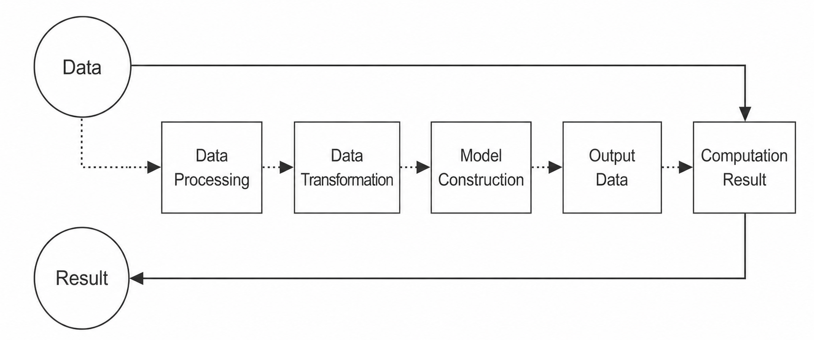

#### 5.1.3.1 Dependencies

MediaPipe depends on OpenCV for video processing and FFmpeg for audio-data processing. Other dependencies include OpenGL or Metal, TensorFlow, and Eigen.

A basic understanding of OpenCV is recommended before starting with MediaPipe. Refer to [**9. OpenCV Computer Vision Course/Basic Course**](https://drive.google.com/drive/folders/1lTz9B2tu3bVbLJAtEk_aIqLdCXA-rcle?usp=sharing) for an introduction to OpenCV.

#### 5.1.3.2 MediaPipe Solutions

Solutions are open-source, prebuilt examples based on specific pretrained TensorFlow or TensorFlow Lite models. MediaPipe Solutions are built on the MediaPipe framework. It currently provides 16 Solutions, including face detection, Face Mesh, iris, hands, pose, and the human body.

### 5.1.4 MediaPipe Learning Resources

MediaPipe Official Website: [https://developers.google.com/mediapipe](https://developers.google.com/mediapipe)

MediaPipe GitHub: [https://github.com/google/mediapipe](https://github.com/google/mediapipe)

dlib Official Website: [http://dlib.net/](http://dlib.net/)

dlib GitHub: [https://github.com/davisking/dlib](https://github.com/davisking/dlib)

## 5.2 Background Segmentation

This section uses the MediaPipe Selfie Segmentation model to separate a trained target, such as a face or hand, from the background and add a virtual background.

### 5.2.1 Experiment Overview

First, import the MediaPipe Selfie Segmentation model and subscribe to topic messages to obtain the real-time camera feed.

Next, flip and process the image, and draw the segmentation mask on the background image. Apply bilateral filtering to improve segmentation around the edges.

Finally, replace the original background with a virtual background.

### 5.2.2 Procedure

1. Power on the robot and connect through the VNC remote connection software.

2. Click the ROS 2 command-line terminal icon  at the top of the system desktop to open a command-line terminal.

3. Enter the command below in the terminal and press **Enter** to run the feature.

```bash
cd ~/ros2_ws/src/example/example/ && python3 self_segmentation.py
```

4. To stop the feature, press **Esc** in the image window to close the camera feed.

5. Alternatively, press **Ctrl+C** in the command-line terminal. If the program does not stop, press **Ctrl+C** repeatedly.

### 5.2.3 Project Outcome

After the feature starts, the image displays a completely gray virtual background. When a person enters the camera view, the person is separated from the background.

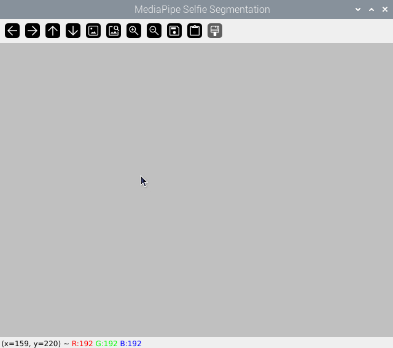

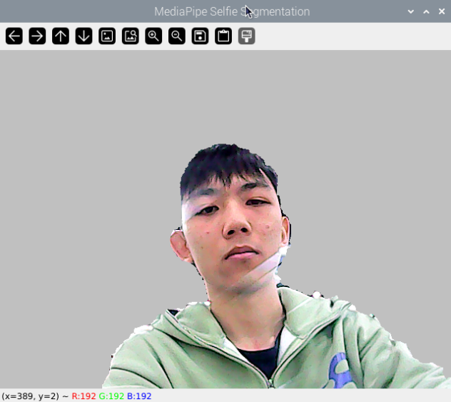

### 5.2.4 Program Analysis

The source code is located at **~/ros2_ws/src/example/example/self_segmentation.py**.

#### 5.2.4.1 Functions

`main`:

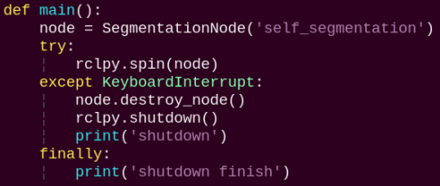

Starts the background segmentation node and performs the segmentation task.

#### 5.2.4.2 Class

`SegmentationNode`:

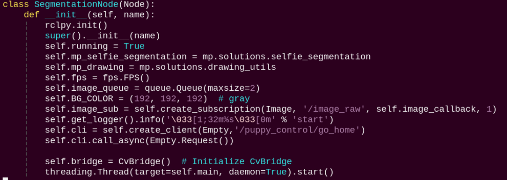

`init`: Initializes the parameters required for background segmentation, calls the image callback function, and starts model inference.

`image_callback`:

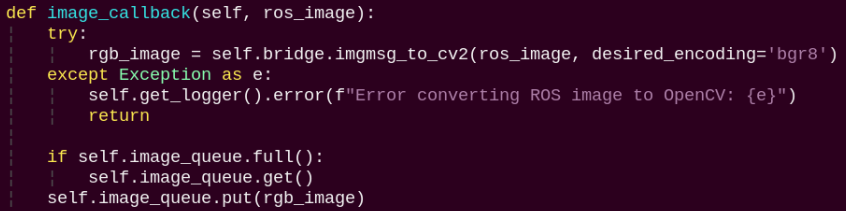

Reads camera data and places it in a queue.

`main`:

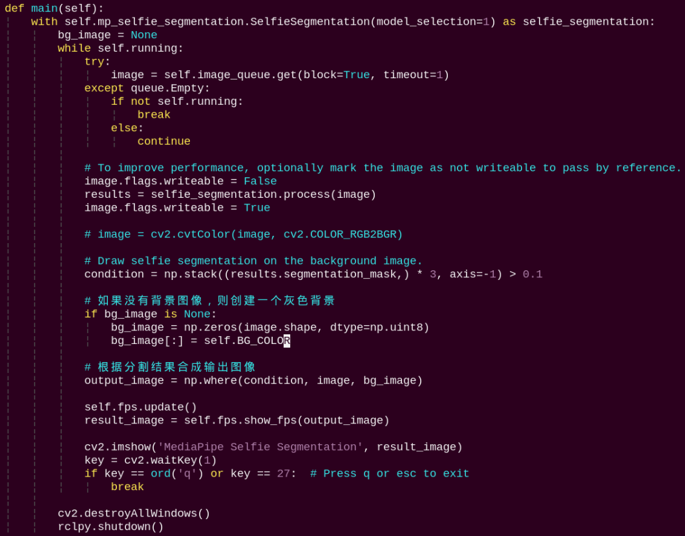

Loads the MediaPipe model, passes the image to the model, obtains the output image, and displays it using OpenCV.

## 5.3 3D Object Detection

### 5.3.1 Experiment Overview

First, import MediaPipe Objectron for 3D object detection and subscribe to topic messages to obtain the real-time camera feed.

Next, flip and process the image, and perform 3D object detection.

Finally, draw a 3D bounding box on the image. This experiment uses a cup as an example.

### 5.3.2 Procedure

1. Power on the robot and connect through the VNC remote connection software.

2. Click the ROS 2 command-line terminal icon  at the top of the system desktop to open a command-line terminal.

3. Enter the command below in the terminal and press **Enter** to run the feature.

```bash
cd ~/ros2_ws/src/example/example/ && python3 objectron.py
```

4. To stop the feature, press **Esc** in the image window to close the camera feed. Alternatively, press **Ctrl+C** in the command-line terminal. If the program does not stop, press **Ctrl+C** repeatedly.

### 5.3.3 Project Outcome

After the feature starts, a 3D bounding box appears around a recognized object in the image. Four object categories are currently supported: cups with handles, shoes, chairs, and cameras. The image below shows cup detection.

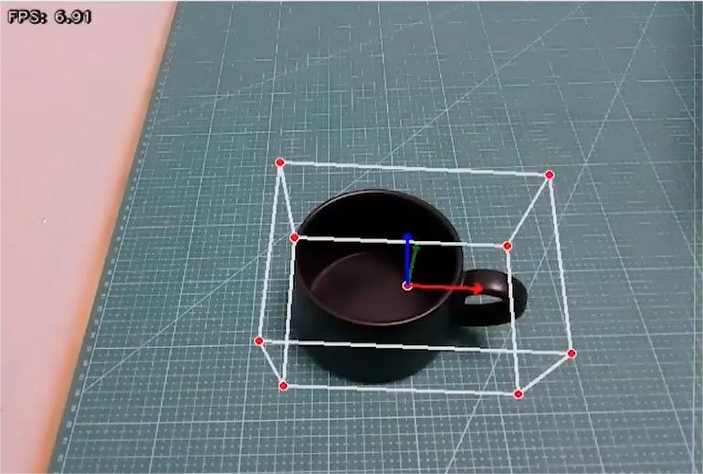

### 5.3.4 Program Analysis

The source code is located at **~/ros2_ws/src/example/example/objectron.py**.

#### 5.3.4.1 Functions

`main`:

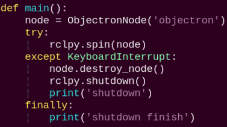

Starts the 3D detection node.

#### 5.3.4.2 Class

`ObjectronNode`:

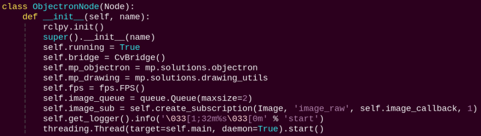

`init`: Initializes the parameters required for 3D recognition, calls the image callback function, and starts model inference.

`image_callback`:

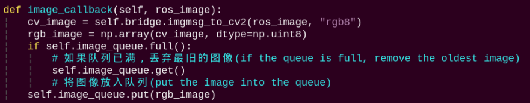

Reads camera data and places it in a queue.

`main`:

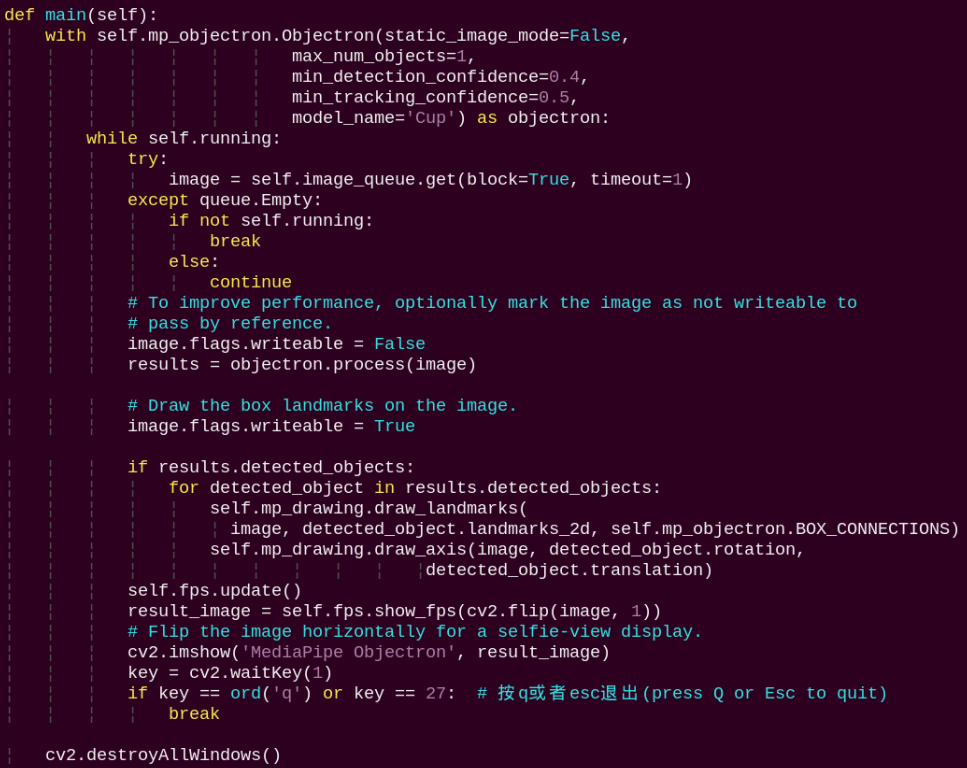

Loads the MediaPipe model, passes the image to the model, and uses OpenCV to draw object edges and display the result.

## 5.4 Face Tracking

### 5.4.1 Experiment Overview

This section uses the camera for face detection, allowing the TurboPi chassis and pan-tilt Servos to follow a moving face.

Image recognition is one of the most widely used artificial intelligence applications. Face detection is one of its most popular uses and is commonly applied to smart door locks and smartphone face unlocking.

Face tracking consists of two parts: face detection and tracking.

First, obtain the face image and use a trained face model to detect faces in a scaled image. Convert the detected face coordinates back to the coordinates of the original unscaled image. Then determine the largest face and draw a bounding box around it.

Finally, use a PID algorithm to compare the image center coordinates with the actual face position. Control the motors and Servos according to the result.

The PID algorithm is one of the most widely used automatic control methods. It performs control according to the proportional, integral, and derivative components of the error. Its advantages include a simple principle, straightforward implementation, broad applicability, independent control parameters, and relatively simple parameter selection.

### 5.4.2 Procedure

1. Power on the robot and connect through the VNC remote connection software.

2. Click the ROS 2 command-line terminal icon  at the top of the system desktop to open a command-line terminal.

3. Enter the command below and press **Enter** to open the directory containing the feature program.

```bash
cd ~/ros2_ws/src/example/example
```

4. Enter a command below and press **Enter** to run the feature. Two modes are available: pan-tilt-only tracking and chassis-only tracking. Pan-tilt tracking is the default.

For pan-tilt-only tracking, enter:

```bash
python3 face_tracking.py
```

For chassis-only tracking, enter:

```bash
python3 face_tracking.py --mode chassis
```

5. Open another command-line terminal. Enter the command below and press **Enter** to start the feature.

```bash
ros2 service call /face_landmarker/set_running std_srvs/srv/SetBool data:\ true
```

6. Enter the command below in the terminal opened in step 5 and press **Enter** to stop the feature.

```bash
ros2 service call /face_landmarker/set_running std_srvs/srv/SetBool data:\ false
```

7. Press **Ctrl+C** in the terminal used in step 4 to stop the program. If the program does not stop, press **Ctrl+C** repeatedly.

### 5.4.3 Project Outcome

> [!NOTE]
>
> **Ensure that only one face appears within the camera field of view during face tracking. Multiple faces may affect the experiment result.**

After the feature starts, the program searches for a face. When a face is detected, a bounding box appears around it. The pan-tilt Servos or TurboPi chassis then follow the moving face.

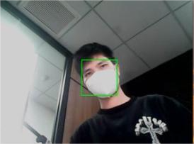

### 5.4.4 Program Analysis

The source code is located at **~/ros2_ws/src/example/example/face_tracking.py**.

#### 5.4.4.1 Functions

`main`:

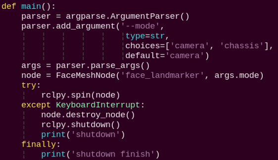

Starts the face tracking node.

#### 5.4.4.2 Class

`FaceMeshNode`:

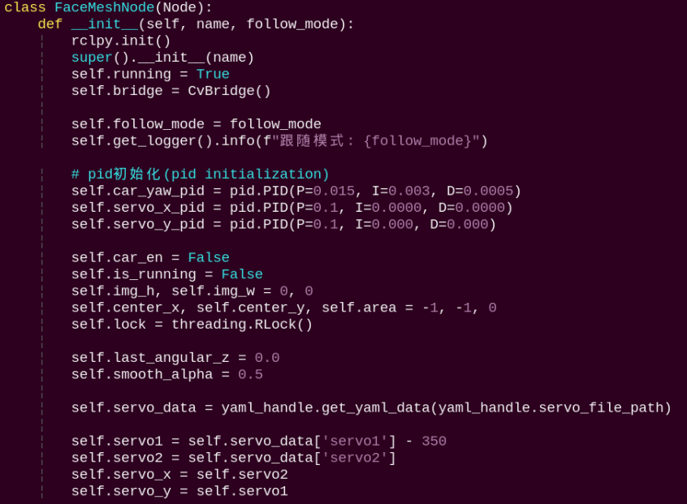


`init`: Initializes the parameters and face detection module, subscribes to the camera image topic, and publishes topics for controlling the chassis and Servos.

`image_callback`:

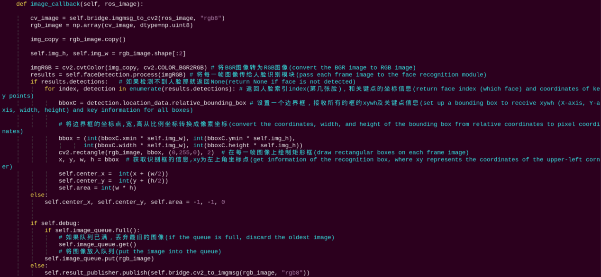

Subscribes to the image topic, detects the face, and calculates the face center coordinates and area.

`main`:

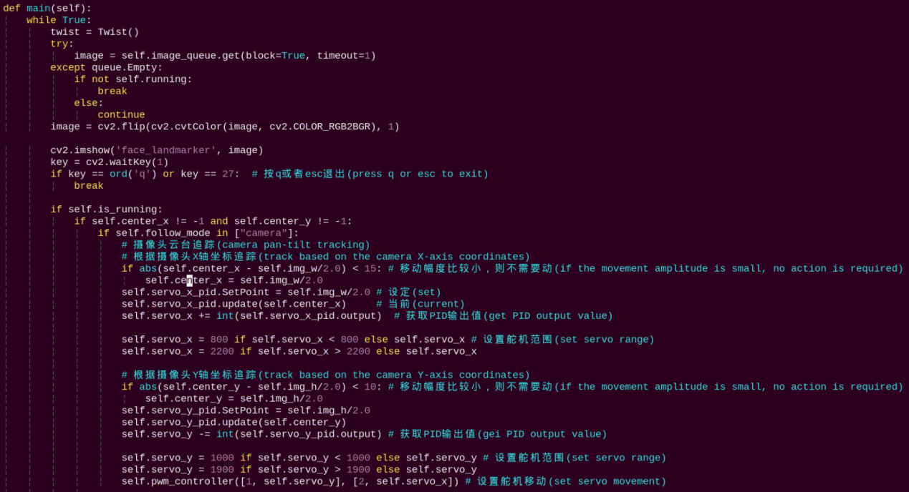

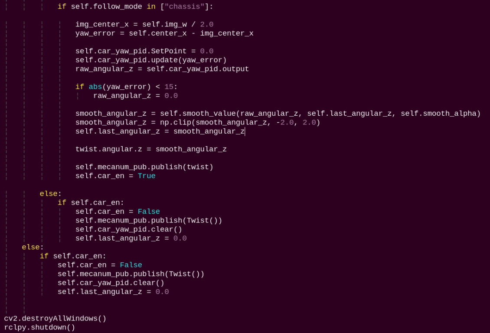

Reads and displays images from the image queue, and performs pan-tilt or chassis tracking according to the selected mode. In `camera` mode, call `pwm_controller` to publish Servo commands. In `chassis` mode, calculate the X-axis error between the face center and the image center. The PID output controls the chassis angular velocity.

## 5.5 3D Face Detection

This section uses the MediaPipe Face Mesh model to detect faces in the image.

MediaPipe Face Mesh estimates 468 3D facial features in real time, even on mobile devices. It uses machine learning, or ML, to infer 3D facial geometry. Its lightweight model architecture and GPU acceleration provide essential real-time performance.

The solution also includes a face transformation module that connects facial landmark estimation with practical real-time augmented reality applications. It establishes a metric 3D space and uses the screen positions of facial landmarks to estimate face transformations in that space. The face transformation data consists of common 3D primitives, including a face pose transformation matrix and a triangulated face mesh.

### 5.5.1 Experiment Overview

The machine learning pipeline is a linear process consisting of two real-time deep neural network models that work together. A detector processes the complete image and calculates the face location. A 3D facial landmark model processes that location and uses regression to predict an approximate 3D surface.

For 3D facial landmarks, transfer learning is applied to train a network with multiple objectives. The network simultaneously predicts 3D landmark coordinates from synthetic rendered data and 2D semantic contours from annotated real-world data. The resulting network uses both synthetic and real-world data to provide reliable 3D landmark predictions.

The 3D landmark network receives cropped video frames without requiring additional depth input. It outputs the positions of 3D points and the probability that a face is present and properly aligned in the input.

After importing the Face Mesh model, subscribe to topic messages to obtain the real-time camera feed.

Next, flip the image and convert its color space. Compare the face detection result with the minimum confidence threshold to determine whether a face has been detected successfully.

Finally, draw a 3D mesh over the detected face.

### 5.5.2 Procedure

1. Power on the robot and connect through the VNC remote connection software.

2. Click the ROS 2 command-line terminal icon  at the top of the system desktop to open a command-line terminal.

3. Enter the command below in the command-line terminal and press **Enter** to run the feature.

```bash
cd ~/ros2_ws/src/example/example/ && python3 face_mesh.py
```

4. To stop the feature, press **Esc** in the image window to close the camera feed.

5. Alternatively, press **Ctrl+C** in the command-line terminal. If the program does not stop, press **Ctrl+C** repeatedly.

### 5.5.3 Project Outcome

After the feature starts, the camera detects a face and draws a box around it in the returned image.

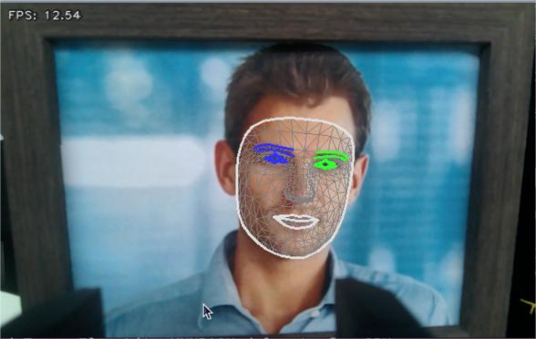

### 5.5.4 Program Analysis

The source code is located at **~/ros2_ws/src/example/example/face_mesh.py**.

#### 5.5.4.1 Functions

`main`:

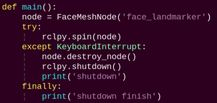

Starts the 3D face detection node.

#### 5.5.4.2 Class

`FaceMeshNode`:

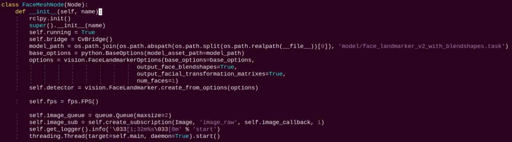

`init`: Initializes the parameters required for 3D face detection, calls the image callback function, and starts model inference.

`image_callback`:

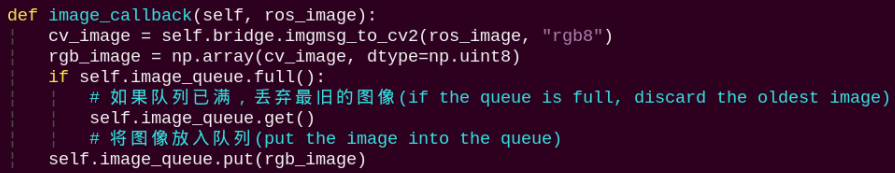

Reads camera data and places it in a queue.

`main`:

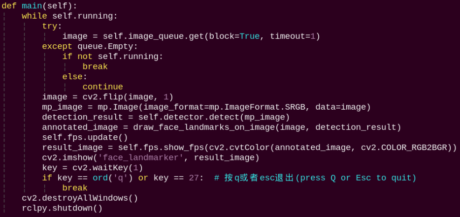

Loads the MediaPipe model, passes the image to the model, and uses OpenCV to draw facial keypoints and display the returned image.

## 5.6 Hand Keypoint Detection

This section uses the MediaPipe hand detection model to display hand keypoints and the lines connecting them in the returned image.

MediaPipe Hands is a high-fidelity hand and finger detection model. It uses machine learning, or ML, to infer 21 3D hand landmarks from a single frame.

### 5.6.1 Experiment Overview

The MediaPipe palm detection model uses a machine learning pipeline consisting of multiple models. This linear process operates like an assembly line. The palm detection model processes the complete image and returns an oriented hand bounding box. The hand landmark model processes the cropped image region defined by the palm detector and returns high-fidelity 3D hand keypoints.

After importing the palm detection model, subscribe to topic messages to obtain the real-time camera feed.

Next, flip the image and convert its color space. These operations greatly reduce the hand landmark model's need for data augmentation.

The pipeline can also generate a crop based on hand landmarks recognized in the preceding frame. Palm detection is called again to relocate the hand only when the landmark model can no longer detect it.

Compare the detection result with the minimum confidence threshold to determine whether the hand has been detected successfully.

Finally, detect and draw the hand keypoints in the image.

### 5.6.2 Procedure

1. Power on the robot and connect through the VNC remote connection software.

2. Click the ROS 2 command-line terminal icon  at the top of the system desktop to open a command-line terminal.

3. Enter the command below in the command-line terminal and press **Enter** to run the feature.

```bash
cd ~/ros2_ws/src/example/example/ && python3 hand.py
```

4. To stop the feature, press **Ctrl+C** in the command-line terminal. If the program does not stop, press **Ctrl+C** repeatedly.

### 5.6.3 Project Outcome

After the feature starts, the camera detects a hand and displays its keypoints and the lines connecting them in the returned image.

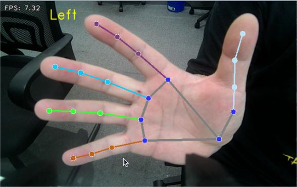

### 5.6.4 Program Analysis

The source code is located at **~/ros2_ws/src/example/example/hand.py**.

#### 5.6.4.1 Functions

`main`:

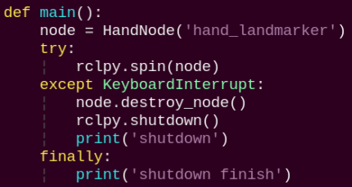

Starts the hand keypoint detection node.

#### 5.6.4.2 Class

`HandNode`:

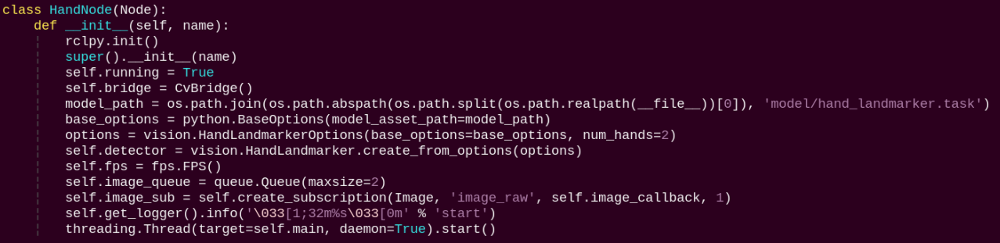

`init`: Initializes the parameters required for hand keypoint detection, calls the image callback function, and starts model inference.

`image_callback`:

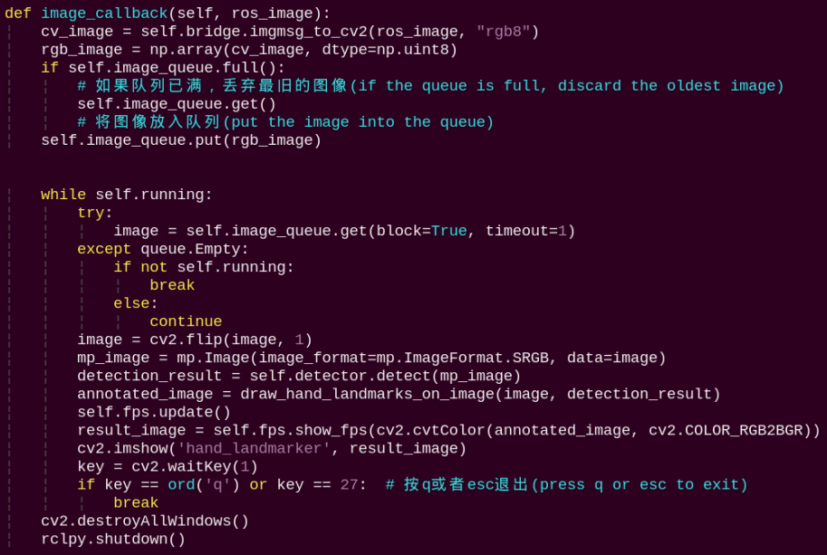

Reads camera data and places it in a queue.

Loads the MediaPipe model, passes the image to the model, and uses OpenCV to draw hand keypoints and display the returned image.

## 5.7 Human-Robot Interactive Grasping

This section uses the MediaPipe hand detection model to recognize hand keypoints. It combines robotic arm and gripper control to implement gesture-based human-robot interactive grasping.

The feature follows the gesture rules defined in the lesson outline. An open hand opens the gripper, and a closed fist closes the gripper. The pan-tilt tracks the hand according to its position in the image.

### 5.7.1 Experiment Overview

First, obtain the real-time camera feed and call the MediaPipe hand detection model to recognize palm and finger keypoints.

Next, determine the current gesture from the hand keypoints. When an open hand is recognized, send the gripper-open command. When a closed fist is recognized, send the gripper-close command.

Finally, adjust the pan-tilt direction according to the hand position in the image to keep the camera tracking the hand.

> [!WARNING]
>
> **The robotic arm and gripper do not provide anti-pinch protection. Before starting this feature, keep fingers, cables, and other objects away from the gripper and the Servo movement range.**

### 5.7.2 Procedure

> [!NOTE]
>
> **Commands are case-sensitive. Press the Tab key to autocomplete keywords.**

1. Power on the robot and connect through the VNC remote connection software.

2. Confirm that the robotic arm is installed securely and that no fingers, cables, or other obstacles are near the gripper.

3. Click the ROS 2 command-line terminal icon at the top of the system desktop to open a command-line terminal.

4. If another ROS program has been run previously, enter the command below to stop the auto-start service or any remaining nodes.

```bash
~/.stop_ros.sh
```

5. Enter the command below in the command-line terminal and press **Enter** to run the feature.

```bash
cd ~/ros2_ws/src/example/example/ && python3 arm_hand_control.py
```

6. To stop the feature, press **Ctrl+C** in the command-line terminal. If the program does not stop, press **Ctrl+C** repeatedly.

## 5.8 Body Keypoint Detection

This section uses the MediaPipe pose detection model to detect body keypoints and display them in the returned image.

MediaPipe Pose is a high-fidelity body pose tracking model. It uses BlazePose to infer 33 3D full-body keypoints from RGB input. This research also supports the ML Kit Pose Detection API.

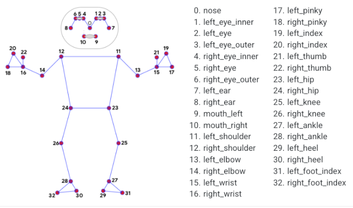

### 5.8.1 Experiment Overview

First, import the pose detection model.

Next, flip the image and convert its color space. Compare the result with the minimum human detection confidence threshold to determine whether a person has been detected successfully.

Then compare the result with the minimum tracking confidence threshold to determine whether the pose has been tracked successfully. If the result does not meet the threshold, automatically call human detection again on the next input image.

The pipeline first uses a detector to locate the region of interest, or ROI, containing the person's pose in the frame. The tracker then uses the cropped ROI frame as input to predict pose landmarks and a segmentation mask within the ROI. For video input, the detector is called only when required. This occurs for the first frame and when the tracker can no longer identify the body pose from the preceding frame. For other frames, the pipeline derives the ROI from the pose landmarks in the preceding frame.

After importing the MediaPipe pose detection model, subscribe to topic messages to obtain the real-time camera feed.

Finally, detect and draw the body keypoints in the image.

### 5.8.2 Procedure

1. Power on the robot and connect through the VNC remote connection software.

2. Click the ROS 2 command-line terminal icon  at the top of the system desktop to open a command-line terminal.

3. Enter the command below in the command-line terminal and press **Enter** to run the feature.

```bash
cd ~/ros2_ws/src/example/example/ && python3 pose.py
```

4. To stop the feature, press **Ctrl+C** in the command-line terminal. If the program does not stop, press **Ctrl+C** repeatedly.

### 5.8.3 Project Outcome

After the feature starts, the camera detects a human pose and displays the body keypoints and the lines connecting them in the returned image.

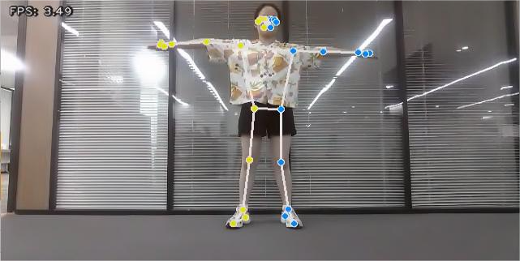

### 5.8.4 Program Analysis

The source code is located at **~/ros2_ws/src/example/example/pose.py**.

#### 5.8.4.1 Functions

`main`:

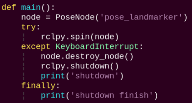

Starts the body detection node.

#### 5.8.4.2 Class

`PoseNode`:

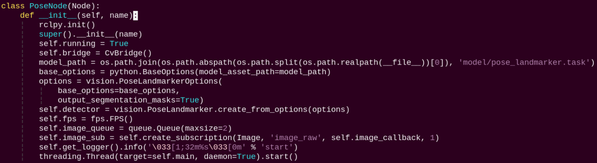

`init`: Initializes the parameters required for body detection, calls the image callback function, and starts model inference.

`image_callback`:

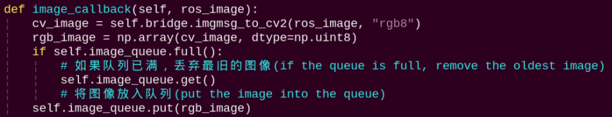

Reads camera data and places it in a queue.

`main`:

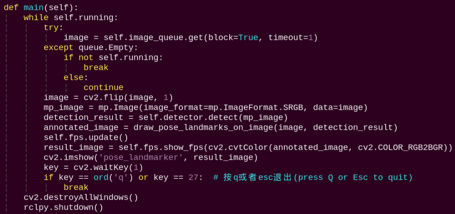

Loads the MediaPipe model, passes the image to the model, and uses OpenCV to draw body keypoints and display the returned image.
## 5.9 Fingertip Distance Recognition

This section uses the MediaPipe hand detection model to recognize palm joints. After detecting a hand, the program identifies the fingertips in the image and draws a line between them.

### 5.9.1 Experiment Overview

First, call the MediaPipe hand detection model and obtain the camera image.

Next, flip and process the image to detect hand information.

Finally, identify the fingertips in the image and draw a line between them.

### 5.9.2 Procedure

> [!NOTE]
>
> **Commands are case-sensitive. Press the Tab key to autocomplete keywords.**

1. Power on the robot and connect through the VNC remote connection software.

2. Click the ROS 2 command-line terminal icon  at the top of the system desktop to open a command-line terminal.

3. Enter the command below in the command-line terminal and press **Enter** to run the feature.

```bash
cd ~/ros2_ws/src/example/example/ && python3 hand_gesture.py
```

4. To stop the feature, press **Ctrl+C** in the command-line terminal. If the program does not stop, press **Ctrl+C** repeatedly.

### 5.9.3 Project Outcome

After the feature starts, place a hand within the camera field of view. When the hand is detected, the returned image marks the hand keypoints and draws a line between the two fingertips.

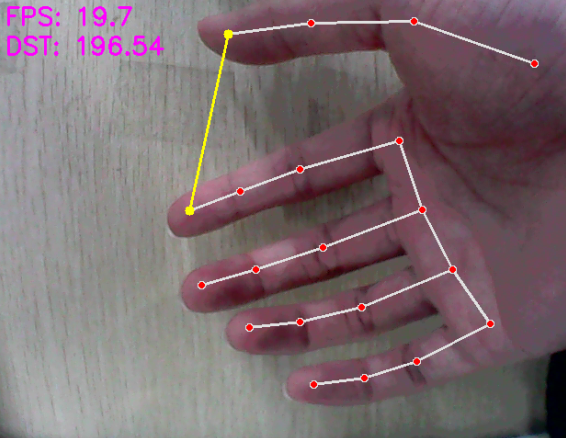

### 5.9.4 Program Analysis

The source code is located at **~/ros2_ws/src/example/example/hand_gesture.py**.

> [!NOTE]
>
> **Back up the original factory program before making any changes. Do not modify the source code file directly. Incorrect parameter changes may cause abnormal robot operation that cannot be restored.**

#### 5.9.4.1 Functions

`main`:

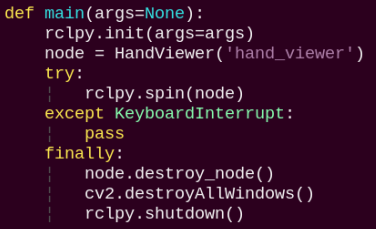

Starts the fingertip distance recognition node.

#### 5.9.4.2 Class

`HandViewer`:

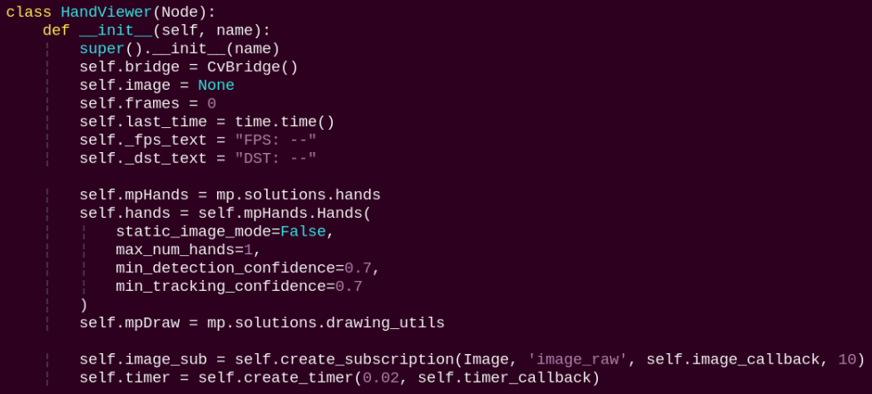

`init`: Initializes the node and subscribes to camera images.

`image_callback`:

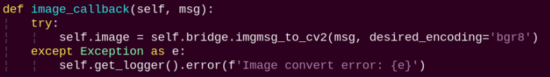

Converts the image to OpenCV format.

`timer_callback`:

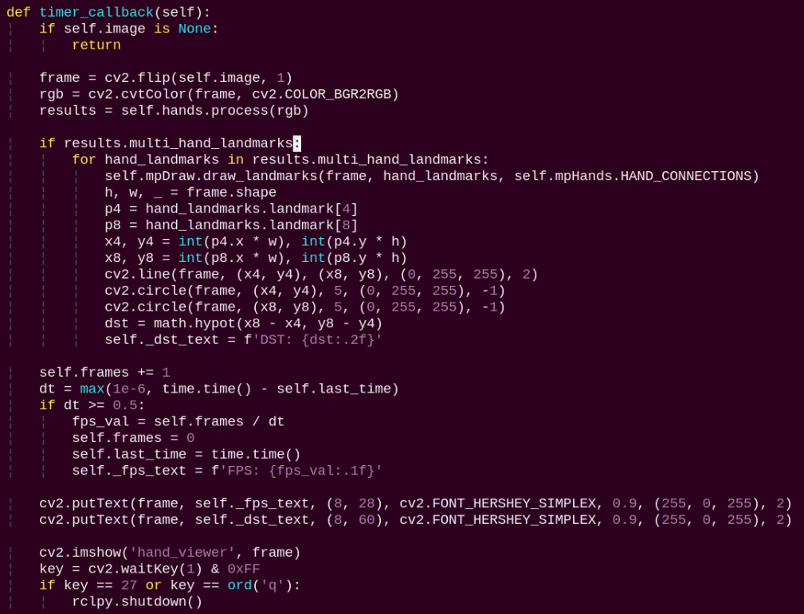

Preprocesses the image with a mirror flip, detects hand keypoints, and draws the keypoints and their connecting lines.

Obtains the coordinates of the thumb tip and index fingertip, draws a line between them, and calculates the Euclidean distance between the two fingertips.

## 5.10 Body Gesture Control

This section uses a human pose estimation model trained with the MediaPipe machine learning framework. After detecting the human torso in the returned image, the program marks the related joint positions and recognizes multiple actions in sequence. These actions provide direct body-gesture control of the robot.

From TurboPi's perspective, raising the left arm makes the robot move a set distance to the right. Raising the right arm makes it move a set distance to the left. Raising the left leg makes it move forward a set distance. Raising the right leg makes it move backward a set distance.

### 5.10.1 Experiment Overview

First, import the MediaPipe human pose estimation model and subscribe to topic messages to obtain the real-time camera feed.

MediaPipe is an open-source framework for multimedia machine learning model applications. It supports cross-platform operation on mobile devices, workstations, and servers, as well as mobile GPU acceleration. It also supports the TensorFlow and TensorFlow Lite inference engines.

Next, use the model to detect keypoints on the human torso in the image. Connect the keypoints to display the torso and determine the body pose.

Finally, when a specific body action is detected, the robot performs the corresponding motion.

### 5.10.2 Procedure

> [!NOTE]
>
> **Commands are case-sensitive. Press the Tab key to autocomplete keywords.**

1. Power on the robot and connect through the VNC remote connection software.

2. Click the ROS 2 command-line terminal icon  at the top of the system desktop to open a command-line terminal.

3. Enter the command below and press **Enter** to run the feature.

```bash
cd ~/ros2_ws/src/example/example/ && python3 body_control.py
```

4. To stop the feature, press **Esc** in the image window to close the camera feed.

5. Alternatively, press **Ctrl+C** in the command-line terminal. If the program does not stop, press **Ctrl+C** repeatedly.

### 5.10.3 Project Outcome

After the feature starts, stand within the camera field of view. When a person is detected, the returned image marks the torso keypoints and draws lines between them.

From TurboPi's perspective, raising the left arm makes the robot move a set distance to the right. Raising the right arm makes it move a set distance to the left. Raising the left leg makes it move forward a set distance. Raising the right leg makes it move backward a set distance.

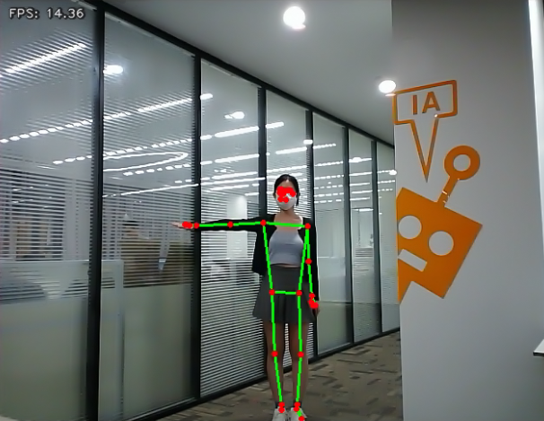

### 5.10.4 Program Analysis

The source code is located at **~/ros2_ws/src/example/example/body_control.py**.

> [!NOTE]
>
> **Back up the original factory program before making any changes. Do not modify the source code file directly. Incorrect parameter changes may cause abnormal TurboPi operation that cannot be restored.**

#### 5.10.4.1 Functions

`main`:

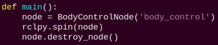

Starts the body gesture control node.

`get_joint_landmarks`:

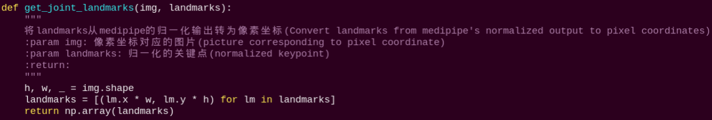

Converts the recognized information into pixel coordinates.

`joint_distance`:

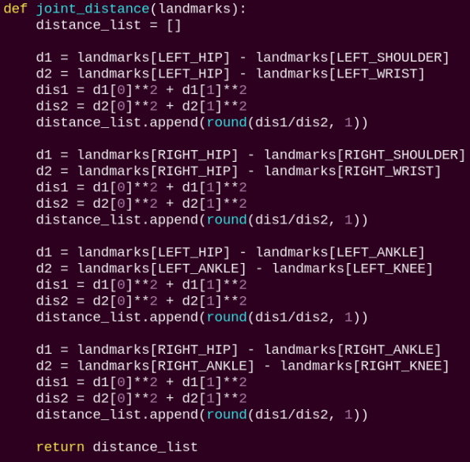

Calculates the distance between each joint from the pixel coordinates.

#### 5.10.4.2 Class

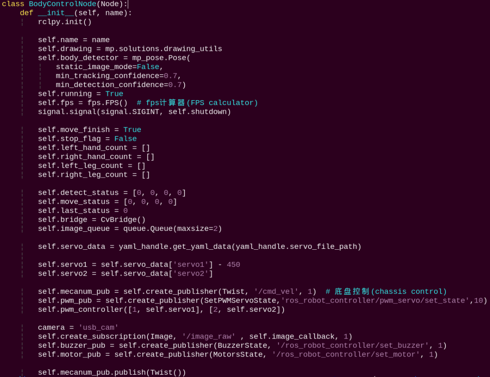

Initializes parameters, subscribes to the image topic, and publishes topics for controlling the Servos, chassis, and Buzzer.

`get_node_state`:

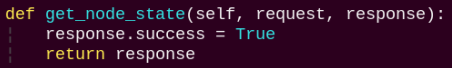

Sets the initialization state of the current node.

`shutdown`:

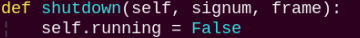

Terminates recognition when the program exits.

`image_callback`:


Processes the image and places it in a queue.

`move`:

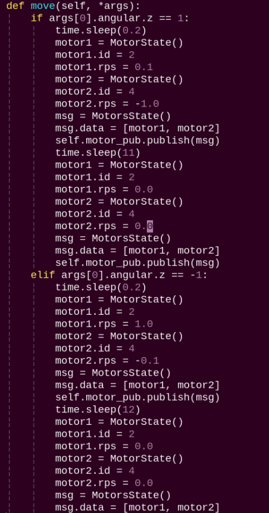

Controls the corresponding robot motion according to the recognized body action.

`buzzer_warn`:

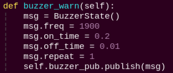

Controls the Buzzer alarm.

`image_proc`:

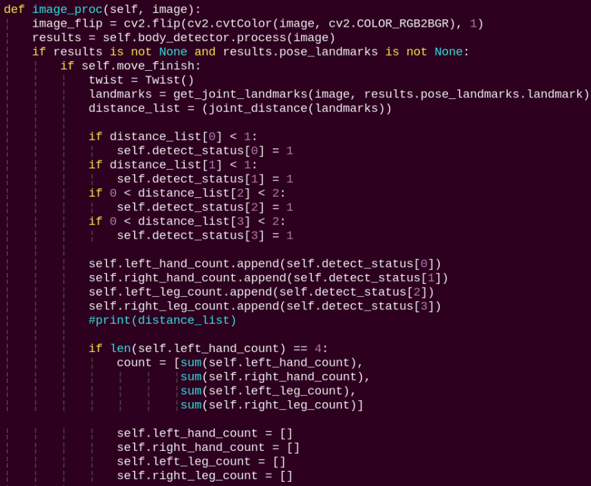

Calls the model to draw body keypoints according to the recognized information and controls motion according to the recognized pose.

`main`:

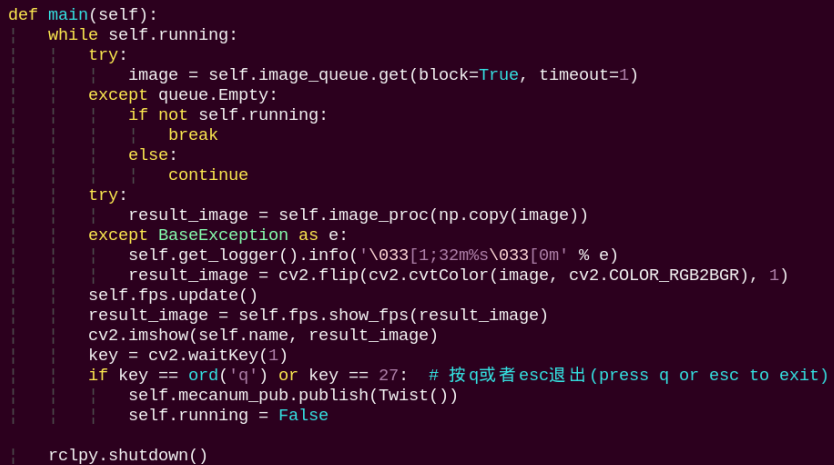

Passes image information to the recognition function and displays the returned image.

## 5.11 Human Pose Detection

This section uses a human pose estimation model from the MediaPipe machine learning framework to detect human poses. When a fall is detected, the robot sounds an alarm and moves forward and backward.

### 5.11.1 Experiment Overview

First, import the MediaPipe human pose estimation model and subscribe to topic messages to obtain the real-time camera feed.

Next, flip and process the image to detect human body information. Calculate the body height from the lines connecting the human keypoints, and use the result to determine the body action.

Finally, when a **fall** is detected, the robot sounds an alarm and moves forward and backward.

### 5.11.2 Procedure

> [!NOTE]
>
> **Commands are case-sensitive. Press the Tab key to autocomplete keywords.**

1. Power on the robot and connect through the VNC remote connection software.

2. Click the ROS 2 command-line terminal icon  at the top of the system desktop to open a command-line terminal.

3. Enter the command below and press **Enter** to start the feature.

```bash
cd ~/ros2_ws/src/example/example/ && python3 fall_down_detect.py
```

4. To stop the feature, press **Esc** in the image window to close the camera feed.

5. Alternatively, press **Ctrl+C** in the command-line terminal. If the program does not stop, press **Ctrl+C** repeatedly.

### 5.11.3 Project Outcome

After the feature starts, keep as much of the body as possible within the camera field of view. When a person is detected, the returned image marks the body keypoints.

Slightly lower the body into a seated position. After recognizing the **fall** pose, the robot repeatedly sounds an alarm and moves forward and backward as a warning.

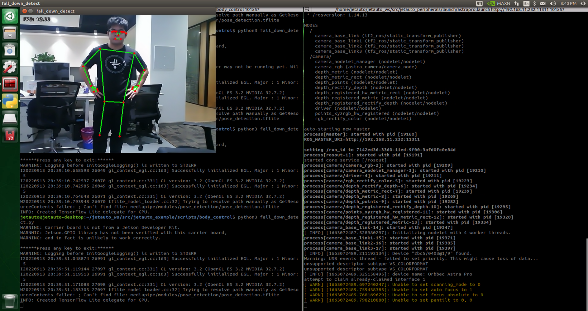


### 5.11.4 Program Analysis

The source code is located at **~/ros2_ws/src/example/example/fall_down_detect.py**.

> [!NOTE]
>
> **Back up the original factory program before making any changes. Do not modify the source code file directly. Incorrect parameter changes may cause abnormal robot operation that cannot be restored.**

#### 5.11.4.1 Functions

`main`:


Starts the human pose detection node.

`get_joint_landmarks`:


Converts the recognized information into pixel coordinates.

`height_cal`:


Calculates the body height from the recognized information.

#### 5.11.4.2 Class


Initializes parameters, subscribes to the camera image topic, and publishes topics for controlling the chassis and Buzzer.

`get_node_state`:


Sets the initialization state of the current node.

`shutdown`:


Terminates recognition when the program exits.

`image_callback`:


Processes the image and places it in a queue.

`move`:


Controls the corresponding robot motion according to the detected body height.

`buzzer_warn`:


Controls the Buzzer alarm.

`image_proc`:


Calls the model to draw human keypoints according to the recognized information and controls motion according to the calculated height.

`main`:


Passes image information to the recognition function and displays the returned image.