# 6. Machine Learning Application

## 6.1 GPU Acceleration

### 6.1.1 Introduction to GPU-Accelerated Computing

GPU generally refers to a graphics processing unit. It is also known as a display core, visual processor, or graphics chip. A GPU is a microprocessor designed to perform image and image-related operations on personal computers, workstations, game consoles, and some mobile devices such as tablets and smartphones.

GPU-accelerated computing uses a GPU together with a CPU to speed up scientific, analytical, engineering, consumer, and enterprise applications. GPUs can accelerate applications on platforms such as cars, smartphones, tablets, drones, and robots.

### 6.1.2 GPU and CPU Performance Comparison

The CPU, short for central processing unit, is responsible mainly for multitask management and scheduling, but its computing capability is limited. The GPU, as a graphics processor, performs large volumes of repetitive calculations but is less suited to complex logical processing.

CPU and GPU architectures differ significantly. A CPU uses a serial architecture with fewer but more powerful cores, which is suitable for completing a single task as quickly as possible. A GPU uses a parallel architecture with many less powerful cores, which is suitable for processing multiple tasks in parallel.

From a hardware perspective, a CPU contains multiple functional modules and can adapt to complex computing environments. A GPU has a simpler structure, with streaming processors and memory controllers occupying most of its transistors.

In a CPU, most transistors are used to build control circuits and cache. Only a small portion performs calculations. This arrangement increases CPU versatility, allowing it to process multiple data types and perform complex logical decisions, but it also limits computing capability.

In a GPU, most transistors are used to build specialized circuits and pipelines. This arrangement significantly improves computing speed and floating-point performance.

### 6.1.3 Advantages of GPUs

With many cores, GPUs are suitable for large-scale parallel data processing and offer clear advantages for the repetitive operations involved in multimedia processing.

Deep learning, for example, relies on neural networks designed to analyze massive amounts of data at high speed. This is exactly the type of workload GPUs handle well.

Furthermore, GPU architecture does not contain algorithms dedicated only to image processing. Instead, it is optimized based on CPU architecture. As a result, GPUs are widely used not only for image processing but also in fields that require parallel computing, including scientific computing, password cracking, numerical analysis, big data processing, and financial analysis.

## 6.2 YOLO Model

### 6.2.1 Introduction to the YOLO Series of Models

* **YOLO Series**

The YOLO series, short for You Only Look Once, uses a one-stage, deep learning-based regression approach.

Before YOLOv1 appeared, the R-CNN series of algorithms dominated the object detection field. Although the R-CNN series achieved high detection accuracy, its two-stage network architecture limited detection speed and could not meet real-time requirements.

YOLO was developed to address this issue. Its core concept redefines object detection as a regression problem. The entire image is used as network input, and the output layer directly regresses the bounding box location and class. Compared with traditional object detection methods, YOLO offers fast detection and high average precision.

* **YOLOv26**

YOLOv26 is a new generation of real-time object detection model released by Ultralytics. It optimizes previous YOLO versions and substantially improves both detection speed and accuracy.

**YOLOv26 Key Highlights**

**1. Architecture Simplification:** Removes Distribution Focal Loss, also known as DFL, simplifies bounding box regression, and improves export compatibility.

**2. End-to-End Inference:** Uses an NMS-free design to output detection results directly, reducing latency and deployment complexity.

**3. Training Enhancements:** Introduces progressive loss balancing, also known as ProgLoss, and small-target-aware label assignment, also known as STAL, to improve small-object detection stability.

**4. Optimizer Innovation:** Uses the MuSGD optimizer, combining the strengths of SGD and Muon to accelerate model convergence.

**5. Multitask Support:** Provides a unified framework for detection, instance segmentation, pose estimation, oriented object detection, and classification.

**6. Edge Optimization:** Supports FP16 and INT8 quantization for low-latency, real-time inference on Jetson and similar devices.

**7. Performance:** Achieves high accuracy on benchmarks such as COCO, with CPU inference speed improved by up to 43% over the previous generation.

### 6.2.2 YOLOv26 Model Architecture

* **Components**

1. Convolutional Layer: Feature Extraction

Convolution describes how the same action performed on or by an object at multiple earlier points affects its current state. Convolution can be divided conceptually into two parts, flipping and accumulation.

Flipping means reversing the data. Accumulation means adding up the influence of earlier data on the current data. Reversing the data establishes relationships between data points and provides a reference for calculating their accumulated influence.

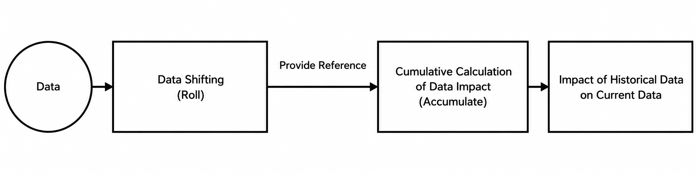

In YOLOv26, the processed data consists of images. Images are two-dimensional in computer vision, so the corresponding operation is two-dimensional convolution. The purpose of two-dimensional convolution is to extract image features. First, understand the convolution kernel.

A convolution kernel is the unit region used for each convolution calculation. The region is measured in pixels, and the pixel values within each region are integrated during the calculation. Convolution is generally performed by sliding the convolution kernel across the image. Set the kernel size manually.

When performing convolution, depending on the desired effect, the image border may remain unchanged or be extended by a specified number of pixels. Place the convolution results back into the corresponding positions in the image. For example, first expand a 6 x 6 image to 7 x 7. Apply the convolution kernel, then place the resulting data into a blank 6 x 6 image.


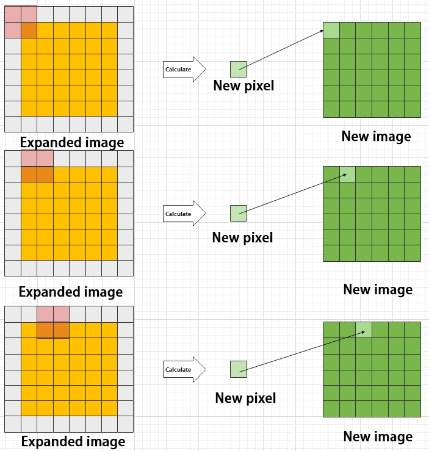

2. Pooling Layer: Feature Amplification

The pooling layer, also called the downsampling layer, is generally used together with the convolutional layer. After convolution, the pooling layer further samples the features. Pooling includes global pooling, average pooling, max pooling, and other methods. Each pooling method produces a different effect.

This section uses max pooling as an example. Before learning about max pooling, understand the filter. Like a convolution kernel, a filter uses a manually configured region. During calculation, the filter slides across the image and selects pixels within each region.

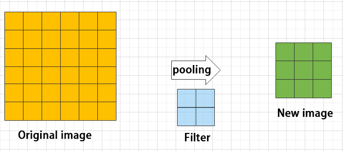

Max pooling retains the most prominent features and removes the remaining features. For example, apply a 2 x 2 filter to a 6 x 6 image to produce a new image.

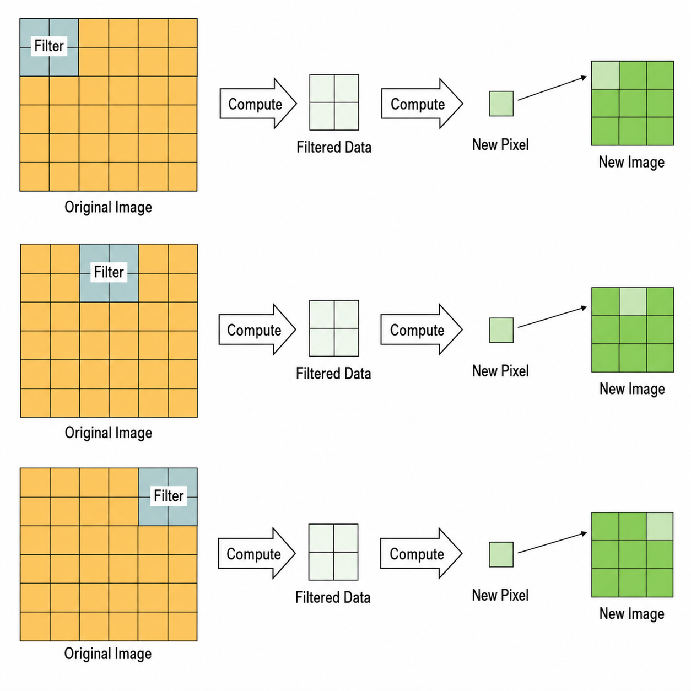

3. Upsampling Layer: Restoring Image Size

Upsampling can be understood as reverse pooling. An image becomes smaller after pooling. Upsampling restores the image to its original size, but only the dimensions are restored. The pooled features also change accordingly.

For example, apply a 3 x 3 filter to a 6 x 6 image during upsampling to produce a new image.

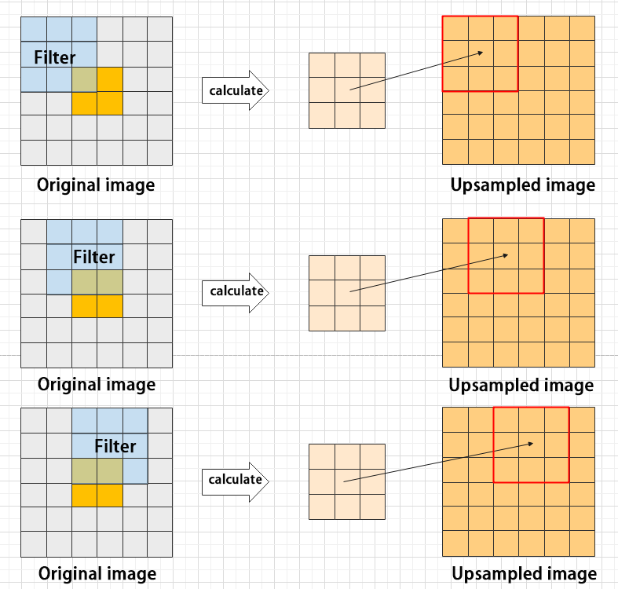

4. Batch Normalization Layer: Organizing Data

Batch normalization rearranges data into an orderly form. Its purpose is to reduce model computation difficulty and map the data more effectively to the activation function.

Batch normalization reduces feature loss after each calculation and retains more features for the next calculation. After repeated calculations, the model becomes more sensitive to the data.

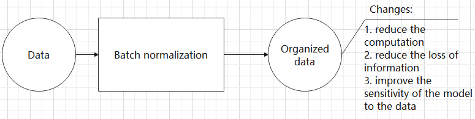

5. ReLU Layer: Activation Function

Adding an activation function during model construction introduces nonlinearity. Without an activation function, each layer is equivalent to matrix multiplication. The output of each layer is a linear function of the preceding layer's input. Regardless of the number of neural network layers, the output remains a linear combination of the input. This prevents the model from adapting to actual conditions.

Common activation functions include ReLU, Tanh, and Sigmoid. This section uses ReLU as an example. ReLU stands for Rectified Linear Unit. It is a piecewise function that replaces all values below 0 with 0 while leaving the remaining positive values unchanged.

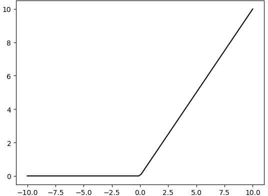

6. ADD Layer: Tensor Addition

Features can be prominent or less prominent. The ADD layer adds feature tensors to enhance prominent features.


7. Concat Layer: Tensor Concatenation

The Concat layer concatenates feature tensors. This combines features extracted by different methods and preserves more features.

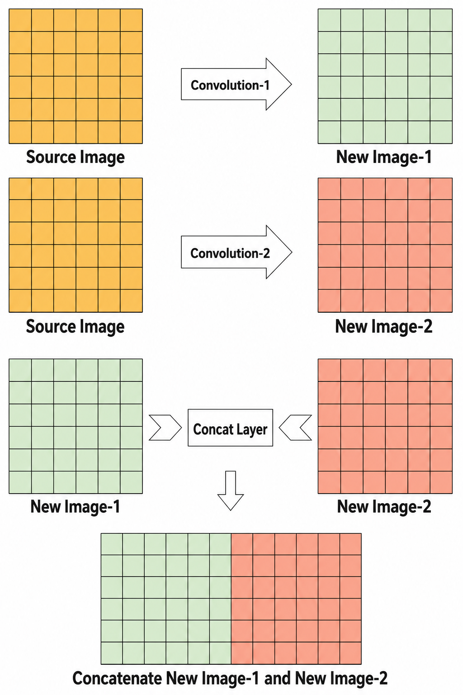

* **Composite Elements**

Building a model using only the layers above can produce lengthy code, a disorganized structure, and an unclear hierarchy. Combining basic elements into reusable units can improve model development efficiency.

1. Convolutional Block

A convolutional block consists of a convolutional layer, a batch normalization layer, and an activation function. Perform convolution first, then batch normalization, and finally activation.

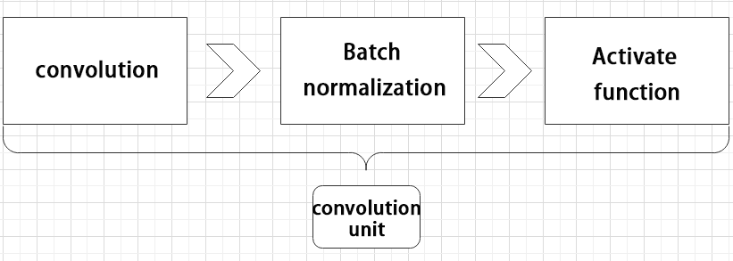

2. Strided Sampling and Concatenation Unit, Focus

First, divide the input image into multiple large regions. Concatenate the small image patches at the same position within each large region. This divides the input image into several images. Finally, perform initial sampling on the images using a convolutional block.

The following example uses a 6 x 6 image and defines each large region as 2 x 2. The image can be divided into nine large regions, with four small image patches in each region.

Concatenate the small image patches at position 1 in each large region to produce a 3 x 3 image. Concatenate the patches at the other positions in the same way. The original 6 x 6 image is ultimately divided into four 3 x 3 images.

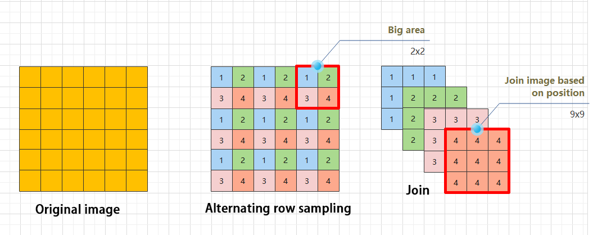

3. Residual Block

The residual block enables the model to learn small changes in an image. Its structure is relatively simple and combines data obtained through two paths.

The first path uses two convolutional blocks to sample the image. The second path uses the original image directly without a convolutional block. Finally, add the data from the first path to the data from the second path.

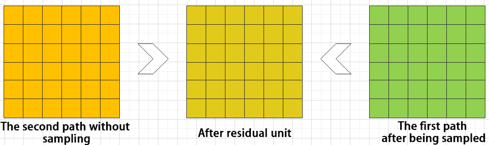


4. Composite Convolutional Block

In YOLOv26, the composite convolutional block allows convolutional blocks to be customized as needed. The composite convolutional block also combines data obtained through two paths.

The first path uses one convolutional layer for sampling. The second path uses `2x + 1` convolutional blocks and one convolutional layer for sampling. After sampling and concatenation, batch normalization organizes the data, followed by the activation function. Finally, use one convolutional block for sampling.

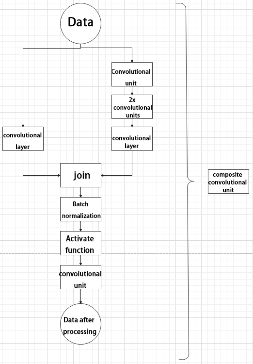

5. Composite Residual Convolutional Block

The composite residual convolutional block replaces the `2x` convolutional blocks in the composite convolutional block with `x` residual blocks. In YOLOv26, residual blocks can be customized as needed.


6. Composite Pooling Block

Send the output data from the convolutional block to three max pooling layers and retain another unprocessed copy. Concatenate the data from the four paths, then send the result to a convolutional block. Processing data with a composite pooling block significantly amplifies the features in the original data.

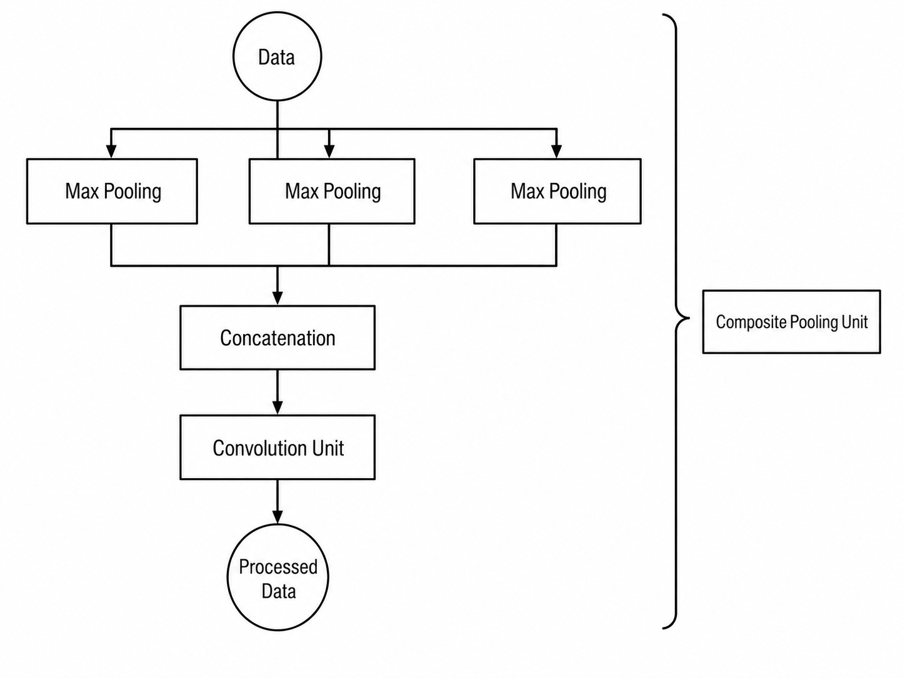

## 6.3 YOLOv26 Workflow

This section explains the model workflow using prior boxes, predicted boxes, and anchor boxes in YOLOv26.

### 6.3.1 Prior Box

When an image is sent to the model, specify the object recognition region in the image. A prior box marks this region in advance.

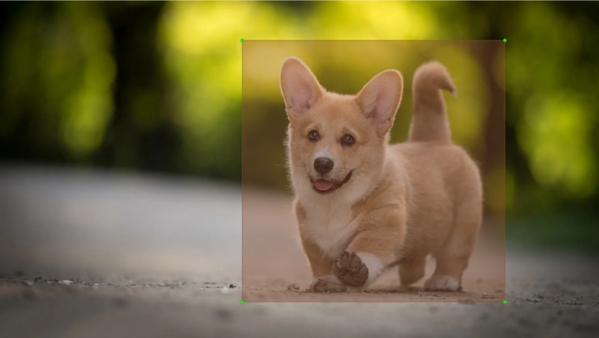

### 6.3.2 Predicted Box

A predicted box does not require manual configuration. It is an output from the model. When the first batch of training data is sent to the model, predicted boxes are generated automatically. Locations where similar objects occur frequently are set as the center points of the predicted boxes.

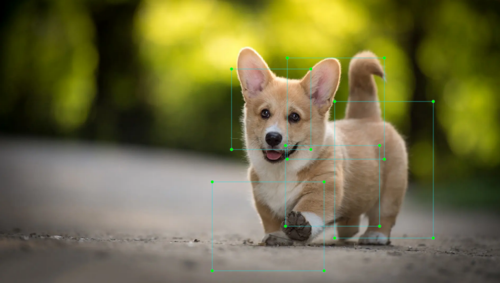

### 6.3.3 Anchor Box

After predicted boxes are generated, their sizes and positions may have deviations. Anchor boxes correct the sizes and positions of predicted boxes.

The predicted boxes determine where anchor boxes are generated. To influence where the next predicted boxes are generated, the anchor boxes are placed at the relative centers of the existing predicted boxes.

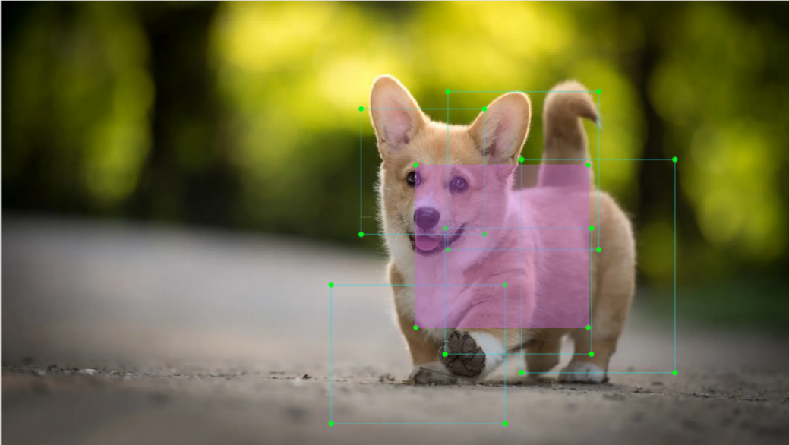

### 6.3.4 Project Process

After bounding-box annotation is complete, prior boxes appear in the image. When the image data is sent to the model, the model generates predicted boxes based on the prior box locations. Anchor boxes are then generated. Finally, update the model with the weights from this training iteration.

Each newly generated predicted box is influenced by the anchor box generated during the preceding iteration. Repeat this process until the size and position deviations gradually disappear and the predicted box overlaps the prior box.

<p id ="anther6.4"></p>

## 6.4 Image Collection and Annotation

Training a YOLOv26 model requires a large amount of data. Collect and annotate the data first to prepare for model training.

Before starting, prepare the images for collection. This section uses traffic signs as an example.

### 6.4.1 Image Collection

1. Power on the robot and connect it to the **VNC** remote control software.

2. Click the terminal icon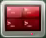 on the system desktop to open a terminal.

3. Enter the following command to stop the automatic app startup service:

```bash
~/.stop_ros.sh
```

4. Enter the following command to start the depth camera service:

```bash
ros2 launch peripherals depth_camera.launch.py
```

5. Open a new terminal. Enter the following command and press **Enter** to create a directory for storing the dataset:

```bash
mkdir -p ~/my_data
```

6. Enter the following command to start the image collection tool:

```bash
cd ~/software/collect_picture && python3 main.py
```

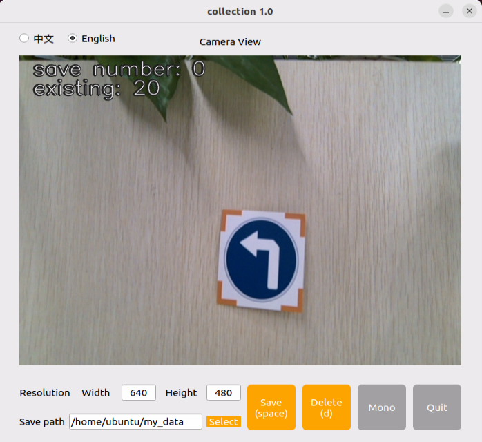

The **save number** in the upper-left corner is the image ID and indicates the sequence number of the image being saved. The **existing** value indicates the number of saved images.

7. Click **Select** and set the save path to the created `my_data` folder.

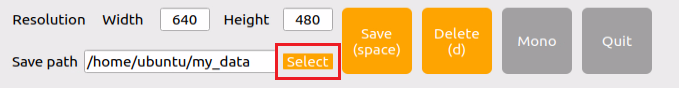

8. After selecting the corresponding directory, click **Choose**.

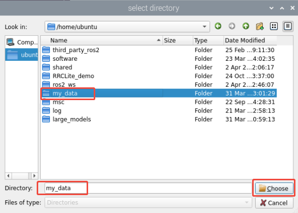

9. Place the target object within the camera view. Click **Save** or press **Space** to save the current camera frame. A `JPEGImages` folder is automatically created under `/home/ubuntu/my_data` to store the images.


> [!NOTE]
>
> **To improve model reliability, capture the target object from different distances, rotation angles, and tilt angles.**

10. After collecting the images, click **Quit** to close the tool.

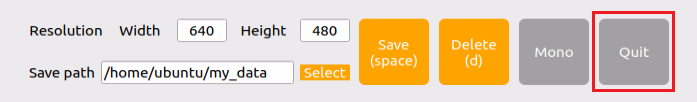

11. Press **Ctrl+C** in all open terminals to exit. This completes the image collection and annotation procedure.
12. Open a terminal and enter the following command to view the saved images:

```
cd ~/my_data/JPEGImages && ls
```

### 6.4.2 Image Annotation

After collecting the images, annotate them. Image annotation is essential for a functional dataset because it identifies the class of each important region for the training model. This allows the model to recognize these classes later in new images that it has not encountered.

> [!NOTE]
>
> **Commands are case-sensitive. Press Tab to auto-complete keywords.**

1. Open a terminal and enter the following command to start the image annotation software:

```bash
python3 ~/software/labelImg/labelImg.py
```

The following table describes some of the available controls:

| **Button**                                                   | **Shortcut** | **Function**                           |
| ------------------------------------------------------------ | ------------ | -------------------------------------- |
| 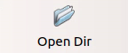 | Ctrl+U       | Select the image storage directory.    |
| 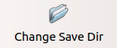 | Ctrl+R       | Select the annotation data directory.  |
|  | W            | Create an annotation box.              |
| 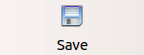 | Ctrl+S       | Save the annotation.                   |
| 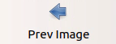 | A            | Switch to the previous image.          |
| 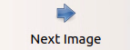 | D            | Switch to the next image.              |

2. Click the button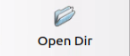 and open the image collection directory. Select the location shown below for this tutorial.

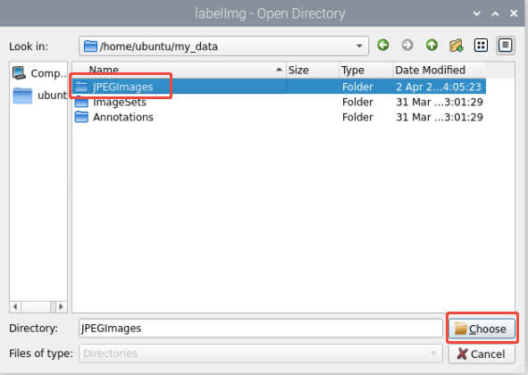

3. Click **Choose** to open the interface shown below.

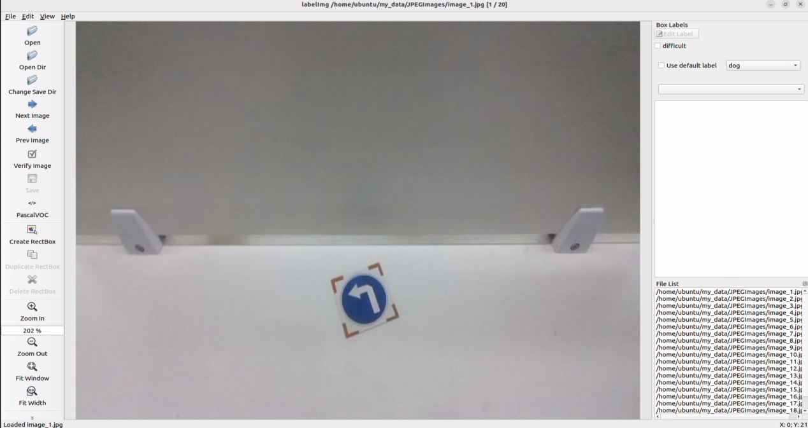

4. Click **Change Save Dir**. Select the corresponding annotation data storage folder. The `Annotations` directory is under the same path used for image collection.

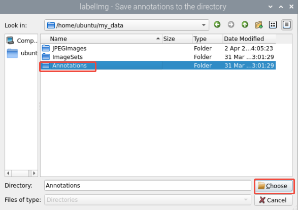

5. Click **Choose** to return to the image annotation interface.

6. Press **W** to start creating an annotation box.

7. Move the pointer to a suitable position. Hold and drag the left mouse button until the annotation box covers the entire target object. Release the left mouse button to complete the selection.

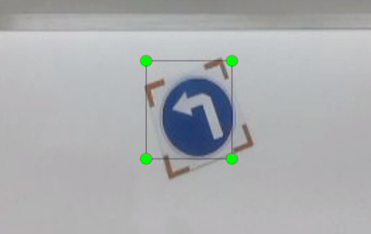

8. Name the target object class in the pop-up window. This example uses `left`. Click **OK** or press **Enter** to save the class.

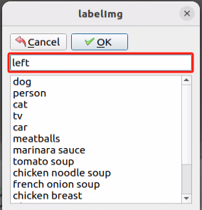

9. Press **Ctrl+S** to save the annotation data for the current image.
10. Press **D** to move to the next image. Repeat steps 7 through 9 to annotate all images. Click the close button in the upper-right corner of the software to exit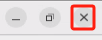.

<p id ="anther6.5"></p>

## 6.5 Data Format Conversion

### 6.5.1 Preparation

Complete image collection and annotation before starting this section. For detailed steps, see [6.4 Image Collection and Annotation](#anther6.4).

Before using the data to train the YOLO model, assign classes to the images and convert the annotation data format.

### 6.5.2 Format Conversion

Complete image collection and annotation before starting this section.

> [!NOTE]
>
> **Commands are case-sensitive. Press Tab to auto-complete keywords.**

1. Open a new terminal and enter the following command to open the file. **If the file does not exist, enter this command to create it.**

```bash
gedit ~/my_data/classes.names
```

2. Add the annotated class `left` to the text file. When multiple classes are used, enter each class on a separate line.

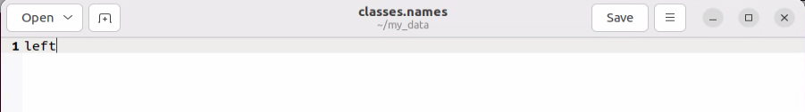

> [!NOTE]
>
> **The class name added here must exactly match the name entered in "labelImg".**

3. Press **Ctrl+S** to save the file, then close it.

4. Return to the terminal. Enter the following command and press **Enter** to convert the data format:

```bash
python3 ~/software/xml2yolo.py --data ~/my_data --yaml ~/my_data/data.yaml
```

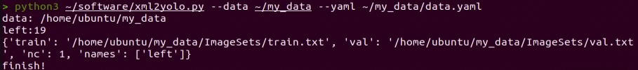

> [!NOTE]
>
> **Set the paths for "~/software/xml2yolo.py" and "my_data" according to the actual file locations.**

The command above contains three parameters:

`xml2yolo.py`: Converts the annotated label format into the label format required for YOLO model conversion. Set the path to the actual script location.

`my_data`: Specifies the annotated data folder. Set the path to the actual folder location.

`data.yaml`: Specifies the format used to convert the entire folder after the model data is split. The command saves this file in the `my_data` folder.

The following image shows the generated `data.yaml` file.

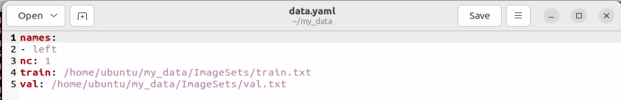

The items listed after `names` indicate the label types. The `nc` field specifies the number of label classes. The `train` field indicates the training set, which is the data used for model training in deep learning. The parameter after `train` specifies its path. The `val` field indicates the validation set, which is the data used to validate results during model training. The parameter after `val` also specifies its path. Enter or update these paths according to the actual file locations. To increase training speed by moving the dataset from the robot to a local PC or cloud server, replace the paths corresponding to `train` and `val`.

Finally, an XML file is generated in the `~/my_data` folder to record the path of the split dataset. Change the last parameter in step 4, `~/my_data/data.yaml`, to change the save path. Record this file path for use during model training.

<p id ="anther6.6"></p>

## 6.6 Training the Model

> [!NOTE]
>
> **Commands are case-sensitive. Press Tab to auto-complete keywords.**

### 6.6.1 Preparation

After converting the model data format, proceed to model training. First, prepare the converted dataset. For details, see [6.5 Data Format Conversion](#anther6.5).

### 6.6.2 Model Training

1. Power on the robot and connect it to the **VNC** remote control software.

2. Click the terminal icon on the system desktop to open a terminal.

3. Enter the following command and press **Enter** to open the specified directory:

```bash
cd ~/third_party_ros2/yolo/yolo26
```

4. Enter the following command and press **Enter** to train the model:

```bash
python3 train.py --img 640 --batch 64 --epochs 300 --data ~/my_data/data.yaml --weights yolo26n.pt
```

In this command, `--img` specifies the image size. `--batch` specifies the number of images in each input batch. `--epochs` specifies the number of training iterations. `--data` specifies the dataset path. `--weights` specifies the path to the training file.

Adjust these parameters as needed. To improve model reliability, increase the number of training iterations. This also increases the training time.

If the following content appears, the model is being trained.

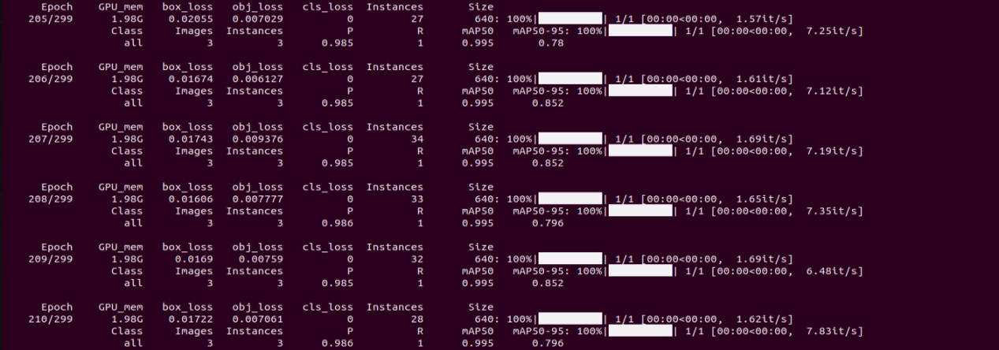

After model training is complete, the terminal displays the output path. In this example, the training results are saved in `/home/ubuntu/runs/detect/train3`.

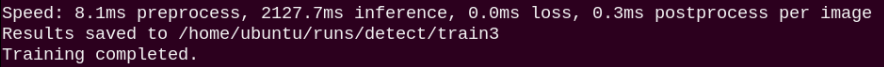

> [!NOTE]
>
> **The generated file path is not fixed. Locate the corresponding folder under "runs/detect/train".**

## 6.7 Object Detection

### 6.7.1 Preparation

After repeated training, a new model is available. For detailed steps, see [6.4 Image Collection and Annotation](#anther6.4) through [6.6 Training the Model](#anther6.6).

### 6.7.2 Object Detection

* **Procedure**

1. Click the terminal icon on the system desktop to open a terminal. Enter the following command and press **Enter** to stop the app service:

```bash
~/.stop_ros.sh
```

2. Enter the following command to copy the trained `best.pt` file to the `~/third_party_ros2/yolo` directory. The generated file path is not fixed. Change it according to the actual path.

```bash
cp ~/runs/detect/train3/weights/best.pt ~/third_party_ros2/yolo
```

3. Enter the following command to open the file:

```bash
gedit ~/ros2_ws/src/example/example/yolo_detect/yolo_detect_demo.py
```

Enter the trained model class name `"left"` in `CLASSES_NAMES_DEFAULT`. Include the double quotation marks. Save and close the file.

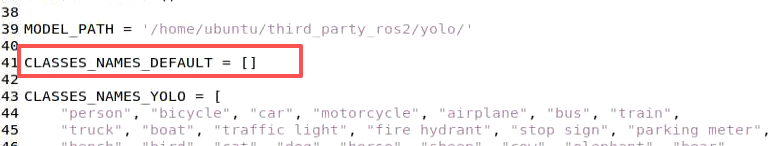

4. Enter the following command to run object detection:

```bash
ros2 launch example yolo_detect_demo.launch.py model_name:=best
```

* **Detection Result**

Place the traffic sign within the camera view. When the sign is recognized, a box marks the traffic sign in the returned image. The image also displays its class name and detection confidence.

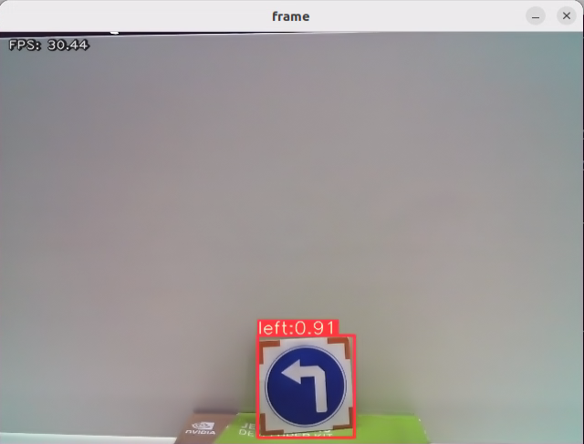

## 6.8 Traffic Sign Model

**Use the actual product names and reference paths as the source of truth.**

For a large dataset, do not train the model on the robot controller board. I/O speed and memory limitations result in slow training. Use a PC with a dedicated graphics card instead. The training process is the same, but the corresponding program environment must be configured.

If traffic sign recognition performs poorly in the autonomous driving feature, follow this section to train a custom traffic sign model.

### 6.8.1 Preparation

1. Prepare a laptop. When using a desktop computer, prepare a wireless network adapter, mouse, and other required tools.

2. Follow the preceding procedure to install and open the **VNC** remote connection tool.

### 6.8.2 Model Usage

1. Power on the robot and connect it to the **VNC** remote control software. Click the terminal icon on the system desktop to open a terminal.

2. Enter the following command and press **Enter** to stop the app service:

```bash
~/.stop_ros.sh
```
3. Enter the following command to run object detection:

```bash
ros2 launch example yolo_detect_demo.launch.py model_name:=best_traffic_26
```

## 6.9 FAQs

1. What should be done if training fails repeatedly?

   **Answer:** Follow these steps:

(1) Click the terminal icon on the system desktop to open a terminal. Enter the following commands in sequence to increase the available swap memory:

```bash
sudo swapoff /swapfile

sudo rm /swapfile

sudo fallocate -l 6G /swapfile

sudo chmod 600 /swapfile

sudo mkswap /swapfile

sudo swapon /swapfile
```

(2) Return to the model training steps in the corresponding section and continue.
