# 7. Robot Network Configuration

## 7.1 Change the Wi-Fi Name and Password

A computer normally connects to a Raspberry Pi hotspot with a name that begins with **HW**. Multiple TurboPi robots nearby can cause a connection to the wrong hotspot. This section explains how to change the default Wi-Fi name and password.

1. Power on TurboPi. Connect the computer to the hotspot generated by TurboPi. The hotspot name normally begins with **HW**. Enter the password **hiwonder** for the first connection.


2. Establish a VNC connection to TurboPi.

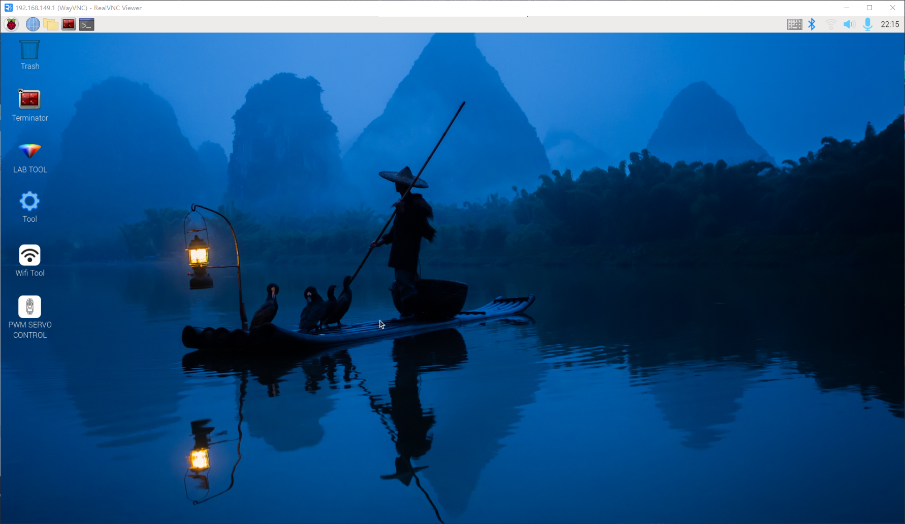

3. Click the  icon on the desktop or press **Ctrl+Alt+T** to open a terminal.

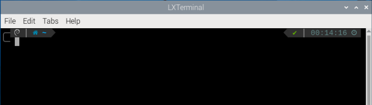

4. In the terminal, enter `cd hiwonder-toolbox` and press **Enter** to go to the directory containing the Wi-Fi configuration file.

```bash
cd hiwonder-toolbox
```

5. Enter `sudo vim wifi_conf.py` to open the Wi-Fi configuration file in the editor.

```bash
sudo vim wifi_conf.py
```

6. The interface appears as shown below.

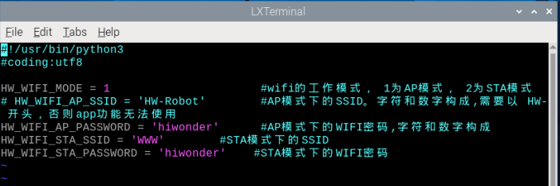

7. Enter `:set number` and press **Enter** to display line numbers as needed.

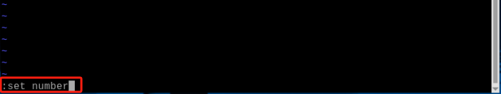

8. Press **i**. The `-- INSERT --` indicator appears in the lower-left corner. Edit the settings as needed.

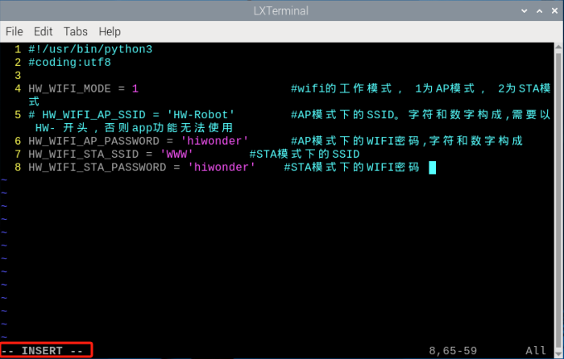

9. To change the Raspberry Pi Wi-Fi name to **HW-TurboPi** and the password to **123456789**, modify the program as shown below.

> [!NOTE]
>
> **Set the Wi-Fi name and password as needed. Follow these rules:**
>
> * **The Wi-Fi name must differ from the name of any existing router and must begin with "HW".**
>
> * **The password must contain at least 8 characters.**
>
> **To restore the original settings, reverse the operation.**

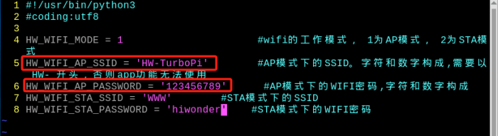

10. After making the changes, press **Esc**. Enter `:wq` to save and exit the file.

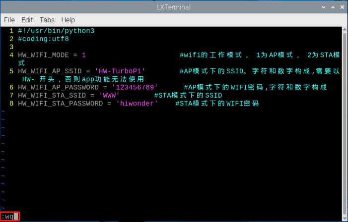

11. Enter `sudo systemctl restart hw_wifi.service` in the terminal. VNC automatically disconnects, and the Wi-Fi service restarts.

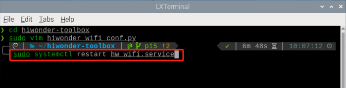

12. Wait for the device to finish restarting. Connect the computer to the **HW-TurboPi** network using the password **123456789**.

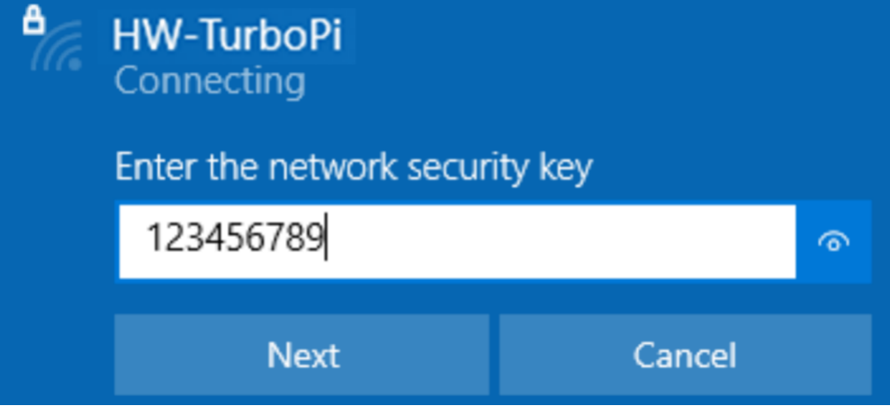

13. After the connection succeeds, wait for VNC to refresh.

14. After the connection succeeds, the VNC remote desktop appears as shown below.


## 7.2 Change the Network Connection Mode

The previous lessons explained how to connect the robot through the mobile app in LAN mode. This section explains how to switch to LAN mode by modifying the Wi-Fi configuration file.

To switch back to AP mode after making the change, reverse the operations below.

1. Power on the robot. Connect the computer to the hotspot generated by the robot. The hotspot name normally begins with **HW**.

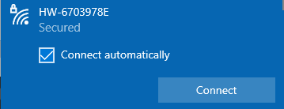

2. Establish a VNC connection to the robot.


3. Click the 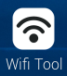 icon on the desktop to open the WiFi Tool PC software.

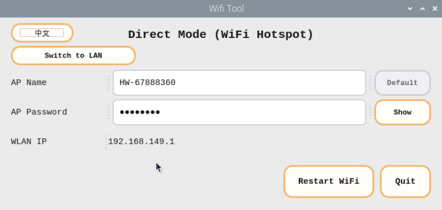

4. Click **Switch to LAN** in the PC software.

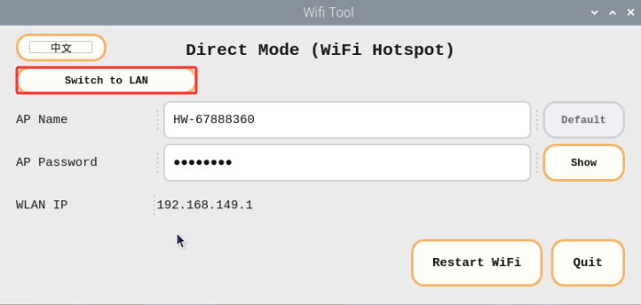

5. Enter the LAN Wi-Fi name in **WiFi SSID** and the password in **WiFi Password**. Then click **Restart WiFi** to switch to LAN mode.

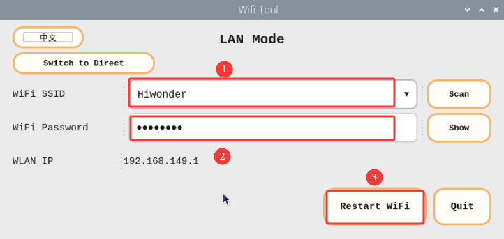

6. VNC automatically disconnects. When the TurboPi LED2 remains steadily on, the switch to LAN mode has succeeded.

7. To switch back to AP mode later, click **Switch to Direct** in the WiFi Tool PC software.

8. Click **Restart WiFi** to switch to AP mode.

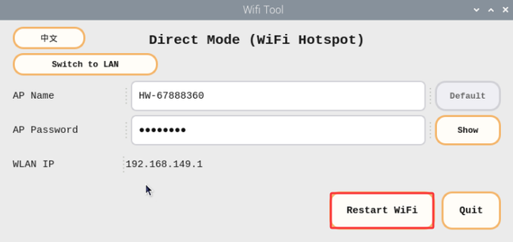

> [!NOTE]
>
> * **This example connects to "Hiwonder". Set a different network as needed.**
>
> * **Do not use a public network, and ensure that the Wi-Fi name contains only English characters.**

9. To view the Raspberry Pi IP address in the mobile app, first connect the phone to the same LAN named **Hiwonder**.

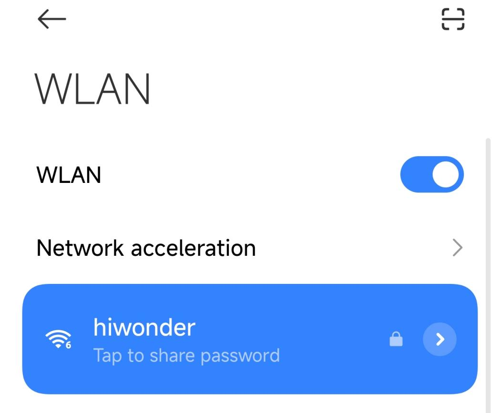

10. Open the **WonderPi** app. Select **Basic**, then select **TurboPi**.

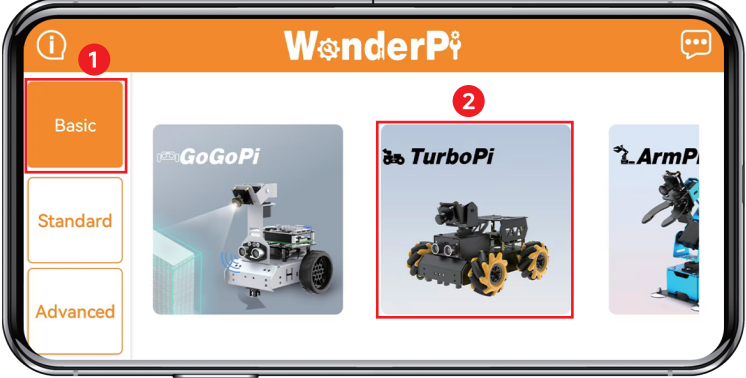

11. The app automatically connects to the device. Wait until the icon shown below appears to confirm a successful connection.

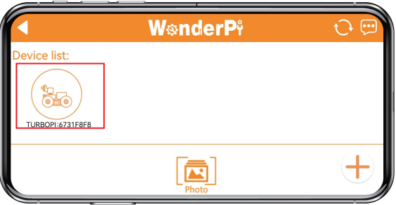

12. Press and hold the robot icon in the app to view the IP address and ID assigned to the robot.

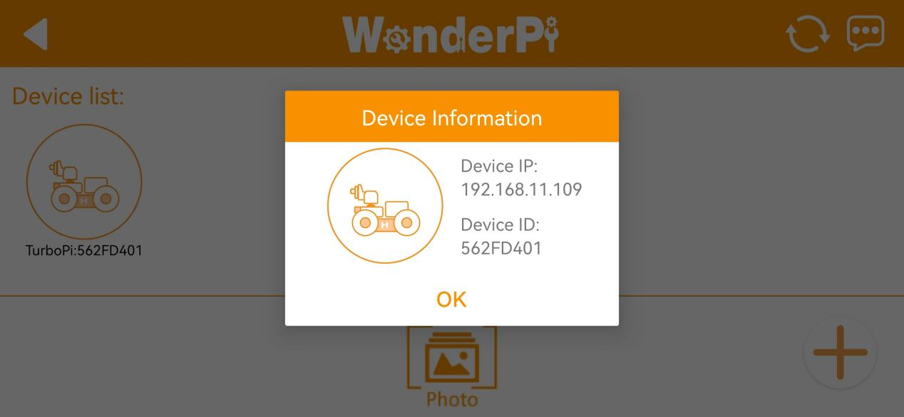

13. Open the VNC software. Enter the IP address **192.168.11.109** and establish a connection. After the connection succeeds, the VNC remote desktop appears as shown below.


