# 9. OpenClaw Hands-On Course

> [!NOTE]
>
> **OpenClaw and the related packages are configured before shipment. For initial use, follow Section 9.1 Preparation to import and build the resources. If errors or compatibility issues occur while following this guide, repeat Section 9.1 Preparation to import the provided backup packages and skills into the corresponding paths. Build the packages successfully before proceeding with the feature.**

<p id="anther9.1"></p>

## 9.1 Preparation

### 9.1.1 Deploying Controller Resources and Building the Environment

Before running the TurboPi OpenClaw feature, move the OpenClaw robot-side resources to the corresponding directory on the controller and build the related packages.

1. Download [**openclaw_resource.zip**](https://drive.google.com/drive/folders/1Dmh-Nru5sErr2g1JSQO3l16TG6ZQhbP9?usp=sharing) to the computer desktop, then extract it.

2. Install the MobaXterm remote connection tool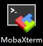. Refer to the tutorials for remote access and remote file transfer. Use MobaXterm to drag the extracted openclaw_resource folder into the following directory on the TurboPi controller:

```bash
/home/pi/docker/tmp/
```

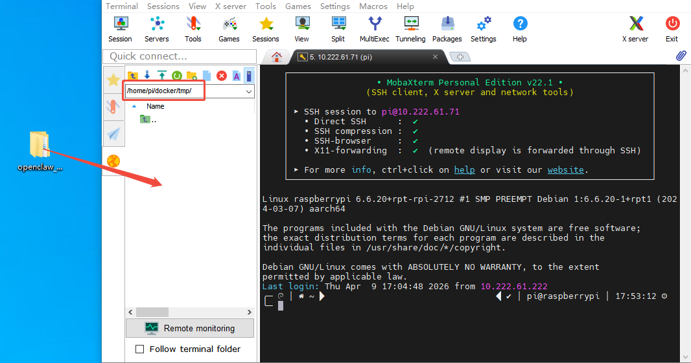

3. Open the VNC remote control software and click the terminal icon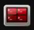 on the system desktop to open a terminal.

4. Enter the following command to copy the resources to the container home directory:

```bash
cp -r ~/shared/openclaw_resource ~/
```

5. Enter the following command to open the resource folder:

```bash
cd openclaw_resource
```

6. Enter the following command to run the deployment script:

```bash
zsh deploy.sh package
```

7. Enter **y** for each subsequent prompt.

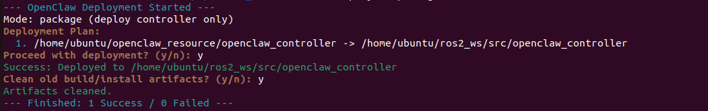

8. Enter the following command in the terminal to open the workspace and build the **openclaw_controller** package:

```shell
cd ~/ros2_ws/ && colcon build --event-handlers console_direct+ --cmake-args -DCMAKE_BUILD_TYPE=Release --symlink-install --packages-select openclaw_controller
```

9. After the build is complete, enter the following command to reload the environment variables:

```bash
source ~/.zshrc
```

### 9.1.2 Setting Up the Virtual Machine Software

#### 9.1.2.1 Installing the Virtual Machine

In simple terms, a virtual machine (VM) enables an additional operating system to run within the existing operating system environment. This section provides installation guides for two virtual machine platforms: VMware and VirtualBox.

- **VMware Workstation Installation**

(1) Obtain and download the virtual machine software from the official **VMware** website: [VMware](https://www.vmware.com/).

(2) Locate the extracted virtual machine folder, then double-click the virtual machine executable file with the **.exe** extension.

(3) Follow the instructions below to complete the installation.

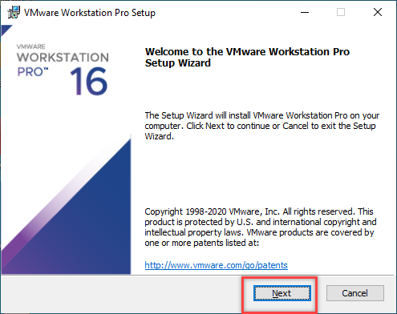

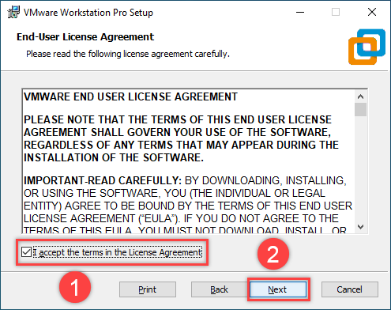

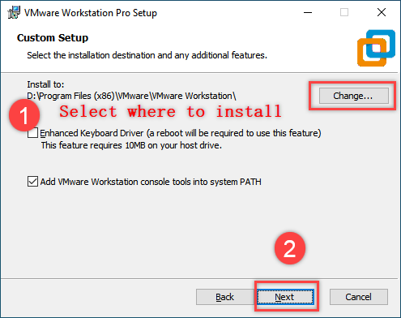

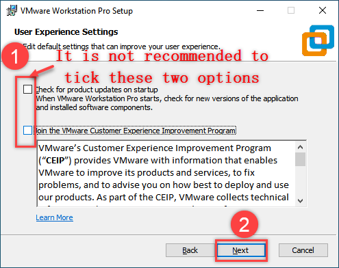

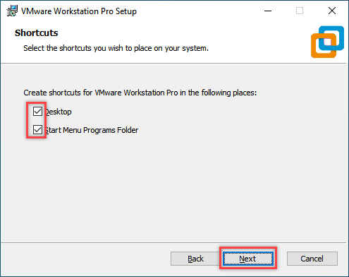

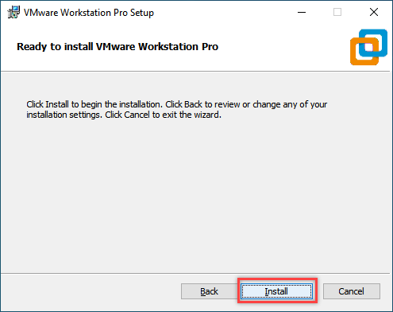

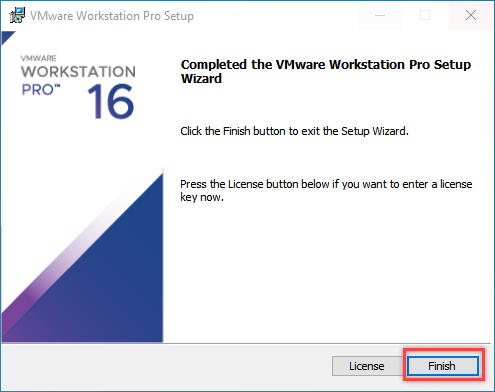

(4) When launching the virtual machine for the first time, enter the product key obtained from the official VMware website.

- **VirtualBox Installation**

(1) Download the installation package from the official VirtualBox website: https://www.virtualbox.org/wiki/Downloads. Open the software installation package in the same directory and click **Next**.

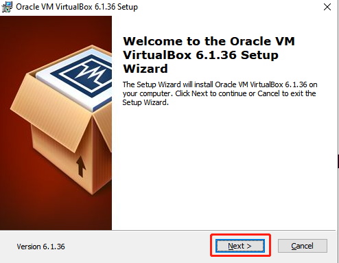

(2) Modify the installation path as needed, then click **Next**.

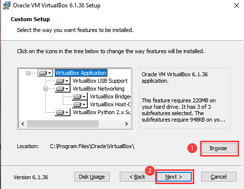

(3) Leave the settings unchanged and click **Next**.

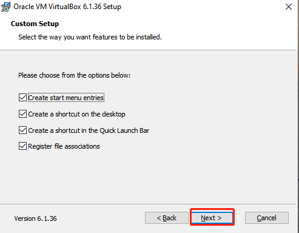

(4) Confirm the installation and click **Install** to begin.

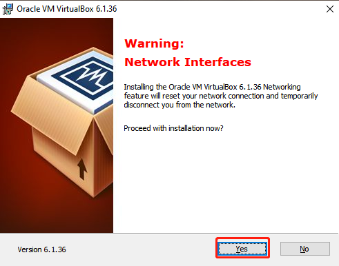

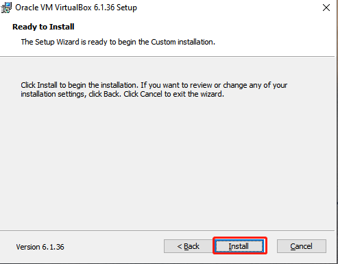

(5) After the installation is complete, click **Finish**.

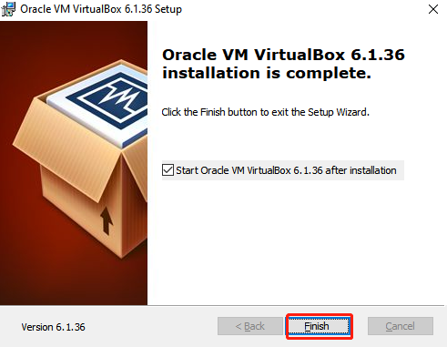

### 9.1.3 Configuring OpenClaw

- **Virtual Machine Preparation**

If OpenClaw is already installed, enter the following command to check the version and confirm that the OpenClaw command is available:

```bash
openclaw --version
```

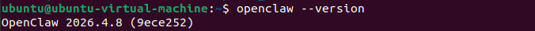

* **Importing Files into the Virtual Machine**

1. Download [**openclaw_resource.zip**](https://drive.google.com/drive/folders/1Dmh-Nru5sErr2g1JSQO3l16TG6ZQhbP9?usp=sharing).

2. Click the folder icon on the system desktop to open the home directory.

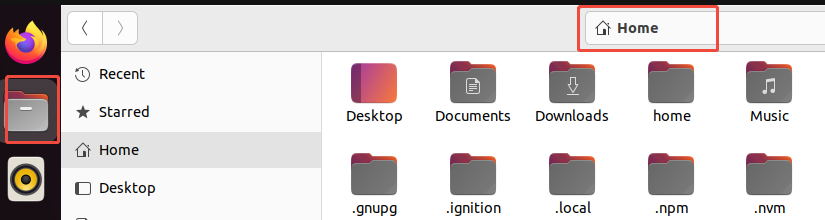

3. Drag **openclaw_resource.zip** into the virtual machine.

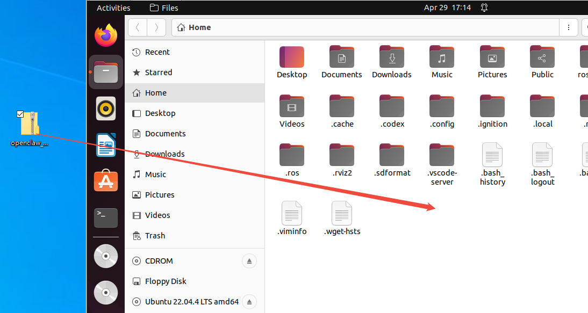

4. Click the terminal icon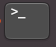 on the system desktop to open a new terminal.

5. Enter the following command to extract **openclaw_resource.zip** into the current home directory:

```bash
unzip openclaw_resource.zip
```

6. Enter the following command to open the folder:

```bash
cd openclaw_resource
```

7. Enter the following command to run the script:

```bash
zsh deploy_pi.sh
```

8. Enter **y** for each subsequent prompt.

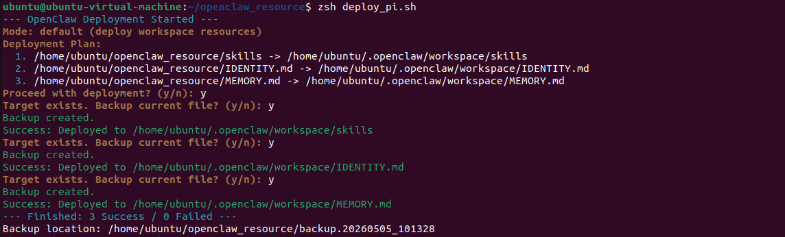

9. Existing backups of **IDENTITY.md**, **MEMORY.md**, and the **skills** folder are saved in the automatically generated backup directory.

10. Add execute permission to the photo capture script:

```bash
chmod +x ~/.openclaw/workspace/skills/ros2-cam-subscribe/scripts/cam_subscribe.sh
```

11. Enter the following command to reload the environment variables:

```bash
source ~/.bashrc
```

<p id="anther9.2"></p>

## 9.2 Large Model API Key Setup

Before using OpenClaw on TurboPi, configure the **agent model**. Obtain an API key for a large AI model and enter it in the OpenClaw configuration.

OpenClaw supports several large AI models, including DeepSeek, MiniMax, OpenAI, Qwen, and Google. This section uses OpenAI as an example. When selecting another large AI model, obtain and configure the API key according to the corresponding platform.

### 9.2.1  OpenAI Account Registration and Deployment

>  [!Note]
>
> **This section requires registering on the official OpenAI website and obtaining an API key for accessing large language models.**

1) Copy and open the following URL: https://platform.openai.com/docs/overview, then click the **Sign Up** button in the upper-right corner.

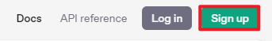

2) Register and log in using a Google, Microsoft, or Apple account, as prompted.

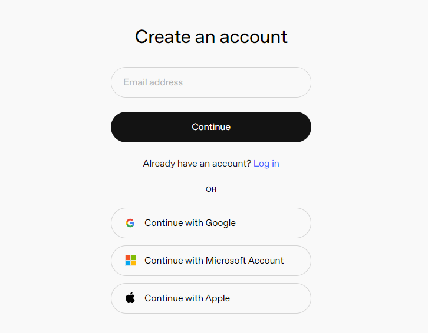

3) After logging in, click the Settings button, then go to **Billing**, and click **Payment Methods** to add a payment method. The payment is used to purchase **tokens**.

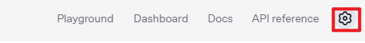

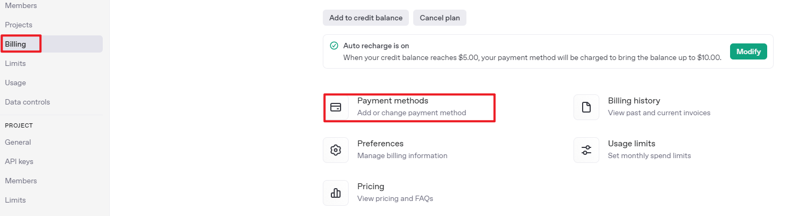

4) After completing the preparation steps, click **API Keys** and create a new key. Follow the prompts to fill in the required information, then save the key for later use.

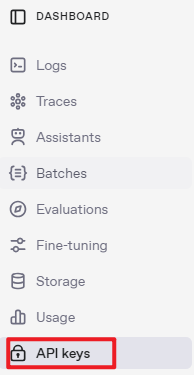

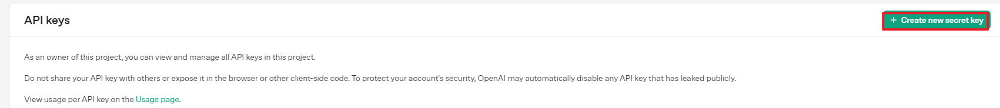

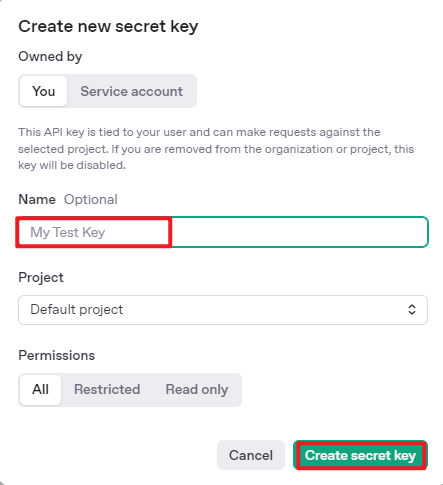

5) The creation and deployment of the large model have been completed, and this API will be used in the following sections.

> [!WARNING]
>
> **An API key is sensitive information. Do not share screenshots, upload the key to a code repository, or include it in a public document.**

### 9.2.2  API Configuration

1. Open the virtual machine system interface. Click the terminal icon on the left taskbar to open a terminal.

2. Enter the following command in the terminal to open the OpenClaw configuration interface:

```bash
openclaw config
```

3. Select **Local** and press **Enter**.

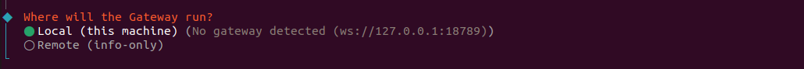

4. Select **model** and press **Enter**.

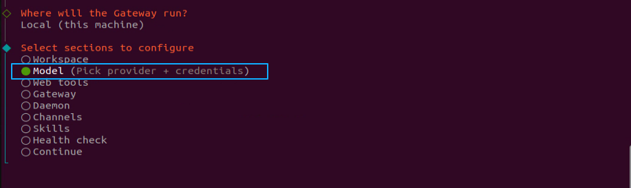

5. Select **OpenAI**, press **Enter**.

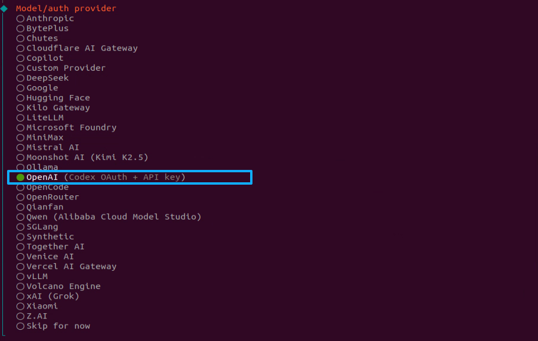

6. Select **OpenAI API key** and press **Enter**.

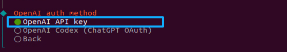

7. Paste the previously generated API key here.

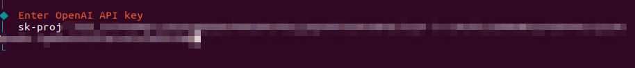

8. Select **openai/gpt-5.4** or another suitable model, then press **Enter**.

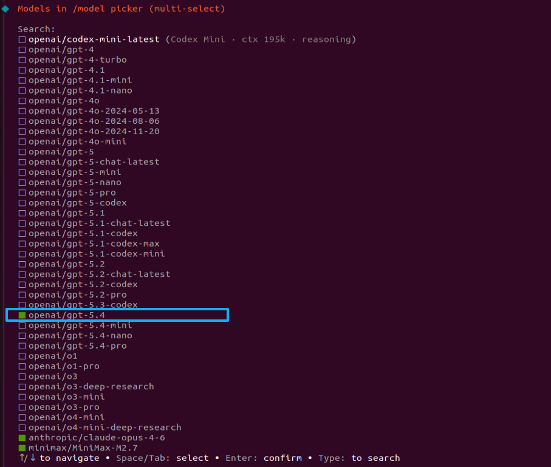

9. This completes the model configuration.

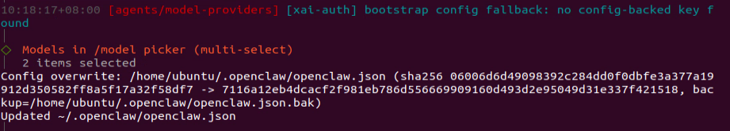

10. Click the terminal icon on the system desktop to open a virtual machine terminal. Enter the following command to check the configuration. If no error is displayed, the environment is configured successfully.

```bash
openclaw gateway run
```

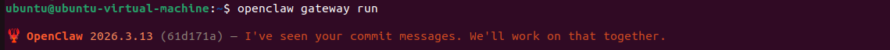

> [!NOTE]
>
> **When using another model such as MiniMax, Qwen, or DeepSeek, select the corresponding model in `openclaw config` and enter the API key from the corresponding platform. Comprehension, response speed, and response text vary among models.**

<p id="anther9.3"></p>

## 9.3 Configuring Telegram

OpenClaw supports interaction through a local TUI window or remote task submission through a Telegram bot. For a quick test, skip Telegram configuration and run `openclaw tui` directly.

### 9.3.1 Preparation

* **Step 1: Confirm that OpenClaw is running properly.**

Run the following commands in the terminal to confirm that the **Gateway** status is normal and the environment has no configuration issues.

```bash
openclaw gateway status
openclaw doctor
```

* **Step 2: Confirm that the Agent for the Telegram workflow exists.**

An **Agent** is required for the workflow covered in later chapters. Run the following command to view the current **Agent** list:

```bash
openclaw agents list --json
```

> [!Note]
>
> **The following steps use the Agent named `main` by default.**

* **Step 3: Confirm that a Telegram account is available.**

Make sure a Telegram account is available and ready to use.

### 9.3.2 Telegram Configuration

> [!Note]
>
> **Telegram can be set up from either the app or Telegram Web. The steps below use Telegram Web.**

Telegram Web address: https://web.telegram.org/k/

* **Step 1: Log in to Telegram.**

Scan the QR code with the app, or log in with a phone number and verification code.

<div align="center">
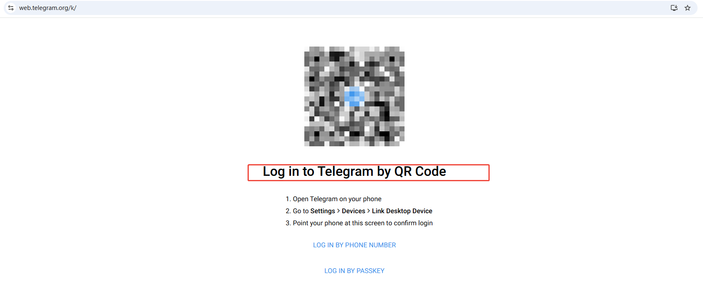
</div>

* **Step 2: Search for BotFather.**

Search for **BotFather** in the search bar at the upper-left corner of Telegram, then open the officially verified account with the blue checkmark.

<div align="center">
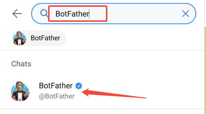
</div>


* **Step 3: Create a bot and get the token.**

Send `/newbot` in the chat to create a Bot and get the Token. The bot username must end with `_bot`.

> [!Note]
>
> **A Token will be generated after the setup is complete. Save it securely and do not share it. This token will be required later in the OpenClaw configuration.**

<div align="center">
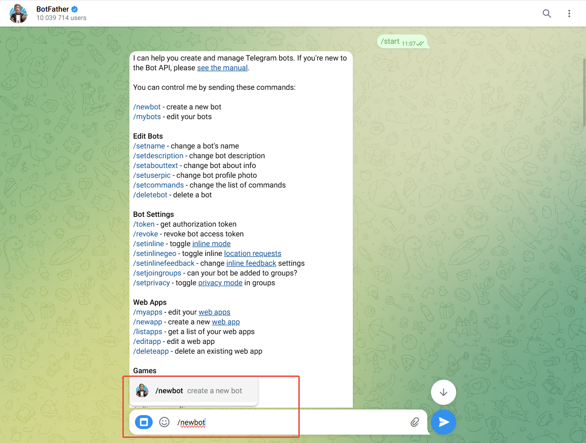
</div>

<div align="center">
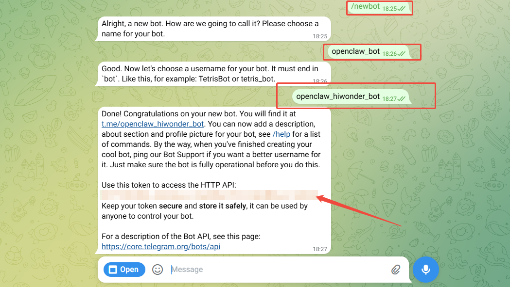
</div>

### 9.3.3 Connect Telegram to OpenClaw through the Plugin

After the Telegram bot is ready, configure OpenClaw from the server or local terminal.

* **Step 1**: Enable the Telegram plugin in the OpenClaw config.

```bash
openclaw config set channels.telegram.enabled true
```

<div align="center">

</div>
* **Step 2**: Add the Telegram bot Token to OpenClaw.

```powershell
openclaw config set channels.telegram.botToken "TELEGRAM_BOT_TOKEN"
```

<div align="center">

</div>
* **Step 3**: Start the OpenClaw Gateway service.

```bash
openclaw gateway
```

<div align="center">

</div>
* **Step 4**: In the BotFather chat, click the bot link shown in the message, such as **t.me/openclaw_hiwonder_bot**, to open the bot chat. Then click **START**.

> [!Note]
>
> `openclaw gateway` must be started before clicking **START** in Telegram. Otherwise, the pairing code will not be received.

<div align="center">
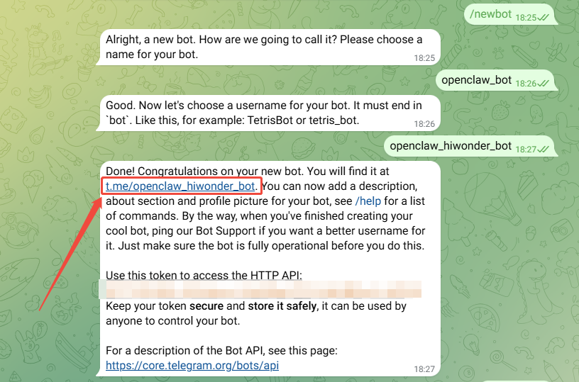
</div>

<div align="center">
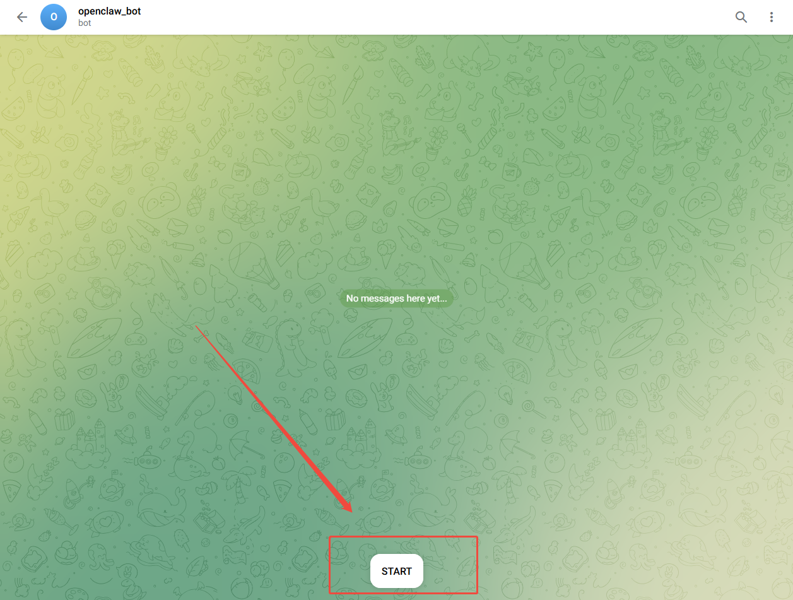
</div>
* **Step 5**: During the first chat, the Telegram Bot sends a pairing code. Run the following command on the server to complete pairing.

<div align="center">
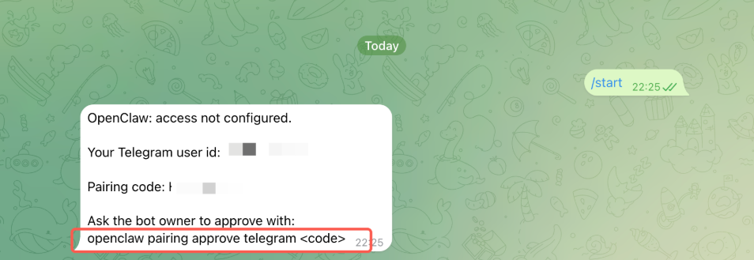
</div>
* **Step 6**: Open a new command-line terminal and run the following command. Replace &lt;code&gt; with the Pairing code received in Telegram. **Do not include the angle brackets when entering it.**

```bash
openclaw pairing approve telegram <code>
```

<div align="center">

</div>
* **Step 7**: After the command runs successfully, send a test message to the Telegram Bot, such as `hello`. If the bot replies like an AI assistant, the Telegram connection to OpenClaw is working properly.

<div align="center">
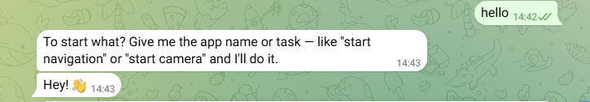
</div>
The Telegram integration for **OpenClaw** is now complete.

## 9.4 OpenClaw Intelligent Logistics Transport

Intelligent logistics transport is the core TurboPi OpenClaw application. Based on natural-language instructions from a researcher, the robot travels to a specified area to locate an industrial component of the target color and delivers it to the specified placement area. If the target color is not found in the target area, the robot reports the inventory in the current area and requests the next action.

### 9.4.1 Preparation

* Complete [9.1 Preparation](#anther9.1).
* Complete [9.2 Large AI Model API Key Setup](#anther9.2).
* For Telegram interaction, complete [9.3 Configuring Telegram](#anther9.3).
* Set up the intelligent logistics map as shown below.

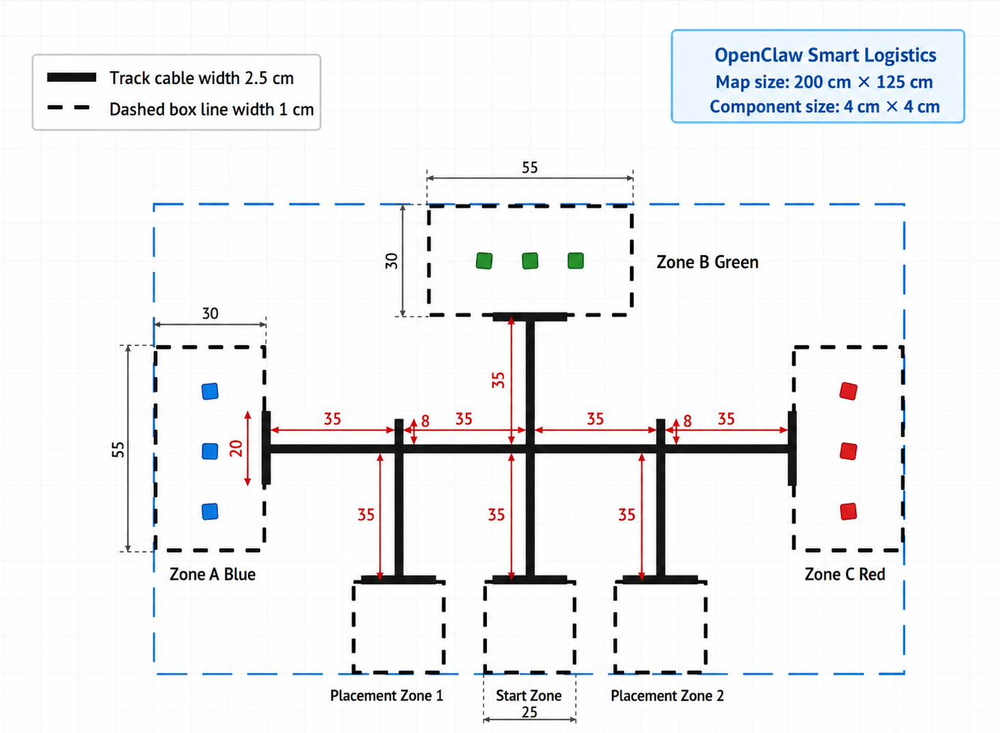

### 9.4.2 Procedure

> [!NOTE]
>
> * **The robot must be connected to the internet. Configure STA local area network mode, or connect a network cable in AP direct connection mode.**
> * **The virtual machine and TurboPi must be on the same subnet.**
> * **The locations of Areas A, B, and C, the starting area, and the placement area on the map must match the program configuration.**
> * **Debug the color thresholds, line-following parameters, and grasping positions in advance.**

**1. Robot-Side Operations**

1. Open the VNC remote desktop. Disable the automatic APP startup service in the TurboPi terminal:

```bash
~/.stop_ros.sh
```

2. Start the OpenClaw intelligent logistics program:

```bash
ros2 launch example smart_logistics.launch.py
```

3. To enable local TTS announcements, start the program with the appropriate package parameter:

```bash
ros2 launch example smart_logistics.launch.py use_tts:=true
```

4. To use a large AI model to generate TTS text or announcement content, start the program with the model key configured in this guide:

```bash
ros2 launch example smart_logistics.launch.py use_tts:=true use_large_models_tts:=true
```

**2. Virtual Machine Operations**

1. Open a terminal and start the OpenClaw gateway service:

```bash
openclaw gateway run
```

2. Open a new terminal and start the OpenClaw TUI:

```bash
openclaw tui
```

3. Enter the following task in the TUI or Telegarm chat window:

```text
Go to the workstation in Area C and pick up the red industrial component.
```

4. Wait for TurboPi to complete line following, recognition, grasping, and placement.
5. If the robot reports that the target color is not present in the target area, enter the following instruction:

```text
Check Area B and take a photo.
```

6. If the target color is still not found in Area B, enter:

```text
Check Area C.
```

7. After locating the red component, the robot grasps it and delivers it to the specified placement area.

**3. Stopping the Feature**

1. Press `Ctrl+C` in every robot-side terminal running the program.
2. If the ROS nodes do not exit normally, open a new terminal and run:

```bash
~/.stop_ros.sh
```

3. Press `Ctrl+C` in the virtual machine terminals running the OpenClaw gateway and TUI.

### 9.4.3 Project Outcome

After the feature starts, natural-language commands can drive TurboPi to complete intelligent logistics tasks:

* Travel to Area A, B, or C as instructed.
* Recognize the colors of the industrial components in the current area.
* Report inventory information when the target color is not present.
* Switch the target area based on follow-up instructions.
* Grasp the target component and deliver it to the specified placement area.
* Remember historical inventory information and prioritize known areas during later tasks.

The operation is shown below:

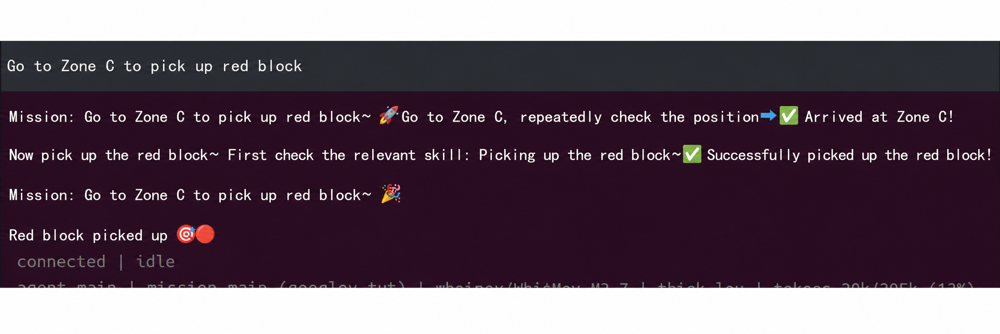

### 9.4.4 Step-by-Step Debugging

If OpenClaw does not execute a task sent through the TUI or Telegram, test each stage by following these steps.

#### 9.4.4.1 Querying the Current Location

```bash
ros2 service call /smart_logistics/get_location std_srvs/srv/Trigger "{}"
```

#### 9.4.4.2 Sending a Destination

Travel from the starting area to Area A:

```bash
ros2 service call /smart_logistics/execute interfaces/srv/SetString "{data: 'A'}"
```

Travel to Area B:

```bash
ros2 service call /smart_logistics/execute interfaces/srv/SetString "{data: 'B'}"
```

Travel to Area C:

```bash
ros2 service call /smart_logistics/execute interfaces/srv/SetString "{data: 'C'}"
```

> [!NOTE]
>
> **If the placement areas are named `1`, `2`, `3`, `P1`, `P2`, or `P3` in the program, modify the `data` field according to the source code configuration.**

#### 9.4.4.3 Turning Around and Traveling to the Next Area

If the robot is not in the starting area and must turn around or switch routes, send the next destination through the interface provided by the package. For example:

```bash
ros2 service call /smart_logistics/execute interfaces/srv/SetString "{data: 'B'}"
```

#### 9.4.4.4 Testing Grasping

Grasp the red component:

```bash
ros2 service call /smart_logistics/pick interfaces/srv/SetString "{data: 'red'}"
```

Grasp the green component:

```bash
ros2 service call /smart_logistics/pick interfaces/srv/SetString "{data: 'green'}"
```

Grasp the blue component:

```bash
ros2 service call /smart_logistics/pick interfaces/srv/SetString "{data: 'blue'}"
```

#### 9.4.4.5 Testing Placement

```bash
ros2 service call /smart_logistics/place std_srvs/srv/Trigger "{}"
```
